{/* last-verified: 2026-11-27 against the app source (sprints/nmi-integration). App routes: Settings → Integrations → NMI card (Connect, Manage, Disconnect) · Ad Tracking → Conversion Setup → Conversion Events → a conversion → Add Source → NMI. Screenshots: demo business "Bloom Bakery", NMI's answers mocked, nothing saved. */}

# NMI payments

NMI is a payment gateway. Connect it to Cortana. Then Cortana sees every NMI payment.

Each payment shows the ad that brought the buyer. Refunds come off the sale. You choose which payments go to Meta, Google and TikTok.

<Note>
  **What you need**

  - An NMI account you can sign in to.
  - Permission to make keys and webhooks in NMI.
  - The Cortana pixel on your site. It links buyers to ads. See [2) Setup Pixel](/2-setup-pixel).
</Note>

## Step 1: Add your Security Key

<Steps>
  <Step title="Click Connect">
    Open **Settings**. Pick the **Integrations** tab. Find the **NMI** card. Click **Connect** (1).

    <Frame caption="The NMI card. Click Connect.">
      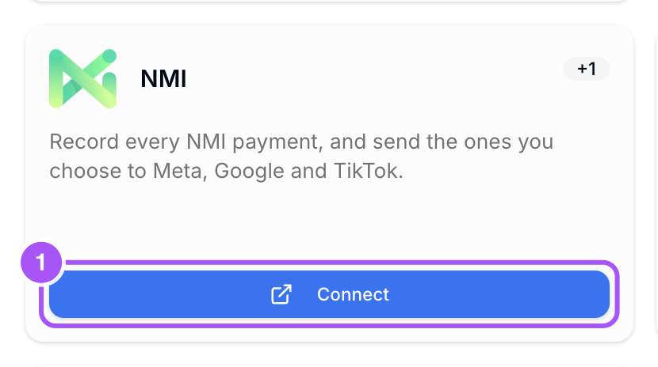
      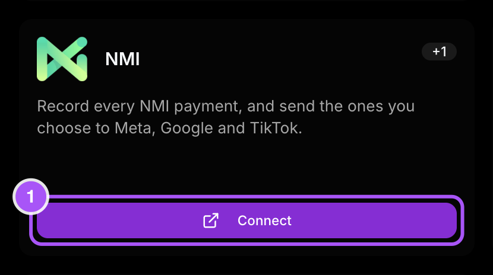
    </Frame>
  </Step>
  <Step title="Make a key in NMI">
    Sign in to NMI. Open **Settings › Security Keys**. Add a **private** key. Give it the **API** permission. Copy the key.
  </Step>
  <Step title="Paste the key">
    1. Paste the key into **Security Key**.
    2. Want your own name for this account? Click **Give this account your own name**. This is optional.
    3. Click **Connect**.

    <Frame caption="Step 1 of 2: your NMI Security Key.">
      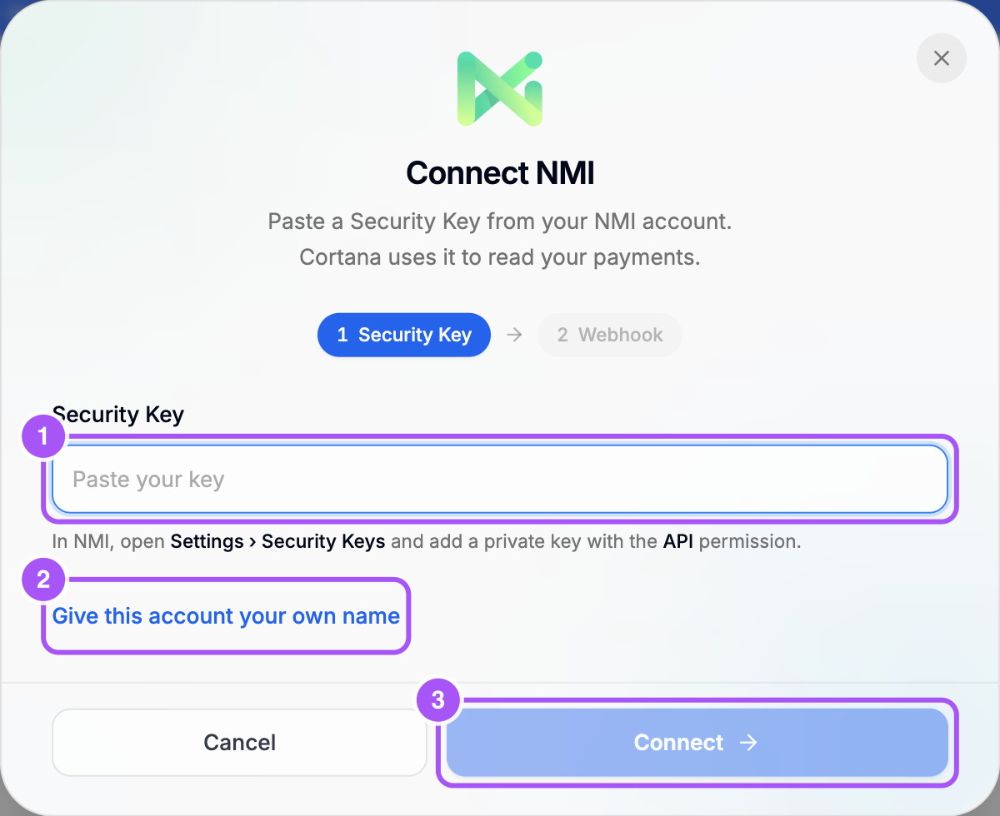
      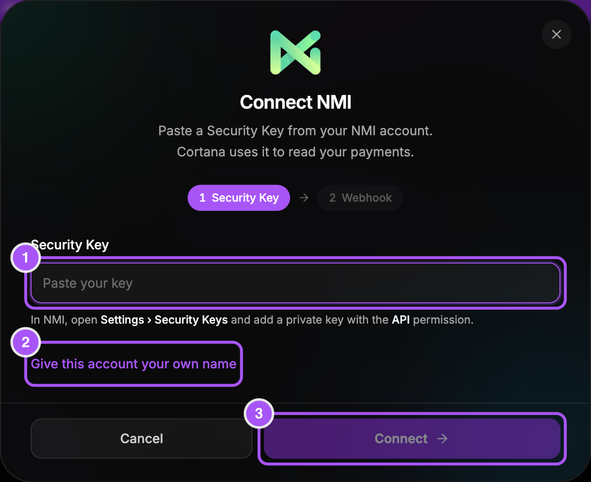
    </Frame>

    Cortana checks the key with NMI. It takes a few seconds.
  </Step>
</Steps>

## Step 2: Add the webhook in NMI

The webhook tells Cortana about each payment. It happens right away.

1. Click **Copy**. Your webhook URL is copied.
2. In NMI, open **Settings › Webhooks**. Choose **Create**. Paste the URL. Click the arrow next to each of the 7 events below. Each one moves to **Subscribed Events**. Leave the other events out. Then save.
3. NMI now shows a **signing key**. Copy it. Paste it into the **Signing key** box in Cortana.
4. Click **Finish setup**.

<Frame caption="Step 2 of 2: add the webhook in NMI.">
  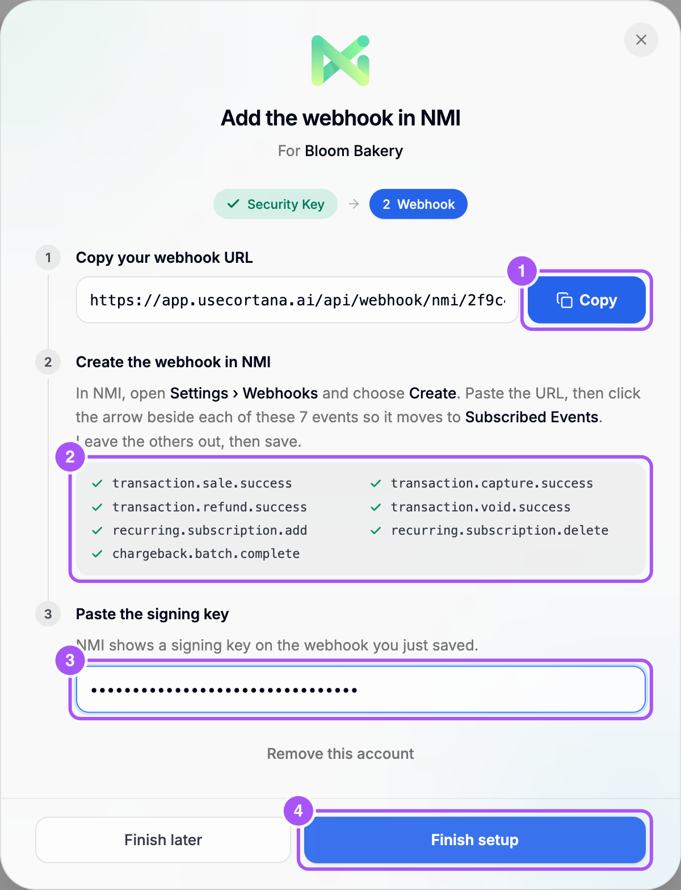
  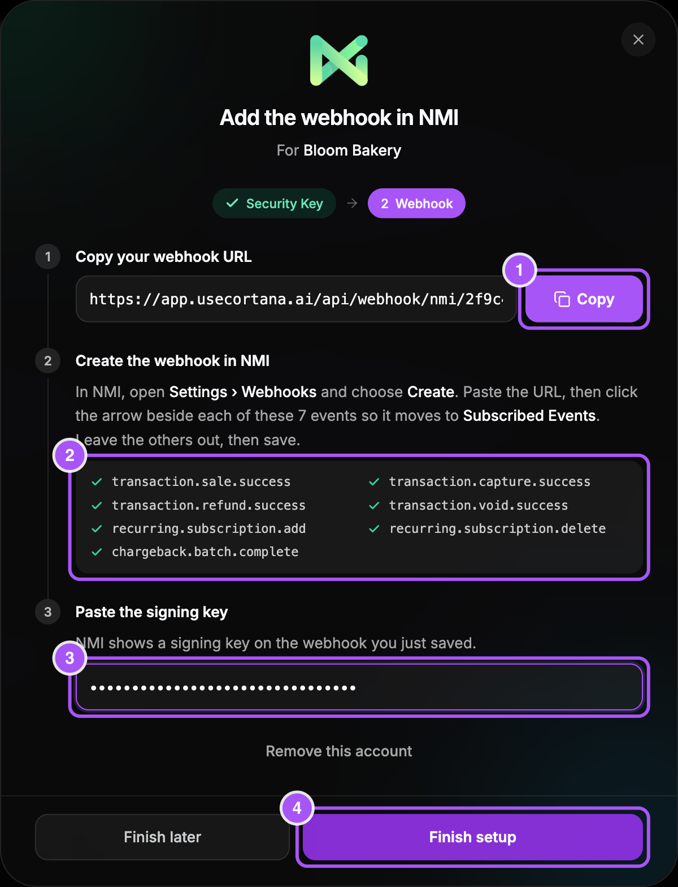
</Frame>

These are the 7 events to turn on in NMI:

- `transaction.sale.success`
- `transaction.capture.success`
- `transaction.refund.success`
- `transaction.void.success`
- `recurring.subscription.add`
- `recurring.subscription.delete`
- `chargeback.batch.complete`

<Tip>
  No time now? Click **Finish later**. The card then says **Finish setup**. Click it any time to come back.
</Tip>

## Step 3: You are connected

You see **NMI is connected**. Cortana adds NMI to **All Payments (LTV)** for you. Every good payment counts there.

Next, choose what an NMI payment counts as. Click **Set up conversions**.

<Frame caption="NMI is connected.">
  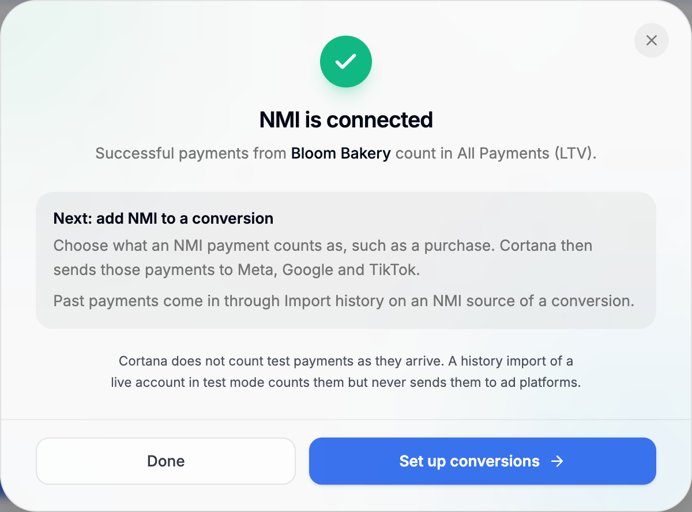
  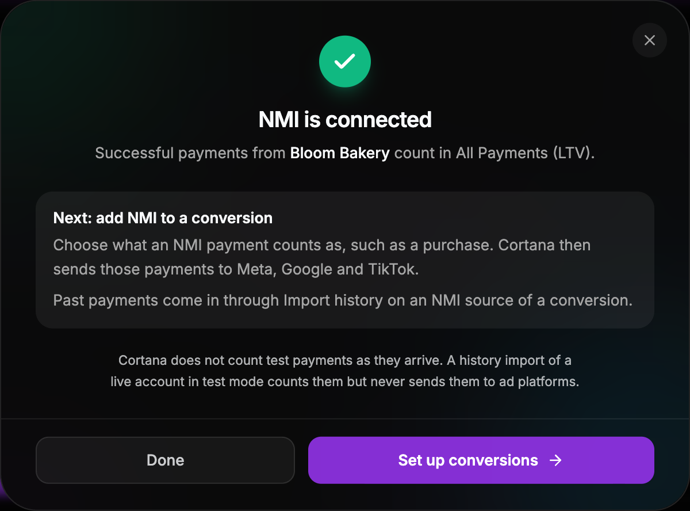
</Frame>

## Count NMI payments as a conversion

<Steps>
  <Step title="Open a conversion">
    Go to **Ad Tracking**. Open **Conversion Setup**, then **Conversion Events**. Click a conversion, like **Purchase**. Click **Add Source**.
  </Step>
  <Step title="Pick NMI">
    In **Integration**, pick **NMI** (1).

    <Frame caption="Pick NMI in the Integration list.">
      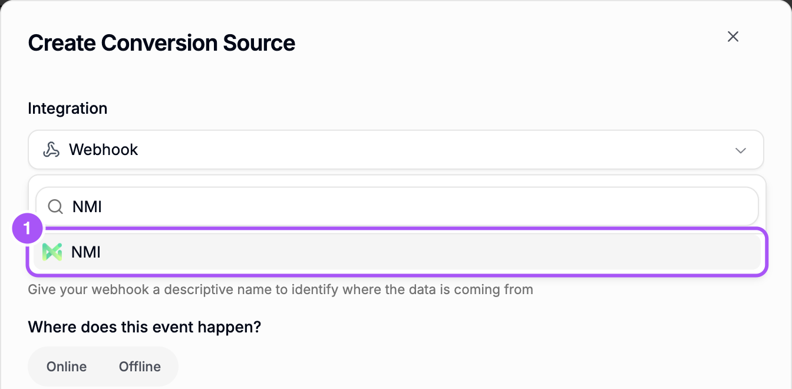
      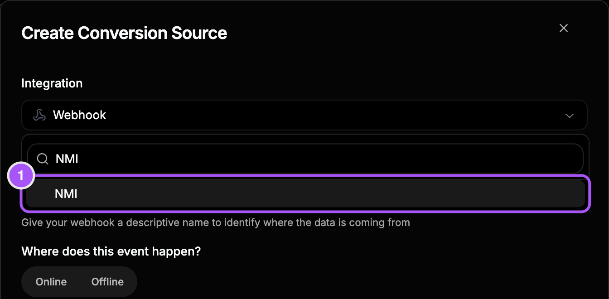
    </Frame>
  </Step>
  <Step title="Pick the event">
    Cortana shows your **NMI account**. Have more than one? Pick one.

    Open **Event**. You can type to search (1). Point at an event to see what it does (2). Then click the event you want.

    <Frame caption="The NMI events. Point at one to see what it counts.">
      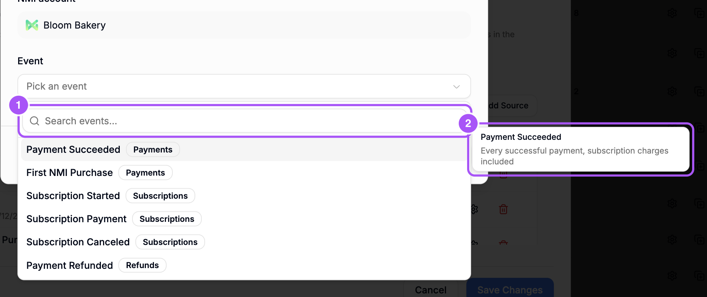
      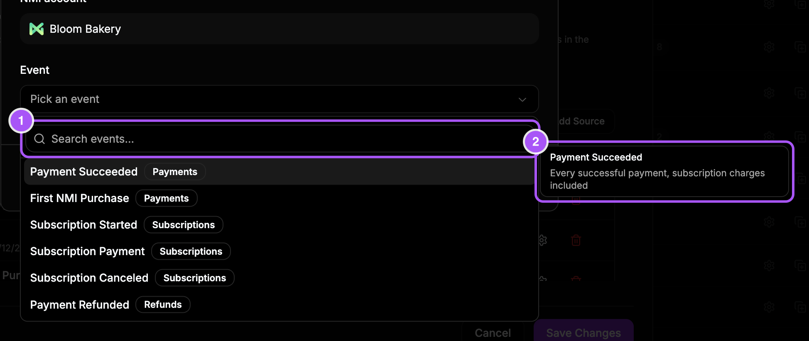
    </Frame>
  </Step>
  <Step title="Submit">
    Check the account (1) and the event (2). Add **Payment Filters** if you need them. Click **Submit** (3).

    <Frame caption="Ready to submit.">
      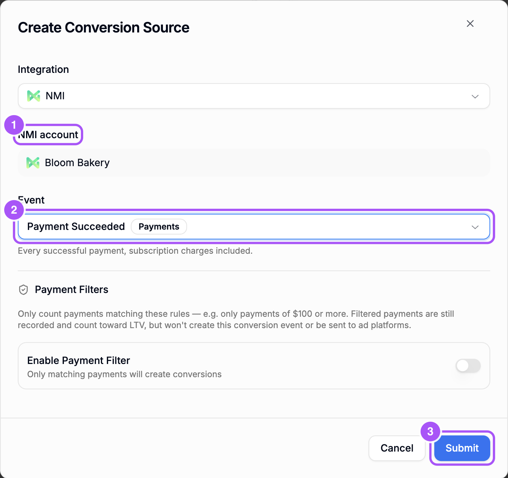
      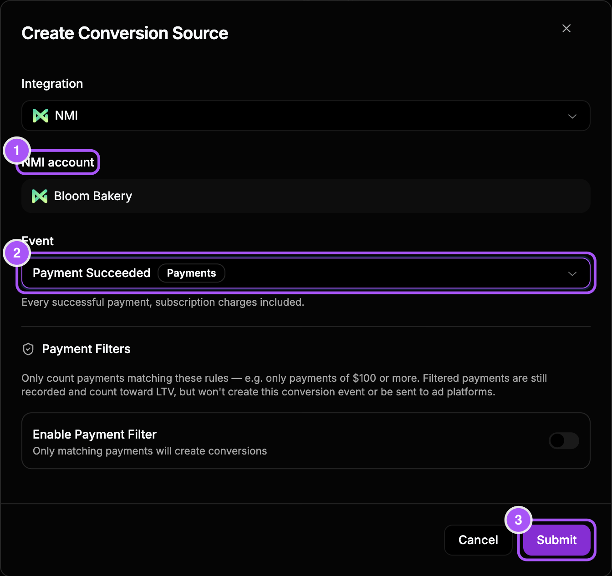
    </Frame>

    Cortana then offers to bring in past payments. See [Bring in past payments](#bring-in-past-payments).
  </Step>
</Steps>

### The NMI events

| Event | What it counts |
| --- | --- |
| **Payment Succeeded** | Every good payment. Subscription charges too. |
| **First NMI Purchase** | A buyer's first payment only. Not returning buyers. Not payments with no email. |
| **Subscription Started** | A new subscription, as $0. Its charges count as payments. |
| **Subscription Payment** | Each renewal charge. Not the first checkout. |
| **Subscription Canceled** | A subscription deleted in NMI, as $0. |
| **Payment Refunded** | Every refund, as a minus. |

<Warning>
  Do not put **Payment Succeeded** and **First NMI Purchase** on the same conversion. New buyers would count twice.
</Warning>

## Bring in past payments

Want payments from before you connected? Cortana can bring them in.

1. Right after **Submit**, Cortana shows **Backfill your history**. Or click **Import history** on the NMI source later.
2. Pick how far back: **30 days**, **60 days** or **90 days**.
3. Cortana shows a preview first. Click **Continue**, then **Import**.

Old payments are not sent to ad platforms unless you turn that on. Even then, only the last 7 days are sent.

## Manage your NMI accounts

Click **Manage** on the NMI card. The **NMI accounts** window opens.

1. The key button: **Replace signing key**. Use it after you make a new webhook in NMI.
2. The red plug button: **Disconnect**.
3. **Add another account**. Connect one more NMI account.

Point at a button to see its name.

<Frame caption="Your NMI accounts.">
  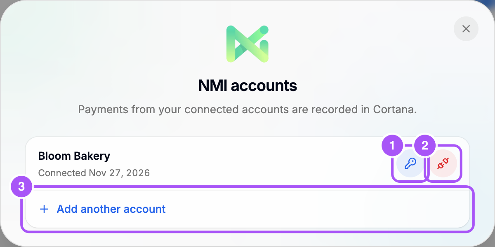
  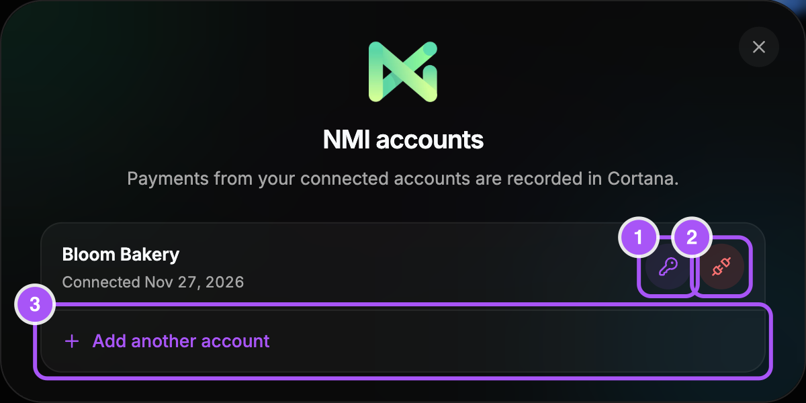
</Frame>

## Disconnect NMI

Click the red plug button in **NMI accounts**.

- Click **Disconnect** to stop. Everything already recorded stays.
- Want the NMI records gone too? Turn on **Also delete its NMI records** (1). Type your business name (2). Click **Disconnect and delete history**.

Deleting the records cannot be undone. Conversions already booked stay in your reports.

<Frame caption="Disconnect, with the records deleted too.">
  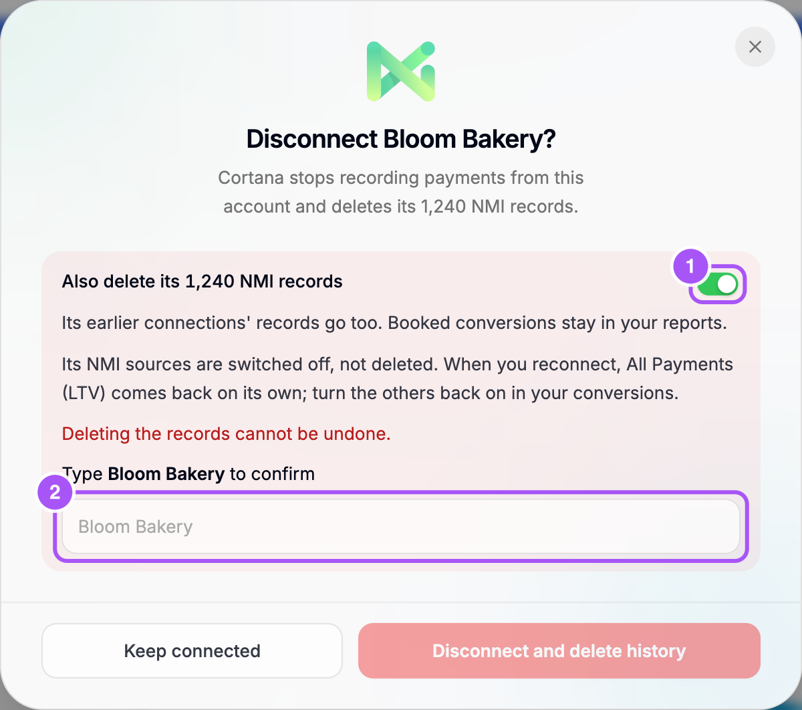
  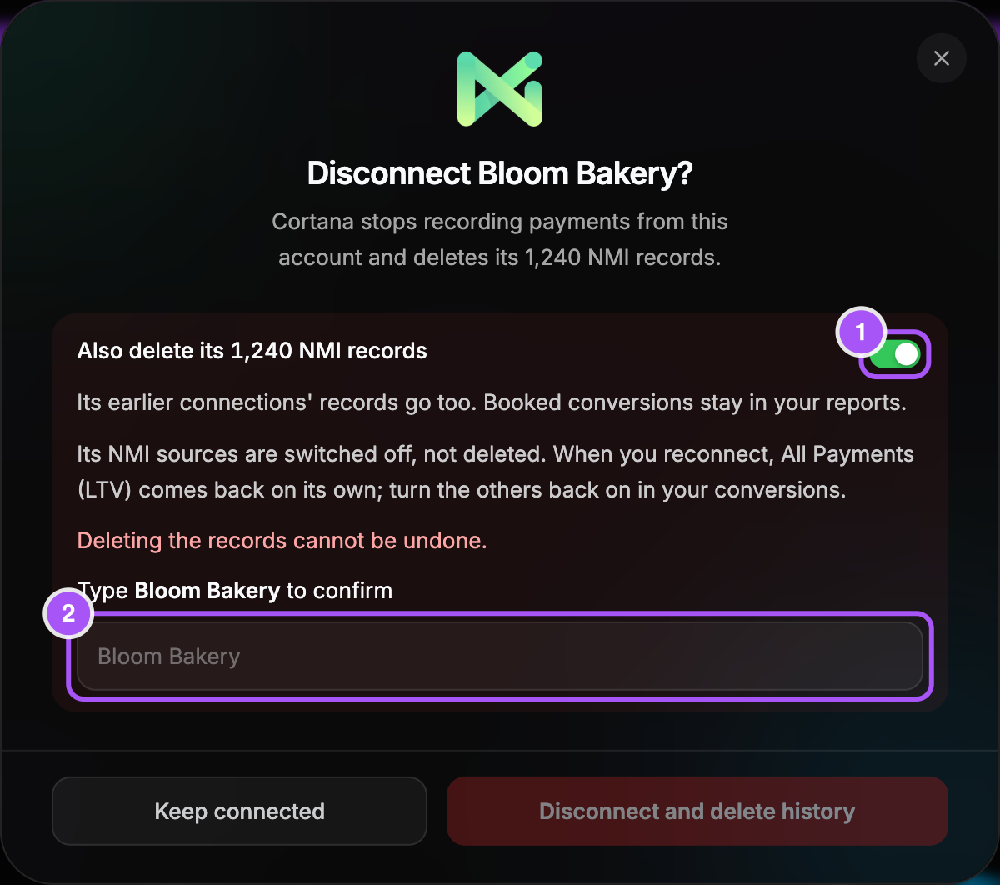
</Frame>

Last, delete the webhook in NMI too. Cortana shows its address under **One step left, in NMI**. NMI keeps sending to it until you delete it.

## How Cortana counts NMI payments

<AccordionGroup>
  <Accordion title="All Payments (LTV)">
    Cortana adds NMI to **All Payments (LTV)** when you connect. Every good payment counts there once. It shows what each buyer paid you over time.

    **All Payments (LTV)** takes **Payment Succeeded** only. Add other NMI events to another conversion.
  </Accordion>
  <Accordion title="How a payment finds its ad">
    NMI sends the buyer's email. Cortana finds the contact with that email. Then it looks at that person's visits before the payment. The visit from an ad gets the credit.

    So the buyer must visit your site first. For example, they fill in a form or a checkout page with the pixel. A payment with no matching visit shows as **Direct/Organic**.
  </Accordion>
  <Accordion title="Refunds">
    A refund comes off its sale. It lands in a refunds conversion, like **Purchase Refunds**. A refund is never a new conversion.

    Many small refunds on one sale add up right. Cortana never takes off more than the sale.

    Add the **Payment Refunded** event to a conversion if you want refunds there. That conversion then counts the refunds. Your other conversions stop taking them off. **All Payments (LTV)** always takes off its own.
  </Accordion>
  <Accordion title="Voids">
    A voided sale ends at $0. This works even when NMI sends the void before the sale.
  </Accordion>
  <Accordion title="A sale refunded in full">
    A sale that was fully refunded is still recorded. It is never sent to Meta, Google or TikTok.
  </Accordion>
  <Accordion title="First NMI Purchase">
    Cortana asks NMI about the buyer's past payments. It looks them up by email. If the buyer paid before, it is not a first purchase. A payment with no email never counts here.
  </Accordion>
  <Accordion title="Subscriptions">
    The first payment of a subscription counts as a payment. Each renewal does too. Use **Subscription Payment** to count renewals only.
  </Accordion>
  <Accordion title="Test payments">
    A live NMI account can turn on test mode. Cortana does not count those test payments as they arrive. A history import counts them. It never sends them to ad platforms.

    A sandbox account is only for testing. Its payments are counted. They are never sent to ad platforms. It shows a **Sandbox** badge.
  </Accordion>
  <Accordion title="The same payment sent twice">
    NMI may send one payment more than once. Cortana keeps it once.
  </Accordion>
  <Accordion title="More than one NMI account">
    Click **Add another account** in **NMI accounts**. Each account gets its own webhook URL. Add that webhook in that account's NMI.
  </Accordion>
</AccordionGroup>

## FAQ

<AccordionGroup>
  <Accordion title="I connected NMI but no payments show up">
    Check the webhook in NMI. Open **Settings › Webhooks**. The URL must be the one Cortana gave you. All 7 events must be in **Subscribed Events**.

    Then open **Manage** on the NMI card. If no event arrived for a day, the account says so. It shows the URL to check.
  </Accordion>
  <Accordion title="It says NMI did not accept this key">
    Make a new key in NMI. Open **Settings › Security Keys**. Make it **private**. Give it the **API** permission. Paste it again.
  </Accordion>
  <Accordion title="It says the signing key does not match">
    Copy the signing key from NMI again. It is on the webhook in **Settings › Webhooks**. Open **Manage**. Click the key button. Paste it.
  </Accordion>
  <Accordion title="Why does a payment show Direct/Organic?">
    Cortana did not see that buyer visit first. Or the payment had no email. Make sure the pixel is on your checkout or form pages.
  </Accordion>
  <Accordion title="Do refunds count as conversions?">
    No. A refund only takes money off. Your conversion count stays the same.
  </Accordion>
  <Accordion title="Can I bring in old NMI payments?">
    Yes, up to 90 days back. Click **Import history** on the NMI source. See [Bring in past payments](#bring-in-past-payments).
  </Accordion>
  <Accordion title="Why is a sale missing from First NMI Purchase?">
    The buyer paid before. Or the payment had no email. Both are left out on purpose.
  </Accordion>
</AccordionGroup>

**Next:** see all your conversion sources in [4.2) Conversion Sources](/4-conversion-tracking).
