{/* last-verified: 2026-11-25 against origin/main and the release tree claude/lead-filter-release-2 22a9c9c3fc (sprint lead-filter-groups C1, C2, E2, L9, L12; sprints/cs-machine/07-HISTORICAL-IMPORT.md Phase 7.5). The tool list is SELF_SERVE_PROVIDERS and SOURCE_TYPE_TO_PROVIDER; the clock icon is isBackfillableSourceType (by source type only). Every strategy runs applyResolveGate with the job's retainDiscarded on a historical import; no Kajabi or CallRail import exists. Paths: src/lib/integration-backfill/provider-windows.ts, start-source-backfill.ts, strategies/*.ts (cal-com, cortana-booking, cortana-form, whop, hubspot, calendly, iclosed, meta-leads), native-import-row.ts, native-sources.ts, src/components/tracking/backfill/backfill-offer-dialog.tsx, src/components/tracking/conversion-setup-dialog.tsx, src/app/api/integrations/backfill/cancel/route.ts. */}

{/* TODO: verify. No Loom walkthrough was supplied for this page. When one is recorded, embed it
    here with a verbatim transcript inside an <Accordion title="Video transcript"> for the KB. */}

# Import your history

You have just set up a conversion source. From now on, Cortana sees every new lead or sale that source sends.

But what about the ones from last month? They are not in Cortana. So the ads that paid for them get no credit.

A **historical import** goes back and gets them.

Cortana asks the connected tool for your old records. For each one it works out where that person came from. Then it imports the ones it is sure about.

## Two kinds of import, and the window tells you which one you are getting

What happens to a record Cortana cannot explain depends on one switch on the window's **Confirm** step: **Also import conversions we can't attribute**. It is off unless you switch it on, and it works the same on every tool.

### By default: only what Cortana can explain is imported

For every old record, Cortana asks one question: **where did this person come from?**

If it can point to a real ad, campaign, ad set, or a link the person clicked, that is a real answer. A record with a real answer is called **resolvable**, and Cortana imports it.

If the only answer is "we do not know", the record is **unresolvable**, and Cortana throws it away.

Throwing it away sounds harsh, but it is the right call. A record with no answer still counts in your totals. It lands in your **untracked** number, which is the share of your conversions Cortana cannot explain. Importing a pile of unknowns makes that number worse, not better. You would end up with more rows and less clarity.

So with the switch off, a historical import gives you history you can actually use, not just a bigger pile of data.

### With the switch on: everything is imported, and the rest shows as untracked

Switch on **Also import conversions we can't attribute** when you want your full past volume inside Cortana. The switch warns you: *"These will show as untracked and will raise your untracked %."*

- **Every record is imported**, including the ones Cortana cannot explain.
- **They count in your totals.** Your lead, booking and revenue numbers for that period are complete.
- **The ones Cortana cannot explain show as untracked**, not as direct. Untracked means "Cortana has no page views for this person", which is the honest answer. Filing them as direct would claim they came straight to your site, which nobody knows.

<Note>
  **Your untracked number will go up, on purpose.**

  That is the trade. You get every past record counted, and you keep an honest view of what Cortana can and cannot explain. If you would rather not raise it, leave the switch off. Turning it off later does not remove what an import already brought in.
</Note>

You will find it in **Ad Tracking → Conversion Setup**, on the source's own row.

<Note>
  **Before you start**

  - **The tool must be connected.** See [Connect integrations](/1-connect-integrations).
  - **The conversion source must already exist.** An import runs on one source at a time, and it follows whatever that source is set up to watch. See [Conversion tracking](/4-conversion-tracking) to make one.
  - **Your tracking needs to have been working back then.** Cortana can only find an answer if your old records carry one. If that traffic was never tagged, there is nothing to recover.
</Note>

## Which sources can be imported

Nineteen tools can be imported. How far back you can go depends on how much history each tool will give us. Every one of them imports only what Cortana can explain, unless you switch on **Also import conversions we can't attribute**.

| Tool | Furthest back you can go |
| --- | --- |
| Meta lead forms | 90 days |
| LinkedIn lead forms | 90 days |
| GoHighLevel | 90 days |
| Typeform | 90 days |
| Tally | 90 days |
| HubSpot | 90 days |
| Calendly | 90 days |
| Cal.com | 90 days |
| iClosed | 90 days |
| ClickFunnels | 90 days |
| WooCommerce | 90 days |
| Stripe | 90 days |
| Whop | 90 days |
| Shopify | 60 days |
| Close | 30 days |
| Google Local Services Ads | 90 days |
| Cortana Calendars | 90 days |
| Cortana Forms | 90 days |
| Instagram / Facebook comments | Back to the day comment recording was switched on |

**HubSpot** imports **Form Submitted** and **Meeting Booked** sources. A form submission is dated when it was sent, a meeting when it was booked (not when the meeting takes place). HubSpot's list of past form submissions can be short, so a form import may find fewer than you expect. Meetings reach back the whole window. **Deal Stage Changed**, **Meeting Updated** and **Custom Field Updated** sources cannot be imported.

**Calendly** imports **Meeting Scheduled** and **Meeting Canceled** sources, on the source's calendars and through its lead filter, including the bookings your teammates host. A booking is dated when it was made, not when the meeting takes place.

**iClosed** imports every event its sources can track, through the source's calendars, outcomes and lead filter, each dated at its own moment. A booking is dated when it was made, not when the call takes place.

**Whop** asks Whop for your store's payments in the window, oldest first, and books each one the way a live payment is booked, with the source's products and payment filters. A buyer's first purchase is booked before their renewals, so a new-customers-only conversion comes out right.

**Cal.com** imports whatever the source tracks: bookings created, bookings cancelled, or bookings rescheduled, on its meeting links and through its lead filter. Each one keeps its own date. Cal.com rarely says which ad a booking came from, so most bookings are matched through the visits Cortana's pixel recorded for that person. See [Import the history of a filtered conversion](#import-the-history-of-a-filtered-conversion).

**Cortana Calendars** and **Cortana Forms** import from Cortana's own records, which are never deleted, so 90 days really is 90 days. They follow the source's calendars or forms, its stage, and its lead filter.

**Instagram / Facebook comments** imports the comments Cortana already recorded. Meta never sends old comments, so nothing from before **Record comments** was switched on can be imported. See [13) Instagram & Facebook comments](/14-instagram-facebook-comments).

**Google Local Services Ads** imports leads older than 30 days. Your last 30 days are counted on their own within minutes of saving the source, so the import only has to bring in the older ones.

### Why 90 days does not always mean 90 days

Every source shows the same three buttons, so you can always click **90 days**. But two tools will not give us that much history:

- **Shopify** only hands over 60 days of orders.
- **Close** only keeps 30 days of the record Cortana reads.

On those two, Cortana asks for as much as the tool allows and imports that. You do not get an error, and nothing fails. You simply get less history than the button says.

<Warning>
  **On Shopify and Close, the screen still says 90.**

  The button keeps reading **Preview my last 90 days**, and the line at the top of the window still says *"Import your last 90 days"*. Only the import itself is shortened.

  So on a Shopify source, 90 days on screen means 60 days of orders. On a Close source, it means 30 days. Everywhere else, 90 days really is 90 days.
</Warning>

**Meta lead forms** and **LinkedIn lead forms** mean the lead ads you run on Facebook, Instagram and LinkedIn, where someone fills in a form without leaving the platform. These are separate from your ad spend and performance figures, which Cortana already brings in on its own.

<Note>
  LinkedIn itself keeps lead form answers for a whole year. Cortana still only offers 30, 60 and 90 days, so **90 days is the most you can import** from LinkedIn today, the same as everywhere else.
</Note>

<Note>
  **Other sources cannot be imported, and show no clock icon.**

  Tracking pixels, CSV uploads, URL parameter sources and sources you made by hand have no tool for Cortana to ask, so there is nothing to fetch. Salesforce, Fathom, CallRail, Kajabi, PayPal and Fanbasis sources have no clock icon either.

  A CSV upload is still how you bring in history from a tool Cortana does not connect to. See [Conversion tracking](/4-conversion-tracking).
</Note>

## Set it up

<Steps>
  <Step title="Find the source you want to import">
    Go to **Ad Tracking** and open the **Conversion Setup** tab. Find the conversion the source belongs to, and click the **settings** icon on its row. **Edit Conversion** opens.

    Scroll down to **Sources**. Each row shows the source name, which tool it came from, and its counts.

    If a source can be imported, its row has a **clock** icon, next to the edit and delete icons. No clock icon means that source cannot be imported.

    <Frame caption="The Sources table inside Edit Conversion. The clock icon on the right of a row is how you start an import.">
      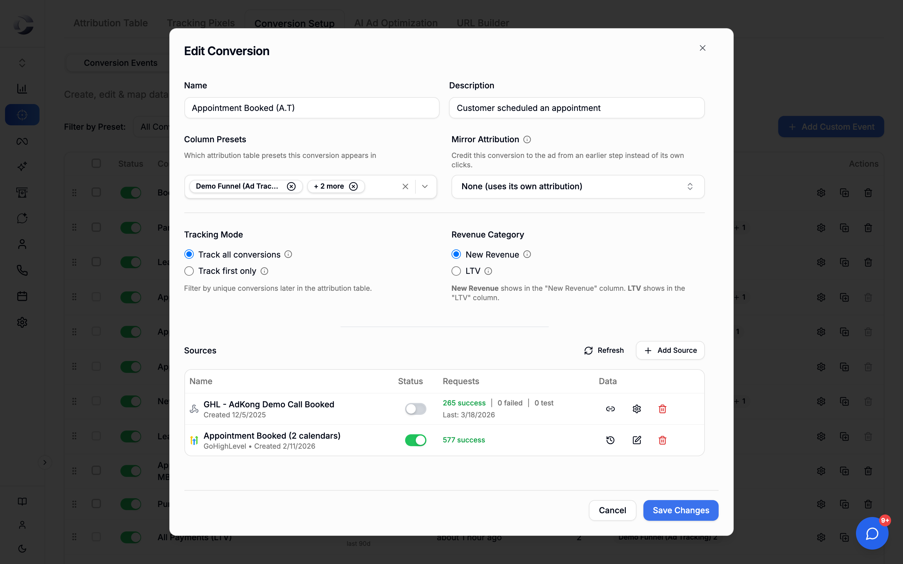
      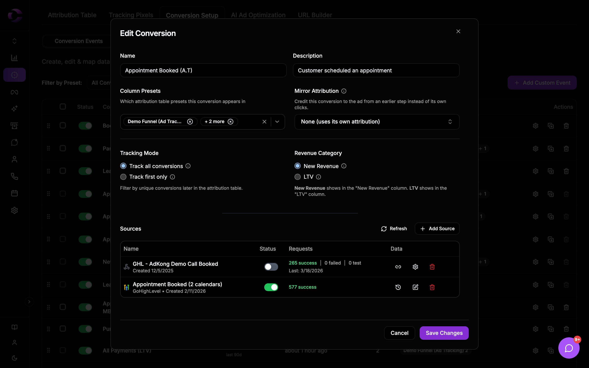
    </Frame>
  </Step>

  <Step title="Click the clock icon">
    Hover over the clock first and it tells you what you are about to open:

    | If it says | It means |
    | --- | --- |
    | **Import history** | Nothing has been run on this source yet. |
    | **Preview running: view it** | A preview is running right now. |
    | **Import running: view progress** | An import is running right now. |
    | **Import stopped: run again** | The last import did not finish. |
    | **Import history: view or run again** | An import finished. You can see its numbers or run it again. |

    Now click it. The **Backfill your history** window opens.

    If this source has been imported before, you first see **"Checking this source's import history…"** for a moment while Cortana looks up what happened last time.

    <Frame caption="Hovering the clock icon. The tooltip tells you what you will see when you click.">
      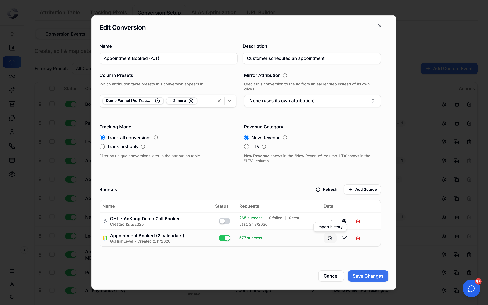
      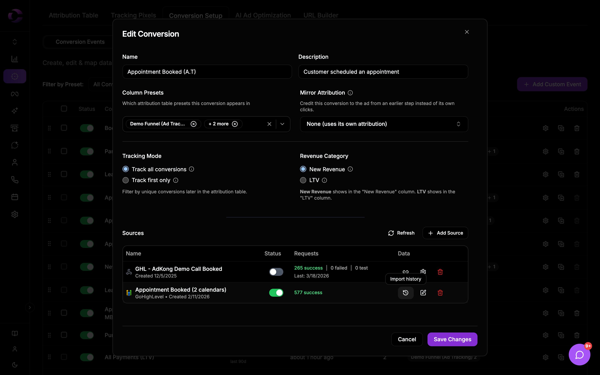
    </Frame>

    <Tip>
      This same window also pops up on its own every time you create a new conversion source. If you press **Skip for now**, nothing is lost. The clock icon is how you come back to it whenever you like.
    </Tip>
  </Step>

  <Step title="Choose how far back to go">
    The window is called **Backfill your history**. The line under the title tells you which source you are importing and what will happen: *"Import your last 90 days of [your source name] and resolve their attribution: only what resolves is imported."*

    Along the top are five steps, so you always know where you are: **Window**, **Preview**, **Confirm**, **Importing**, **Done**.

    Under **How far back?** are three buttons: **30 days**, **60 days** and **90 days**. **90 days** is already picked for you.

    Most people should leave it on 90 days. Pick a shorter one if you only started running ads a few weeks ago. A longer window means more records to check, so the import takes longer, but it will not import anything it cannot answer for.

    <Frame caption="The Window step. 90 days is the default, and nothing is imported until you have seen a preview.">
      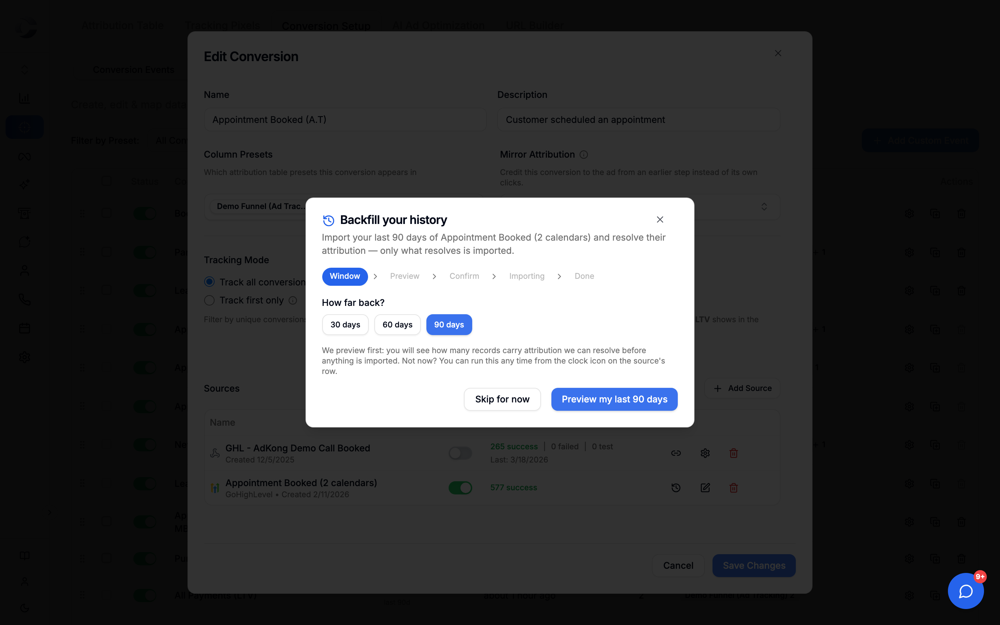
      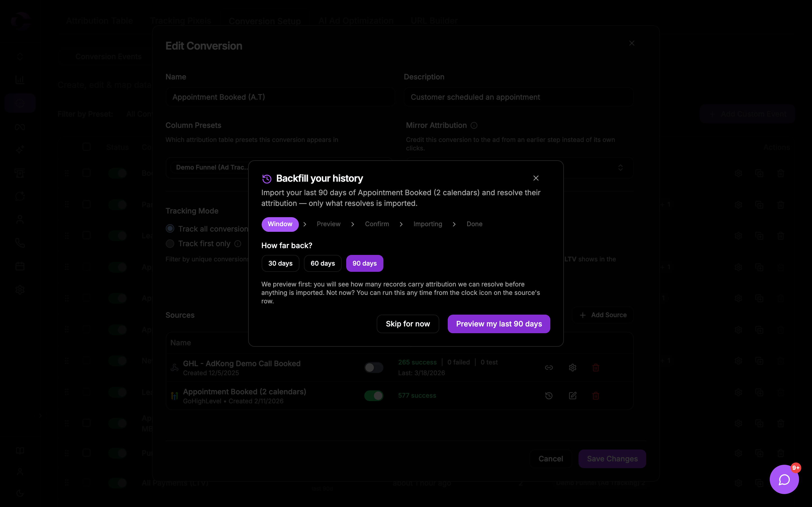
    </Frame>

    Two buttons sit at the bottom: **Skip for now**, and **Preview my last 90 days**. The number on that second button matches the window you picked.
  </Step>

  <Step title="Run the preview">
    Click **Preview my last 90 days**.

    **A preview never imports anything.** It is a safe look before you commit. Cortana counts how many records are there, then checks a sample of them to see how many it can find an answer for.

    While it works, it says *"Sampling your last 90 days… for appointment and pipeline triggers this reads up to 50 contacts, so it can take a few minutes."*

    <Frame caption="The Preview step while it checks. Nothing is imported at this stage.">
      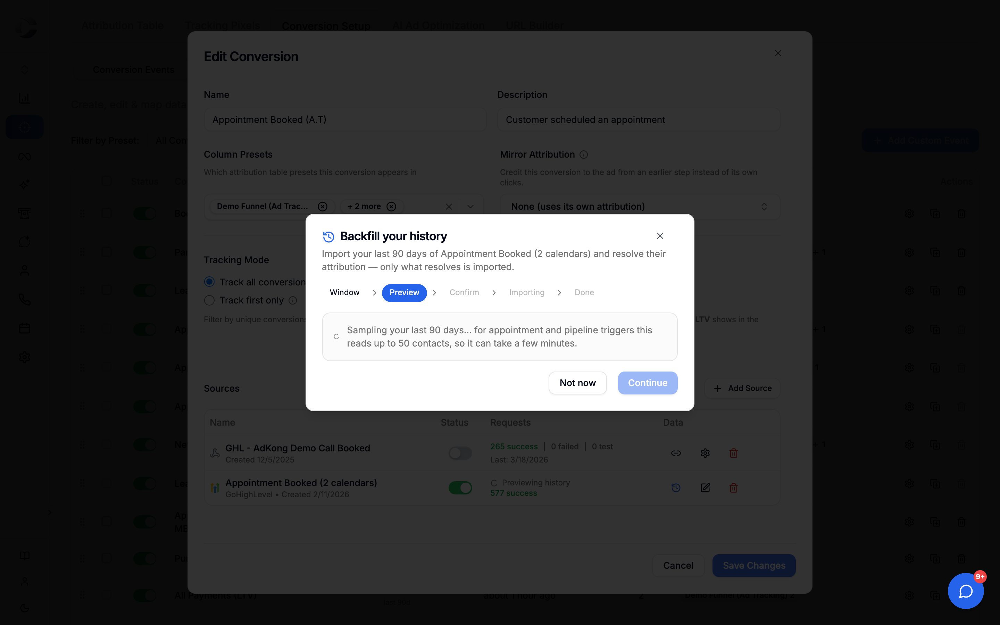
      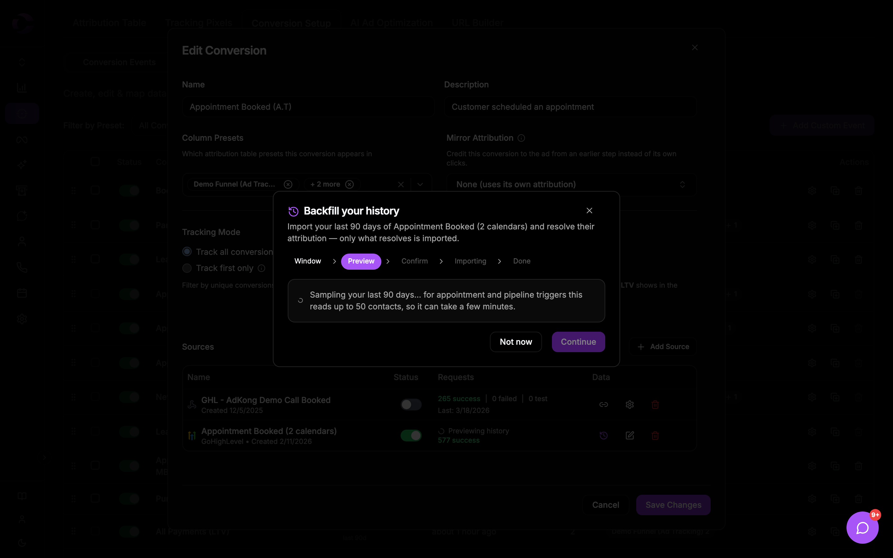
    </Frame>
  </Step>

  <Step title="Read the preview">
    You get two numbers. In the example below they are **≈105 resolvable** and **309 records found**.

    | The number | What it tells you |
    | --- | --- |
    | **≈105 resolvable** | Roughly how many records Cortana expects to import. The **≈** sign means "about". |
    | **309 records found** | How many records exist in that window in total. |

    The gap between them, about 204 records here, is what Cortana expects to throw away.

    Under the numbers you also see the rate, written as *"(~34% of the sample)"*, and a reminder that the sample came from your most recent records, so older ones may work out differently.

    <Frame caption="The Preview step once it has finished. The number it can import comes first, the total sits under it.">
      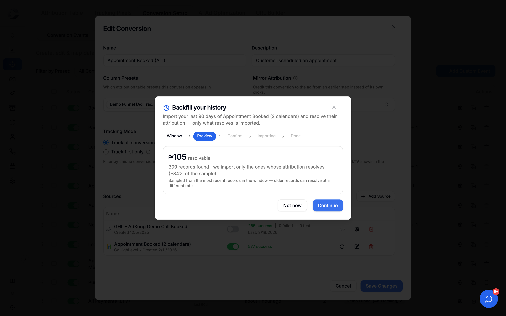
      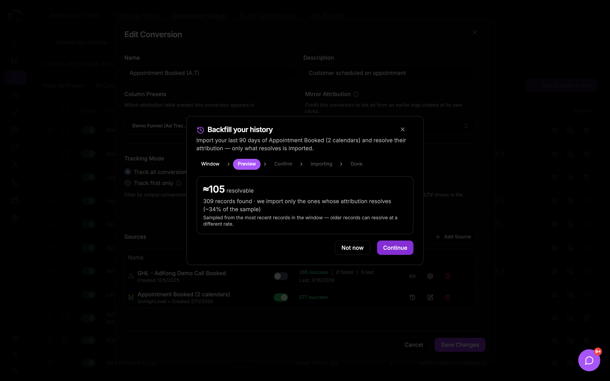
    </Frame>

    Some tools show it a little differently:

    - For some tools Cortana cannot check a sample at all. Then you just see **"N records found"**, plus the line *"Recovery is not sampled for this provider: we still import only the ones whose attribution resolves"*. **Stripe**, **Meta lead forms**, **LinkedIn lead forms**, **HubSpot**, **Calendly**, **iClosed**, **Cortana Calendars** and **Cortana Forms** all work this way. You still get a real count of what is there, and the import still only keeps what it can trace.
    - If a tool will only confirm a minimum, the number starts with **"At least "**.

    <Note>
      **The preview is a best guess, not a promise.**

      It looks at a sample and works out the rest from there. The real result can come out higher or lower, sometimes by a lot.

      Use the preview to decide whether the import is worth running. Do not use it to check the result afterwards. The numbers on the **Done** step are the real ones.
    </Note>

    Click **Continue** to carry on, or **Not now** to close without importing.
  </Step>

  <Step title="Choose whether to send to your ad platforms">
    You are now on the **Confirm** step. The first setting is **Send imported conversions to ad platforms (CAPI)**. It is **off**.

    CAPI is the direct line from Cortana to Facebook, Google and your other ad platforms. It tells them a conversion happened, so their algorithms can learn from it.

    The setting explains its own catch. Off or on is your call. If it is on, only conversions from the last 7 days are sent, because ad platforms reject older events, and your Event Match Quality may dip for about 7 days, since much historical data has no click IDs.

    In plain terms:

    - **Turning it on will not send 90 days of history to Facebook.** Ad platforms refuse anything older than about a week. So only the newest 7 days of what you import can be sent. Everything older is ignored no matter what you do.
    - **Event Match Quality** is a score Facebook gives you for how well it can match your conversions to real people. Old records often have less information attached, so sending them can pull that score down for about a week.

    **We recommend leaving it off.** The real value of an import is inside Cortana, where every imported record counts no matter how old it is. Sending one thin week of weaker data to your ad platforms gains you very little and can knock your score for a while.

    <Frame caption="The Confirm step. Both settings are on screen, and both are off.">
      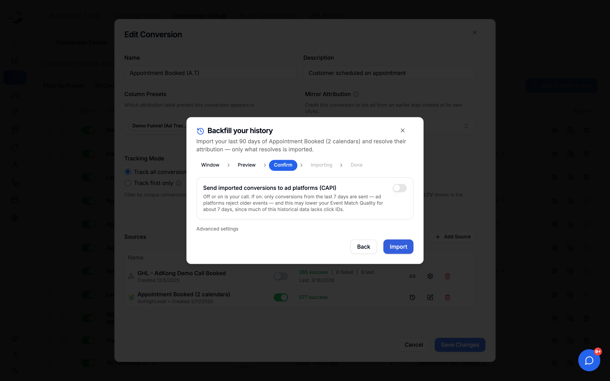
      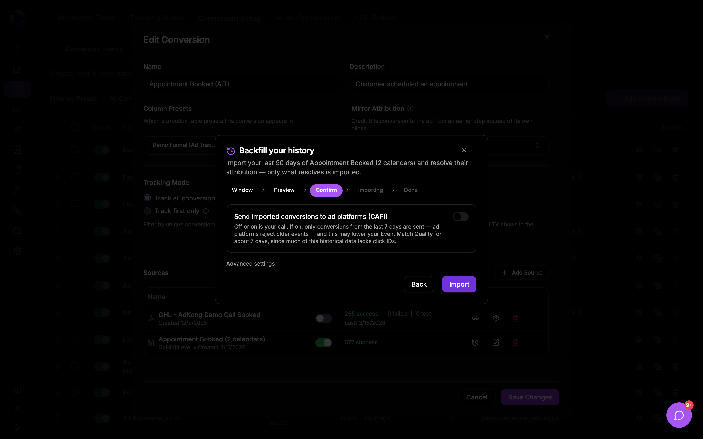
    </Frame>

    {/* SCREENSHOT TODO: recapture 06-confirm.png (and its dark twin if the page keeps them). Since 0c460d4b0e there is no Advanced settings link: the Confirm step shows the CAPI switch and the Also import conversions we can't attribute switch together, both off. 07-confirm-advanced.png is no longer used. Light mode, fake data. */}
  </Step>

  <Step title="Choose what to do with records Cortana cannot answer for">
    The second setting on the **Confirm** step, right under the first, is **Also import conversions we can't attribute**. It is **off**, and it warns you *"These will show as untracked and will raise your untracked %."*

    - **Off** is what this page has described so far. Records Cortana cannot answer for are thrown away.
    - **On** imports them anyway. They arrive labelled **untracked**, and your untracked percentage goes up.

    It works the same on every tool. **We recommend leaving it off.** Only turn it on if you want a full count of your past volume inside Cortana and you are happy for your untracked number to rise to match.

    Be sure before you switch it on. Turning it back off later does not remove the records it brought in.

    **Back** takes you to the preview. **Import** starts the real thing.
  </Step>

  <Step title="Start the import and watch it">
    Click **Import**.

    The window now shows *"Importing… 0 imported so far"*. Both numbers climb as it works: how many have been imported, and how many have been thrown away.

    Under that it says *"This runs in the background: you can close this window and the import continues."* That is exactly true.

    - **Run in background** closes the window and lets the import carry on.
    - **Cancel import** only works if the import has not actually started yet. See **Cancel import did not work** below.

    Behind the window, the source's own row shows the same thing in miniature: **Importing history**, a bar, and a percentage.

    <Frame caption="The Importing step. The source row behind it shows the same progress.">
      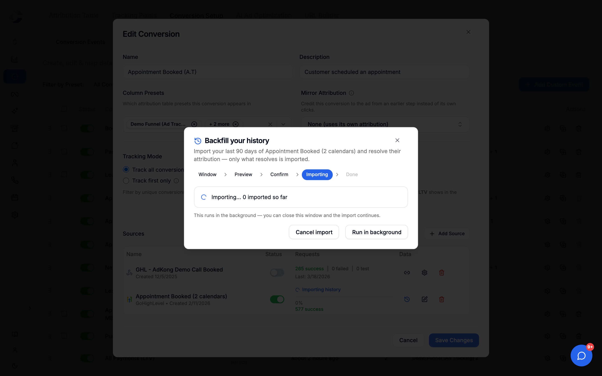
      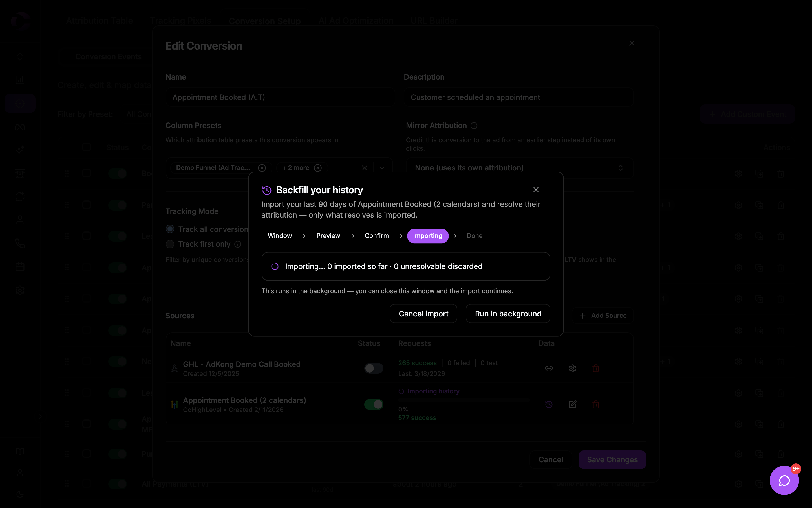
    </Frame>

    <Note>
      **The bar does not count records. It shows how far through the dates it has got.**

      So it will not move at a steady speed. If most of your leads landed in one busy week, the bar crawls through that week and then races through the quiet ones. That is normal.

      The bar is also not a countdown. How long an import takes depends on how much history there is and how quickly the other tool answers.
    </Note>
  </Step>

  <Step title="Let it finish">
    Once every record has been fetched, the message changes to *"All rows are in (1 imported · 2 unresolvable discarded). Finishing: refreshing attribution on related conversions…"*

    This last part matters, so let it run. An old lead you just imported can also explain a sale you already had. Cortana goes back over the people this import touched and updates their other conversions too.

    On the source row you will see **Finishing: refreshing attribution** while this happens.

    This step can keep running for a while after the last record is in, sometimes much longer than the fetching took. You do not have to sit and watch. Close the window and come back to the clock icon later.

    <Frame caption="The finishing step. All records are in, and Cortana is now updating related conversions.">
      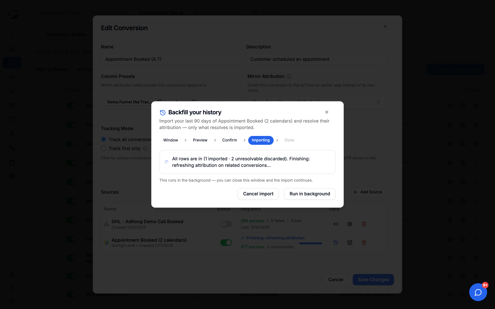
      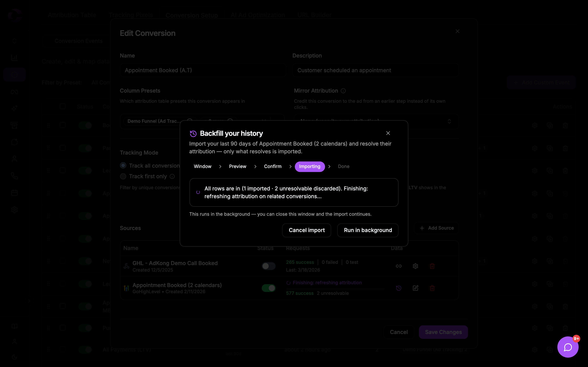
    </Frame>

    <Frame caption="The source row while an import is going. The status, the bar and the unresolvable count all sit on the row.">
      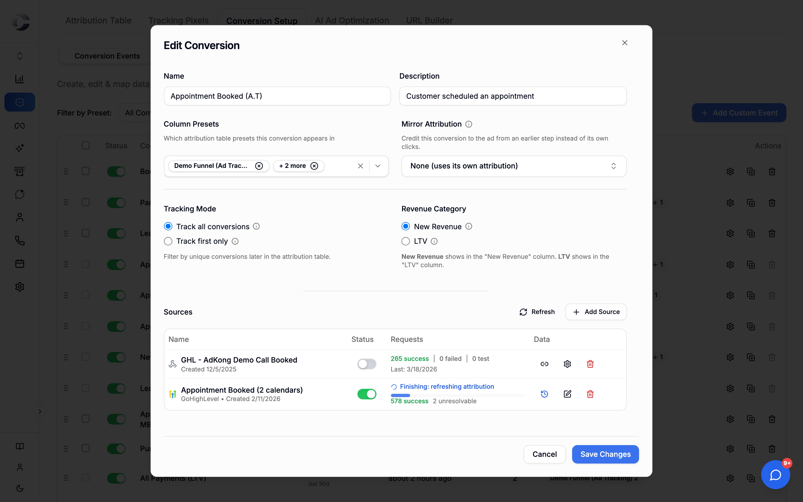
      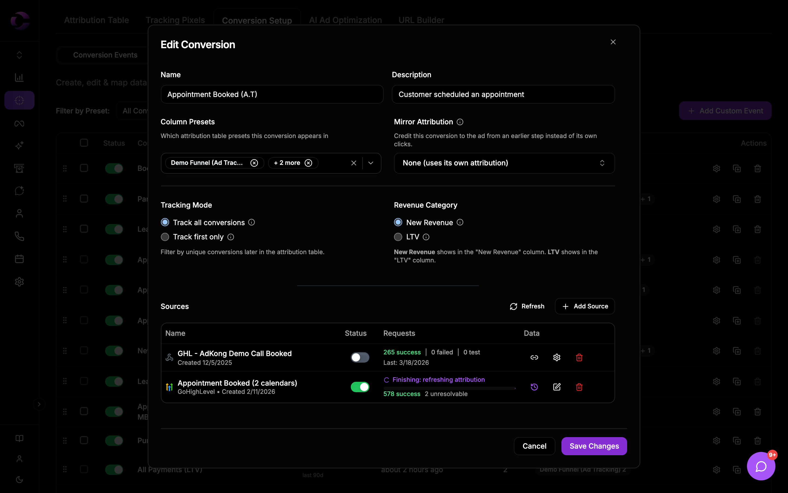
    </Frame>
  </Step>

  <Step title="Read the result">
    The last step says **Import finished** and gives you three numbers on one line:

    *"[N] conversions imported with attribution · [M] discarded as unresolvable · [K] already present"*

    <Frame caption="The Done step. You get real numbers, not just a tick.">
      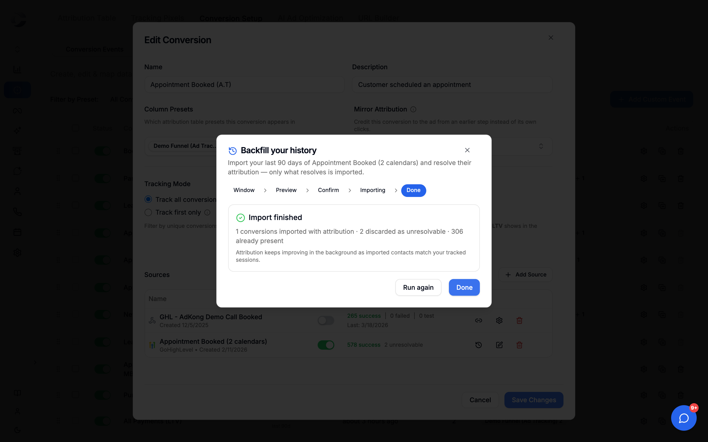
      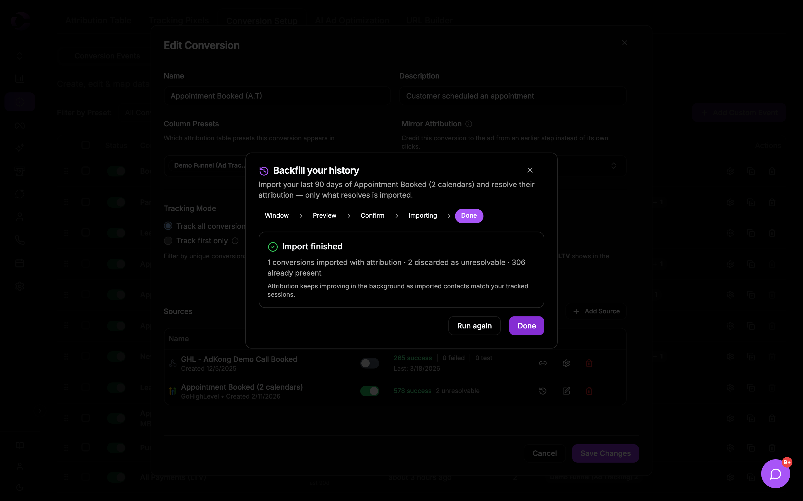
    </Frame>

    | The number | What it counts |
    | --- | --- |
    | **imported with attribution** | Cortana found where these came from. They are now in your account. |
    | **discarded as unresolvable** | Cortana found these, but could not work out where they came from, so it left them out. |
    | **already present** | Cortana already had these. Nothing changed. |

    Two extra bits can appear on the same line:

    - **"[N] earlier conversions retro-resolved"** means older conversions you already had now have a proper answer, thanks to what this import taught Cortana.
    - **"stopped at the volume cap"** means the import hit the 50,000 record limit and stopped there.

    The heading changes if things did not go perfectly. **Import finished with notes** means it finished but there is something to read. **Import stopped** means it did not finish. Either way the reason is added to the end of the same line.

    Under the numbers: *"Attribution keeps improving in the background as imported contacts match your tracked sessions."* In other words, your numbers can still get better on their own after this window closes.

    **Run again** starts over. **Done** closes the window.

    Back on the source row, an import that finished cleanly leaves no status line at all. You just see the **success** count, now including everything imported, with **[M] unresolvable** next to it.

    <Frame caption="The source row after a finished import. No status line, just the counts.">
      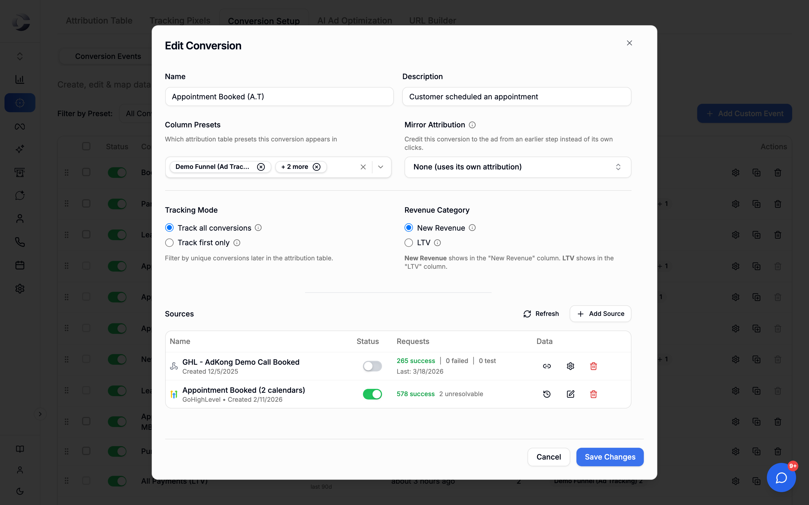
      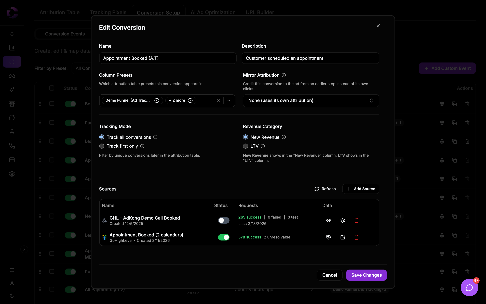
    </Frame>
  </Step>
</Steps>

## Import the history of a filtered conversion

{/* last-verified: 2026-11-25 against the app source (sprint lead-filter-groups C1, C2, E2, L9, L12; A1b: no import offer for a source whose filter did not save). Paths: src/lib/integration-backfill/strategies/cortana-booking.ts, strategies/cortana-form.ts, strategies/cal-com.ts, strategies/meta-leads.ts, native-import-row.ts, native-sources.ts (youngTagLeadsNote), src/lib/booking/native-recorder-backfill.ts, src/components/tracking/backfill/backfill-offer-dialog.tsx. */}

A new conversion with a [lead filter](/4-conversion-tracking#lead-filters-form-qualification-rules) starts at zero, because the filter only counts leads from the moment it is saved. A history import fills it with the past leads that pass the filter, dated when they really happened and credited to the ad they came from. This is how a **Qualified lead** conversion beside your **Lead** conversion gets its history on day one. See [Tiered conversions](/4-conversion-setup#tiered-conversions-count-every-lead-and-your-qualified-leads).

Every source that can be imported and holds a lead filter imports through it: Meta lead forms, Calendly, Cal.com, Typeform, Tally, HubSpot forms, GoHighLevel, iClosed, Cortana Forms and Cortana Calendars. The three that joined with lead filter groups work like this:

- **Cortana Calendars**: past bookings on the source's calendars.
- **Cortana Forms**: past forms started or sent on the source's forms, plus the bookings of any calendar that shows one of those forms, unless the same conversion already counts that calendar.
- **Cal.com**: past bookings on the source's meeting links, for the event it tracks (created, cancelled, or rescheduled).

<Steps>
  <Step title="Save the source with its lead filter">
    Set up the source and its **Lead filter**, then save. On a new source, the **Backfill your history** window opens by itself. On a source you already have, click the clock icon on its row.

    If the filter could not be saved, Cortana does not offer the import, so history never comes in unfiltered.
  </Step>

  <Step title="Pick how far back, and preview">
    Pick **30 days**, **60 days** or **90 days**, then click **Preview my last 90 days** (the number matches your pick). On Cortana Calendars and Cortana Forms the preview is a plain count of the past leads that pass the filter and reach the source's stage, with no estimate of how many will resolve. Past 5,000 it reads **At least**. Every other tool previews the way **Read the preview** above describes.
  </Step>

  <Step title="Confirm and import">
    On the **Confirm** step, the same two choices apply as on any import: **Send imported conversions to ad platforms (CAPI)** and **Also import conversions we can't attribute**, both off. Click **Import**.
  </Step>
</Steps>

{/* SCREENSHOT TODO: the Backfill your history window on the Preview step for a Cortana Calendars source of a "Qualified booking" conversion, showing its records found count. Light mode, fake data. */}

<AccordionGroup>
  <Accordion title="What a filtered import keeps">
    - **The filter.** Only past leads that pass the source's lead filter as it is now are imported, judged exactly as a new lead would be: groups, **is one of**, tags and all. A lead that does not pass is left out and appears in none of the three numbers on the **Done** step.
    - **The original times.** A Cortana Calendars booking is dated when the lead came in. A Cortana Forms lead is dated when the person started the form or sent it, whichever stage the source counts. A Cal.com booking is dated at its own moment: when it was made, when it was cancelled, or when the new booking of a reschedule was made.
    - **The original attribution.** Each lead is credited to the ad it came from, worked out the same way as for a live lead. On Cortana Calendars and Cortana Forms, Cortana also ties the imported lead to the visit its own browser made around the time of the lead, so the ad of that visit gets the credit.
    - **Quiet.** No webhook, no Zapier, no GoHighLevel workflow, no team notification. Ad platforms only hear about it when **Send imported conversions to ad platforms (CAPI)** is on, and then only for the last 7 days.
    - **No duplicates.** A lead the source already counted is reported as **already present**.
    - **Your main conversion.** The import only adds to the conversion you run it on. Your main **Lead** conversion keeps its numbers; at most, an existing conversion of the same person can be credited to a better ad (see **What an import does to conversions you already had** below).
  </Accordion>

  <Accordion title="What a filtered import leaves out">
    - **GoHighLevel appointments read today's answers.** A GoHighLevel appointment filter judges each contact's custom fields as they are on the day of the import, not as they were when the person booked.
    - **Tag rules read today's tags.** A filter with a tag rule checks the tags each contact has on the day of the import. Leads from the last 2 minutes are left out, because a tag may not have landed yet, and the result's notes say so: *"3 leads from the last 2 minutes were not imported: a tag this conversion's filter reads may not have landed on them yet. Import again in a few minutes to count them"*.
    - **Bookings a team member made for a lead** on a Cortana calendar are not imported.
    - **Older Cortana Forms submissions** sometimes have no record of when they were sent. Those are dated when the person started the form, and the result's notes count them.
    - **Cal.com bookings with no email** are skipped: Cortana needs an email to know who booked.
  </Accordion>
</AccordionGroup>

## Sub-features

<AccordionGroup>
  <Accordion title="Running an import again">
    Click the clock icon on the source row. If an earlier import is shown, press **Run again**.

    **Running it again is safe.** Every tool gives each record its own ID, and Cortana remembers those IDs. Anything it already has is counted as **already present** instead of being added twice. You cannot create duplicates by running an import twice.

    The **Window** step reminds you what happened last time: *"Last import: [N] imported on [date]. Running again only adds records that are not already present."*

    Running it again is worth doing in two cases:

    - You want to go further back than you did the first time.
    - You have fixed your tracking since. Records that had no answer before might have one now.

    <Note>
      Editing a conversion source never offers you an import. The window only pops up when a source is **created**. After that, the clock icon is the only way in.
    </Note>
  </Accordion>

  <Accordion title="What the source row tells you">
    The row keeps you posted the whole way through:

    | On the row | What it means |
    | --- | --- |
    | **Previewing history** | A preview is running. |
    | **Import queued** | The import is accepted and waiting to start. |
    | **Importing history** | Records are being fetched and checked. The bar shows how far through the dates it has got. |
    | **Finishing: refreshing attribution** | All records are in. Cortana is now updating related conversions. |
    | **Import hit an error, retrying (attempt N of 3)** | Something failed and Cortana is trying again. The reason is shown underneath. |
    | **Import stopped** | The import did not finish. |
    | **Stopped at the volume cap** | It hit the 50,000 record limit. |
    | **Finished with notes** | It finished, but there is something worth reading. |

    Once it finishes cleanly, the status line goes away. What stays is **[M] unresolvable** next to the success count, so you can always see how many were left out.
  </Accordion>

  <Accordion title="What happens to records Cortana cannot answer for">
    This depends on the **Also import conversions we can't attribute** switch. With it on, every record is imported and the ones Cortana cannot explain are shown as untracked, and none of what follows applies. With it off, which is the default:

    They are not imported as conversions. Cortana checks them, finds nothing solid, and leaves them out rather than filing them as untracked.

    A record has a real answer when Cortana can tie it to something specific: a matching ad, campaign or ad set, a click ID such as `fbclid` or `gclid` still attached to it, or a genuine traffic source.

    "Direct or organic, with nothing else attached" does not count as an answer. It looks exactly the same as having no information at all, so Cortana does not treat it as a result.

    <Warning>
      **The person is kept, even when the conversion is not.**

      If fetching a record made Cortana create a contact for that person, the contact stays in your account even though the conversion was left out.

      So you may see new contacts appear after an import with no conversion attached to them. That is on purpose, not a bug.
    </Warning>

    Turning on **Also import conversions we can't attribute** changes this. Then the conversions are kept, and shown as untracked.

    <Note>
      **Kept-but-unexplained conversions show as untracked, never as direct.**

      This is true for every record that switch kept. Direct would mean the person typed your address in; untracked means Cortana has no page views for them. Only the second one is known to be true, so that is what it says, even if that person has visited your site since.
    </Note>
  </Accordion>

  <Accordion title="What an import does to conversions you already had">
    Two things, and both only add.

    **It leaves your existing records alone.** Anything Cortana already had is counted as **already present** and not touched.

    **It can improve them.** Once all records are in, Cortana goes back over the people this import touched and rechecks their other conversions. An old lead you just imported can hold the answer to a sale you recorded weeks ago. When that happens, the Done step reports it as **earlier conversions retro-resolved**.

    Your numbers also keep improving quietly afterwards, as the imported people get matched to visits your pixel recorded.
  </Accordion>

  <Accordion title="Notes for each tool">
    **Meta lead forms.** This covers the lead ads you run on Facebook and Instagram. Meta keeps lead answers for 90 days, so 90 days is the furthest back you can go.

    You do not pick a form or an event for this one. If your source is set to watch particular forms, the import covers those. If it is set to watch everything, the import covers every form on your connected pages. Either way it matches what your live tracking already does.

    This one is worth running. Until now, if your Facebook connection broke, those leads were gone from Cortana for good. An import is how you get them back.

    **LinkedIn lead forms.** This covers LinkedIn lead gen forms, and it works the same way as Meta. You pick no form and no event, and the import follows whatever your source already watches. LinkedIn keeps a year of answers, but Cortana's longest window is 90 days.

    **GoHighLevel.** Six kinds of event can be imported: opportunity stage changes, opportunity status changes, appointment created, appointment updated, form submitted and survey submitted. An import only pulls what that source is set up to watch, so a source watching one form imports that form only, not every form in your account. Appointment and opportunity sources take longer to preview, because Cortana reads up to 50 contacts to work out the rate.

    **Shopify.** Only sources built on the **orders/paid** and **orders/create** events can be imported. Other Shopify events cannot. Shopify reaches back 60 days.

    **Close.** Close reaches back 30 days, because Close itself only keeps 30 days of the record Cortana reads.

    **Google Local Services Ads.** Your last 30 days of leads are counted on their own within minutes of saving the source, so the import brings in the leads older than that. The **30 days** button therefore finds next to nothing: pick **60 days** or **90 days**. The preview shows a lead count with no estimate of how many will import, because an LSA lead carries its own Google Ads attribution. With **Skip short calls** on, the preview says **At least**: it only knows the call lengths Cortana already holds, and the import reads the rest.

    **Stripe.** The preview gives you a record count but no estimate of how many will import, because checking a payment properly means running the full process on it. The import still leaves out anything it cannot answer for.

    **Cal.com.** The import follows the source's event: **Booking Created** brings in every booking made in the window, including ones that were later cancelled or moved, as live tracking counted them; **Booking Cancelled** and **Booking Rescheduled** bring in those changes, each dated when it happened. Its meeting links and its lead filter apply. Bookings with no email are skipped.

    **Cortana Calendars and Cortana Forms.** The import reads Cortana's own records, so the window is never cut short. It follows the source's calendars or forms, its stage and its lead filter, and the preview is a plain count. See [Import the history of a filtered conversion](#import-the-history-of-a-filtered-conversion).

    <Warning>
      **For payment tools, the revenue Cortana shows is ad-attributable revenue, not your total revenue.**

      With Stripe, Shopify and WooCommerce, payments Cortana cannot trace are left out just like anything else. So the revenue you see in Cortana after an import is only the part it can tie to a source. It will be lower than the total in Stripe or Shopify for the same period.

      When you want your true total revenue, check it in Stripe, Shopify or WooCommerce. Cortana is telling you a different thing on purpose.
    </Warning>
  </Accordion>
</AccordionGroup>

## Settings reference

| Setting | What it does | Default | We recommend | Watch out for |
| --- | --- | --- | --- | --- |
| **Window** (30 / 60 / 90 days) | How far back the import goes. | **90 days** | 90 days, unless you only started advertising recently. | Shortened automatically where the tool allows less: 60 days on Shopify, 30 on Close. The screen still shows the number you picked, so check the table above for what you actually get. You cannot pick your own dates. |
| **Send imported conversions to ad platforms (CAPI)** | Tells Facebook, Google and your other ad platforms about the imported conversions. | **Off** | Leave it off. | Even when on, only the last 7 days can be sent, because ad platforms refuse older events. It can lower your Event Match Quality for about a week. |
| **Also import conversions we can't attribute** | Keeps the records Cortana cannot trace instead of leaving them out. | **Off** | Leave it off. | They arrive as untracked and push your untracked percentage up. Turning the setting off again later does not remove them. |
| **Record limit** | The most records one import can bring in. | **50,000** | Nothing to do. | If your preview is bigger than this, **Continue** is greyed out and you are asked to contact support to raise it for your account. |

<Tip>
  If you only run one import, run it on the source behind the conversion you judge your ads by. That is where getting the history back actually changes what you decide to do.
</Tip>

## Troubleshooting

<AccordionGroup>
  <Accordion title="I set up a source and no import was offered">
    The window only pops up for the tools listed above, and only when a source is **created**. Editing a source never brings it up.

    If your source is one of them, open **Edit Conversion**, find the row, and click the clock icon. That takes you through exactly the same steps.

    If there is no clock icon, that kind of source cannot be imported. Pixels, CSV uploads, URL parameter sources and sources made by hand have no tool for Cortana to ask. Salesforce, Fathom, CallRail, Kajabi, PayPal and Fanbasis sources have no import either.

    A source whose lead filter could not be saved is not offered the import either, so its history never comes in unfiltered. Save the filter again, then use the clock icon.
  </Accordion>

  <Accordion title="The clock icon is missing from the row">
    Two reasons, most likely first.

    1. **That kind of source cannot be imported.** See the table near the top of this page. Salesforce, Fathom, CallRail, Kajabi, PayPal and Fanbasis sources, pixels, CSV uploads and sources made by hand have no clock icon.
    2. **You do not have permission to manage tracking for this business.** The icon is hidden rather than greyed out, so ask whoever runs your account.

    The icon follows the kind of source, not what it watches. A source of a tool that can be imported always shows it, even when it watches an event that cannot be imported, such as a Shopify source on anything other than orders/paid or orders/create, or a HubSpot **Deal Stage Changed** source. Clicking it then stops at the preview with the reason: see **The preview says zero, or will not run** below.
  </Accordion>

  <Accordion title="The preview says zero, or will not run">
    Zero means Cortana found no records at all for that source inside the window. Two things to check: that the window covers a time when the source was actually getting activity, and that the source is set to watch what you think it is.

    You may also see one of these messages:

    | Message | What to do |
    | --- | --- |
    | **"This source has no form configured: nothing to backfill"** | Open the source's settings and pick the form it should watch. |
    | **"This source has no trigger configured: nothing to backfill"** | Open the source's settings and pick what it should watch. |
    | **"This source has no pipeline configured"** | A GoHighLevel opportunity source needs its pipeline set. |
    | **"This source has no calendar configured"** | A GoHighLevel appointment source needs its calendar set. |
    | **"The "[trigger]" trigger is not backfillable yet"** | That kind of event cannot be imported yet, for example a HubSpot **Deal Stage Changed** source or a Shopify source on an event other than orders/paid or orders/create. Your live tracking still works as normal. |
    | **"Backfill is not yet available for [source type]"** | That kind of source cannot be imported. |

    The first two messages do not apply to **Meta lead forms** or **LinkedIn lead forms**. Those sources have no form or event for you to pick, so they can never be missing one. If a Meta or LinkedIn import returns nothing, the usual causes are that no lead forms are mapped for this business yet, or that the connection needs reconnecting.

    If Cortana cannot measure the preview, it tells you honestly rather than showing a fake zero: *"A preview is not available for this source yet: you can still run the import; unresolvable records are discarded, never imported blind."*
  </Accordion>

  <Accordion title="The preview number did not match what actually imported">
    This is normal. The preview checks a sample and works out the rest from there, so it can be too high or too low.

    Most of the time the gap is not a mistake at all. It is the **already present** column.

    If your source has been running live for a while, Cortana already has most of what the import finds. The preview counts those records, because they really are there. They then land in **already present** rather than **imported**.

    So a preview of 105 can finish as 1 imported and 306 already present, and nothing has gone wrong. Read all three numbers on the Done step together and they will add up.
  </Accordion>

  <Accordion title='"A backfill for this source is already queued or running"'>
    You can only run one import per source at a time.

    Click the clock icon on that row to see the one already going. Then either watch it or leave it to finish.

    If it is sitting at **Import queued** and you would rather start over, **Cancel import** frees the source so you can run a new one.
  </Accordion>

  <Accordion title="Cancel import did not work">
    **Cancel only works while the import is still waiting to start.**

    Once it is actually running, pressing Cancel does nothing and you see **"Job is RUNNING: only queued jobs can be cancelled"**.

    A large import runs in batches, and it goes back to waiting between them. If you press Cancel during one of those gaps, it stops before the next batch. So you may need to try more than once.

    There is no way to stop an import instantly, and no way to remove what it has already imported.
  </Accordion>

  <Accordion title="It says Finished with notes, or Import stopped">
    **Finished with notes** means it finished, but there is something to read. The reason is printed at the end of the same line as the three numbers.

    **Import stopped** means it did not finish. Cortana tries a failing step up to three times before giving up, and the row shows **Import hit an error, retrying (attempt N of 3)** while it is trying.

    In both cases, just run it again. Anything already imported is recognised and counted as already present, so a second run carries on from where the first one got to instead of duplicating anything.
  </Accordion>

  <Accordion title="The numbers do not add up">
    The three numbers on the Done step count **conversions**, not records fetched. A record that never becomes a conversion is in none of them.

    The usual cause is a record with nothing to identify the person by, for example a form submission with no email address and no phone number. Cortana has nobody to attach a conversion to, so no conversion is made. There is nothing to import and nothing to throw away.

    Records like that are counted by the preview but appear in none of the three columns at the end.
  </Accordion>
</AccordionGroup>

## Frequently asked questions

<AccordionGroup>
  <Accordion title="Will this duplicate my data?">
    No. Every tool gives each record its own ID, and Cortana checks against those IDs. Anything it already has is counted as **already present** instead of being added again.

    Running an import twice cannot create duplicates. Neither can running one over a period your live source was already covering.
  </Accordion>

  <Accordion title="Why did it only import a small part of my records?">
    Because, unless you switch on **Also import conversions we can't attribute**, Cortana only imports the records it can trace. The rest were either impossible to trace, or already in your account. On a source with a lead filter, the past leads that do not pass it are left out too.

    A small number is not a failure. Importing records Cortana cannot explain would push your untracked percentage up and teach you nothing, which is exactly what this feature is built to avoid.
  </Accordion>

  <Accordion title="Why did my untracked number go up after an import?">
    Because **Also import conversions we can't attribute** was on for that import. With it on, Cortana imports every past record, and the ones it cannot trace are marked untracked, which means "no page views recorded for this person". Your totals for that period are now complete. The untracked share is the honest cost of that.

    It is not a mistake to fix. Switching the setting off later does not remove what that import brought in. Next time, leave the switch off to import only what Cortana can explain.
  </Accordion>

  <Accordion title="Will my team get emails, or will this set off my automations?">
    No. Everything an import brings in is kept quiet on purpose.

    Imported conversions and imported contacts do not send webhooks, do not set off tools connected to those webhooks such as Zapier, and do not notify your team. A 90 day import will never replay months of old activity into your automations.
  </Accordion>

  <Accordion title="Can I go back further than 90 days?">
    No. The three buttons are the only choice, 90 days is the longest, and it is shorter on Shopify and Close. There are no custom dates and no way to ask for more from this window.

    This holds even where the tool itself keeps more. LinkedIn stores a year of lead form answers, but Cortana can still only ask it for 90 days.

    For anything older, or from a tool Cortana does not connect to, use a CSV upload. See [Conversion tracking](/4-conversion-tracking).
  </Accordion>

  <Accordion title="Will this send my old conversions to Facebook?">
    Only if you turn on **Send imported conversions to ad platforms (CAPI)**, and even then only conversions from the last 7 days go.

    Ad platforms refuse anything older than about a week, so most of an import can never be sent no matter what you choose. The setting is off unless you switch it on yourself.
  </Accordion>

  <Accordion title="Can I undo an import?">
    No. There is no undo button and no way to remove what an import brought in.

    So decide before you press **Import**, especially about **Also import conversions we can't attribute**. Untracked records brought in by an import stay in your account.
  </Accordion>

  <Accordion title="Can I set this to run automatically?">
    No. Every import is started by hand.

    You should not need it to repeat. Once your source is live, new conversions arrive on their own, so there is no backlog building up behind you.
  </Accordion>

  <Accordion title="Will Cortana tell me when it has finished?">
    No. There is no email and no notification in the app.

    Either leave the window open and watch it, or come back to the clock icon on the source row later. It shows you the result whenever you next open it.
  </Accordion>
</AccordionGroup>

## Next step

<CardGroup cols={2}>
  <Card title="URL parameters" icon="link" href="/5-url-parameters">
    Tag your traffic so future conversions can be traced without needing an import at all.
  </Card>
  <Card title="Conversion tracking" icon="crosshairs" href="/4-conversion-tracking">
    Create and set up the conversion sources an import runs on.
  </Card>
  <Card title="Connect integrations" icon="plug" href="/1-connect-integrations">
    Connect GoHighLevel, Stripe, Shopify and the rest before you import from them.
  </Card>
</CardGroup>
