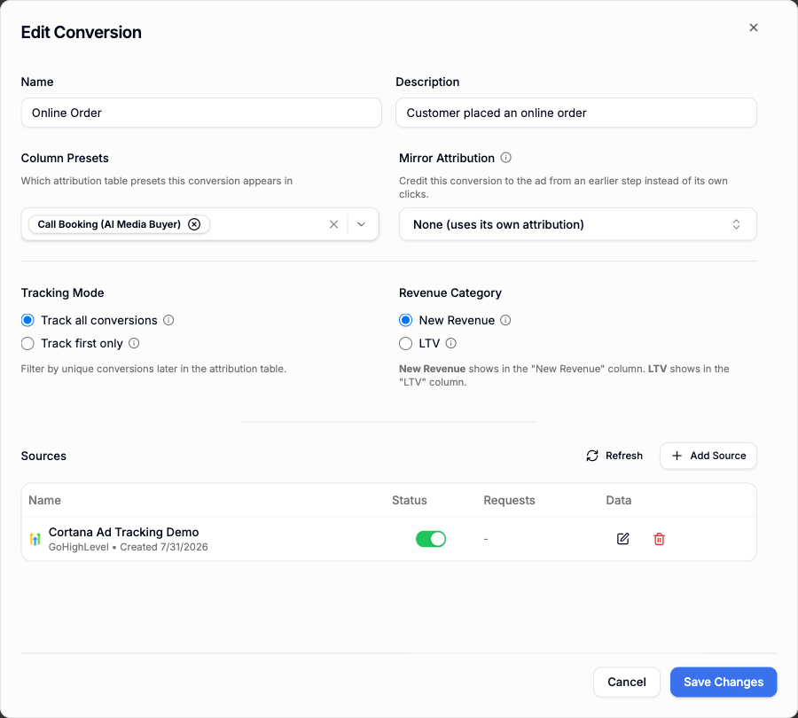
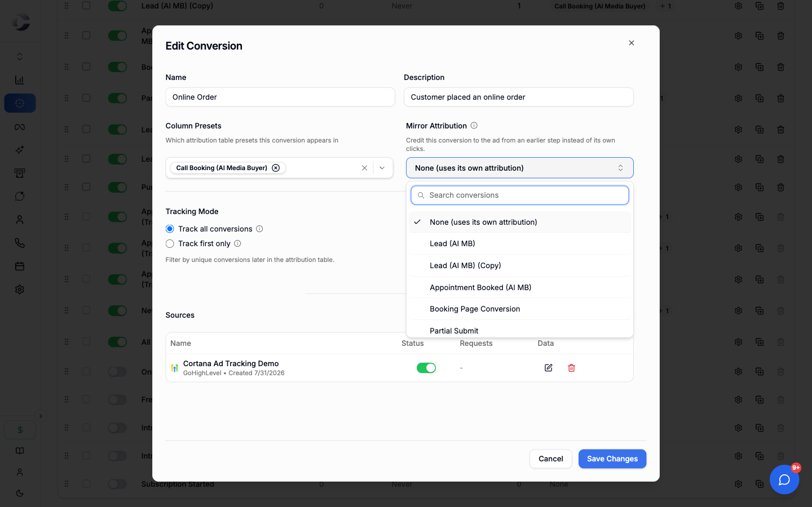
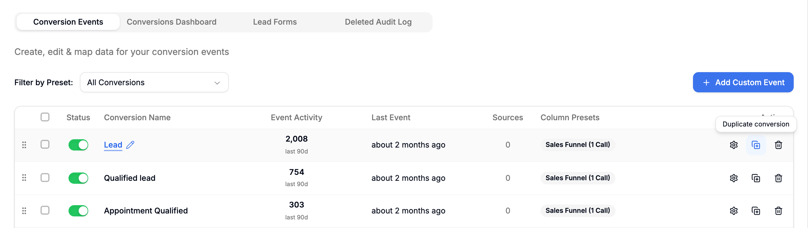

  <iframe src="https://www.loom.com/embed/3d88f4d53d77411681dcfaee67b83645" frameborder="0" webkitallowfullscreen mozallowfullscreen allowfullscreen style={{ position: 'absolute', top: 0, left: 0, width: '100%', height: '100%' }} />

<Expandable title=" ">
  Alright, so now that we have our pixel done and our contact tracking done, we're going to go over here to the Conversion Setup and we're going to click on this Conversion Events tab. And in here, you're going to see you're going to be able to create, edit, and map data for your conversion events. Now, right out the gate, we're going to give you guys a set of most standardized stuff, right? Like lead, intro call, if you're doing two-call close, appointment booked, appointment qualified, new deal closed, all payments, etc., etc., right? So, you can also create unlimited custom events. So, if I wanted to do, let's say, event upsell VIP, and this is someone who purchased VIP upsell for our webinar, we can go ahead and create an event. Don't worry about the column presets for now. Basically, I'll give you a little snippet. Let's say I wanted to see this inside of our one-call close column preset. This column preset, you'll see sales funnel one call. If I go to the attribution table and I hit columns, these are the column presets, right? So, I basically added that in there, and now you'll see that the, uhm, event upsell one is somewhere in here. There we go. Event upsell VIP, right? So, you can go ahead, you can then drag it around. So, that's just a nice way to quickly and easily add it to your column preset, but that's not what I wanted to dive into in this video. I wanted to dive into the actual concept of a conversion, how it all works, all the different settings, and what conversion sources are. So, kicking it from the top, let's go ahead, let's look at the tracking mode, because this is an important one, right? So, right at the gate, you can fire off conversion. It's going to track every conversion for a contact. So, this will record every conversion from each contact, recommended for most setups, right? Or, you can track first only. So, this is like a hard stop. I only want to track the first time this ever happens with a contact. Now, some people have different tracking requirements, which is why we gave you the ability to turn off, like, first only and not track every single one. What's important to mention is if you track all conversions, you can always still filter out the conversions in your report. So, I'm going to show you how you can do that in just a second. So, if you go to the attribution table, I'm just going ahead of myself here, guys. Like, don't worry, we're going to go over this again in another video. I just want to walk you through it all anyway. But, you guys see here, when we have everything here, like, so let's say leads. So, right now we're going to show all, but if I want to filter this report where it's like, hey, I only want to actually show one per contact, what's going to happen, let's just say this was your setup, count only one per contact, then I hit save. So, now this sales funnel one call is going to show only one per contact because that's the report I want to see here, but if I click. So, click on sales funnel two call and I click on this lead, you're going to see the lead is still showing all. So, this is just a filtration on top of the actual data, so that way you can view it in a report however you want. So, what that means is if you have this setup here, where you are tracking all conversions, meaning every single time the lead takes this conversion, we're going to show it to you. But, inside of your report, you're like, you know, I don't actually want to see that, uhm, maybe not one per contact, especially for lead, right? Like, someone might opt in twice accidentally or appointment booked. Appointment booked is a great example here, because I want to track every appointment booked, right? So, I'm actually going to go ahead, I'm going to go click on the appointment booked because that's a perfect example. So, let's say appointment booked, I do want to track every single appointment booked. I do not want to track the first one only. However, here's where the data reporting can get quite messy. If I track every single conversion, someone books now, they're like, ah, shit, I chose the wrong time, and then five minutes later, they reschedule, they book again. That's now going to count as two bookings, right? So, this, in theory, is going to inflate the number of appointments you have, lower your actual cost required book appointment, and you're going to be running blind. So, what we're going to do instead, is instead of filtering here, to tracking first only, we're going to hit track all conversions, then we're going to come here to appointment booked, and then I'm only going to show one every, us personally, honestly, I think we do every, I think we have it running every 14 days, because you might book in, and then the date might come, right? Like, let's say you book today for six days out, and then six days, or five days coming, you're like, ah, shit, you know, I had to reschedule. Uh, that does happen sometimes. It does a lot, so we just filter out, so it only shows one every single 14 days, meaning that guy can book seven times within 14 days. Inside of the report, we're only going to show you one, because only one happened every 14 days. However, if he books again next month, then we're going to show you that one, because it's a separate 14-day window, right? So, hopefully, that makes sense in terms of the filtration, and how the tracking mode works. For most of the time, you're going to probably going to set up track all conversions. The only time you would want to set up maybe like track first only might be if you have, like, a new deal closed, and you only want to track this once, because he might come back, I don't know, maybe he churns, but then he rebuys in, like, three months. Again, everyone's tracking setup is so unique. The reason that we have all of this setting is to really give you the LEGO pieces, to really customize it. If you do have any questions, feel free to reach out to our support team. We're more than happy to answer any questions you have, but I hope that makes sense in terms of the tracking mode where you can track all conversions. Again, this is going to be standard for most setup. However, if you do require, like, a hard block and you're like, nope, I only want to record the first one, I never want to see more than one conversion per contact, then you can go ahead and you can hit tracking first only. So that's it for the tracking mode. Then we're going to go into revenue mode. And this is actually going to require me to open up this one here. So let's go ahead and let's look at New Deal Closed, right? So for New Deal Closed, you guys can see I am going to, uh, have the new revenue setup here because that's what it's considered. So if I show you what that means, this is revenue collected from that specific transaction at the time a customer converts. Now, this particularly is going to be things like Shopify orders. First subscription payment, right? You might be doing software or you might be doing agency or something that's recurring payment and someone's going to continue to pay you month after month. So this would be considered like the first transaction, the first payment. Or again, if you're doing a three-month coaching program and it's 15K and the guy's going to do a split pay 7.5 and 7.5 and you're like, all right, sick. I want to track the new revenue so I can see how much you're made up front, then we're going to typically do revenue here, right? And that's going to be for things like new deals closed. I also think we have an online order. So again, this is more of your Shopify thing that's going to be marked as new revenue. Now we also have something called all payments LTV, and this is going to be a revenue category of LTV. Now, one thing that's very important to mention when you guys connect Stripe or when you connect with WAP or any other native payment processors, we are automatically going to create a new conversion source. Actually, I'm going to just show you that live. So you guys see I have no sources in here, right? Now I'm going to go over. I'm going to come down. I'm going to connect Stripe. All right, so I've gone ahead. I've connected Stripe. You'll now see that it's sinking. It's starting to pull everything back, right? But I've gone ahead and I've connected Stripe. So now I'm going to go back here. I'm simply going to refresh and you're going to see automatically that we create a new Stripe payment and this is basically going to be every single Stripe payment that hits your Stripe. We're going to add it in here as all payments LTV. Now we're doing this for you because we know the best setup methodology because chances are you want to track all payments LTV as well as new revenue. So now that we've connected this and you understand, hey, I connect Stripe or I connect WAPT or any payment processor and automatically it's going to add everything here to all payments LTV, you're going to be like, what's the difference? Why do I want this versus new revenue? And again, if I come back and I hit new deals closed, I haven't done anything, right? So I'm going to go on Stripe and let's go here, Stripe, and I'm going to do, let's say, checkout completed, uhm, because that's going to be like I send someone a link and they're going to complete the checkout. I wouldn't do payment succeeded. Payment succeeded is what we're using in the other one. So this one right here, the all payments LTV, it's the payment succeeded. So if I came in here, it'd be the exact same thing as if I set up payment succeeded. It's literally the same thing on all products. However, we do that for you. I'm going to come back to new deals closed and this is going to be, let's go Stripe and let's use, let's say, a checkout completed. Checkout completed. Okay. Now we're going to use it for all products. You can filter out if you only want certain products, then you can go ahead and say, Hey, I only want to track it if this one gets purchased, such as like a nice filtration. But for this example, I'm just going to leave it on all hit submit. And now you're going to see checkout completed. And I might actually just want to track the first one only. Cause like, I don't care to see if someone comes back again and we send them a checkout link and it inflates it. Like I genuinely want to see this from paid ad standpoint of like, Hey, I'm running paid ads. Who's the, who's coming in through my funnel and buying the first time. So I would leave this track first only and new revenue, then hit save changes. Now, if you understand the difference, right, I'm going to come to the attribution table. You're going to see, we're going to have new deals closed. So this is going to be every time someone does that checkout link that I just set up, then we're going to have cost per new deal closed. Then we're going to have new revenue. And new revenue is coming only from new deals closed because that's what it's set up as. And then we also have the other conversion called all payments LTV. And then you'll see, we have another revenue category here called LTV. Now, when someone hits that checkout, what's going to happen is they're going to add one to new deal closed. Let's say they paid me a thousand bucks. New revenue is going to go to a thousand bucks. That's also going to hit all payments LTV. So that's going to turn to one. And that's going to turn to a thousand bucks. However, next month, when he pays me another thousand bucks, this is going to stay at one. It's going to stay at a thousand, but all payments LTV is going to go to two. And then this is going to go to 2000. So that way you can start to track and attribute lifetime value and gross lifetime sales from your sources, your campaigns, your ad set in your ads, and also be able to differentiate and split apart new deals closed. Now, hope that makes sense. Again, we have had to add a lot of, you know, just little filters and little settings so we can really tailor this platform to any business. So I hope that makes sense. Again, we kind of just take care of this for you. You don't have to come in here and ever set this up. You connect Stripe, boom, it automatically sets up, it automatically marks as LTV, it automatically gets done for you. The only one that you're going to have to define is what you consider like a new deal closed. Right? You can do that from Stripe, you can do that from literally anywhere. We don't give a shit where you do it from, but I just want you to understand the revenue category. New Revenue is counted inside of your attribution table here as New Revenue. And then the LTV, if I change this to LTV, anytime I had a payment that came in here, it would move into the LTV category. Now, New Revenue, by default, because of how we set it up in here, all payments, it should pretty much go in there as well into LTV. But I'm going to stop talking about LTV and New Revenue. If you do have any questions, please feel free to reach out to the support team. We're more than happy to assist on this. I think it's pretty self-explanatory from here on out, though. And that really is it, ladies and gentlemen, in terms of setting up your conversions. In the trainings below, we're going to go through each individual, what we call conversion sources. So that way you can add a source, right? You can add a bunch of them. You can do, like, a webhook. We're going to do test. We're going to leave that there. Let's say I wanted to also count this from, I don't know, let's say I use Salesforce for whatever reason. I'm going to go, I don't have Salesforce set up, but, uhm, right? We can do all these different sources, and it doesn't really matter. Our system doesn't really care all the different sources. They all feed into the one conversion called the intro, called the webhook. So, overview again, we're going to have your different conversions and the names, and then within the conversion we're going to have different sources that you can go ahead and add inside. So hopefully that makes sense. If you have any questions, please do let me know.
</Expandable>

# Conversion Event Setup

Alright, now that we have our pixel installed and our contact tracking dialed in, we’re going to head over to the **Conversion Setup** tab. This is where you’ll create, edit, and map data for your conversion events so you know exactly what’s happening in your funnel.

## Getting Started with Events

Right out of the gate, we give you a set of standard events: things like Lead, Intro Call Booked, Appointment Shown, and New Deals Closed. These are the basics, but you aren’t limited to them.

<Tip>
  You can create **unlimited custom events**. If you want to track a "VIP Webinar Upsell," just click **Add Custom Event**, give it a name, and a description.
</Tip>

## Configuring Your Tracking Mode

This is an important one. You have two ways to track how contacts interact with your events:

- **Track all conversions:** This records every single time an event happens for a contact. This is the recommended setting for most setups.
- **Track first only:** This is a hard stop. It will only record the very first time a specific conversion happens for a contact and ignore everything after that.

### Pro Tip: Filtering vs. Tracking

I generally recommend tracking **all** conversions. Why? Because you can always filter the data later in your reports. For example, if someone reschedules an appointment, you might want to track both events but only _show_ one unique booking every 14 days in your attribution table to keep your cost-per-booking numbers accurate.

## Revenue Categories

When an event involves money, you need to decide how that revenue is categorized in your dashboard.

<CardGroup cols={2}>
</CardGroup>

## Mirror Attribution

Some conversions aren't a new visit at all. They're an update to something that already happened.

Picture it. A lead clicks your ad, lands on your page, and books a call. Cortana credits that booking to the ad that earned it. That night the same person scrolls, sees a retargeting ad, clicks it, and does nothing. The next morning your team reviews the call and marks it **Qualified**.

Cortana looks at that qualified call and asks the normal question: what did this contact click most recently? The answer is the retargeting ad. So the qualified call credits the wrong ad, and your retargeting campaign quietly takes credit for a call your prospecting campaign produced.

**Mirror Attribution** fixes that. When you switch it on for a conversion, that conversion stops working out its own ad and credits the same ad as an earlier step in your funnel.

<Frame caption="Mirror Attribution sits beside Column Presets in the Edit Conversion dialog. 'None' is the default for every conversion.">
  
</Frame>

### Turning it on

Open any conversion and find **Mirror Attribution** on the right. The dropdown lists your other active conversions.

<Frame caption="Open the dropdown to pick which conversion to mirror. Your own conversions are listed, and you can search if you have a lot of them.">
  
</Frame>

- **None (uses its own attribution)** is the default, and it's how every conversion behaves until you change it. The conversion works out its own ad from the contact's clicks.
- **Pick a conversion**, and this one credits the same ad as that contact's most recent one of those.

A typical setup: set **Qualified Call** to mirror **Booked Call**. Now every qualified call credits the ad that produced the booking, no matter what the lead clicked in between.

<Tip>
  The line under the dropdown tells you exactly what will happen in plain English, using your own conversion names. Read it before you save.
</Tip>

### What it does and doesn't change

It copies the **whole** attribution picture from the earlier conversion, not just the campaign. Source, campaign, ad set, ad, and every attribution model. So the numbers stay consistent whichever model you're viewing your table in.

It does **not** touch dates. A qualified call still counts on the day it happened. Only the credited ad changes.

It never makes attribution worse. If the earlier conversion has nothing useful on it (no ad, no session, just "Direct/Organic"), Cortana leaves the conversion alone rather than overwrite something real with a blank.

<Note>
  Mirror Attribution applies to **new conversions from the moment you switch it on**. Your existing conversions keep the attribution they already have. If you want your history corrected too, reach out to support.
</Note>

### Seeing why a conversion credits the ad it does

Open any contact's **Customer Journey**. A conversion that mirrored will show a line underneath it reading *"Ad credited from Booked Call"* with the date.

The lead's other page views stay in the timeline exactly as they were. Nothing is hidden: that overnight ad click still happened, it just stops taking credit for a call it had nothing to do with.

## Adding Conversion Sources

A conversion event is just a bucket; you need to tell it where the data is coming from. These are your **Conversion Sources**.

<Note>
  **Automatic Setup:** When you connect a native payment processor like **Stripe** or **Whop**, we automatically create an "All Payments LTV" event for you. We know the best methodology for tracking this, so we handle the heavy lifting out of the box.
</Note>

Our system doesn't really care where the data comes from: you can have multiple sources (like a Webhook and a CRM) all feeding into a single "Intro Call Booked" event. This gives you the "Lego pieces" you need to build a tracking setup that fits your specific business.

If you have any questions on how to map these out, feel free to reach out to the support team in the bottom right!

You can also ask in your Slack channel. Cortana can add a source to a conversion for you: she shows you exactly what will change, waits for your yes, and her message carries an **Undo** button. See [Cortana does it for you](/platform/cortana-vip#cortana-does-it-for-you).

## Tiered conversions: count every lead and your qualified leads

{/* last-verified: 2026-11-25 against the app source (sprint lead-filter-groups L11, L11a, L13, F1, D14). Release tree claude/lead-filter-release-2 at 22a9c9c3fc; Duplicate read in claude/lead-filter-duplicate at 8a6902f3dc (D14 final): it copies metaCapiMappings and googleAdsCapiMappings only; TikTokEventsConversionMapping, LinkedInCapiConversionMapping, BingCapiConversionMapping and WhopCapiConversionMapping (prisma/schema.prisma) are not copied. Paths: src/app/api/tracking/events/duplicate/route.ts, src/lib/tracking/duplicate-conversion-holds.ts, src/lib/tracking/source-switch-on-claims.ts, src/lib/tracking/copy-destination-guard.ts, src/lib/tracking/meta-form-ids.ts, src/lib/tracking/calendly-shared-calendar-guard.ts, src/lib/facebook/meta-copy-claims.ts, src/lib/cal-com/meeting-type-claims.ts, src/lib/cal-com/copy-capi.ts, src/lib/capi/copy-send-dedup.ts, src/components/tracking/webhook-setup-table.tsx (Duplicate conversion), src/components/tracking/source-hold-feedback.tsx, src/components/tracking/conversion-setup-dialog.tsx (source switch). */}

A tiered setup is two conversions on the same leads. **Lead** counts every lead. **Qualified lead** sits beside it with a lead filter, so it counts only the leads that pass. Both can count the same Meta lead forms, the same Cal.com meeting type, or the same form or calendar on any other source. Your reports then show cost per lead and cost per qualified lead side by side.

<Steps>
  <Step title="Leave your main conversion as it is">
    Your main conversion, for example **Lead**, keeps no lead filter and goes on counting every lead.
  </Step>

  <Step title="Make the copy">
    In **Conversion Setup → Conversion Events**, click the copy icon (tooltip **Duplicate conversion**) in the **Actions** column of the main conversion. The copy appears right under it as **Lead (Copy)**. Rename it, for example to **Qualified lead**, with the pencil that appears beside its name on hover. See [Duplicate a conversion](#duplicate-a-conversion) for what it copies and what it holds back.

    You can also create a new conversion and add the same source to it yourself. On Meta lead forms and Cal.com, switch on that source's **Lead filter** before you click **Submit**.
  </Step>

  <Step title="Give the copy's source a lead filter">
    Open the copy with the gear icon, then open its source with the edit icon in the **Sources** table. Switch on **Lead filter**, add your rules, and click **Save**. See [Lead Filters](/4-conversion-tracking#lead-filters-form-qualification-rules).
  </Step>

  <Step title="Switch the copy's source on">
    Sources that would count the same leads twice come over paused. Once the filter is saved, switch the source on with its switch in the **Sources** table.
  </Step>

  <Step title="Send the copy to your ad platforms as its own event">
    Map the copy to its own event, for example a custom *QualifiedLead* event in Meta, or its own Google Ads conversion, so the platforms learn which leads are the good ones. Each platform still hears about each lead once: see **How each ad platform gets each lead once** below.
  </Step>
</Steps>

<Frame caption="The copy icon in Lead's Actions column reads Duplicate conversion. The copy, renamed Qualified lead, sits right under it.">
  
</Frame>

<AccordionGroup>
  <Accordion title="What each conversion counts">
    - The main conversion counts every lead. The copy counts only the leads that pass its filter, so a qualified lead counts once in each conversion.
    - The filter counts leads from the moment it is saved. To fill the copy with the past leads that pass it, run a history import on its source. Every source that can be imported does this through its filter, Meta lead forms, Calendly, Cal.com, Typeform, Tally, HubSpot forms, GoHighLevel, iClosed, Cortana Forms and Cortana Calendars included: see [Import the history of a filtered conversion](/4-backfill-history#import-the-history-of-a-filtered-conversion).
    - Inside one conversion a lead counts once: two sources of the same conversion cannot take the same Meta form or the same Cal.com meeting type.
  </Accordion>

  <Accordion title="How each ad platform gets each lead once">
    Every lead the copy counts is also counted by the main conversion, so Cortana makes sure an ad platform hears about it only once.

    - **Meta**, for copies on Meta lead forms and on Cal.com: when the copy is mapped to the same event on the same pixel as the main conversion, Cortana does not send that lead again from the copy, because the main conversion already sends it. On the copy's conversion, that lead's Meta status badge reads **Not Sent**. Hover it for **Not sent to Meta** and *"Sent once by Lead as Lead"* (the main conversion's name and the event). You see the badge in the conversion details, in the customer journey and on the conversion dashboard. Map the copy to a different event or pixel and it sends as normal. **TikTok** works the same way for copies on Meta lead forms.
    - **Google Ads and LinkedIn** have no way to take one lead from two conversions. So a copy may not send the same Google Ads conversion, or the same LinkedIn conversion, as its main conversion. Saving the source, or turning such a mapping on later, is refused with *"This conversion sends the same Google Ads conversion as Lead. Pick another Google conversion for the copy."* (or the LinkedIn version).
    - **Cal.com copies** are refused the same way on Google Ads, TikTok, and LinkedIn, for example: *"Demo call" is also counted by "Lead", and both conversions send Google Ads "Booked call". One booking would be reported to the ad platform twice. Give one of them a different event, or remove its mapping, then add the meeting type again.*
    - **Calendly**: a calendar can feed several conversions. Saving is refused when both would send the same Meta event or Google Ads conversion for one booking.
    - **Every other source** (Typeform, Tally, GoHighLevel, HubSpot, iClosed, Cortana Forms, Cortana Calendars): each conversion sends its own events. Map the copy to its own event, so one qualified lead is never reported twice as the same event.
  </Accordion>

  <Accordion title="Which sources need a filter before they can be copied">
    - **Meta lead forms:** a form keeps at most one source without a filter. Any number of sources with a filter, in other conversions, can count it beside that one. A second conversion with no filter is refused with *"This form is already counted by Lead. A second conversion on it needs a lead filter."* Turning off a copy's filter while the main conversion counts the form is refused with the same words.
    - **Cal.com:** the same rule per meeting type, with *"This meeting type is already counted by Lead. A second conversion on it needs a lead filter."*
    - **Calendly and every other source:** several conversions can count the same calendar or form, with or without a filter. **Duplicate conversion** still starts an unfiltered Calendly copy paused (see below), because it would count every booking its original counts.
  </Accordion>
</AccordionGroup>

## Duplicate a conversion

{/* last-verified: 2026-11-25, same sources as the section above, with Duplicate read in claude/lead-filter-duplicate at f762838f45 (F7, F8): src/lib/tracking/duplicate-conversion-holds.ts (planCalendly, calendlyNeedsFilterMessage, unheldMeta on every source but WEBHOOK, an unfiltered Meta lead forms source and an unfiltered Cal.com source), src/lib/tracking/calendly-shared-calendar-guard.ts, src/lib/tracking/source-switch-on-claims.ts (CALENDLY_WEBHOOK now claimed). The held-back note and the toast: src/components/tracking/source-hold-feedback.tsx (CopyHoldsNotice, showConversionChangeFeedback, SourceHoldNotice) and its mount at the top of the Sources in conversion-setup-dialog.tsx, claude/lead-filter-editor at deac5a3da2. */}

**Duplicate conversion** makes a safe copy: everything the original has, minus anything that would count or report the same lead twice.

<Steps>
  <Step title="Click Duplicate conversion">
    In **Conversion Setup → Conversion Events**, click the copy icon in the **Actions** column of the conversion. Its tooltip reads **Duplicate conversion**.
  </Step>

  <Step title="Find the copy under the original">
    The copy appears right under the original, named after it with **(Copy)** (a second one gets **(Copy 2)**). It counts the same way as the original, with the same column presets, and copies every source (lead filters included) and its Meta events and Google Ads conversions. TikTok, LinkedIn, Microsoft Ads and Whop conversions are not copied: set them on the copy.
  </Step>

  <Step title="Read what it held back">
    When Duplicate held something back, a short message points you to it: *"Copy made. Some of its sources are paused: see the note at the top of its sources."* (or *"Copy made. Some of its ad platform events are off: see the note at the top of its sources."*). When nothing was held back, the message reads *"Booked calls" duplicated successfully* with your conversion's name.

    Open the copy with the gear icon. At the top of its **Sources**, a note titled **Held back on this copy, so no lead counts twice** lists:

    - each paused source and why, for example *Meta leads is paused. This form is already counted by Booked calls. A second conversion on it needs a lead filter.*
    - each ad platform event that was turned off, for example *Meta event "Lead" was turned off when this copy was made, so the same lead would not reach Meta twice from the copy and the original.*

    A paused source leaves the note once you switch it on. The lines about turned-off events stay until you close the note with its **x**, and the note goes away by itself once nothing is left on it. Cortana keeps it in this browser only, for up to 30 days, so a teammate on another computer does not see it.

    <Frame caption="The note at the top of a copy's sources says what Duplicate held back, and why.">
      
    </Frame>
  </Step>

  <Step title="Add a lead filter to each paused source, then switch it on">
    Open each paused source, switch on **Lead filter**, add your rules, and click **Save**. Then switch the source on in the **Sources** table.
  </Step>
</Steps>

<Frame caption="A copy's Sources in its Edit Conversion window: the note on top, the paused Calendly source below it with its switch off.">
  
</Frame>

<AccordionGroup>
  <Accordion title="What Duplicate holds back, and why">
    - **Sources that would count the same leads twice start paused.** A Meta lead forms source or a Cal.com source on forms or a meeting type the original counts comes over paused, unless it already has a lead filter. The note at the top of the copy's sources says, for example, *Meta leads is paused. This form is already counted by Booked calls. A second conversion on it needs a lead filter.* (for Cal.com: *This meeting type is already counted by Booked calls. A second conversion on it needs a lead filter.*). A source that already has a filter stays on when the rules allow it, and otherwise starts paused with the reason.
    - **A Calendly source with no filter starts paused**, because it would count every booking its original counts. The note says, for example, *Calendly bookings is paused. "Discovery call" is also tracked by "Booked calls", so one booking would count twice. Add a lead filter to the copy, then switch it on.* (*Every calendar is also tracked by…* when the source tracks every calendar). A Calendly source that already has a filter follows the shared-calendar rule: it stays on unless both conversions would send the same Meta event or Google Ads conversion for one booking, and then it starts paused with that reason.
    - **Google Ads conversions on the copy start off.** A copied mapping would send the very conversion the original sends, so each one comes over switched off, and the note says, for example, *Google Ads conversion "Booked call" was turned off when this copy was made, so Google would not count the same conversion twice.* Give the copy its own Google Ads conversion. On copies of Meta lead forms and Cal.com sources, Cortana refuses to let the copy send the original's Google Ads conversion while both count the same leads.
    - **Meta events on the copy start off, and the note names each one:** *Meta event "Lead" was turned off when this copy was made, so the same lead would not reach Meta twice from the copy and the original.* Calendly, Typeform, Tally, GoHighLevel, HubSpot, iClosed, Cortana Forms, Cortana Calendars and the payment sources record every lead in both conversions, so a copied Meta event would reach Meta twice. Give the copy its own Meta event, such as *QualifiedLead*, and switch it on.
    - **Meta events stay as they are only when every source the copy holds is covered:** a Meta lead forms or Cal.com source with no filter yet (once you add one, the send-once rule above sends each lead once), or a **Webhook** source, whose copy gets its own webhook address and counts nothing until something posts to it.
    - **Every other source is copied as it is**, on or off like the original.
    - **TikTok, LinkedIn, Microsoft Ads and Whop conversions are not copied.** Set the ones you want on the copy, with its own events.

  </Accordion>

  <Accordion title="Switching a paused copy on before its filter is saved">
    On Meta lead forms and Cal.com it is refused, so the same lead never counts twice. Switching the source on in the **Sources** table shows the reason, for example *"This form is already counted by Lead. A second conversion on it needs a lead filter."* or *"This meeting type is already counted by Lead. A second conversion on it needs a lead filter."*

    A Calendly copy is asked the shared-calendar rule again: switching it on is refused only when both conversions would send the same Meta event or Google Ads conversion for one booking, with *"Discovery Call" is also tracked by "Lead", and both conversions send Meta "Schedule". One booking would be reported to the ad platform twice. Give one of them a different event, or remove its mapping, then add the calendar again.* Without a filter, a Calendly copy that is switched on counts every booking its original counts.

    Switching the whole copy on with its **Status** switch turns its other sources on and keeps the held ones paused, naming each one: *"Meta leads" stays paused: This form is already counted by Booked calls. A second conversion on it needs a lead filter.* Each held source also shows its reason under its name in the **Sources** table, unless the copy's held-back note already names it.

    Save the source's lead filter first, then switch it on.
  </Accordion>
</AccordionGroup>

## FAQ

<AccordionGroup>
  <Accordion title="How do I track leads and qualified leads from the same Meta form?">
    Duplicate your **Lead** conversion with **Duplicate conversion**, rename the copy to **Qualified lead**, open its Meta lead forms source, switch on **Lead filter**, add your rules, save, and switch the source on. **Lead** keeps counting every lead and the copy counts only the ones that pass. Map the copy to its own Meta event, such as *QualifiedLead*.
  </Accordion>

  <Accordion title="Why is my duplicated conversion's source paused?">
    The original already counts the same Meta forms, Cal.com meeting type or Calendly calendar, so an unfiltered copy would count every lead twice. Add a lead filter to the paused source, save, then switch it on. Switching it on before the filter is saved is refused with *"This form is already counted by Lead. A second conversion on it needs a lead filter."* (or the same words for a meeting type).
  </Accordion>

  <Accordion title="Why is the Google Ads conversion turned off on my copy?">
    The copy would have sent the very same Google Ads conversion as the original, and Google would count those leads twice. Pick another Google Ads conversion for the copy, for example a "Qualified lead" conversion action, and turn that one on.
  </Accordion>

  <Accordion title="Will Meta get my qualified leads twice?">
    No. On Meta lead form and Cal.com copies, when the copy and the original send the same event to the same pixel, Cortana sends that lead once, from the original, and the copy's Meta status badge reads **Not Sent** (*"Sent once by Lead as Lead"*). On every other source, **Duplicate conversion** turns the copy's Meta events off. Map the copy to its own event, such as *QualifiedLead*, and Meta gets both events: one for every lead, one for the qualified ones.
  </Accordion>

  <Accordion title="Why does my new qualified conversion show zero past leads?">
    A filter counts leads from the moment it is saved. To bring in the past leads that pass it, run a history import on the copy's source from the clock icon on its row. See [Import the history of a filtered conversion](/4-backfill-history#import-the-history-of-a-filtered-conversion).
  </Accordion>
</AccordionGroup>