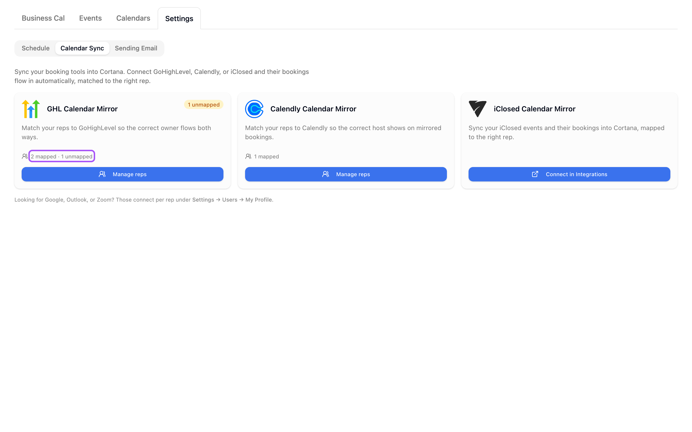
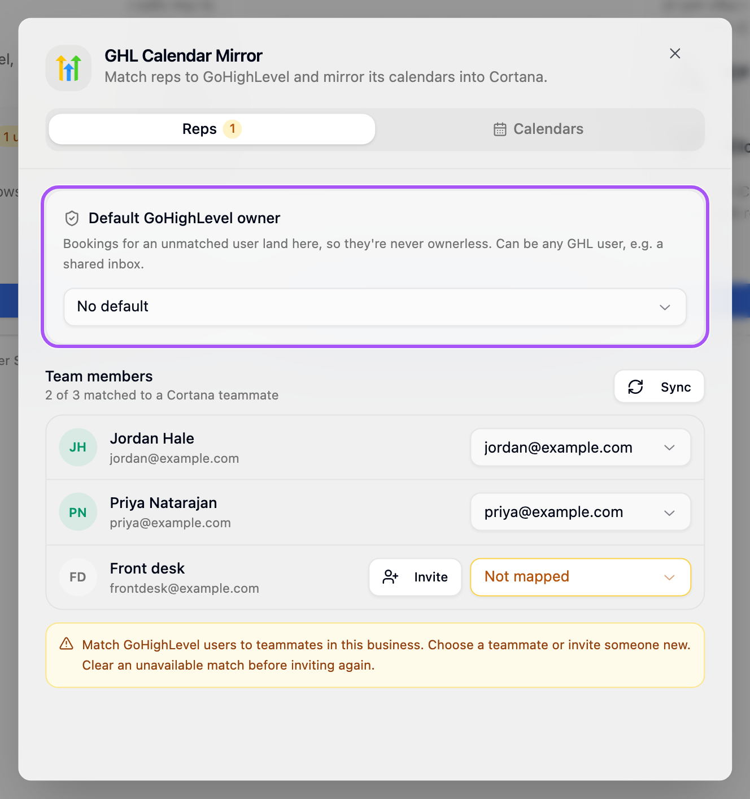

{/* TODO: verify. No Loom walkthrough was supplied for this page. Add the embed and a
    verbatim transcript inside an <Accordion title="Video transcript"> here once recorded. */}

## Overview

Your team may already book calls in GoHighLevel, Calendly, HubSpot or iClosed. **Calendar Sync** joins those tools to Cortana. You then stop having two separate pictures of your calendar.

It does two jobs. Keep them apart in your head.

<CardGroup cols={2}>
  <Card title="Bookings come in" icon="arrow-down-to-line">
    Cortana copies every booking made in the other tool into your calendar and your reports. This happens on its own. The booking still lives in the other tool, and that tool is still in charge of it.
  </Card>
  <Card title="Bookings go out" icon="arrow-up-from-line">
    You can point a Cortana booking page at one of those tools. The lead books on your Cortana page. The meeting itself gets created over in GoHighLevel, Calendly, HubSpot or iClosed, with the lead's answers on it.
  </Card>
</CardGroup>

To find this page, go to **Appointments → Settings → Calendar Sync**. This is a different Settings to the one in the main left sidebar.

<Note>
  **Two words you will see on this page.**

  **GHL** is short for **GoHighLevel**. The product uses both names.

  A **mirror** is Cortana's copy of a calendar in another tool. When Cortana mirrors a calendar, it makes its own copy, brings over its questions, and keeps copying the bookings across. The other tool still owns the hours and who takes the call. The questions are yours to change: see [What comes over with each calendar](#3-what-comes-over-with-each-calendar).
</Note>

<Note>
  **Google, Outlook and Zoom are not on this page.** Each person connects those alone, under **Settings → Users → My Profile**. They are that one person's own calendar and video account. GoHighLevel, Calendly, HubSpot and iClosed get connected once for the whole business, so they live here instead.
</Note>

<Note>
  **HubSpot works a little differently.** It has no card on this page. Each HubSpot meeting link becomes its own Cortana calendar once HubSpot is connected. [HubSpot calendars](#9-hubspot-calendars) covers it.
</Note>

---

## 1. Connect a Tool

You connect the tool on the business **Integrations** page, not here. Go to **Settings → Integrations**. Find GoHighLevel, Calendly, HubSpot or iClosed. Click **Connect**, then sign in to that tool when it asks you.

Now come back to **Appointments → Settings → Calendar Sync** to manage it.

Each tool then shows up here as its own card.

<Frame caption="The Calendar Sync tab. Each card shows how many of your team have been matched to that tool.">
  
</Frame>

A tool you have not connected yet shows **Connect in Integrations**. Click that to go and connect it. A connected card shows how many of your team have been matched, plus a **Manage reps** button.

---

## 2. What Happens After You Connect

This part runs on its own. It is **not instant**. Knowing the timing saves you a support ticket.

<Steps>
  <Step title="Cortana copies the tool's calendars, within about two hours">
    Cortana checks the other tool every two hours. On the next check after you connect, it creates one Cortana calendar for every calendar in the other tool. In Calendly these are called event types. In HubSpot they are meeting links. Seven calendars in GoHighLevel gives you seven copies here.

    Nothing shows up the moment you connect. If you look straight away and see nothing, that is normal.
  </Step>

  <Step title="Or press Pull, if you don't want to wait">
    Open **Manage reps → Calendars** and click **Pull**. This does the same job right now. It then tells you how many it found, for example *Pulled 7 calendar(s)*. HubSpot has no **Pull** button, so its calendars arrive on the next check.
  </Step>

  <Step title="From then on, bookings arrive on their own">
    Once the copies exist, new bookings come across with no action from you.

    | Tool | How fast a new booking shows up in Cortana |
    | --- | --- |
    | **GoHighLevel** | Straight away. Cortana also double-checks every 15 minutes, in case one gets missed. |
    | **Calendly** | Straight away. Cortana also double-checks every 5 minutes, in case one gets missed. |
    | **iClosed** | Cortana checks every 5 minutes, so a booking can take up to 5 minutes. |
    | **HubSpot** | Cortana checks every 5 minutes, so a booking made on HubSpot's own page can take up to 5 minutes. |
  </Step>
</Steps>

<Warning>
  **Bookings made before you connected do not come across.** Cortana only looks about one day into the past. Calls booked earlier than that stay in the other tool only. It does look 90 days ahead, so meetings already in the diary for the coming weeks do come across.
</Warning>

<Note>
  **The other tool still runs the calendar.** These copies arrive with rescheduling and cancelling switched off. Leads are sent to the other tool to change their booking. Change the hours, the meeting length and the reminders in the tool the calendar came from.

  The questions are different. They come over from the other tool and keep following it until you edit them in Cortana. [The next section](#3-what-comes-over-with-each-calendar) explains how.

  Renaming a calendar in the other tool does **not** rename the Cortana copy. The copy keeps the name it started with.
</Note>

---

## 3. What Comes Over With Each Calendar

A calendar does not arrive empty. Cortana brings over what the lead sees on the other tool's own booking page, so your Cortana page asks the same things.

### The questions

Each calendar comes over with its questions. The wording, the answer choices, the order, and whether each one must be answered all match the other tool.

| Tool | What your Cortana calendar asks |
| --- | --- |
| **GoHighLevel** | The questions on the form the calendar uses in GoHighLevel. Name, email and phone fill in the person's record. Questions tied to a GoHighLevel custom field stay tied to that field. A calendar with no form in GoHighLevel keeps Cortana's built-in name, email and phone page, which is what GoHighLevel asks too. |
| **Calendly** | Name and email, then each question switched on in Calendly, in Calendly's order. A phone number is asked only when Calendly asks for one. A question with an "other" box gets an **Other** choice. |
| **iClosed** | Two pages, like iClosed's own page. Page one asks the contact details with iClosed's wording. Page two asks the rest of the questions. Email is always asked, because iClosed needs it to take a booking. |
| **HubSpot** | First name, last name and email, then the meeting link's own questions, then any consent boxes as Yes or No questions. |

<Note>
  **Imported questions stay in sync until you edit them.** Cortana re-reads them every time it checks the other tool. Change a question in GoHighLevel, Calendly or iClosed and your Cortana calendar follows.

  The moment you edit the questions in Cortana, Cortana keeps your version. It never writes over your changes again.

  Two GoHighLevel calendars that use the same GoHighLevel form also share one form in Cortana. Editing it changes it on both, the same as [two calendars sharing one form](/cal-calendars#3-build-the-booking-form).
</Note>

### Calendars you already had

Calendars that came over before this existed get their questions filled in on their own, over the next few checks. That happens only when the calendar has no questions yet and nobody has booked on its Cortana page.

A calendar with questions you already set up in Cortana is left alone.

A calendar that has no questions but **has** already taken bookings on its Cortana page is not changed on its own. Open it, go to the **Questions** tab, and click **Import questions from GoHighLevel**, **Import questions from Calendly** or **Import questions from iClosed**. The button reads *Importing questions…* while it works, then *Questions imported from* the tool.

If there is nothing to bring over, the button tells you why. For example, a GoHighLevel calendar that only asks for a name, email and phone has nothing more to import.

### The screen after booking

What the other tool shows after a lead books comes over too.

- **GoHighLevel**: the redirect page, or the thank-you message, set on the calendar in GoHighLevel.
- **iClosed**: the outside page iClosed sends people to after booking. If iClosed shows its own confirmation page instead, your Cortana page shows Cortana's confirmation.
- **HubSpot**: the page the meeting link sends people to after booking.

It keeps following the other tool. If you set your own screen in **Ending rules**, yours wins.

### The calendar type

Calendars from GoHighLevel, Calendly and HubSpot start on the **Standard** calendar type: times first, then the questions. That is the order those tools use. Calendars from iClosed start on **Application + Cal**: every question first, then the times. That is the order iClosed uses.

Calendars you already had keep the type they were on. You can change any of them under **Questions → Calendar → Calendar type**. [The three calendar types](/cal-calendars#the-three-calendar-types) compares them.

---

## 4. Match Your Team to the Other Tool

People skip this step. It decides whether bookings land on the right person, so do not skip it.

<Steps>
  <Step title="Open the matching screen">
    Click **Manage reps** on a connected card. Reps are the people on your team who take the calls. The window has two tabs, **Reps** and **Calendars**.

    <Frame caption="Rep matching. Anyone not matched falls back to the default owner instead of having no owner at all.">
      
    </Frame>
  </Step>

  <Step title="Set a default owner first">
    **Default owner** catches anyone you have not matched. A booking then always has someone's name on it. Pick any user from the other tool. A general account such as "Sales Team" works fine here.

    Set this before you do anything else. It is your safety net.
  </Step>

  <Step title="Match each person">
    Under **Team members** you will see a count such as *2 of 3 mapped to a Cortana rep*. Below that you get every user from the other tool, with their email address.

    Cortana pairs people up for you when the email address is exactly the same in both tools. When it is not the same, nothing breaks. Just pick the right person from the dropdown yourself. The two email addresses do not have to match.

    Added someone new in the other tool? Click **Sync** to bring the list up to date.
  </Step>

  <Step title="Check the Calendars tab">
    Click **Calendars** and read the list. Check that every booking calendar you care about is on it. Every calendar shown is being copied into Cortana. There is nothing to switch on here. The list is only there to reassure you.
  </Step>
</Steps>

---

## 5. Take Bookings Straight Into Another Tool

You can also point a Cortana booking page **at** one of these tools. Cortana becomes the front door. The meeting itself gets created in the tool your team already works from.

This is worth doing when your team lives in GoHighLevel all day. You still get a branded booking page with your own questions, lead scoring and ad tracking in front of it.

<Steps>
  <Step title="Open the calendar and go to Details">
    Go to **Appointments → Calendars**. Open the booking calendar you want. Stay on the **Details** tab.
  </Step>

  <Step title="Change the Calendar setting">
    Under **Calendar**, change **Cortana Calendar** to **Go High Level**, **Calendly** or **iClosed**. A tool you have not connected is greyed out. A note next to it tells you to connect it in Integrations first.

    **HubSpot** is on the list too, but only a calendar that came over from HubSpot can use it. On any other calendar it is greyed out with *HubSpot calendars come over from HubSpot: open the one for the meeting link you want.*
  </Step>

  <Step title="Pick the exact calendar to book into">
    A second dropdown shows up. It lists the real calendars in that account, fetched fresh. Choose the one the meeting should be created in.

    You have to pick one. Cortana blocks you from saving without it. You will see a message such as *Select a GoHighLevel calendar for this booking calendar.*
  </Step>
</Steps>

### What changes once a page is pointed at another tool

| What | Who looks after it now |
| --- | --- |
| The times the lead can pick from | The other tool. Cortana asks it for free times as the lead is looking. |
| Working hours, gaps between calls, and taking turns | The other tool. Cortana hides its own **Availability** tab and shows a "Managed by" panel instead. |
| Who the meeting is given to | The other tool, unless your **Ending rules** pick a person. GoHighLevel and iClosed can follow those rules. Calendly and HubSpot always pick the person themselves. |
| Your questions, lead scoring and rules | Cortana. These stay on the booking page as normal. |
| The lead's answers | Both. Cortana keeps them, and sends them to the other tool with the booking. See [Answers go back to the other tool](#6-answers-go-back-to-the-other-tool). |
| Confirmation email, calendar invite, reminders | **The other tool.** Cortana does not send any of these for these bookings. |
| Ad tracking and reporting | Cortana, the same as on any of its own booking pages. |

<Warning>
  **If Cortana cannot reach the other tool, the booking page shows no times at all.** It will not quietly use Cortana's own hours instead. A time the other tool has not agreed to could double-book the person taking the call. So an empty booking page usually means the other tool is down, or your connection has stopped working.
</Warning>

<Note>
  **Some Calendly accounts finish on Calendly's own page.** On those plans, Calendly does not let Cortana create the booking for you. The lead is passed to Calendly to pick their time there. They still answer your Cortana questions first.
</Note>

---

## 6. Answers Go Back to the Other Tool

When a lead books on a Cortana page that books into another tool, their answers go with the booking. Your team sees them where they already work.

| Tool | Where the answers show up |
| --- | --- |
| **Calendly** | On the booking in Calendly, next to each question, the same as if the lead had booked on Calendly's own page. |
| **iClosed** | On the call in iClosed, next to each question. |
| **GoHighLevel** | In the appointment's description. Each answer is a line, *Question: answer*, in the order of your form. Name, email and phone are left out, because they are already on the contact. Answers tied to a GoHighLevel custom field still fill that field on the contact too. |
| **HubSpot** | With the booking in HubSpot, on the fields the meeting link asks for. |

<Note>
  **Calendly and iClosed only take answers to their own questions.** Only questions that came over from Calendly or iClosed are sent back. A question you add yourself in Cortana has no place to go in those tools. Its answer stays on the person's record in Cortana.

  The booking always comes first. If the other tool refuses an answer, Cortana books the meeting without it and keeps the answer in Cortana.

  On Calendly, if a question Calendly requires has no answer, the lead finishes on Calendly's own page instead.
</Note>

---

## 7. What Each Tool Can and Cannot Do

The three tools do not all do the same things. Read this table before you decide which one to send bookings through.

| Question | GoHighLevel | Calendly | iClosed | HubSpot | Google / Outlook |
| --- | --- | --- | --- | --- | --- |
| **Who connects it** | Once, for the whole business | Once, for the whole business | Once, for the whole business | Once, for the whole business | Each person connects their own account |
| **Bookings made there show up in Cortana** | Yes, all of them | Yes, all of them | Yes, all of them | Yes, on the meeting links Cortana copied | No. These are personal calendars, not booking tools, so there is nothing to pull in. |
| **Questions come over** | Yes | Yes | Yes | Yes | Not applicable |
| **The lead's answers go back** | Yes, in the appointment's description | Yes, on the booking | Yes, on the call | Yes, with the booking | Not applicable |
| **A Cortana page can book into it** | Yes, pick it in **Details** | Yes, pick it in **Details** | Yes, pick it in **Details** | Yes, on the calendar Cortana made for each meeting link | No. Cortana adds the meeting to your calendar so you see it, but leads cannot pick a time from it. |
| **You must match your team to their users** | Yes, in **Manage reps** | Yes, in **Manage reps** | Yes, in **Manage reps** | No. Cortana matches HubSpot's people to your team by email. | No. Each person connects their own account, so Cortana already knows whose calendar it is. |
| **Cortana can send a booking to one named person** | Yes, set it in **Ending rules** | No. Calendly picks the person itself. | Yes, set it in **Ending rules**, once the rep is matched in **Manage reps** | Only by sending the lead to that rep's own HubSpot meeting link | No. Leads never book on these calendars directly. |
| **Cancelling in Cortana also cancels it there** | Yes, straight away | No. You have to cancel in Calendly too. | No. You have to cancel in iClosed too. | No. Move or cancel it in HubSpot. | Yes, the meeting is removed from your calendar. |
| **Hides times you are already busy** | No. It does not check your personal calendar. | No. It does not check your personal calendar. | No. It does not check your personal calendar. | Shows the open times HubSpot gives for the link. | Yes. Cortana reads your meetings and hides those times from leads. |

<Warning>
  **With Calendly and HubSpot you cannot choose who a booking goes to.** Those tools decide that themselves, using their own settings.

  This matters if you use rules to send leads to certain people. Open **Ending rules** on a Calendly or HubSpot calendar. **Book with a team member** and **Book with a team pool** are greyed out there. Cortana says why, next to them. Need to send a lead to one named person? On Calendly or HubSpot, use **Book a different event** and send them to that person's own calendar. Or use GoHighLevel, iClosed or a Cortana booking calendar.
</Warning>

<Warning>
  **Cancellations and changes of time made in Cortana only reach GoHighLevel.** Say a lead cancels a Calendly or iClosed booking using a link Cortana sent them. Cortana marks it cancelled, but Calendly or iClosed still think the call is going ahead. The lead may still get a reminder from them, and the time stays blocked. So cancel it in that tool as well. Do this whether you cancelled it or the lead did.
</Warning>

---

## 8. iClosed: Who Gets the Call

An iClosed calendar can follow two sets of routing rules: yours in Cortana, and the ones you already built in iClosed.

### Your Cortana rules

**Book with a team member** and **Book with a team pool** work on iClosed calendars. A rule can send a lead to one closer, or to a group of closers.

<Steps>
  <Step title="Match each rep to their iClosed user">
    Go to **Appointments → Settings → Calendar Sync**. Click **Manage reps** on the **iClosed Calendar Mirror** card. Pick the Cortana rep for each iClosed user. Click **Sync iClosed users** if a closer is missing from the list.
  </Step>

  <Step title="Add the rule">
    Open the iClosed calendar. Go to **Questions → Ending rules** and add a rule with **Book with a team member** or **Book with a team pool**.

    A rep who is not matched to an iClosed user shows **Not linked** and cannot be picked.
  </Step>
</Steps>

The lead then only sees the times that closer is free, and the call is booked with that closer.

On the **Standard** calendar type the lead picks a time before answering, so the closer is a preference, not a promise. Cortana books that closer if they are still free at that time, and lets iClosed pick if not. [The warning under Ending rules](/cal-calendars#5-route-people-with-ending-rules) explains why.

If iClosed no longer knows a closer, the lead sees the calendar's normal times and iClosed picks who takes the call. The booking is never lost.

### Your iClosed rules

A calendar that came over from iClosed with its questions also follows the rules you built in iClosed: its disqualify rules and its routing rules. You do not need to build them again in Cortana.

- **Disqualified in iClosed**: the lead sees iClosed's disqualify message. If iClosed sends disqualified leads to a page, they go there.
- **Routed in iClosed**: the lead sees the times of the closers iClosed picked, and the call is booked with them. On **Standard** this is a preference, the same as your Cortana rules.

Your Cortana rules come first. When a Cortana rule turns the lead away, sends them to another page or calendar, or picks a closer, iClosed's rules are not asked. A rep's own booking link also wins.

<Note>
  **iClosed's rules need the lead to be an iClosed contact.** When the lead finishes the questions, Cortana finds them in iClosed by email, or adds them as a new contact. iClosed's own booking page does the same. So a lead who answers but never books still shows up in iClosed as a contact.

  If iClosed cannot be reached, the lead is never turned away. They see the calendar's normal times and can book.
</Note>

---

## 9. HubSpot Calendars

Connect HubSpot, and your HubSpot meeting links become Cortana calendars. Your Cortana page shows HubSpot's real open times and books straight into HubSpot.

### Connect HubSpot

Go to **Settings → Integrations** and click **Connect** on the **HubSpot** card. Sign in and approve the access. [Connecting HubSpot](/1-connect-integrations#connecting-hubspot) shows each step.

### What you get

<Steps>
  <Step title="One Cortana calendar for each meeting link">
    Within about two hours, every meeting link in your HubSpot account shows up under **Appointments → Calendars**. That includes each rep's personal link, so each rep gets a calendar of their own.

    Each calendar comes with the link's name, its meeting length, its questions, and the page HubSpot sends people to after booking. HubSpot's people on the link are matched to your Cortana team by email. New HubSpot calendars start on the **Standard** calendar type.
  </Step>

  <Step title="The calendar books into HubSpot">
    Open one of these calendars. Under **Details → Calendar** it reads **HubSpot**, and **HubSpot Meeting Link** shows the link it books into, with its kind: **Personal**, **Round robin** or **Group**. The link is shown, not changed: each HubSpot calendar always books into its own link.

    A **Managed by HubSpot** card takes the place of the hours, the scheduling rules and the team. Those come from the meeting link, so you change them in HubSpot.
  </Step>

  <Step title="Share the Cortana link">
    Share the calendar's Cortana booking link the usual way. Leads see HubSpot's open times, answer your questions, and book.

    The meeting is created in HubSpot, on the host's calendar, with the contact. The answers go with it. Cortana tracks which ad the lead came from, the same as on any Cortana page.
  </Step>
</Steps>

### Meetings booked on HubSpot's own page

Meetings booked on HubSpot's own page for these links show up in **Appointments** too. Cortana checks HubSpot every 5 minutes. When a meeting is moved or cancelled in HubSpot, Cortana follows.

### Moving and cancelling

HubSpot meetings are moved and cancelled in HubSpot. HubSpot calendars arrive in Cortana with rescheduling and cancelling switched off. Leads use the links in HubSpot's confirmation email.

A lead who opens a Cortana move or cancel link for a HubSpot meeting sees *This meeting is booked in HubSpot, so it can only be moved there. Use the reschedule link in your HubSpot confirmation email.*

### Sending a lead to one rep

Inside a round-robin meeting link, HubSpot picks the host. So **Book with a team member** and **Book with a team pool** are greyed out on HubSpot calendars, the same as on Calendly.

To send a lead to one rep, send them to that rep's own calendar. Every HubSpot meeting link is its own Cortana calendar, so each rep's personal link is one.

<Steps>
  <Step title="Open Ending rules on the calendar the lead starts on">
    Go to **Questions → Ending rules** and click **Add rule**.
  </Step>
  <Step title="Pick Book a different event">
    Under **Then**, pick **Book a different event**. Choose the Cortana calendar for that rep's personal HubSpot meeting link.
  </Step>
</Steps>

---

## Troubleshooting

<AccordionGroup>
  <Accordion title="I connected the tool but no calendars appeared">
    This is normal for up to two hours. Cortana copies calendars across every two hours, and connecting does not start that off. Do not want to wait? Open **Manage reps → Calendars** and click **Pull**.
  </Accordion>

  <Accordion title="Bookings are all landing on one person">
    That person is set as your **Default owner**, and you have not matched the rest of the team yet. Open **Manage reps**. Pick the right Cortana person for each user in the list.
  </Accordion>

  <Accordion title="Someone shows as Not mapped even though they exist in both tools">
    Cortana only pairs people up on its own when the email address is exactly the same in both tools. Pick that person from the dropdown yourself. The two addresses do not have to match.
  </Accordion>

  <Accordion title="A calendar I just created in the other tool isn't here">
    Cortana picks up new calendars on its two-hourly check, not right away. Click **Pull** to fetch it now.
  </Accordion>

  <Accordion title="Old bookings never came across">
    They will not come across. Cortana only reaches about one day into the past. Anything booked before you connected stays in the other tool only. Meetings already booked for the next 90 days do come across.
  </Accordion>

  <Accordion title="I renamed a calendar in the other tool and Cortana still shows the old name">
    This is normal. A copy keeps the name it started with. Rename it in Cortana too if the difference confuses your team.
  </Accordion>

  <Accordion title="A connected booking page shows no available times">
    Your connection has most likely stopped working. Go to **Settings → Integrations**. A working connection reads **Connected**. A broken one offers **Reconnect**. Click that and sign in again. Cortana shows no times rather than guessing, so the problem is easy to spot instead of double-booking someone.
  </Accordion>

  <Accordion title="I cancelled in Cortana but the lead still has the meeting">
    This is normal for Calendly and iClosed. Go and cancel it in that tool too.
  </Accordion>

  <Accordion title="My imported calendar stopped following the other tool's questions">
    You edited its questions in Cortana. From then on Cortana keeps your version and never writes over it. Make further changes in Cortana.
  </Accordion>

  <Accordion title="An imported calendar has no questions, and no Import button">
    Calendars nobody has booked on through Cortana get their questions on their own, on one of the next checks. The **Import questions from** button only shows on calendars that already took bookings on their Cortana page.
  </Accordion>

  <Accordion title="A rep shows Not linked on an iClosed calendar">
    That rep is not matched to an iClosed user yet. Open **Calendar Sync → iClosed Calendar Mirror → Manage reps** and pick them next to their iClosed user.
  </Accordion>

  <Accordion title="A HubSpot calendar says its meeting link was removed">
    The link was deleted in HubSpot, so that calendar cannot take bookings. Each HubSpot meeting link has its own calendar. Open the one for the link you use now.
  </Accordion>

  <Accordion title="A HubSpot calendar says HubSpot isn't connected">
    Go to **Settings → Integrations** and connect HubSpot again. Until then the calendar cannot take bookings.
  </Accordion>
</AccordionGroup>

---

## FAQ

<AccordionGroup>
  <Accordion title="Do I have to use any of these?">
    No. Cortana's own booking calendars work fine on their own. These connections exist for two reasons. Calls booked elsewhere still show up in your reporting. And your team can keep using a tool they already know.
  </Accordion>

  <Accordion title="Is the sync really two-way?">
    Partly. Bookings come **in** from all four tools. A booking made on a Cortana page goes **out** to the tool, with the lead's answers. Changes to an existing booking made in Cortana only go back out to GoHighLevel. Move or cancel Calendly, iClosed and HubSpot bookings in those tools.
  </Accordion>

  <Accordion title="Do I have to rebuild my questions in Cortana?">
    No. GoHighLevel, Calendly, iClosed and HubSpot calendars bring their questions with them. Check them once on the **Questions** tab. Edit them there if you want, and Cortana keeps your version.
  </Accordion>

  <Accordion title="Where do I connect Google Calendar?">
    Go to **Settings → Users → My Profile**. Each person does this for themselves. Once connected, Cortana hides the times you are already busy and adds each booking to your own calendar.
  </Accordion>

  <Accordion title="Can I use a shared inbox as the default owner?">
    Yes. **Default owner** can be any user in the other tool, including a general team account.
  </Accordion>

  <Accordion title="Will a mirrored booking show which ad produced it?">
    You will always see the booking, the person taking the call and the time. Whether Cortana can also name the ad depends on how the lead got there. Came through a Cortana booking page or a tracked link? The ad is recorded. Went straight to a Calendly link from somewhere untracked? The booking shows no ad.
  </Accordion>

  <Accordion title="Can I stop copying one calendar without disconnecting the tool?">
    Yes. Go to **Manage reps → Calendars**. Click **Unsync** on that calendar and confirm. The appointments you already have are kept. Cortana will not create the calendar again on the next check.
  </Accordion>
</AccordionGroup>

---

## Next Steps

<CardGroup cols={2}>
  <Card title="4) Sending Email" icon="envelope" href="/cal-sending-email">
    Send confirmations and reminders from your own domain.
  </Card>
  <Card title="2) Schedule & Working Hours" icon="clock" href="/cal-schedule">
    Set the business timezone and each team member's hours.
  </Card>
</CardGroup>

If any of this does not match what you are seeing, reach out to the support team in the bottom right.
