{/* last-verified: 2026-11-28 (booking page v2: the Calendar panel, the three calendar types, the countdown, routing on Standard, the questions spaced and centred, the embed holding one height while it loads (Calendar Combo too), the test booking) · route: /business/[businessId]/appointments, Calendars tab */}

{/* TODO: verify. No Loom walkthrough was supplied for this page. Add the embed + a
    verbatim transcript inside an <Accordion title="Video transcript"> here once recorded,
    matching the pattern used on platform/business/appointments.mdx. */}

## Overview

**Calendars** is where you build the booking pages people book on.

Each calendar is one kind of meeting. A discovery call. An onsite visit. A support session.

Each one gets its own web address, its own questions, its own hours and its own reminder emails.

You'll find it in the **Appointments** area of your business, on the **Calendars** tab.

By the end of this page you will have a live link. It looks like `https://app.usecortana.ai/your-business/strategy-call`.

Anyone can open that link, answer a few questions, pick a time and book. The booking then shows up in **Business Cal**. The person who booked gets a confirmation email straight away.

<Note>
  **Before you start**

  - Your business must already exist, and you must be signed in to it.
  - Do you want bookings to go to specific people? Then invite them as **team members** first. If you skip this, every booking goes to the business owner. That is fine if you work on your own.
  - Connecting Google, Outlook or Zoom is **optional**. Your calendar works without them. Connecting one only adds calendar invites and video links. You'll find this under **Settings → Calendar Sync**.
</Note>

---

## 1. Create the Calendar

<Steps>
  <Step title="Open the Calendars tab">
    Go to **Appointments** in the left sidebar. Then click the **Calendars** tab.

    You'll see every calendar in the business as a card. Each card shows its colour, its length, how many bookings it has, how many people viewed it, and its web address.

    Click **Add calendar** at the top right.

    <Frame caption="The Calendars tab. Each card is one kind of meeting. Add calendar starts a new one.">
      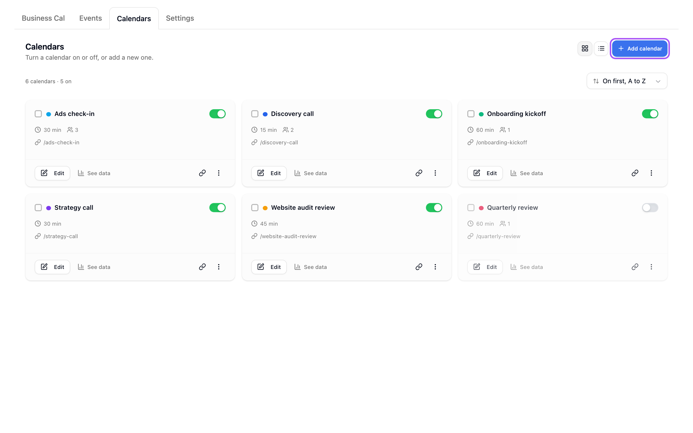
    </Frame>
  </Step>

  <Step title="Give it a title">
    A **Create calendar** dialog opens. It has one **Title** field and the hint *Give it a title. You'll build the form next*.

    Type what you want people to see. For example, `Strategy Call`. Then click **Continue**.

    The title also builds the web address. So keep it short and plain. You can change both later.

    <Frame caption="The Create calendar dialog only asks for a title. You set everything else in the builder.">
      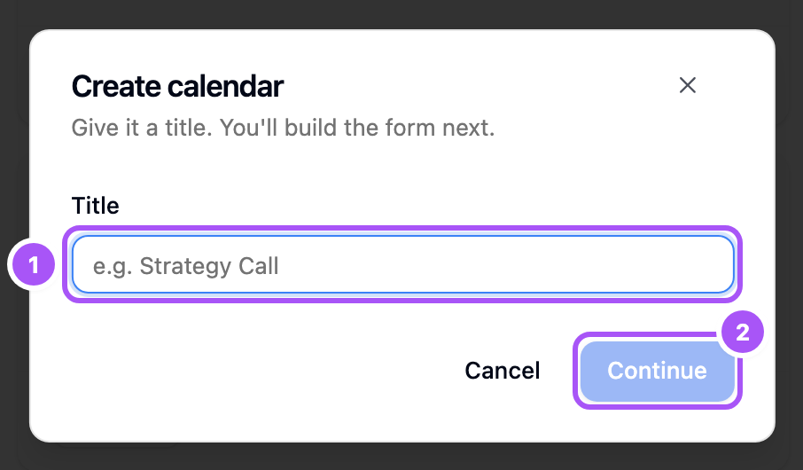
    </Frame>
  </Step>
</Steps>

<Warning>
  **Your calendar goes live the moment you click Continue.** There is no separate publish button.

  Anyone with the web address can book on it right away. They will also see the sample wording covered in Step 3, which is not what you want.

  So finish setting the calendar up before you share the link with anyone.
</Warning>

---

## 2. Set the Details

Clicking **Continue** opens the builder.

It has four tabs. **Details**, **Questions**, **Availability** and **Notifications**. It also has **Share** and **View Site** buttons.

<Tip>
  The button at the top right also tells you whether your work is stored.

  It reads **Saved** when everything is stored. It turns into a blue **Save** button the moment you change something. So if it says **Save**, click it. You have work that is not stored yet.

  The **Ending rules & redirects** panel is separate. It has its own **Cancel** and **Save** buttons.
</Tip>

<Steps>
  <Step title="Check the name, address and description">
    Under **Basic Details** you'll find four things.

    - **Name**: the big heading people see on your booking page.
    - **Event URL**: the last part of your web address. It copies your title until you type over it. After that it stays as you typed it. You'll see the whole address underneath as **Full link**.
    - **Connected domains**: which web address your link uses. `app.usecortana.ai` is marked **default**. Any of your own web addresses show here too. They stay marked **not verified** until you finish the setup with the company you bought them from.
    - **Description**: the text under the title on your booking page. You can format it with the toolbar above the box.

    <Frame caption="Basic Details. The Event URL sets the last part of the address people book on.">
      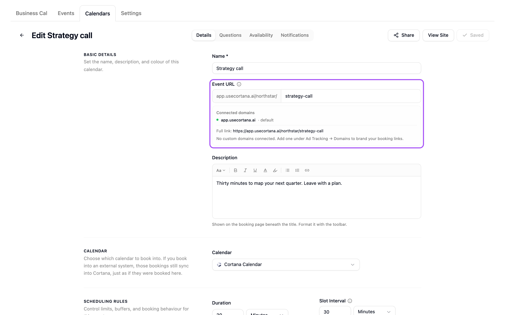
    </Frame>
  </Step>
</Steps>

<Warning>
  **Rewrite the description before you share the link.**

  New calendars come with sample wording. It reads `{Insert short main offer callout}`, then `✅ {Key Outcome 1}`, `✅ {Key Outcome 2}` and `✅ {Key Outcome 3}`.

  This is **not** hidden text. Your customers see it on the live page, word for word. Delete it and write your own.
</Warning>

<Steps>
  <Step title="Choose which calendar to book into">
    Under **Calendar**, pick where each booking should be created.

    **Cortana Calendar** is the normal choice. It means Cortana decides your free times and stores the booking.

    You can pick another booking system instead. Then that system decides your free times and stores the booking. The booking still shows up in Cortana, exactly as if it had been made here.

    If you pick another system, the **Scheduling Rules**, **Distribution & Team** and **Availability** settings disappear. That system controls them now, so there is nothing for you to set here.
  </Step>

  <Step title="Set the scheduling rules">
    **Scheduling Rules** set your limits, your gaps between meetings, and what people can do after booking.

    Each box with a number in it has its own dropdown next to it for minutes, hours or days.

    <Frame caption="Scheduling Rules and Distribution & Team, showing the settings every new calendar starts with.">
      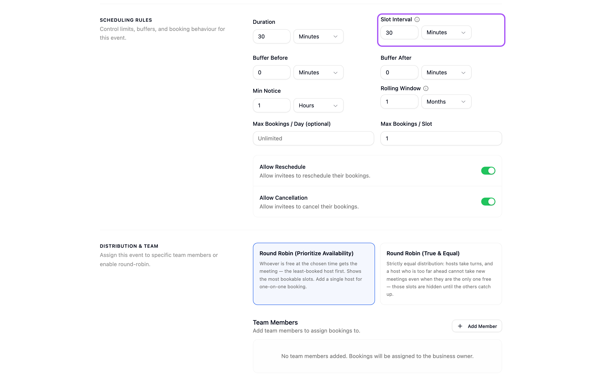
    </Frame>

    The [Scheduling rules reference](#scheduling-rules) further down explains every box and what we suggest you put in it.
  </Step>

  <Step title="Choose how bookings are shared out">
    **Distribution & Team** decides who takes each meeting.

    - **Round Robin (Prioritize Availability)** *(the normal choice)*: the meeting goes to whoever is free at that time. If more than one person is free, the one with the fewest bookings gets it. This shows people the most times to choose from. **If you take all the calls yourself, add only yourself here.**
    - **Round Robin (True & Equal)**: everyone takes an exactly equal share. Your team takes strict turns. If one person is too far ahead, they cannot take a new meeting, even when they are the only one free. Those times stay hidden until the others catch up.

    Click **Add Member** to pick who takes the calls.

    Add nobody and the panel reads *No team members added. Bookings will be assigned to the business owner.*

    <Frame caption="Distribution & Team. Add nobody and every booking goes to the business owner.">
      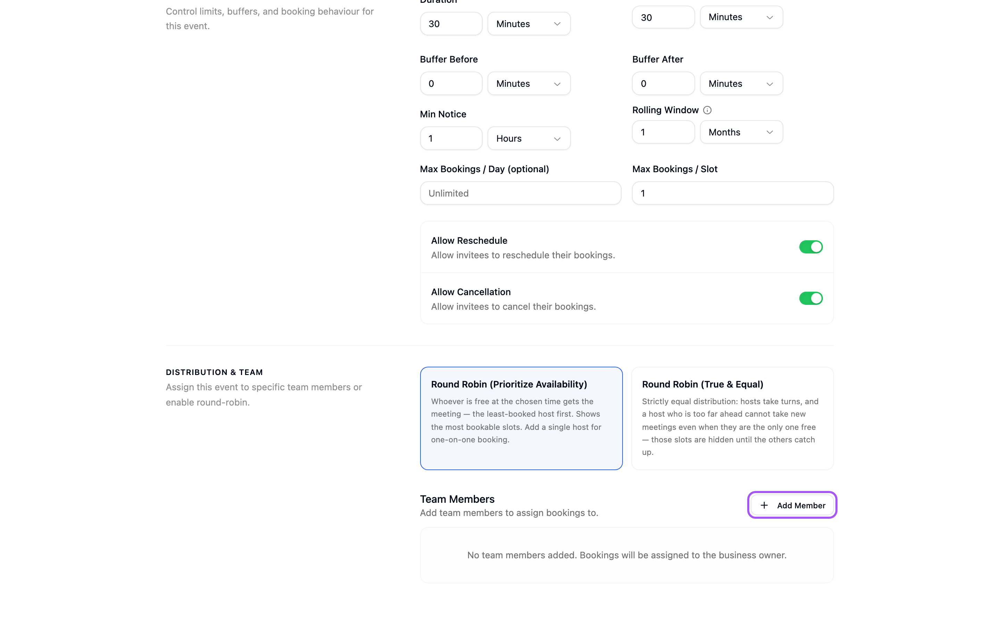
    </Frame>
  </Step>
</Steps>

---

## 3. Build the Booking Form

<Steps>
  <Step title="Create the form">
    Open the **Questions** tab. A new calendar has no form yet.

    You'll see *A form holds the questions people answer when they book*, and two buttons.

    - **Create a form**: builds a new form named after your calendar. It already asks for **Name**, **Email** and **Phone**, and all three must be filled in.
    - **Select a form**: uses a form you already built on another calendar.

    Click **Create a form**.

    The **Questions** tab is the same builder as [Build your form](/forms-build), with your calendar around it. On the left: your form's card, then each page with its questions and the sentence that says where people go after it, then **Lead routing**: **Conditional logic** opens the Map of your paths, **Ending rules & redirects** opens your rules. In the middle: your booking page, working. On the right: **Calendar** for the page's look, and **Field settings** for one question.

    The middle column opens on **Mobile**, with your booking page drawn inside an iPhone at real phone width, because most people book on a phone. Click **Desktop** beside it to see the page on a computer. Both work on every calendar type.

    <Frame caption="The Questions tab. 1 is the form, 2 says where people go after a page, 3 opens the Map of every path, 4 switches the preview between a phone and a computer.">
      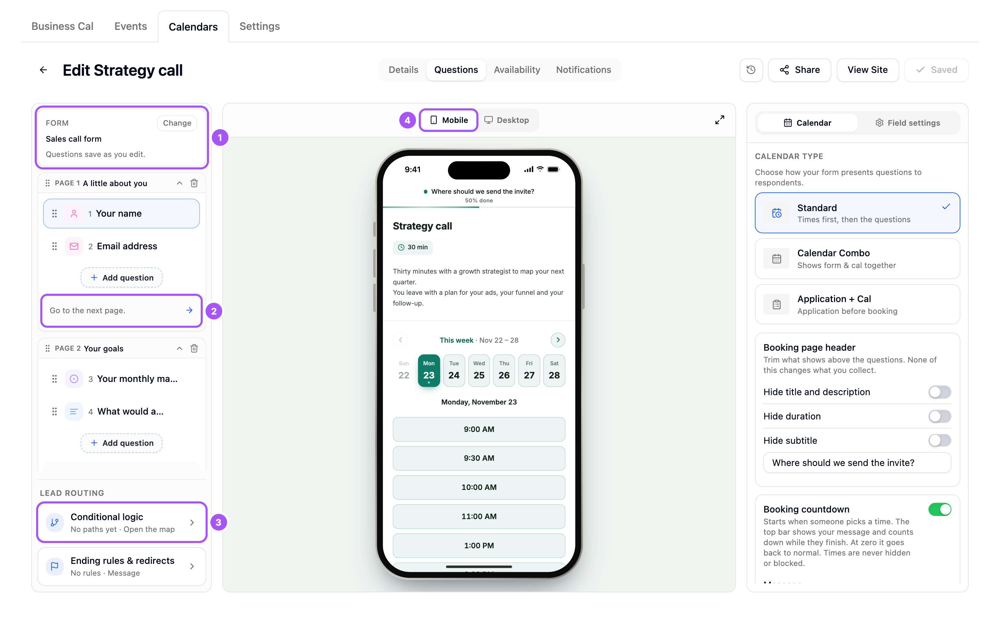
    </Frame>
  </Step>
</Steps>

<Warning>
  **Creating a form also creates an empty Page 2.**

  People have to click past that blank screen before they can pick a time. Some will give up there.

  So either add a question to Page 2, or delete the page.
</Warning>

<Note>
  **Two calendars can use one form.**

  **Select a form** points at the *same* form, not a copy. So editing a question changes it on every calendar that uses that form. The form's card says so, such as *Used by 2 calendars. Edits apply to all.* Click **Change** on the card to point the calendar at another form.

  Copying a calendar works differently. The copy always gets its own private form.
</Note>

<Steps>
  <Step title="Add your qualifying questions">
    Click **Add question** under the page you want the question on.

    The picker is the one the Forms builder uses. It says *Pick what you want to ask for, or one of your custom fields. You can change it later.*

    - **Contact**: the details a booking saves onto the person. Name, First name, Last name, Email, Phone number, Company website, City, State / province, Zip / postal code, Country, and a full Address. A detail the form already asks is not offered twice.
    - **Text**, **Choice**, **Rating**, **Numbers**, **Date and time**, **Upload and sign** and **Display only**: every kind a form can ask, as on [Build your form](/forms-build).
    - **Steps**: **Payment** takes money inside the booking form. **Calendar** says *Where this calendar's time picker sits in the form*: add it to put the time picker on a page of your choosing. Pages after it are asked once the person has booked.
    - **Custom fields**: every question you already made for this business. **Create a new custom field** builds one without leaving this screen.

    Use the search box at the top to find a question fast. You can also type a new name there to create one.

    <Frame caption="The question picker. The Contact group lists the details a booking saves onto the person.">
      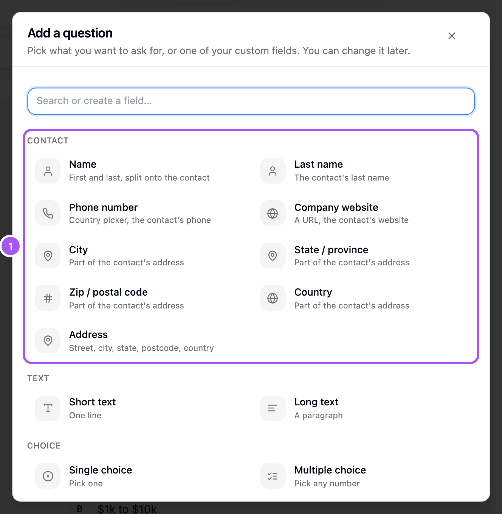
    </Frame>

    <Frame caption="Steps: a Payment inside the booking form, and where the calendar's own time picker sits.">
      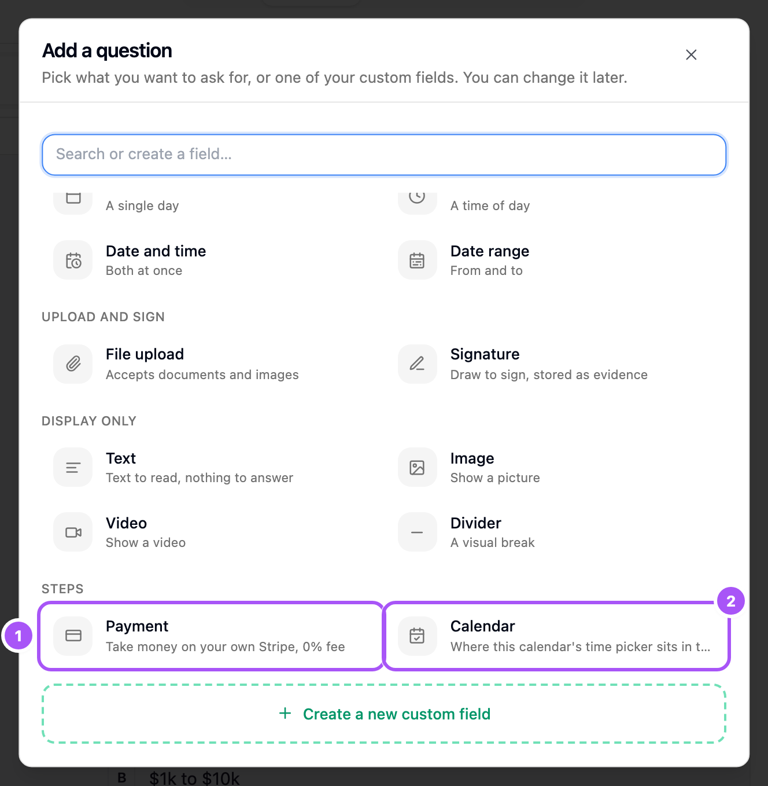
    </Frame>
  </Step>

  <Step title="Send people down different paths">
    A path sends people somewhere other than the next page, based on their answers. It works on a booking page exactly as it does on a form: see [Send people down different paths](/forms-build#7-send-people-down-different-paths).

    Click the sentence under a page, such as *Go to the next page.* In the panel, click **Add a path**. Under **When**, pick the question, the test and the answer. Under **Then**, pick a page or an ending. Under **Otherwise**, pick where everyone else goes.

    On a booking page this lets you:

    - End the form before the calendar for people who do not qualify, on an ending of their own, such as a message or your free guide.
    - Send "pay now" people to a **Payment** page, and "book a call" people to the time picker.
    - Ask some pages only of the people who need them.

    <Frame caption="A path on a booking form. People under $1k end on Not a fit yet, before they ever see the calendar.">
      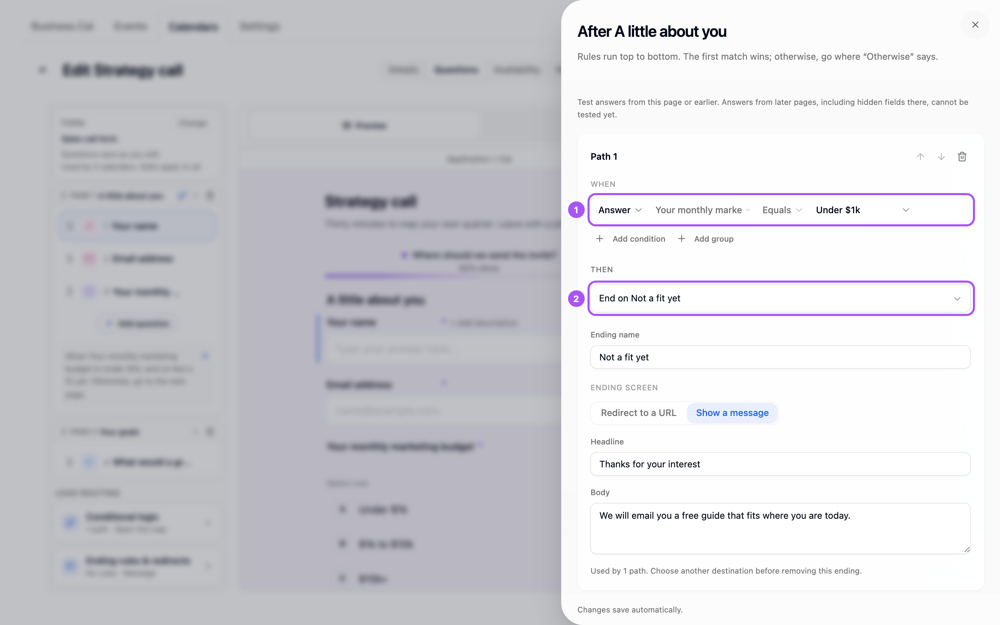
    </Frame>
  </Step>

  <Step title="Style the booking page">
    The panel on the right has two tabs, **Calendar** and **Field settings**. Under **Calendar** you set the look of the whole page, top to bottom.

    - **Calendar type**: **Standard** sits first and shows the times first, then the questions. **Calendar Combo** shows the questions and the calendar side by side. **Application + Cal** asks every question first, then shows the calendar. A new calendar starts on **Standard**. [The three calendar types](#the-three-calendar-types) below compares them.
    - **Booking page header**: the panel says *Trim what shows above the questions. None of this changes what you collect.* What it offers follows the calendar type.
      - On **Standard**: **Hide title and description** (one switch for both), **Hide duration**, then **Hide subtitle**.
      - On **Application + Cal**: a note, *Application + Cal never shows the title or description, so it reads as an application, not a calendar.*, then **Hide subtitle**.
      - On **Calendar Combo**: **Hide title**, then **Hide subtitle**.
      - **Hide subtitle** is always last. While the subtitle shows, its box sits right under it, already filled with the words the page uses, in the page's language: *Where should we send the invite?* in English. Type over them to change them. Empty the box and leave it, and the standard words come back.
    - **Booking countdown**: a switch, the **Message** the top bar shows (already filled with *Hurry, book now to secure your slot*) and its **Length**. [The booking countdown](#the-booking-countdown) below shows what people see.
    - **Transition** and **Sticky Contact**, side by side. **Sticky Contact** fills in the details of people who have booked with you before.
    - **Typography**: **Font** and **Size** side by side. The next step covers them.
    - **Colors**: five of them. **Background**, **Text**, **Accent**, **Button** and **Button Text**.
    - **Theme**: six light looks (Sage, Snow, Cream, Azure, Blush, Lavender) and six dark ones (Midnight, Royal, Obsidian, Forest, Ember, Rose).
    - **Button wording**: the word on the button that moves people on. It is already filled with *Continue*. Empty the box and the button shows just the check mark, as its hint says: *Empty shows just the check mark.*
    - **Page language** and **Time format**: the language the page writes its own words and dates in, and 12-hour or 24-hour times.
    - **Reset theme and typography**: puts the shipped look back.
    - **Logo**: a PNG, JPG or WebP image file, up to 2 MB. **Hide "Powered by"** sits under it.

    The business name never shows on a booking page, on any calendar type, so there is no switch for it.

    <Frame caption="The top of the Calendar panel. 1 is the calendar type, 2 the booking page header, 3 the booking countdown.">
      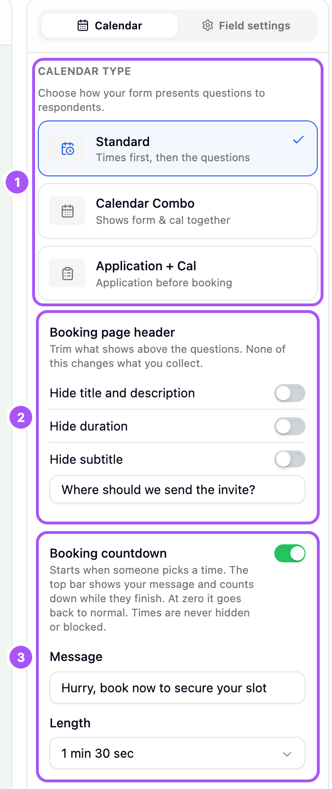
    </Frame>
  </Step>

  <Step title="Pick a font and a text size">
    **Typography** sits above **Colors**, with **Font** and **Size** side by side.

    **Font** gives you seven to choose from: **Inter**, **Roboto**, **Open Sans**, **Lato**, **Poppins**, **Montserrat** and **System**. **System** means the visitor's own device font, the one their phone or computer uses everywhere. A new calendar uses **Inter**.

    **Size** makes all the writing bigger or smaller. Type any number from 12 to 24. It starts at 16. The boxes people type in never go below 16, so phones do not zoom in on them.

    The middle column changes as you type, so you can watch it on **Mobile** and on **Desktop**.

    <Frame caption="Font and Size side by side, then the colours, the Theme tiles and the button's word.">
      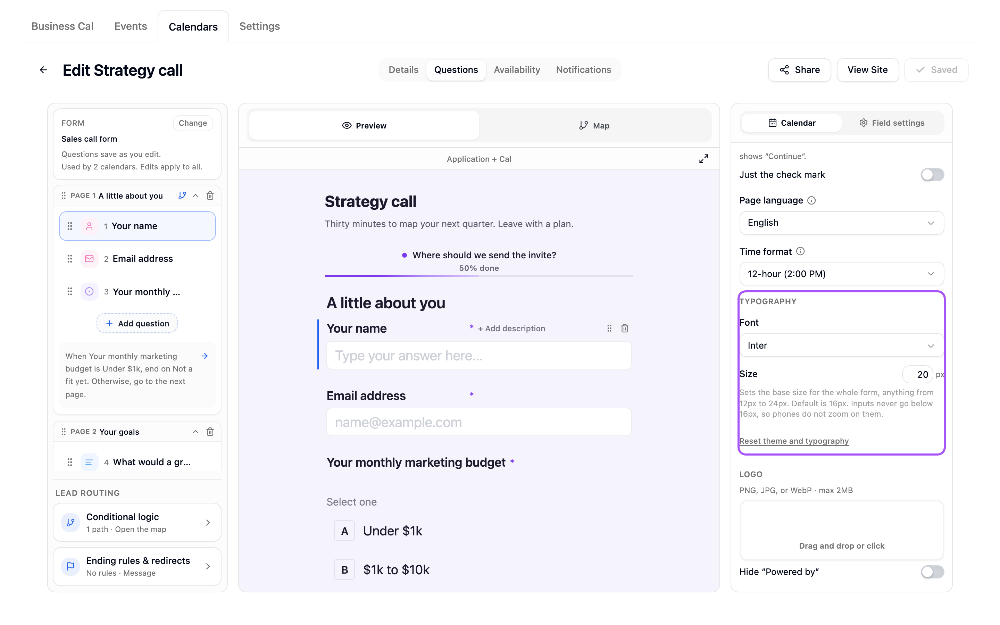
    </Frame>

    Picking a **Theme** tile changes the colours only. It never changes your font or your size.
  </Step>

  <Step title="Make one question bigger, or push it down">
    Every question can break away from the form's size and spacing.

    Click a question, then switch the panel to **Field settings**. Scroll down past the question's own settings to **Text size** and **Space above**.

    Both read **Match form** until you move them. That means the question is following the whole form.

    On **Standard** and **Application + Cal**, **Space above** shows 32 px while the preview is on **Mobile** and 36 px on **Desktop**, at the 16 px size: the room the card leaves between questions. It grows and shrinks with the size. On **Calendar Combo** it shows 20 px.

    Move a handle and the question is on its own. A link then appears to put it back: **Match the form's size**, or **Match the form's spacing**.

    **Space above** replaces the gap above the question, it does not add to it. Set it to 0 and the question sits right against the one above, which is how two short fields read as one pair. On the first question of a page it reads 0, because there is nothing above it.

    <Frame caption="Text size and Space above, on one question. The links put it back to following the form.">
      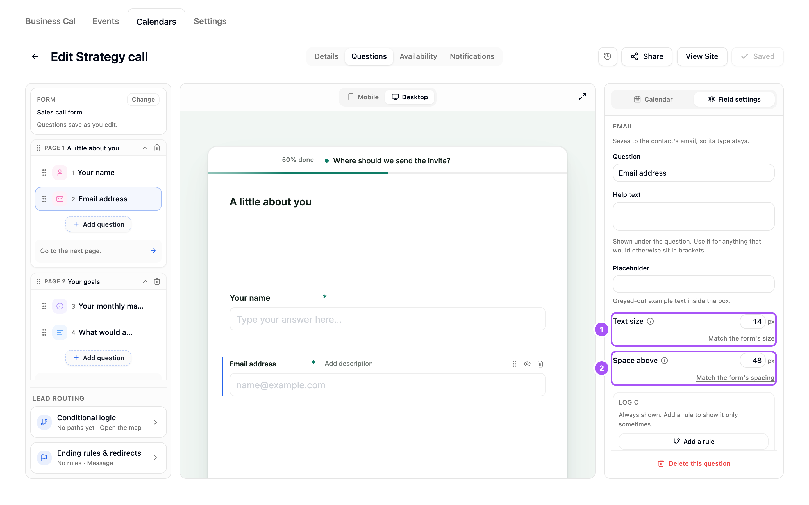
    </Frame>
  </Step>
</Steps>

### The three calendar types

**Calendar type** decides the order people see things in. Pick it in the **Questions** tab, in the **Calendar** panel on the right.

| Calendar type | What people see | Pick it when |
| --- | --- | --- |
| **Standard** | One card split in two: your title, the meeting's length and your description on the left, the times on the right. They tap a time, then tap it again to move on. Then they answer your questions, with the time they picked on the left. The last button, **Book**, books it. | You want the most people to book. Seeing open times first feels like a normal booking page. **Every new calendar starts here.** |
| **Calendar Combo** | The questions and the calendar side by side. The calendar unlocks once the questions are answered. | You want both on one screen. |
| **Application + Cal** | Every question first, then the calendar, in one card. The title and the description never show, so it reads as an application, not a calendar. | You screen people hard before they ever see a time. |

On **Standard**, your **Ending rules** still run. They run when the person presses the last button. A rule that turns a lead away, sends them to another page or sends them to another calendar books nothing. A rule that books one person or a pool keeps the lead with them: see [Routing rules on Standard](#routing-rules-on-standard).

If another lead books that time while the person is typing, they go back to the times and see *That time was just booked. Pick another.* Their answers are kept. They pick a new time and book.

### What people see on Standard

Standard and Application + Cal are drawn as one card in your colours, with a top bar in the same colour as the card. The bar shows the subtitle (*Where should we send the invite?*) and how far along they are, or the countdown while it runs.

**Picking a time, on a computer.** The left of the card holds your title, the meeting's length and your description. The right holds a month calendar beside a column of that day's times, with the timezone underneath. Open days are tinted in your accent colour.

Tapping a time once picks it: **Continue** grows in beside it. Tapping the time or **Continue** again moves them on. There is no separate button to find.

<Frame caption="Standard on a computer. 1 is a picked time with Continue beside it, 2 the top bar, here counting down.">
  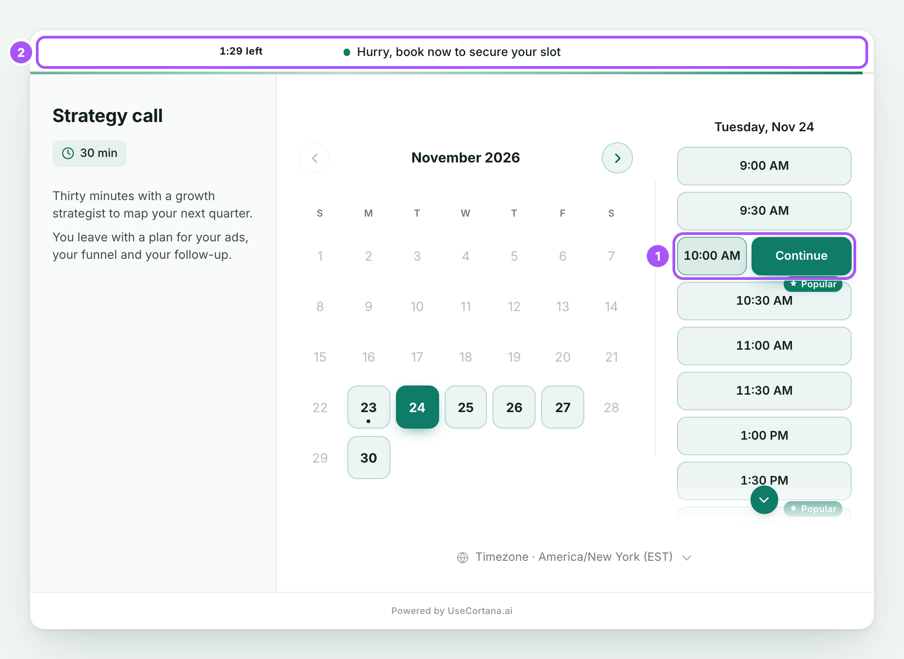
</Frame>

**Answering the questions.** Once they move on, the description steps aside. The left becomes a short summary: the title, the length, the time they picked and **Change**, which takes them back to the times.

A single-choice question that is the last one on its page moves on by itself once they pick an answer, on a phone and on a computer. Typed answers and questions with several answers still need **Continue**, or **Enter**. **Back** is always there.

With the latest update, the questions sit in the middle of the card, between the picked time and the **Back** and **Continue** buttons, with more room between one question and the next. A question's own **Space above**, set in **Field settings**, still wins.

On a computer the card keeps one height for every step, so it never jumps as they move through. A step that is taller scrolls inside the card.

<Frame caption="The questions after the time is picked. 1 is the summary of the picked time, with Change.">
  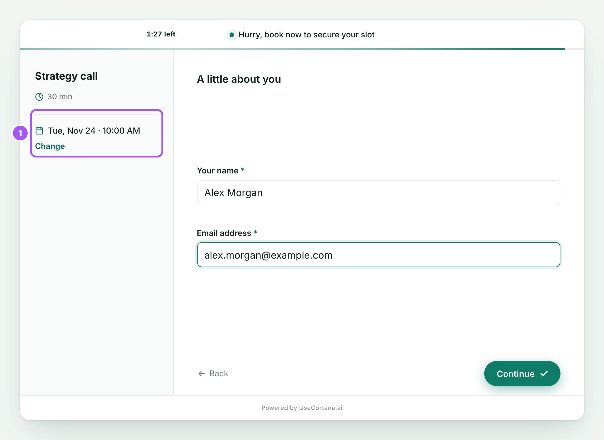
</Frame>

**On a phone.** The card fills the screen. Your title, length and description come first, then a week of days in one row: **This week** with its dates, and arrows on each side for the weeks ahead. Under it sit the day's times, full width and easy to tap. Tapping works the same as on a computer: once to pick, again to go.

<Frame caption="Standard on a phone: a row of days for the week, then the day's times.">
  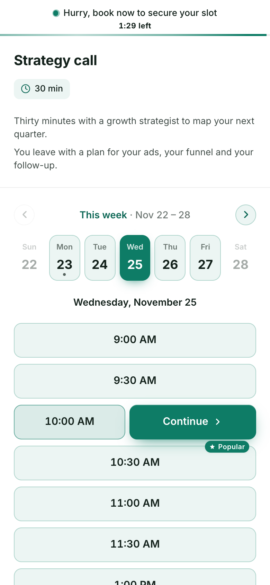
</Frame>

### What people see on Application + Cal

The same card, a little narrower, with no title and no description. People answer one page of questions at a time, with the subtitle and how far along they are in the top bar. After the last page, the calendar opens in the same card.

Answers to a choice question are lettered rows they tap. A single choice at the end of its page moves on by itself, as on Standard. The questions sit in the middle of the card with room between them, as on Standard.

<Frame caption="Application + Cal: no title, no description, one page of questions at a time.">
  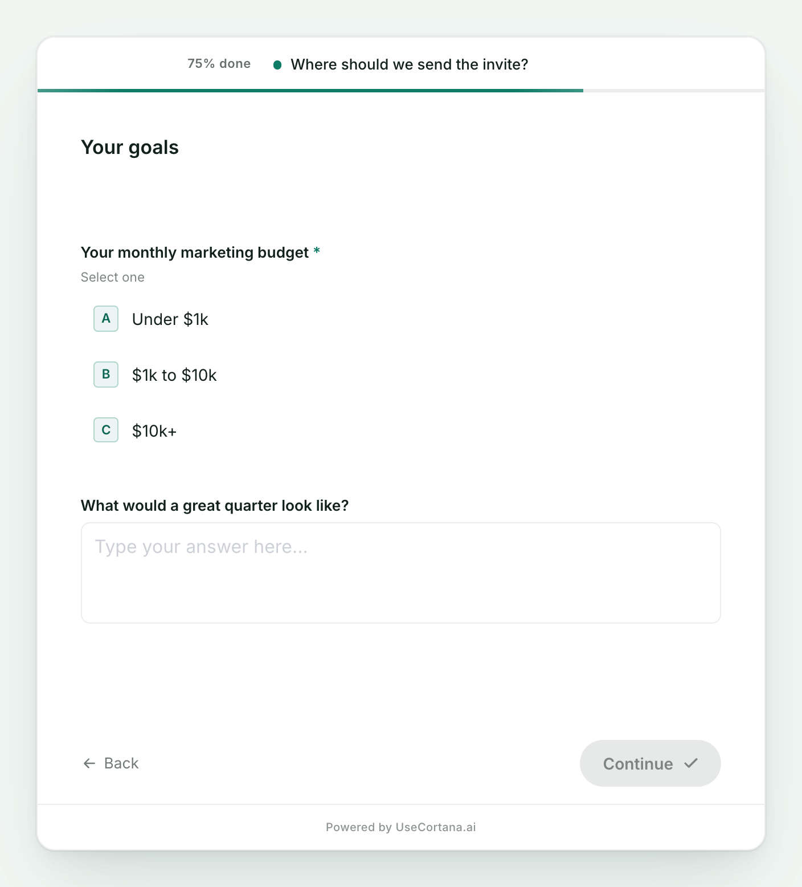
</Frame>

### The booking countdown

Switch on **Booking countdown** in the **Calendar** panel to add a gentle push to book. Choose the **Message** and the **Length**, from 30 seconds to 5 minutes. A new countdown runs for 1 minute 30 seconds.

- **On Standard and Application + Cal** it starts when the person picks a time, and keeps running while they answer.
- **On Calendar Combo** it starts when the times show.

While it runs, the top bar shows your message, a clock such as *1:29 left*, and a line that drains as the time runs out.

With the latest update, the countdown never moves anyone. At zero, the top bar says *Try booking your slot to confirm it's still available.* and stays that way, on every calendar type. Nothing refreshes, the time they picked stays picked, and whatever they are typing stays where it is. The countdown never hides or blocks a time either.

The real check is the booking itself. If someone else took that time in the meantime, the person sees *That time was just booked. Pick another.*, with their answers kept.

<Frame caption="The countdown at zero. 1 is the top bar's message; the picked time and the answers stay.">
  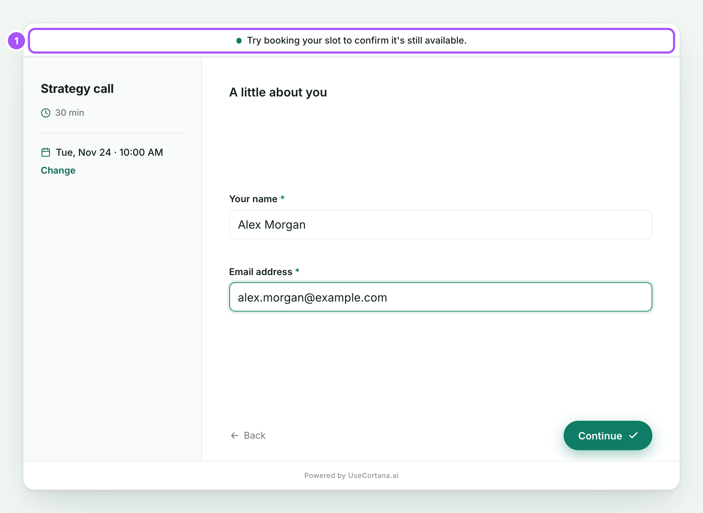
</Frame>

<Note>
  **Calendars you bring in from another tool start on a layout too.** Calendars that come over from GoHighLevel, Calendly or HubSpot start on **Standard**, because those tools also show the times first. Calendars from iClosed start on **Application + Cal**, because iClosed asks its questions first. You can change any of them here. Calendars you already had keep the type they were on. [3) Calendar Sync](/cal-calendar-sync) explains what comes over.
</Note>

<Tip>
  **Duplicate** (in the menu on a calendar card) keeps the calendar type, the whole look (the theme, the colours, the font and the size) and your date overrides. A copy of an imported calendar is a normal Cortana calendar: it does not book into the other tool.
</Tip>

---

## 4. Score Your Leads

Lead scoring puts a number on how good each enquiry is. The number comes from how people answer your questions.

You give points to individual answers. Cortana adds them up when someone books.

Set this up if you want to spot your best enquiries at a glance. It also lets you send your biggest enquiries straight to a senior salesperson.

<Steps>
  <Step title="Open a question's field settings">
    Go to the **Questions** tab. In the form column on the left, click the question you want to score. It opens in the panel on the right.

    Switch that panel from **Calendar** to **Field settings**. Then scroll down to the **Lead score** box, just below the question's choices.

    Only four kinds of question can be scored: **single select**, **multi-select**, **dropdown** and **number**.

    If the box shows a sentence instead of number boxes, that kind of question cannot hold points. Pick a different question.
  </Step>

  <Step title="Give the answers points">
    **For questions with set answers**, you get one row per answer, each with a small number box. Type in what each answer is worth.

    Leave it blank or type `0` and that answer adds nothing. You can also type a minus number for answers you do not want.

    Say you ask about budget. You could score `Under $1k` as `0`, `$1k to $5k` as `10`, and `$5k+` as `25`.

    **For questions that take a number**, you build ranges instead. Each range has a lowest number, a highest number, and the points. Leave the lowest or the highest blank to leave that end open.

    The first range that fits wins. So put your narrowest range at the top, and never let two ranges overlap.

    <Frame caption="Field settings for a Budget question, with points next to each answer.">
      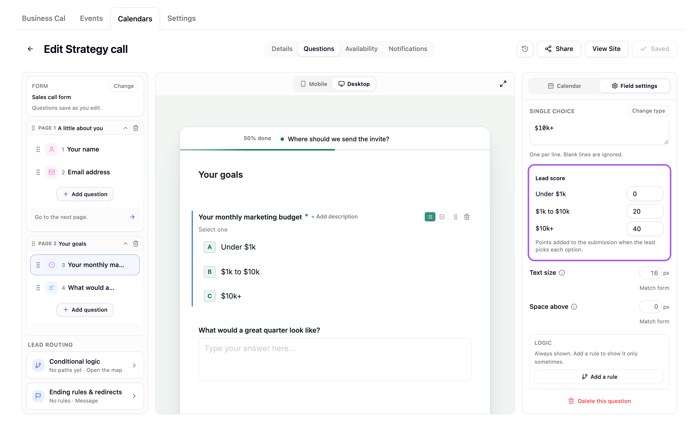
    </Frame>
  </Step>

  <Step title="Let it save">
    Click anywhere outside the box. Your points save on their own. There is no save button here.

    If something goes wrong you'll see **Could not save the lead score**. Click back into the box and type the number again.
  </Step>

  <Step title="See the scores">
    Once people start booking, go to the **Events** tab. The **Lead Score** column shows a coloured badge for each booking.

    Hover over a badge for a **Why** breakdown. It lists which answers earned which points.

    The person's record keeps their latest score as **AI Lead Score**.

    | Score | Tier |
    | --- | --- |
    | 80 and above | Hot |
    | 60 to 79 | Warm |
    | 40 to 59 | Cool |
    | Below 40 | Cold |
  </Step>
</Steps>

<Warning>
  **The badge and your routing rules use two different numbers.**

  The badge shows a score out of 100. It is how many points someone scored, as a share of the most your form could ever give.

  Your rules do not use that. They use the plain points total. Write a rule saying *Lead score is greater than 20* and it means 20 real points, not 20 out of 100.

  So add up the points you handed out, and write your rules on that scale. Set a rule at `80` when your whole form only gives 35 points and the rule can never happen.
</Warning>

<Note>
  **Points belong to the question itself, not to this one calendar.**

  Use the same question on another booking form and it carries the same points there. Change a number here and it changes everywhere that question is used.

  Two more things are worth knowing.

  The score out of 100 counts the best possible answer to every scored question, even questions the person never reached. So adding a big-points question pushes everyone's percentage down.

  Changing points never rescores bookings you already have. Each score is a snapshot from the moment the person booked.
</Note>

## 5. Route People With Ending Rules

**Ending rules** decide what happens after someone answers your questions. They can book as normal, be sent somewhere else, or be turned away politely.

<Steps>
  <Step title="Open Ending rules">
    Go to the bottom of the **Questions** tab. Under **Lead routing**, click **Ending rules & redirects**.

    The dialog explains how it works in one line: *Rules run top to bottom; the first match wins. If none match, the Default books the calendar.*

    <Frame caption="Ending rules. The Default sits at the bottom. It always exists and you cannot delete it.">
      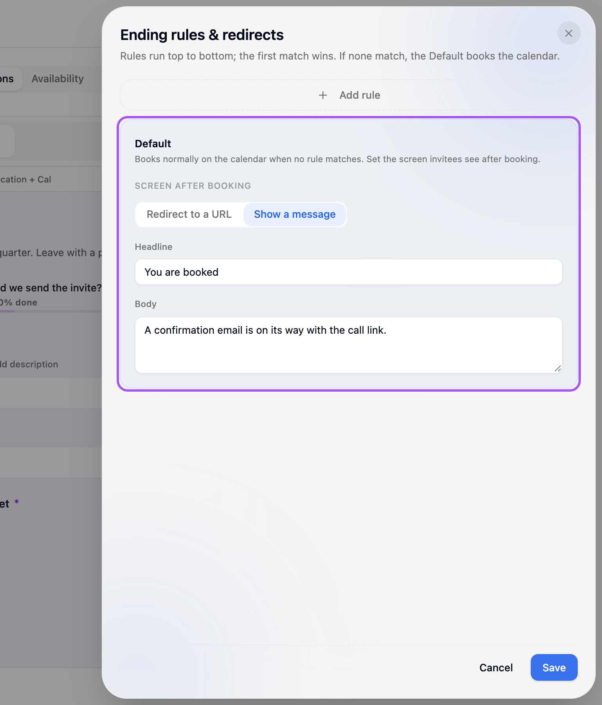
    </Frame>
  </Step>

  <Step title="Add a rule">
    Click **Add rule**. Each rule reads like a sentence.

    - **When**: pick **Answer**, then which question, or pick **Lead score**. Then pick how to compare it, such as **Equals**, and type the value. Click **Add condition** to add more tests to the same rule. Two or more tests give you **Match all** and **Match any**.
    - **Several answers to one question**: a choice question starts on **Is One Of**, and you tick the answers that count. "Grade **is one of** 9th, 10th" **and** "maths **is one of** Algebra, Geometry" is two tests and no group.
    - **and** and **or** in one rule, across different questions: hover a test and click **Group** to give it its own **Any of these** or **All of these** (hover a group for **Ungroup**), or write the tests in a row and click the word between two of them to switch it; the tests on each side fold into their own groups. The word stays plain text where a switch would need a group inside a group. A new rule starts with no tests, just **Add condition** and **Add group**.
    - **Add group**, next to **Add condition**, builds the same thing by hand: a set of tests inside the rule with its own **Any of these** or **All of these** switch. A group can hold answers and the lead score alike, and the rule's own **Match all** or **Match any** joins the group with the tests outside it. Taking the last test out of a group removes the group; remove every test and the rule is empty again, ready for **Add condition** or **Add group**, and cannot be saved until it has one.
    - **Then**: pick what happens. **Show the calendar** lets them book as normal. **Book with a team member** gives the meeting to one chosen person. **Book with a team pool** gives it to a group who take turns. **Book a different event** sends them to a different meeting type. **Disqualify from Booking** turns them away.
    - **Screen after booking**: this one is optional. Leave it switched off and they see the Default screen.
  </Step>

  <Step title="Set the Default screen">
    The **Default** sits at the bottom. It books people in as normal when no other rule fits.

    Pick what people see once they have booked. Choose **Show a message** or **Redirect to a URL**.

    Choose **Redirect to a URL** and you can also use **URL parameters**. This passes the meeting name, the date, the time, the score and any answer over to your own thank-you page.

    When your form takes a payment, a **Payment** row adds `paid=true` and the payment's Stripe id, as `session_id` unless you rename it under **Payment id as**. A booking page never sends the amount or the currency. The id cannot take the name of the booking's own parameters (`date`, `time`, `event_name`, `score`, `utm_source`, `utm_medium`, `utm_campaign`, `utm_content`): the row says so and the id goes as `session_id`.

    Click **Save**.
  </Step>
</Steps>

### Routing rules on Standard

On **Standard** people pick a time before they answer your questions. With the latest update, a rule that says **Book with a team member** or **Book with a team pool** keeps the lead with that person or pool. This works on Cortana calendars, GoHighLevel calendars and iClosed calendars.

- **They are free at the picked time.** The booking is theirs.
- **They are not free then, but have other times.** Nothing is booked yet. The lead goes back to the times and sees *Sorry, our calendar timing had some changes, and we had to refresh. Please select a new time. (No need to re-enter your information.)* The times now shown are only that person's, or the pool's. The answers are kept. On a phone the title and the description step aside, so the times come first. A tapped time now says **Book**, and the next tap books it with them.
- **They have no open time at all** in the days people can book ahead (your **Rolling Window**). Anyone free on the calendar takes the picked time, so the lead is never stuck.
- **They cannot be booked on this calendar**, for example they are not on its team, or not matched to their user in the other tool. Anyone free takes it.
- **A calendar that takes more than one booking per time** (**Max Bookings / Slot** above 1) keeps the rule as a preference: that person when they are free then, anyone free when they are not.
- **A GoHighLevel collective, event or class calendar** has no single host, so anyone free takes it.

<Frame caption="The lead's view when the routed rep is not free at the picked time. 1 is the message above that rep's own times.">
  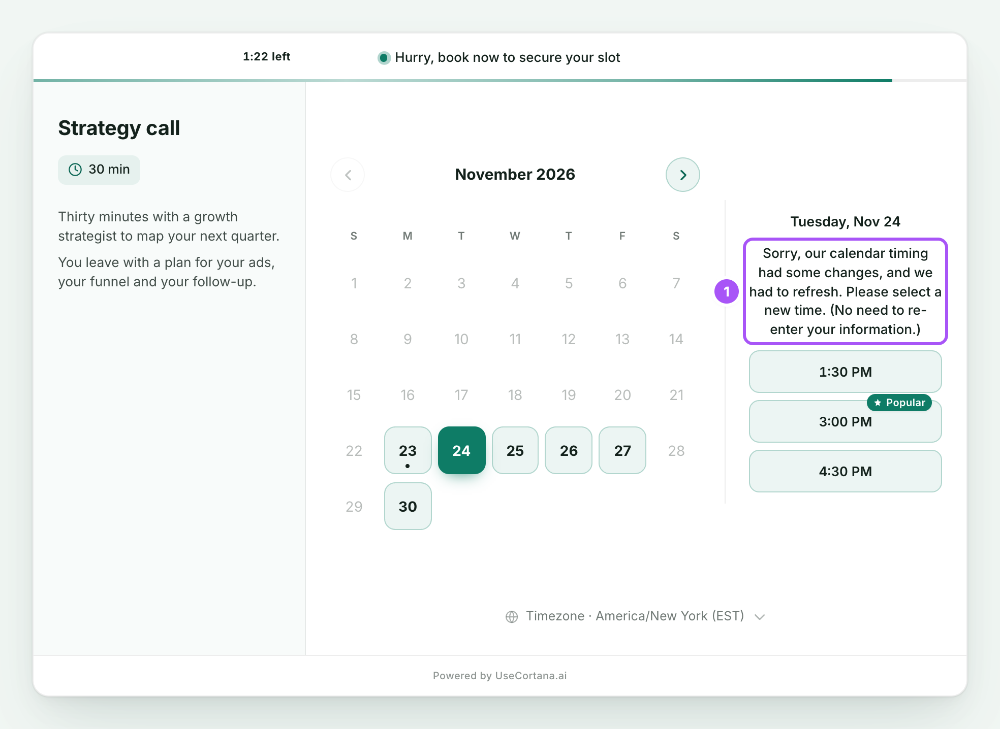
</Frame>

The rule editor says this under the person or pool you pick: *On the Standard layout people pick a time before they answer. If this team member isn't free then, they're asked to pick one of this team member's times. If this team member has no open times, anyone free takes it.* Once you pick a person, their name takes the place of "this team member". For a pool it says *If nobody in this pool is free then, they're asked to pick one of the pool's times. If the pool has no open times, anyone free takes it.* On a GoHighLevel calendar it adds *On a GoHighLevel collective, event or class calendar, anyone free takes it.*

The **Ending rules** card shows **Leads book with the routed rep** (on a calendar that takes more than one booking per time: **Leads book with the routed rep when free**).

<Frame caption="A rule that books one rep on a Standard calendar. 1 is the note under the rep.">
  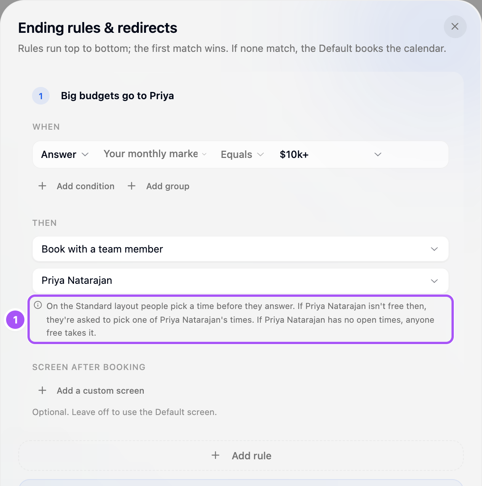
</Frame>

On **Calendly** and **HubSpot** calendars, **Book with a team member** and **Book with a team pool** are greyed out, because those tools pick the person themselves. Send the lead to that rep's own calendar with **Book a different event** instead. A rep's own booking link still goes to that rep on every calendar type.

---

## 6. Set Your Availability

<Steps>
  <Step title="Set weekly hours">
    Open the **Availability** tab.

    **Weekly Availability** is already filled in as **Monday to Friday, 09:00 to 17:00**. Saturday and Sunday are closed.

    Click **Add time slot** to add a second window to a day. That is handy if you only take calls in the morning and late afternoon.

    To close a day, delete every time slot on it.

    <Frame caption="Weekly Availability, already filled in as Monday to Friday, 09:00 to 17:00. Date overrides sit underneath.">
      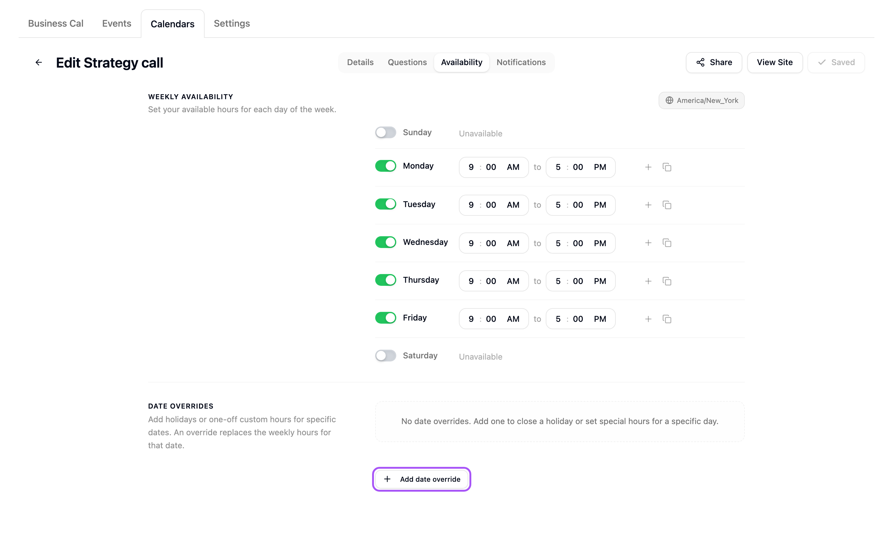
    </Frame>
  </Step>

  <Step title="Add holidays or one-off hours">
    Use **Date overrides** for single dates, such as a holiday or a day with odd hours.

    An override **replaces** your normal hours for that date. It does not add to them. So type in every hour you want to be bookable that day.
  </Step>
</Steps>

<Warning>
  **These hours use your business clock, not each person's own local clock.**

  You'll see which one is in use at the top of the Weekly Availability section. To change it, go to **Settings → Schedule**.

  You cannot set a different local clock for each person. You cannot set holidays or time off for one person either.

  Someone's personal time off only blocks a booking if it sits on a Google or Outlook calendar they have connected. Otherwise people can still book them during it.
</Warning>

---

## 7. Check the Reminder Emails

Open the **Notifications** tab. Every new calendar comes with two messages already switched on.

| Notification | Trigger | Timing | Sent by | Sent to |
| --- | --- | --- | --- | --- |
| **Booking Confirmed** | Booking Confirmed | Immediately | Email | Invitee |
| **Upcoming Booking Reminder** | Reminder | 1 day before | Email | Invitee |

Click either one to change its subject line and wording, change when it goes out, or switch it off.

Use the merge fields to drop in real details. They fill in the person's name, the date, the time and the join link for you.

<Frame caption="The two messages every new calendar starts with.">
  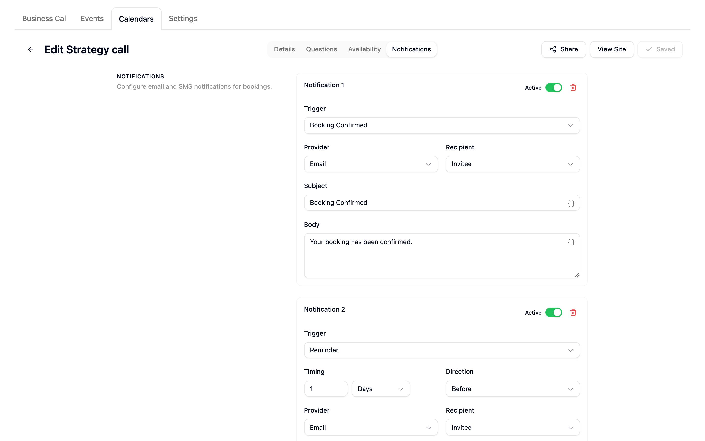
</Frame>

<Note>
  You can send text messages as well as emails. First you need to connect Twilio to your business, and it must have a number that can send. Until then the SMS option stays greyed out and you cannot click it.

  Emails go out from your own web address once you set one up. Do that under **Settings → Sending Email**.
</Note>

---

## 8. Share the Link

<Steps>
  <Step title="Open Share">
    Click **Share** at the top of the builder. You get five ways to hand out your calendar.

    - **Booking link**: your main link. This is the one to give people. It works everywhere.
    - **Short link**: a shorter link, easier to paste into direct messages and social posts. Click **Customize** to choose how it ends.
    - **QR code**: an image you can download. Use it on printouts, slides and signs.
    - **Embed on your site**: a small piece of code. Paste it into a custom HTML block on your website. It keeps the tracking tags from your ad links, so you can still see which ad each booking came from. For Notion, use the booking link instead. The code will not work there.
    - **One-time link**: stops working after someone opens it once. Good for private invites.

    <Frame caption="The Share dialog. The Booking link is the one to give people.">
      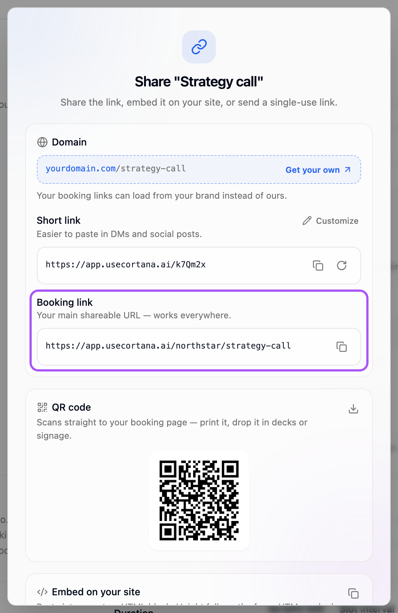
    </Frame>
  </Step>
</Steps>

### How the embed looks on your site

With the latest update, a **Standard** or **Application + Cal** calendar embedded on your site sits on your page as a card with rounded corners, on a phone and on a computer.

The card also keeps one steady height from the first question to the booking. Your page around it never grows, shrinks or jumps as the person moves through. The top bar stays at the top and the buttons stay at the bottom. Only the middle of the card scrolls, and only when a step holds more than fits, such as a long list of times. When everything fits, nothing scrolls, and a flick inside the card never scrolls your page instead.

With the latest update, a **Calendar Combo** embedded on your site also holds one height while your page loads, so nothing on your page moves as it opens. It grows only once the person starts using it: their first tap, click or key. Then it follows the card as they move through, and grows downwards, never pushing your page up.

On a computer, code you copy now starts the Combo at the card's own height, so it never changes size at all. On a phone, the Combo's questions stack above its calendar, so the card can be taller than the space it starts in: it scrolls inside that space until the first tap, then grows to fit. Code you pasted before also holds its height while your page loads. Copy the code again from **Share** to start at the card's own height.

<Frame caption="A Standard calendar embedded on a website: one card with rounded corners and one steady height.">
  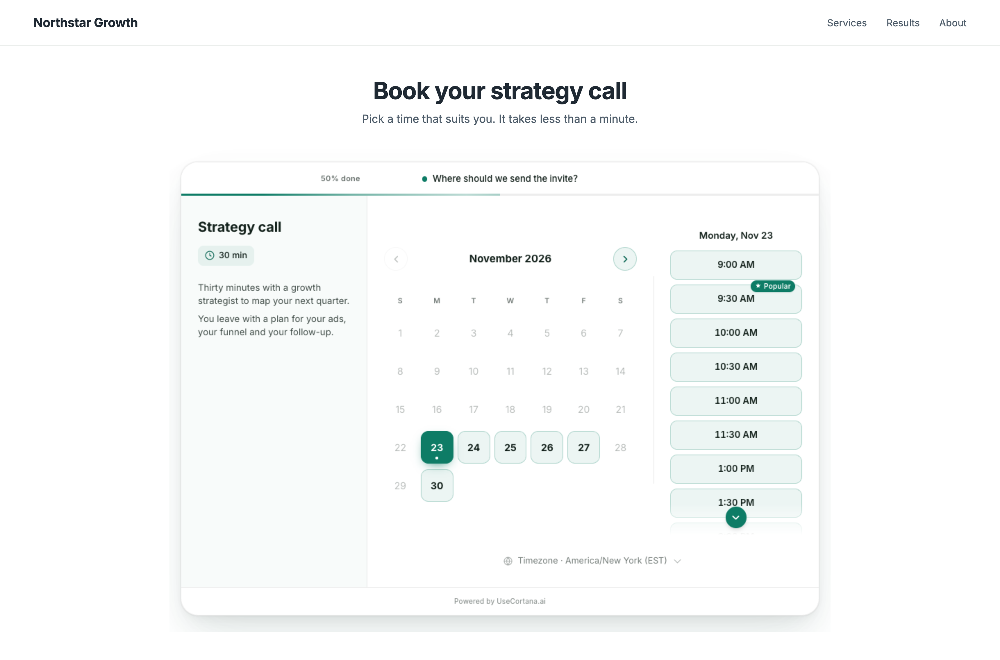
</Frame>

---

## 9. Test It Yourself

Always book your own calendar once before you send it to anyone.

<Steps>
  <Step title="Open the booking page">
    Click **View Site**. Or open the **Booking link** in a private browser window, so you see the page as a stranger does.

    What comes first depends on your **Calendar type**. On **Standard** you see the times first. On **Calendar Combo** and **Application + Cal** you see the questions first.

    The page works out the person's local time on its own and shows it with the times. They can change it if it is wrong.
  </Step>

  <Step title="Pick a day and a time">
    Only the days you are free on can be picked. Pick a day, then tap a time.

    On **Standard**, the first tap picks the time and **Continue** grows in beside it. Tap the time or **Continue** again to move on to the questions. If the booking countdown is on, it starts now.

    On **Application + Cal** the questions come first, and the calendar opens in the same card after the last page. The first tap on a time shows **Book** beside it, and the second tap books it.

    On **Calendar Combo** the calendar stays locked and grey until the last page of questions is answered. That is on purpose: you get the person's details before you show them your free times. Then pick a time and click **Select Timeslot**.
  </Step>

  <Step title="Answer the questions">
    People answer your questions one page at a time. Fill in each box, then press **Continue**, or **Enter**. A single choice at the end of a page moves on by itself.

    The phone box picks their country for them.

    On **Standard** the time you picked stays on the left, with **Change** to pick another. The last button reads **Book** and books it.

    <Frame caption="Standard after the time is picked: the summary on the left, the questions on the right.">
      
    </Frame>
  </Step>

  <Step title="Check the confirmation">
    You should now see **Booking Confirmed!** and *You will receive a confirmation email shortly.*, then the date, the time and how long the meeting is.

    The **Reschedule** and **Cancel** links reach the person in their confirmation email. On **Calendar Combo** the confirmation screen also shows them as buttons.

    <Frame caption="The confirmation on Standard: the day, the time and the length of the meeting.">
      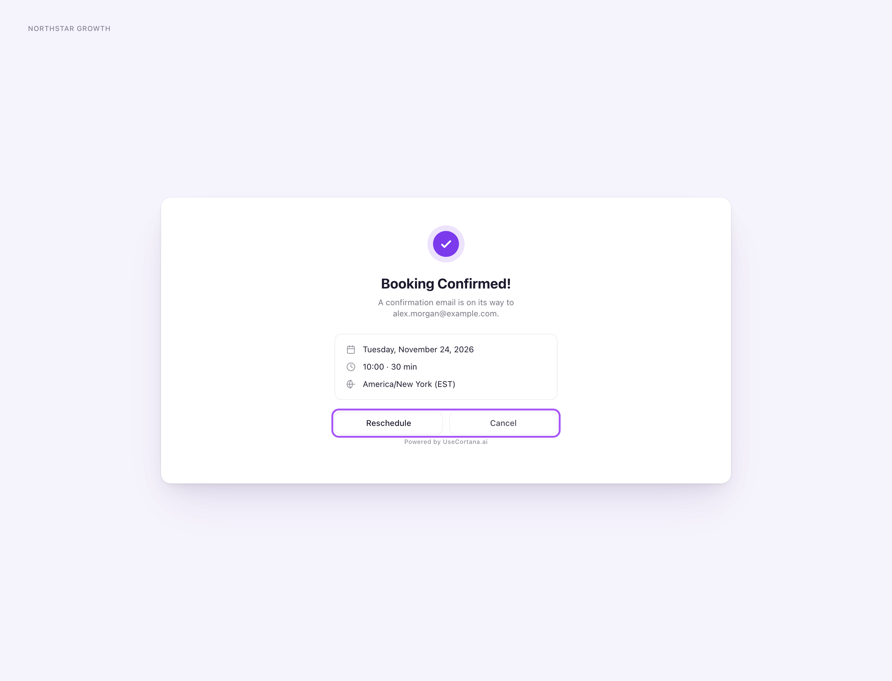
    </Frame>
  </Step>

  <Step title="Confirm it reached your dashboard">
    Go back to **Appointments**. Your booking sits on the **Business Cal** tab, on the day you picked.

    It also shows as a row under **Events → Appointment Booked**, with the person's name, email and date.

    <Frame caption="The test booking on Business Cal. Seeing it here proves the whole chain works.">
      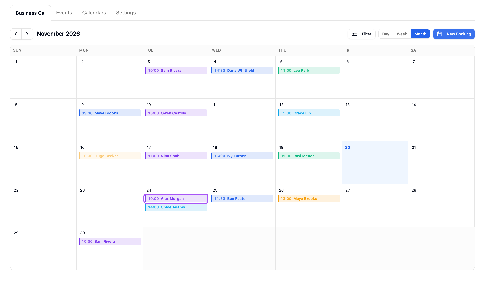
    </Frame>
  </Step>
</Steps>

<Check>
  Can you see the booking here? Then your calendar works from start to finish. The link opens, the form collects the details, your free times work out correctly, the booking is stored, and the confirmation email goes out.
</Check>

---

## Settings Reference

### Scheduling rules

| Setting | What it does | Default | Recommendation |
| --- | --- | --- | --- |
| **Duration** | Sets how long the meeting lasts. | 30 minutes | Match how long your calls really take. This is the time blocked out on your calendar. |
| **Slot Interval** | Sets how often a start time is offered. | 30 minutes | Keep it the same as Duration for back-to-back calls. Make it bigger to leave gaps. Never make it smaller than Duration. |
| **Buffer Before** | Keeps time free before each booking. | 0 minutes | Use 5 to 10 minutes if you like to prepare first. |
| **Buffer After** | Keeps time free after each booking. | 0 minutes | Use 5 to 15 minutes for writing notes and for calls that run over. |
| **Min Notice** | Sets how soon someone can book you. | 1 hour | Raise it to 12 or 24 hours if same-day bookings catch you out. |
| **Rolling Window** | Sets how far ahead people can book. | 1 month | 1 month suits most sales calls. Leave it alone unless you book up further out. |
| **Max Bookings / Day** | Caps how many bookings you take in one day. | Unlimited, so people can book you all day | Set a cap to keep some days free for other work. |
| **Max Bookings / Slot** | Sets how many people can take the same time. | 1 | Leave it at 1. Only raise it if you run group sessions. |
| **Allow Reschedule** | Lets people move their own booking without asking you. | On | Leave it on. It means fewer people simply not turning up. |
| **Allow Cancellation** | Lets people cancel their own booking without asking you. | On | Leave it on. A cancelled slot you can resell beats an empty one. |

### Distribution

| Setting | What it does | Default |
| --- | --- | --- |
| **Round Robin (Prioritize Availability)** | Gives the meeting to whoever is free. If several are free, the one with the fewest bookings gets it. Shows people the most times to choose from. | On. Every new calendar starts here |
| **Round Robin (True & Equal)** | Makes your team take strict turns. Anyone too far ahead is hidden until the others catch up. | Off. Switch it on only if an exactly equal split matters |
| **Team Members** | Sets who your bookings go to. | Empty. Every booking goes to the business owner |

### Booking page

| Setting | What it does | Default |
| --- | --- | --- |
| **Calendar type** | Chooses the order: times first (**Standard**), questions and calendar together (**Calendar Combo**), or every question first (**Application + Cal**). Standard is first in the list. | Standard, so the times show first |
| **Theme** | Sets the overall look. Six light and six dark ones. Colours only, never the font or the size. | Whichever look you use in Cortana when you make the calendar |
| **Colors** | Sets the Background, Text, Accent, Button and Button Text colours. | Blue, `#3B82F6`, for Accent and Button |
| **Font** | Sets the writing for the whole page. Seven to pick from, including **System**, the visitor's own device font. | Inter |
| **Size** | Makes all the writing bigger or smaller, from 12 to 24. | `16px`. The boxes people type in never go below `16px` |
| **Text size** | On one question, in **Field settings**. Overrides the form's size for that question only, from 12 to 24. | **Match form**, so it follows the whole page |
| **Space above** | On one question, in **Field settings**. Replaces the gap above it, from 0 to 96. | **Match form**: 32 on a phone and 36 on a computer on Standard and Application + Cal, 20 on Calendar Combo, at the 16px size. The first question on a page reads 0 |
| **Reset theme and typography** | Puts back the shipped look: the theme for the mode you are in, all five colours, the font and the size. | Not applicable. A toast offers **Undo** for ten seconds |
| **Logo** | Puts your logo on the page. Takes PNG, JPG or WebP files. | No logo. Files up to 2 MB |
| **Sticky Contact** | Fills in the details of people who booked with you before. | On, so returning people type less |
| **Hide title and description** | On **Standard**: hides the meeting name and your description, in one switch. **Calendar Combo** has **Hide title**. **Application + Cal** never shows either. | Off, so both are shown |
| **Hide duration** | On **Standard**: hides the meeting's length. | Off, so the length is shown |
| **Hide subtitle** | Hides the line in the top bar. While it shows, the box under the switch sets its words. | Off. The box reads *Where should we send the invite?*, in the page's language |
| **Booking countdown** | Shows your message and a clock in the top bar. Starts when a time is picked on Standard and Application + Cal, and when the times show on Calendar Combo. At zero the bar says *Try booking your slot to confirm it's still available.* | Off. When on: *Hurry, book now to secure your slot*, for 1 minute 30 seconds |
| **Button wording** | The word on the button that moves people on. Empty shows just the check mark. | *Continue* |
| **Page language** and **Time format** | The language the page writes its own words and dates in, and 12-hour or 24-hour times. | English, 12-hour |
| **Hide "Powered by"** | Hides the Powered by line at the bottom of the card. | Off |

---

## Troubleshooting

<AccordionGroup>
  <Accordion title="The booking page shows {Key Outcome 1} to real visitors">
    That is the sample wording every new calendar starts with. It is live text, not a preview.

    Go to **Details → Description**, delete it, and write your own.
  </Accordion>

  <Accordion title="No times are showing, or every day is greyed out">
    Work through these five in order.

    1. **The form is not finished.** On **Calendar Combo** and **Application + Cal** the calendar stays locked on purpose until the last question is answered. Fill it in, then click the round checkmark button.
    2. **The day has no hours.** Only days with hours in **Availability** can be clicked. Weekends are closed to start with.
    3. **A date override closed it.** Check **Availability → Date overrides**. An override wipes out that day's normal hours completely.
    4. **Min Notice is hiding the day.** Set Min Notice high and the next day or two disappear.
    5. **The times are taken.** A time vanishes once someone books it. It also vanishes when it clashes with something on a connected Google or Outlook calendar.
  </Accordion>

  <Accordion title="Invitees get stuck on a blank page in the middle of the form">
    Creating a form also creates an empty **Page 2**. That blank screen is what they are stuck on.

    Open **Questions**. Either add a question to Page 2, or delete the page.
  </Accordion>

  <Accordion title="The booking link shows an error page instead of the calendar">
    Go to the **Calendars** tab and check the calendar's on and off switch. A calendar that is switched off does not show its page.

    Then check the **Event URL** matches the link you shared. Edit it by hand and the address changes straight away, which breaks any link you already sent out.
  </Accordion>

  <Accordion title="Confirmation emails aren't arriving">
    Open **Notifications** and check the **Booking Confirmed** message is switched on.

    Then go to **Settings → Sending Email**. Until your web address is verified, emails go out from a shared sender. Those land in spam more often.

    Also ask the person to look in their spam folder.
  </Accordion>

  <Accordion title="Bookings go to the wrong person">
    Add nobody to the team and every booking goes to the business owner.

    Add the right people under **Details → Distribution & Team**.

    Then check your **Ending rules**. A rule that gives the meeting to one chosen person beats the taking-turns setting.

    On **Standard**, the rule keeps the lead with that person. Anyone free takes the booking only when that person has no open time at all, cannot be booked on this calendar, or the calendar takes more than one booking per time. See [Routing rules on Standard](#routing-rules-on-standard).
  </Accordion>

  <Accordion title="A lead says the page asked them to pick a new time">
    That is a **Standard** calendar keeping a routing rule. The lead picked a time, then their answers sent them to a rep or a pool who was not free at that time. So the page showed *Sorry, our calendar timing had some changes, and we had to refresh. Please select a new time. (No need to re-enter your information.)* with only that rep's times.

    Their answers were kept. They pick one of the times shown and book. Nothing was booked before that. See [Routing rules on Standard](#routing-rules-on-standard).
  </Accordion>

  <Accordion title="The countdown ran out and the lead could still book">
    That is how it works. At zero the top bar says *Try booking your slot to confirm it's still available.* The times are never hidden or blocked, and the picked time stays picked. The booking itself checks the time is still free. See [The booking countdown](#the-booking-countdown).
  </Accordion>

  <Accordion title="I edited a question and it changed on another calendar">
    Two calendars can use one form. If you used **Select a form**, both calendars point at the same one.

    Click **Change → Create a form** to give this calendar its own separate copy.
  </Accordion>
</AccordionGroup>

---

## FAQ

<AccordionGroup>
  <Accordion title="Do I need to connect Google Calendar to take bookings?">
    No. Your calendar works on its own.

    Connecting Google or Outlook adds two things. Anything already in your diary blocks out that time here. And each booking creates a real diary entry with a video link.
  </Accordion>

  <Accordion title="How do I stop people booking me at the last minute?">
    Raise **Min Notice** under **Details → Scheduling Rules**.

    It starts at 1 hour. Most people change it to 12 or 24 hours.
  </Accordion>

  <Accordion title="Can I use my own domain instead of app.usecortana.ai?">
    Yes. Any web address you have connected shows under **Event URL → Connected domains**.

    They stay marked *not verified* until their DNS records are set up.
  </Accordion>

  <Accordion title="Can I ask qualifying questions and turn people away?">
    Yes. That is exactly what **Ending rules** do.

    Add a rule such as *When Budget Equals Under $1k, Then disqualify*. Then pick whether those people see a message or get sent to another page.
  </Accordion>

  <Accordion title="Where do the answers go?">
    They save onto the person's record. Every question saves there, so you can use the answers on other forms and give them points.

    You'll also see them next to the booking under **Events → Form Submitted**.
  </Accordion>

  <Accordion title="Can two calendars share the same set of questions?">
    Yes. Click **Select a form** on the second calendar.

    Just remember the two stay tied together after that. Edit a question on one and it changes on both.
  </Accordion>

  <Accordion title="Can invitees reschedule or cancel themselves?">
    Yes, as long as **Allow Reschedule** and **Allow Cancellation** are switched on.

    Both links come in their confirmation email. On **Calendar Combo** they also show as buttons on the confirmation screen.
  </Accordion>

  <Accordion title="Does rescheduling change the person's name, email or phone?">
    No. A reschedule moves the booking and keeps the details already on the person's record.

    - A different email typed while rescheduling is kept as an extra email on the same contact.
    - A name or phone only fills in what was empty, and a blank phone never wipes the one you have.
    - A reschedule never merges two of your contacts.
  </Accordion>

  <Accordion title="Why doesn't my business name show on the booking page?">
    With the latest update, no booking page shows the business name, on any calendar type, so the **Calendar** panel has no switch for it. Your title and your description still show where the calendar type shows them.
  </Accordion>

  <Accordion title="My embedded calendar makes my website jump up and down">
    With the latest update, an embedded **Standard** or **Application + Cal** calendar keeps one steady height from the first question to the booking, with rounded corners. Only the middle of the card scrolls, and only when a step holds more than fits. An embedded **Calendar Combo** holds one height while your page loads and grows only after the person's first tap, click or key, downwards. See [How the embed looks on your site](#how-the-embed-looks-on-your-site).
  </Accordion>

  <Accordion title="Do bookings from my ads stay attributed?">
    Yes. The booking page counts its own visits. The website code you paste in also carries over the tracking tags from your ad links.

    So each booking is recorded as a sale you can trace back to an ad, not just a diary entry.
  </Accordion>
</AccordionGroup>

---

## Next Steps

<CardGroup cols={2}>
  <Card title="2) Schedule & Working Hours" icon="clock" href="/cal-schedule">
    Set your business booking timezone, default slot length, and each team member's working hours.
  </Card>
  <Card title="3) Calendar Sync" icon="rotate" href="/cal-calendar-sync">
    Connect Google, Outlook, Zoom, or an external booking system.
  </Card>
  <Card title="4) Sending Email" icon="envelope" href="/cal-sending-email">
    Send confirmations and reminders from your own domain.
  </Card>
  <Card title="5) Business Cal" icon="calendar-days" href="/cal-business-cal">
    See every booking, change its status, and track the form-to-booking funnel.
  </Card>
</CardGroup>

If any of this does not match what you see on screen, message the support team using the button in the bottom right.
