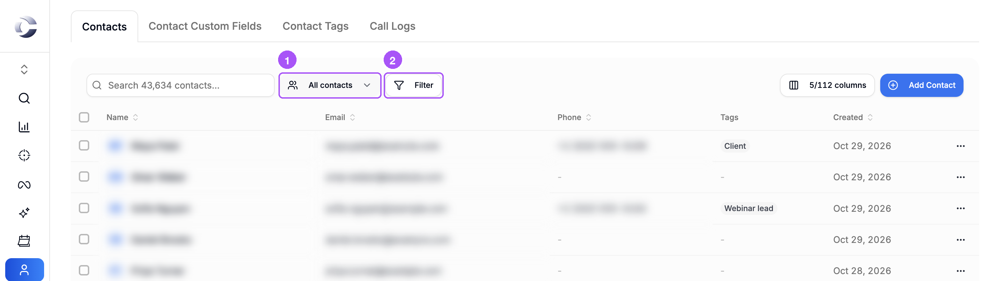
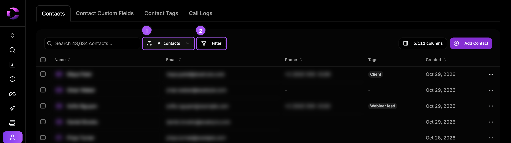
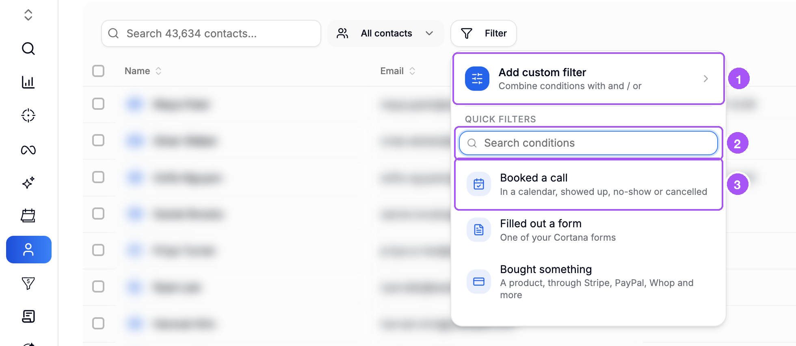
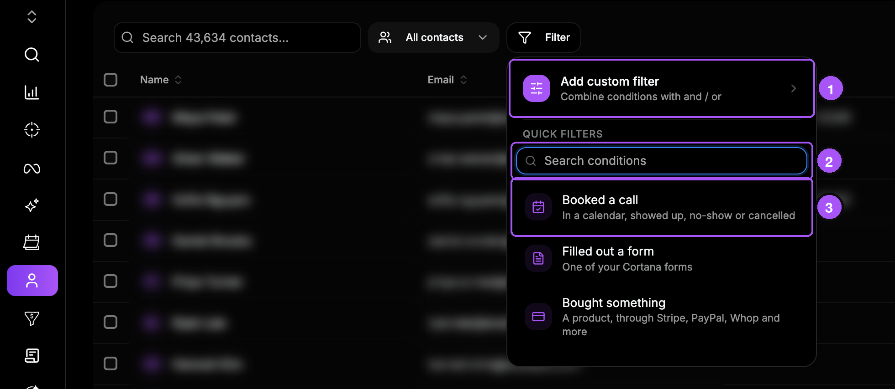
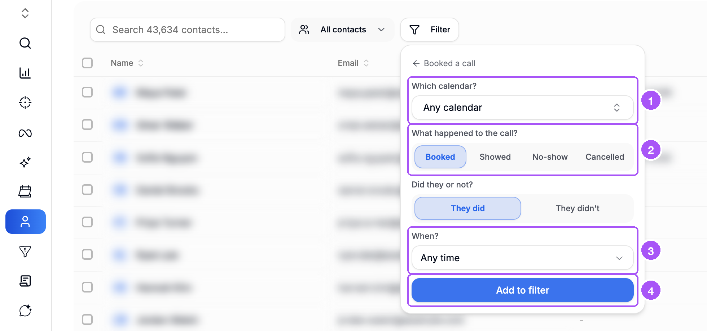
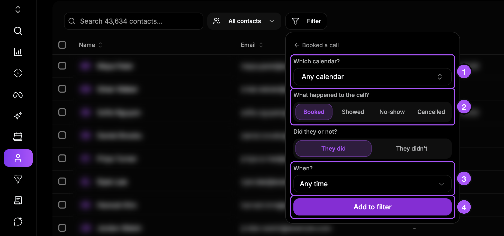
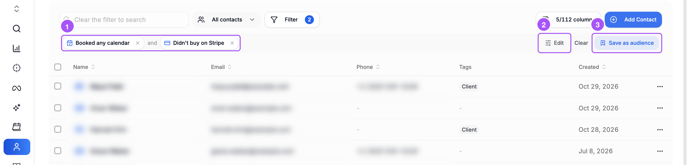
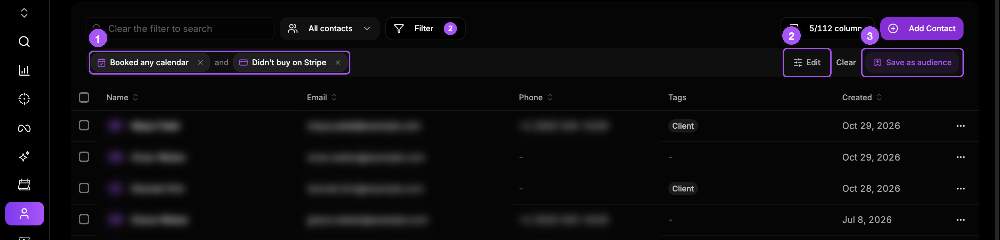
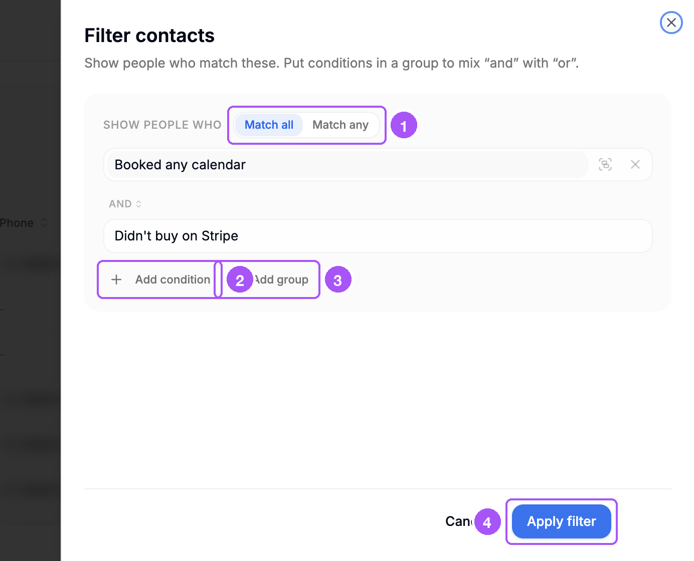
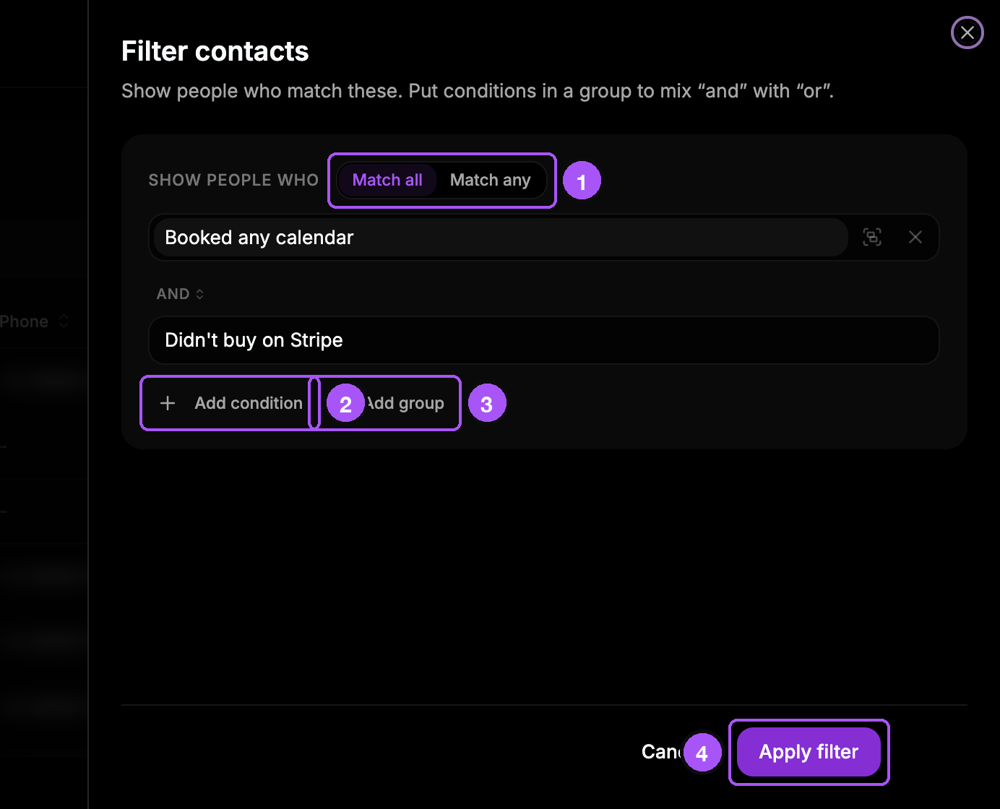

{/* last-verified: 2026-11-01 · route: /business/[businessId]/contacts · source: src/components/audiences/audience-filter-popover.tsx, rule-builder.tsx, audience-toolbar.tsx, contact-kind-questions.tsx, purchase-attribution-questions.tsx */}

## Overview

The **Filter** button shows only the people you want.

The table changes. Your contacts do not.

---

## 1. Find the Filter

Click **Contacts** in the menu on the left. Above the table you see:

1. **All contacts**: the list you are looking at.
2. **Filter**: picks the people you want.

<Frame caption="The list (1) and the Filter button (2).">
  
  
</Frame>

---

## 2. Add a filter

<Steps>
  <Step title="Click Filter">
    A menu opens.
  </Step>
  <Step title="Pick what the person did">
    For example, **Booked a call**.
  </Step>
  <Step title="Answer the questions">
    Leave a question as it is if you do not need it.
  </Step>
  <Step title="Click Add to filter">
    The table now shows only the people who match.
  </Step>
</Steps>

The menu has three parts:

1. **Add custom filter**: mix "and" with "or". See step 4.
2. **Search conditions**: type a word to find a filter fast, like "stripe" or "tag".
3. The quick filters, like **Booked a call**.

<Frame caption="The Filter menu.">
  
  
</Frame>

**Booked a call** asks these questions:

1. **Which calendar?** One calendar, or **Any calendar**.
2. **What happened to the call?** **Booked**, **Showed**, **No-show** or **Cancelled**.
3. **When?** For example, **Any time** or **In the last 30 days**.
4. Then click **Add to filter**.

It also asks **Did they or not?** Pick **They did** or **They didn't**.

<Frame caption="The questions for Booked a call.">
  
  
</Frame>

<Tip>
  **Want people who did NOT do something?** Pick the "not" answer, like **They didn't** or **Didn't buy**.
</Tip>

---

## 3. Add more filters

Click **Filter** again to add another one. Each filter shows as a chip under the toolbar.

1. Your filters. **and** between them means a person must match all of them. Click **x** on a chip to remove it.
2. **Edit**: mix "and" with "or". See step 4.
3. **Save as audience**: keep this filter. See [2) Save An Audience](/crm/audiences-save).

**Clear** takes the filter off and shows everyone again.

<Frame caption="Two filters: people who booked a call and did not buy on Stripe.">
  
  
</Frame>

<Note>
  **You cannot search while a filter is on.** The search box says **Clear the filter to search**.
</Note>

---

## 4. Mix "and" with "or"

Use this when a person can match one thing **or** another.

Click **Edit** on the filter strip. Or click **Filter**, then **Add custom filter**. The **Filter contacts** panel opens.

1. **Match all** means every filter must match. **Match any** means at least one must match.
2. **Add condition** adds another filter.
3. **Add group** starts a small group with its first filter. A group has its own **All of these** or **Any of these**.
4. **Apply filter** shows the result. **Cancel** changes nothing.

<Frame caption="The Filter contacts panel.">
  
  
</Frame>

<AccordionGroup>
  <Accordion title="An example with and plus or">
    You want people who booked a call **and** filled out form A **or** form B.

    1. Pick **Match all**.
    2. Click **Add condition** and pick **Booked a call**.
    3. Click **Add group** and pick form A. The group starts as **Any of these**.
    4. Click **Add condition** inside the group and pick form B.
  </Accordion>

  <Accordion title="More things you can do in the panel">
    - Click the **and** or **or** word between two rows to switch it.
    - Click a filter to change it.
    - Use the group button on a filter to put it in a group.
    - A group cannot hold another group.
  </Accordion>

  <Accordion title="Limits">
    - Up to 10 filters at once, groups included.
    - Up to 5 groups.
  </Accordion>
</AccordionGroup>

---

## Every filter and its questions

<AccordionGroup>
  <Accordion title="Booked a call">
    - **Which calendar?** One calendar, or **Any calendar**.
    - **What happened to the call?** **Booked**, **Showed**, **No-show** or **Cancelled**. **Booked** means any booking.
    - **Did they or not?** **They did** or **They didn't**.
    - **When?**
  </Accordion>

  <Accordion title="Filled out a form">
    - **Which form?** One of your Cortana forms.
    - **Filled it out or not?** **Filled it out** or **Didn't**.
    - **When?**
  </Accordion>

  <Accordion title="Bought something">
    - **Which payment processor?** Stripe, PayPal, Whop, Fanbasis, Shopify or WooCommerce.
    - **Which product?** One product, or **Any product**. If Cortana has no product list, it asks **Product name (optional)**. Type part of the name, or leave it empty.
    - **Bought it or not?** **Bought** or **Didn't buy**.
    - **When?**
  </Accordion>

  <Accordion title="Spent an amount">
    - **Which total?** **Lifetime value** or **New revenue**. These are the same numbers you see on a contact card.
    - **At least, under, or top spenders?** **At least**, **Under** or **Top spenders**. **Under** also counts people who never paid.
    - **How much?** An amount in dollars, like 5,000.
    - **Top what share of spenders?** For **Top spenders**. A number from 1 to 99. Type 10 for the top 10%.
    - **When?**

    Cortana ranks top spenders once a day. The first time can take a while. The table says **Ranking spenders first** while it works.
  </Accordion>

  <Accordion title="Is in a pipeline stage">
    - **Which pipeline?**
    - **Which stage?** One stage, or **Any stage**.
    - **Deal status:** **Any status**, **Open**, **Won**, **Lost** or **Abandoned**.
    - **In it or not?** **In it** or **Not in it**.

    There is no **When?** here. It looks at where the deal is now.
  </Accordion>

  <Accordion title="Answered a custom field">
    - **Which field?** One of your custom fields.
    - **Their answer:** for example **is**, **is not**, **contains** or **is empty**. The choices depend on the field.
    - **Value:** the answer to compare with.
  </Accordion>

  <Accordion title="Came from an ad">
    - **Which ad platform?** **Meta Ads**, **Google Ads**, **TikTok Ads**, **LinkedIn Ads** or **Microsoft Ads**.
    - **Which campaign?** One campaign, or **Any campaign**.
    - **Which ad set?** and **Which ad?** Pick one, or leave it on any.
    - **Came from it or not?** **Came from it** or **Didn't**.
    - **When?**

    Renaming a campaign does not break the filter.
  </Accordion>

  <Accordion title="Did something in a webinar">
    - **Which webinar?** One webinar, or **Any webinar**.
    - **What did they do?** **Registered**, **Attended**, **Missed it** or **Watched at least**.
    - **How much of it?** For **Watched at least**: 25%, 50%, 75% or 90%.
    - **When?**
  </Accordion>

  <Accordion title="Watched a video">
    - **Which video?** One video, or **Any video**.
    - **How much of it?** 25%, 50%, 75% or 95%.
    - **When?**
  </Accordion>

  <Accordion title="Visited a page">
    - **Page address contains:** part of the page address, like `/pricing`. Big or small letters do not matter.
    - **Visited it or not?** **Visited** or **Didn't visit**.
    - **When?** The last 7, 30, 90 or 180 days. Or your own number, up to 360 days.

    It only counts visits from people Cortana knows.
  </Accordion>

  <Accordion title="Has a conversion">
    - **Which conversion?** For example, a purchase, a booking or a lead.
    - **Have it or not?** **Have it** or **Don't have it**.
    - **When?**
  </Accordion>

  <Accordion title="Has a tag">
    - **Which tag?**
    - **Tagged or not?** **Tagged** or **Not tagged**.

    There is no **When?** here. It looks at the tags the contact has now.
  </Accordion>

  <Accordion title="The When question">
    - **Any time** (this is the default)
    - **In the last 7 days**
    - **In the last 30 days**
    - **In the last 90 days**
    - **In the last year**
    - **Custom number of days**: type a number from 1 to 3,650.

    "In the last 30 days" moves forward every day. Someone who booked 31 days ago drops out.
  </Accordion>
</AccordionGroup>

## FAQ

<AccordionGroup>
  <Accordion title="Why does the table say Finding matching contacts?">
    Some filters look through your contacts one by one. The number shows how many Cortana has checked. People show up as they are found.

    If it says **No matches in the contacts checked so far**, click **Keep looking**.
  </Accordion>

  <Accordion title="Why can't I type in the search box?">
    You cannot search while a filter is on. Click **Clear** first.
  </Accordion>

  <Accordion title="How do I find people who did NOT do something?">
    Pick the "not" answer. For example **They didn't**, **Didn't buy**, **Not tagged** or **Didn't visit**.
  </Accordion>

  <Accordion title="I deleted a tag and now my filter shows an error. Why?">
    The filter still uses the deleted tag. Remove that filter and pick a tag that exists. The same is true for a deleted form, calendar, webinar, video, conversion, pipeline or field.
  </Accordion>

  <Accordion title="Are test contacts included?">
    No. Test contacts never show in a filter or an audience.
  </Accordion>
</AccordionGroup>

## Next step

<Card title="2) Save An Audience" icon="bookmark" href="/crm/audiences-save">
  Keep your filter as a list that updates by itself.
</Card>
