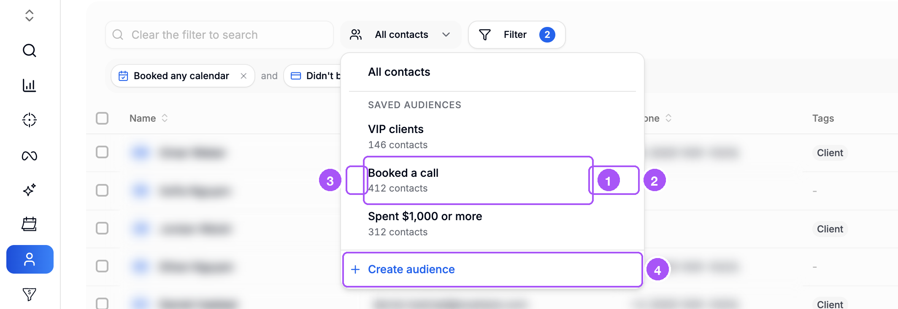
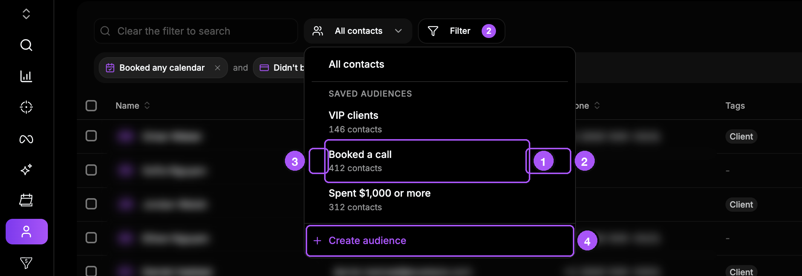
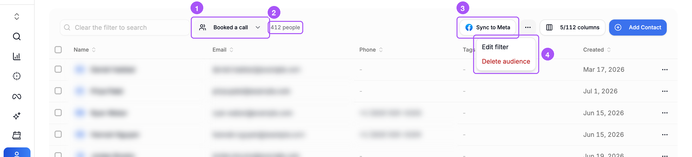
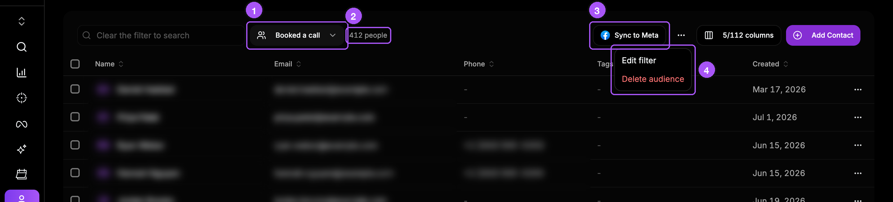
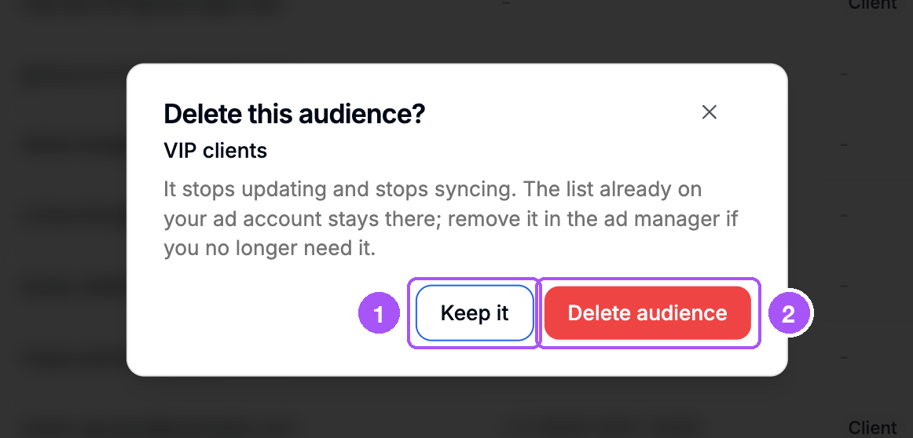
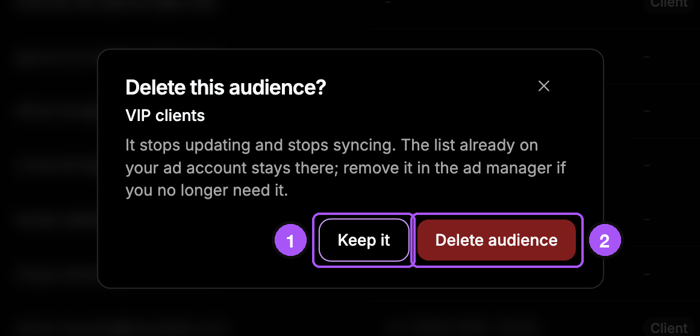

{/* last-verified: 2026-11-01 · route: /business/[businessId]/contacts · source: src/components/audiences/audience-switcher.tsx, audience-toolbar.tsx, audience-visitors-list.tsx, src/lib/audiences/service.ts */}

## Overview

All your audiences are in the **All contacts** list above the table. From there you can open, change, sort or delete them.

<Note>
  **Who can do what:** anyone who can see contacts can open an audience. To change, send, sort or delete one, you need the **Edit contacts** permission.
</Note>

---

## 1. Your audience list

Click **All contacts** above the table. Your audiences show under **Saved audiences**.

1. Click a name to open it. Under each name you see how many people are in it.
2. Move your mouse over a row. The pencil changes its filter. The bin deletes it.
3. Drag the handle on the left to move it up or down. The new order saves by itself.
4. **Create audience** makes a new one. See [2) Save An Audience](/crm/audiences-save).

<Frame caption="The audience list.">
  
  
</Frame>

To see everyone again, click **All contacts** at the top of the list.

---

## 2. Open an audience

The table shows only the people in the audience.

1. The audience's name is where **All contacts** was.
2. How many people are in it, like **412 people**. While it counts, it says **Counting members**.
3. **Sync to Meta** sends it to Meta. See [3) Send An Audience To Meta](/crm/meta-audience-settings).
4. The **...** button has **Edit filter** and **Delete audience**.

<Frame caption="An open audience.">
  
  
</Frame>

---

## 3. Change the filter or the name

<Steps>
  <Step title="Click Edit filter">
    Use the **...** button, or the pencil in the list. The filter strip says **Editing**.
  </Step>
  <Step title="Change the filters">
    Add one with **Filter**. Remove one with its **x**. Or click **Edit**.
  </Step>
  <Step title="Click Update audience">
    A box opens. You can change the name here too.
  </Step>
  <Step title="Click Update audience in the box">
    Cortana counts the people again. If it goes to Meta, the Meta list follows the change.
  </Step>
</Steps>

Changed your mind? Click **Cancel** on the filter strip. Nothing changes.

<Tip>
  **The Meta list gets the new name too,** if it still has the old name. If you renamed the Meta list yourself, it keeps your name.
</Tip>

---

## 4. Delete an audience

<Steps>
  <Step title="Click Delete audience">
    Use the **...** button, or the bin in the list.
  </Step>
  <Step title="Read the box">
    It shows the audience's name and what will happen.
  </Step>
  <Step title="Choose">
    Click **Delete audience** to delete it. Click **Keep it** to keep it.
  </Step>
</Steps>

1. **Keep it**: nothing changes.
2. **Delete audience**: deletes it.

<Frame caption="Cortana asks before it deletes.">
  
  
</Frame>

Deleting stops the updates and stops sending to Meta. Your contacts stay. The list in Meta stays too, in case an ad uses it. You can delete it in Meta Ads Manager.

<AccordionGroup>
  <Accordion title="My audience says Paused">
    The filter uses something that was deleted. For example, a tag, a conversion, a webinar or a video.

    The page says **Paused: its filter uses a tag, conversion, webinar or video that was deleted. Edit the filter to fix it.** In the list, it says **Paused: its filter needs a fix**.

    While it is paused, nobody joins or leaves. To fix it, click **Edit filter**. Remove the filter that uses the deleted thing. Then click **Update audience**.
  </Accordion>

  <Accordion title="Contacts and visitors">
    Some people watch your videos but are not your contacts yet. An audience with a **Watched a video** filter can hold them too. You see two buttons next to its name, like **120 contacts** and **35 visitors**.

    - **Contacts** shows the people in your Contacts table.
    - **Visitors** shows each unknown visitor. You see their device and the videos they watched. You also see when Cortana first and last saw them.
  </Accordion>

  <Accordion title="What the list says under each name">
    - **N contacts**: how many people are in it.
    - **N contacts · N visitors**: it also has unknown video viewers.
    - **Counting members**: it is still counting.
    - **Paused: its filter needs a fix**: see "My audience says Paused" above.
  </Accordion>
</AccordionGroup>

## FAQ

<AccordionGroup>
  <Accordion title="Does deleting an audience delete the contacts in it?">
    No. Only the audience is deleted. Your contacts stay.
  </Accordion>

  <Accordion title="Why does my audience say Counting members again?">
    Someone clicked **Update audience**. Cortana counts the people again. It usually takes less than 15 minutes.
  </Accordion>

  <Accordion title="I can't see Sync to Meta or the ... button. Why?">
    You need the **Edit contacts** permission. Ask your account owner or admin for it.
  </Accordion>

  <Accordion title="How do I go back to all my contacts?">
    Click the audience's name above the table. Then click **All contacts**.
  </Accordion>
</AccordionGroup>

## Next step

<Card title="Custom Audiences overview" icon="users" href="/crm/audiences-overview">
  Back to the overview.
</Card>
