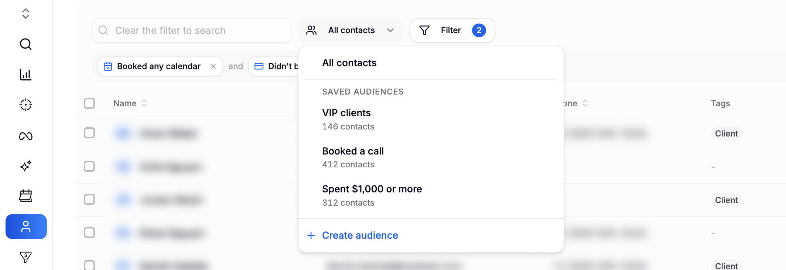
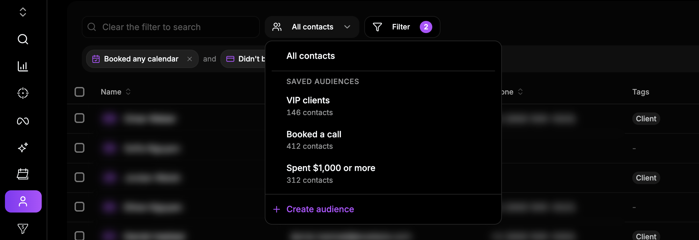

{/* last-verified: 2026-11-01 · route: /business/[businessId]/contacts · screenshots captured on production with every name, email, phone, calendar, tag and ad account swapped to fakes; people's names, emails and phones also blurred · Loom transcript: not processed by Loom yet, add it under the video when it is */}

<iframe src="https://www.loom.com/embed/c9cf8a921eb146c1a6e194aafb02db1e" title="How To Create A Custom Audience & Sync It With Meta" frameborder="0" className="w-full aspect-video rounded-xl" allow="accelerometer; autoplay; clipboard-write; encrypted-media; gyroscope; picture-in-picture; web-share" allowfullscreen />

A custom audience is a list of people that keeps itself up to date.

You pick what the people did. Cortana finds them. When someone starts to match, they join. When they stop, they leave.

You can send the list to Meta. Then your ads reach the right people.

<Frame caption="Your saved audiences are in the list next to the Filter button.">
  
  
</Frame>

## How it works

1. **Filter** your contacts. Pick what the people did.
2. **Save** the filter as an audience.
3. **Send** it to Meta, if you want to.
4. Cortana keeps it up to date every 15 minutes.

## Ideas to start with

- People who booked a call but did not buy.
- People who watched half of your sales video.
- Your top 10% of spenders.
- People who came from one ad.

## What you can filter on

| Filter | For example |
| --- | --- |
| **Booked a call** | Booked, showed up, missed it, or cancelled. |
| **Filled out a form** | Filled out one of your Cortana forms. |
| **Bought something** | Paid with Stripe, PayPal, Whop, Fanbasis, Shopify or WooCommerce. |
| **Spent an amount** | Spent at least $500, or is a top spender. |
| **Is in a pipeline stage** | Has a deal in a stage, or a deal that was won or lost. |
| **Answered a custom field** | Gave an answer in one of your custom fields. |
| **Came from an ad** | Came from Meta, Google, TikTok, LinkedIn or Microsoft ads. |
| **Did something in a webinar** | Registered, attended, missed it, or watched part of it. |
| **Watched a video** | Watched 25%, 50%, 75% or 95% of a video. |
| **Visited a page** | Visited a page like `/pricing`. |
| **Has a conversion** | Has a purchase, a booking or a lead. |
| **Has a tag** | Has a tag, or does not have it. |

## The steps

| Step | What you do |
| --- | --- |
| [1) Filter Your Contacts](/crm/audiences-filter) | Pick the people you want. |
| [2) Save An Audience](/crm/audiences-save) | Keep the filter as an audience. |
| [3) Send An Audience To Meta](/crm/meta-audience-settings) | Send the list to your Meta ad account. |
| [4) Manage Your Audiences](/crm/audiences-manage) | Open, change, sort and delete audiences. |

## FAQ

<AccordionGroup>
  <Accordion title="Where do I find custom audiences?">
    Click **Contacts** in the menu on the left. Your audiences are in the **All contacts** list above the table. The **Filter** button is right next to it.
  </Accordion>

  <Accordion title="Do I need Meta connected?">
    Only to send an audience to Meta. You can filter and save audiences without it.
  </Accordion>

  <Accordion title="Do I have to update the list myself?">
    No. Cortana checks for changes every 15 minutes. It also checks everyone once a day. People who stop matching leave the list, in Cortana and in Meta.
  </Accordion>

  <Accordion title="Can I send an audience to Google Ads?">
    Not yet. Google shows as **Coming soon**.
  </Accordion>

  <Accordion title="How many audiences can I make?">
    Up to 50 in each business.
  </Accordion>

  <Accordion title="Can my AI assistant make audiences for me?">
    Yes, with the Cortana MCP server. See [Audiences](/mcp/tools/audiences).
  </Accordion>
</AccordionGroup>

## Next step

<Card title="1) Filter Your Contacts" icon="filter" href="/crm/audiences-filter">
  Pick the people you want.
</Card>

Stuck? Click the support button at the bottom right of Cortana.
