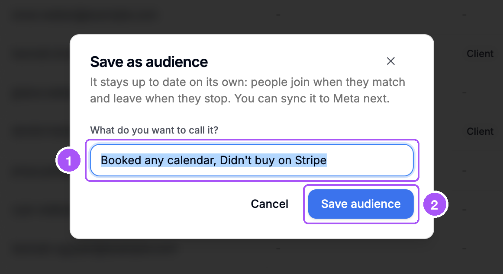
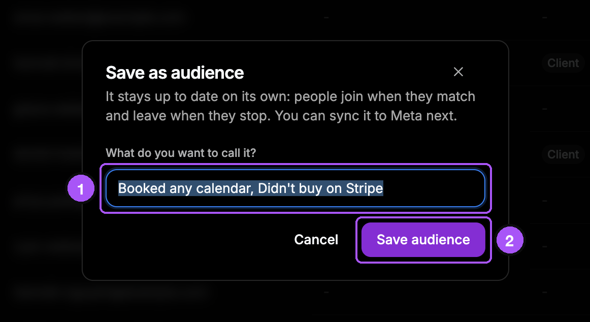
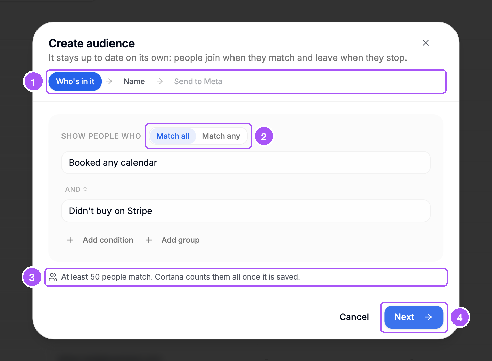
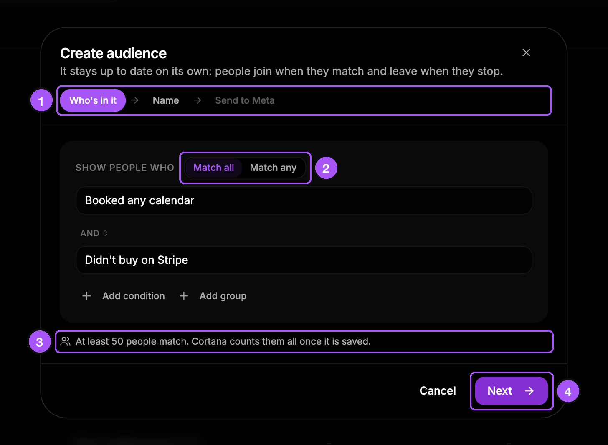
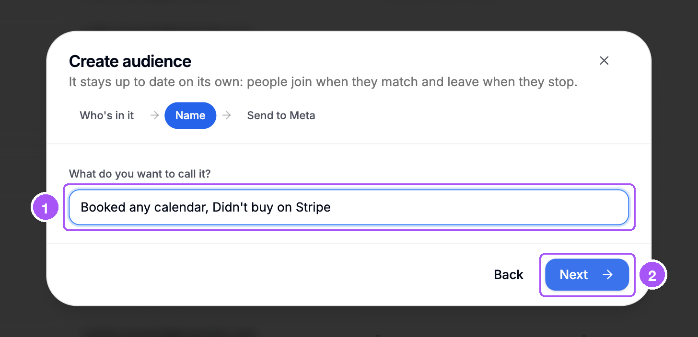
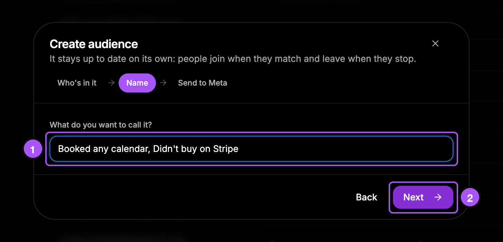
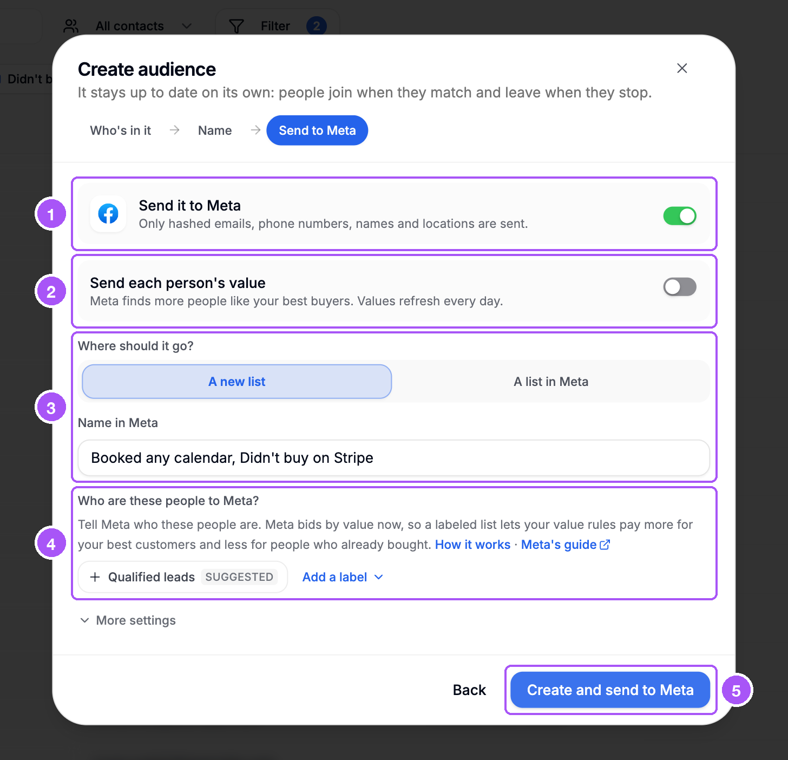
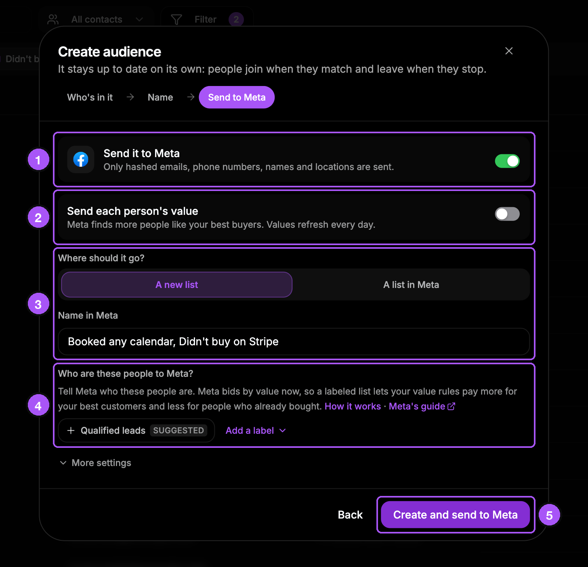

{/* last-verified: 2026-11-01 · route: /business/[businessId]/contacts · source: src/components/audiences/audience-toolbar.tsx, create-audience-dialog.tsx, src/lib/audiences/evaluation-run.ts */}

## Overview

An audience is a filter that Cortana keeps up to date. People join when they match. They leave when they stop matching.

There are two ways to make one:

- **Save as audience**: you already have a filter on. Give it a name.
- **Create audience**: build it in three steps. You can send it to Meta at the same time.

<Note>
  **You need the Edit contacts permission.** Without it, you will not see these buttons.
</Note>

---

## 1. Save the filter you have

<Steps>
  <Step title="Put a filter on">
    See [1) Filter Your Contacts](/crm/audiences-filter).
  </Step>
  <Step title="Click Save as audience">
    It is on the right of the filter strip.
  </Step>
  <Step title="Name it">
    Cortana fills in a name for you. Change it if you like.
  </Step>
  <Step title="Click Save audience">
    The table now shows your new audience.
  </Step>
</Steps>

1. **What do you want to call it?**: the name.
2. **Save audience**: saves it.

<Frame caption="The Save as audience box.">
  
  
</Frame>

Want it in Meta too? See [3) Send An Audience To Meta](/crm/meta-audience-settings).

---

## 2. Or use Create audience

Click **All contacts** above the table. Then click **Create audience** at the bottom of the list.

A box opens with three steps.

<Tip>
  **A filter you already have comes with you.** If a filter is on, the first step starts with it.
</Tip>

### Step 1: Who's in it

1. The three steps. The one you are on is colored.
2. **Match all** or **Match any**. Then add filters with **Add condition** or **Add group**.
3. How many people match right now.
4. Click **Next**.

<Frame caption="Step 1: who is in the audience.">
  
  
</Frame>

### Step 2: Name

1. **What do you want to call it?** Cortana fills in a name. Change it if you like.
2. Click **Next**.

<Frame caption="Step 2: the name.">
  
  
</Frame>

### Step 3: Send to Meta

1. **Send it to Meta**: on means the audience goes to Meta. Turn it off to keep it in Cortana only.
2. **Send each person's value**: leave it off for a normal list.
3. **Where should it go?**: **A new list**, or **A list in Meta** you already have.
4. **Who are these people to Meta?**: pick a label. This is optional.
5. Click **Create and send to Meta**. If Meta is off, the button says **Create audience**.

<Frame caption="Step 3: send it to Meta.">
  
  
</Frame>

Each Meta setting is explained in [3) Send An Audience To Meta](/crm/meta-audience-settings).

<Warning>
  **If Meta says no, nothing is saved.** The box shows the reason above the buttons. Fix it, then click the button again.
</Warning>

---

## 3. Wait for the count

A new audience counts its people first.

- While it counts, you see **Counting members**.
- When it is done, you see the number, like **412 people**.
- This usually takes less than 15 minutes.
- Nothing goes to Meta until the count is done.

<AccordionGroup>
  <Accordion title="How Cortana keeps an audience up to date">
    - **Every 15 minutes**, Cortana checks the people whose details changed. For example, someone who just bought leaves a "did not buy" audience.
    - **Once a day**, after 03:00 UTC, Cortana checks everyone. This is when a "last 30 days" filter lets older people go.
    - **When you change the filter**, Cortana counts everyone again.

    People who match again later join again. Leaving an audience never deletes a contact.
  </Accordion>

  <Accordion title="What the number in step 1 means">
    - **N people match right now.** Cortana found everyone.
    - **At least N people match. Cortana counts them all once it is saved.** Cortana took a quick look. The full count comes after you save.
    - **No match in the first N contacts checked. Cortana checks everyone once it is saved.** The quick look found nobody. The full count may still find people.
    - **Ranking spenders first.** Cortana is ranking your top spenders. This can take a while.
  </Accordion>

  <Accordion title="Limits">
    - Up to 50 audiences in each business.
    - Up to 10 filters in each audience, in up to 5 groups.
    - A name can be up to 255 letters long.
  </Accordion>

  <Accordion title="Who is never in an audience">
    Test contacts. They never join an audience, and never go to Meta.
  </Accordion>
</AccordionGroup>

## FAQ

<AccordionGroup>
  <Accordion title="I saved my audience but it shows nobody. Is it broken?">
    No. It is still counting. The table says **Nobody is in this audience yet. New audiences count their members within 15 minutes.** Check again in a few minutes.
  </Accordion>

  <Accordion title="It says I can only keep 50 audiences. What do I do?">
    Delete an audience you do not use. Then save again. See [4) Manage Your Audiences](/crm/audiences-manage).
  </Accordion>

  <Accordion title="Why is the final count different from the number in step 1?">
    Step 1 takes a quick look. After you save, Cortana checks every contact.
  </Accordion>

  <Accordion title="Can I make an audience without Meta?">
    Yes. Use **Save as audience**. Or turn off **Send it to Meta** in step 3. You can send it to Meta later.
  </Accordion>
</AccordionGroup>

## Next step

<Card title="3) Send An Audience To Meta" icon="share" href="/crm/meta-audience-settings">
  Send your audience to Meta.
</Card>
