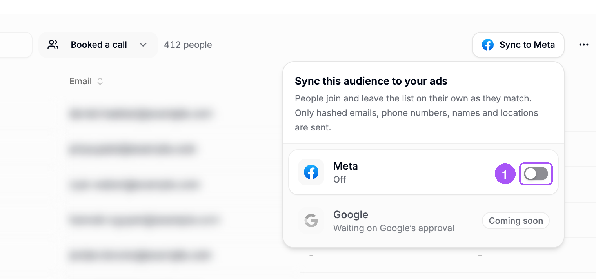
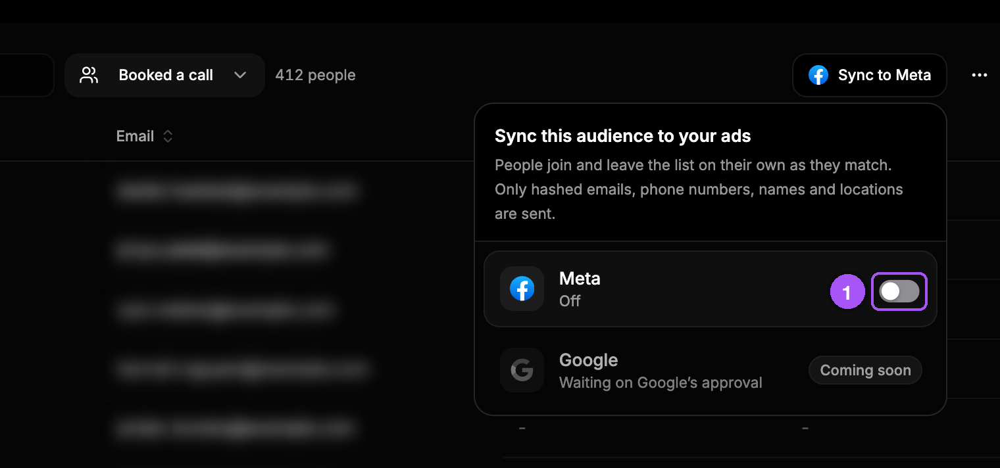
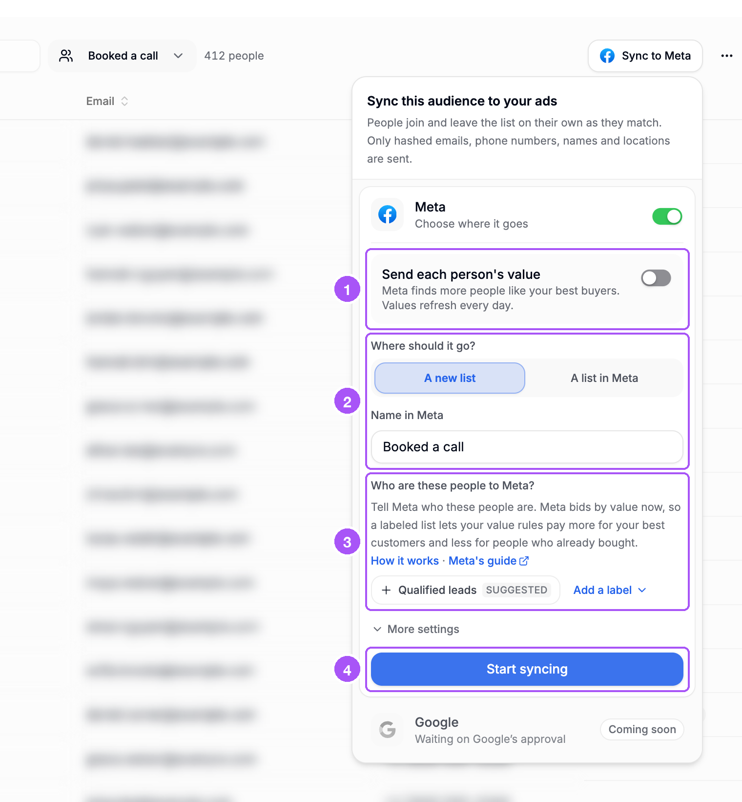
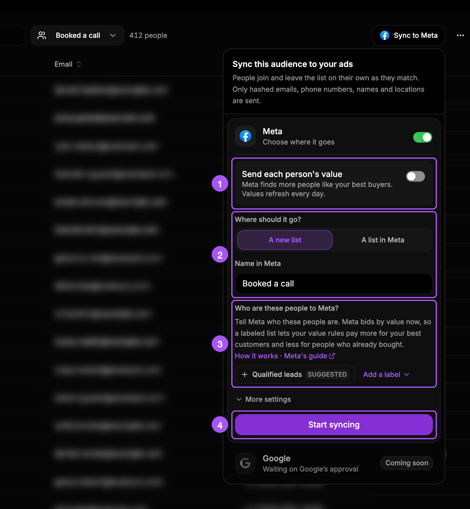
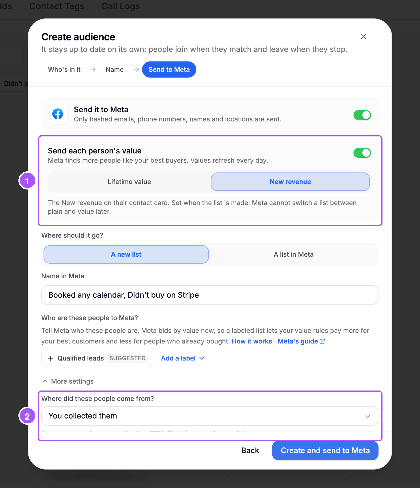
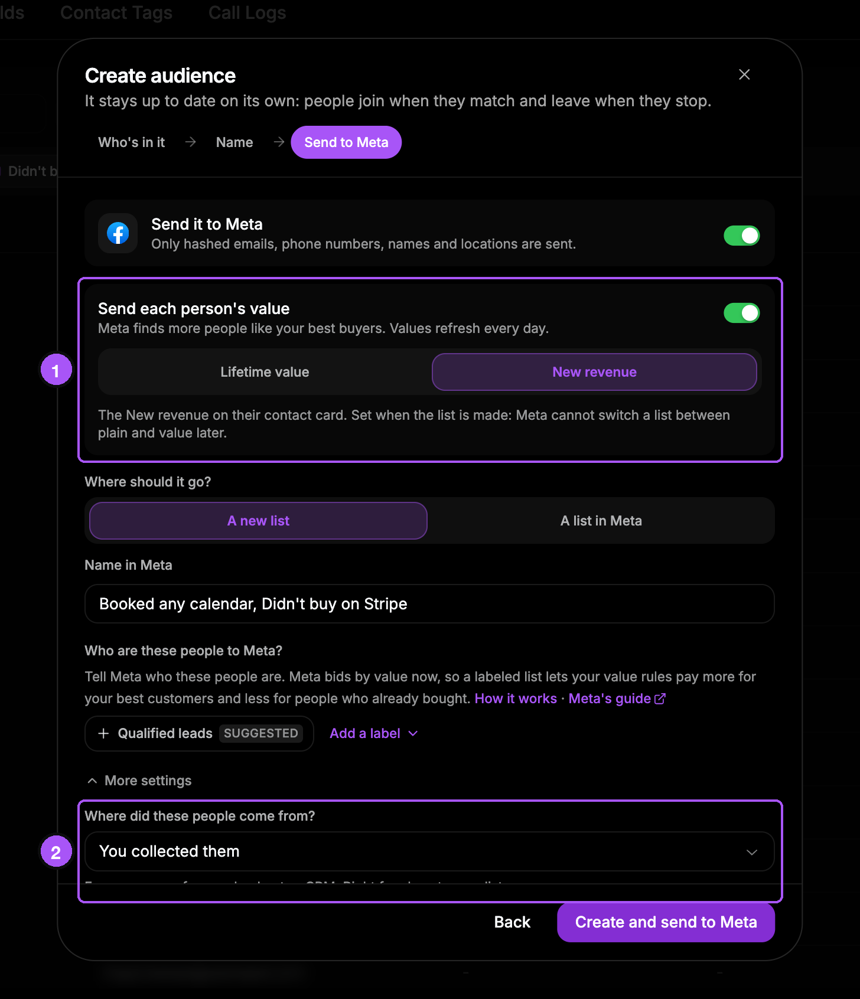
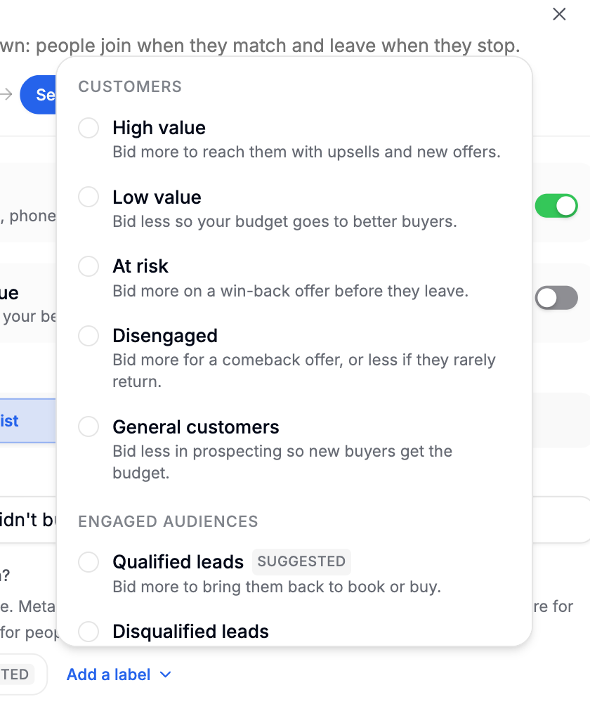
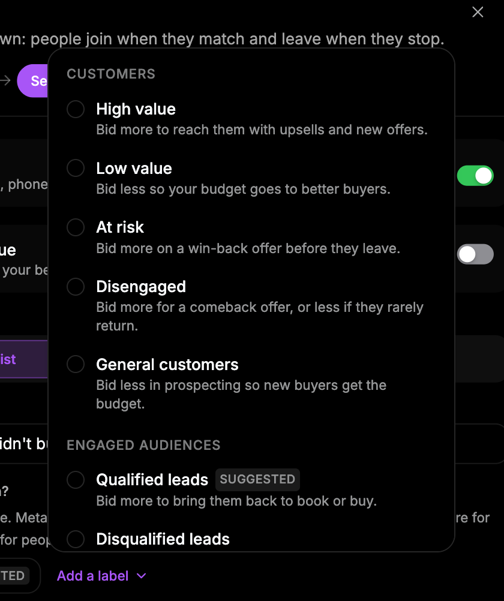
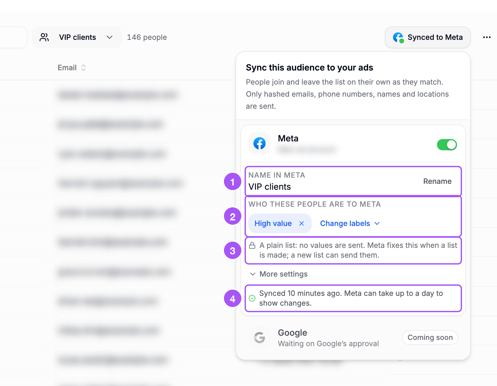
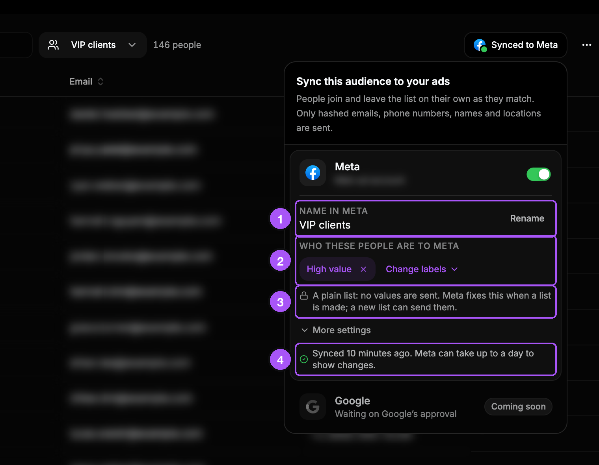

{/* last-verified: 2026-11-01 · route: /business/[businessId]/contacts?audience=<id> · this page is the in-app "How it works" link (src/lib/audiences/meta-labels.ts META_AUDIENCE_HELP_URL); keep its address · source: src/components/audiences/audience-sync-popover.tsx, meta-settings-fields.tsx, meta-sync-settings.tsx, src/lib/audiences/sync/meta.ts, run.ts, hashing.ts */}

## Overview

Any audience can go to Meta as a customer list.

Cortana adds people when they join. It takes them off when they leave. You never upload a file.

Cortana sends emails, phone numbers, names and locations. It scrambles them first, so nobody can read them. Meta uses them to find the same people.

<Note>
  **Before you start:**

  - Connect Meta in **Integrations** and select your ad account there.
  - Save an audience first. See [2) Save An Audience](/crm/audiences-save).
  - You need the **Edit contacts** permission.
</Note>

---

## 1. Turn on Meta

<Steps>
  <Step title="Open your audience">
    Click **All contacts** above the table. Then click your audience.
  </Step>
  <Step title="Click Sync to Meta">
    It is on the right, above the table.
  </Step>
  <Step title="Turn on the Meta switch">
    The settings open. Nothing is sent yet.
  </Step>
</Steps>

1. The **Meta** switch.

<Frame caption="The sync panel with Meta off.">
  
  
</Frame>

---

## 2. Pick the settings

1. **Send each person's value**: leave it off for a normal list. See "Send each person's value" below.
2. **Where should it go?**: pick **A new list** and check the **Name in Meta**. Or pick **A list in Meta** and choose one.
3. **Who are these people to Meta?**: pick a label. This is optional. See "Labels" below.
4. Click **Start syncing**. The first upload happens within 15 minutes.

<Frame caption="The settings.">
  
  
</Frame>

Do you have more than one ad account? Then **Which ad account?** shows first. Pick one.

### Send each person's value

Turn this on to send how much each person spent. Meta then looks for more people like your best buyers.

1. Pick **Lifetime value** or **New revenue**. These are the same numbers you see on a contact card.
2. Under **More settings**, you can say where the people came from. See "Where did these people come from?" below.

<Frame caption="Send each person's value, and More settings.">
  
  
</Frame>

<Warning>
  **You cannot change this later.** Meta decides it when the list is made. To change it, make a new list.
</Warning>

Cortana sends fresh values once a day. Meta has its own terms for lists with values. If you have not accepted them, Cortana shows you a link to accept them.

### Labels

A label tells Meta who the people are. Then Meta can pay more to reach your best customers. You can pick more than one.

<Frame caption="The labels you can pick.">
  
  
</Frame>

| Label | When to use it |
| --- | --- |
| **High value** | Bid more to reach them with upsells and new offers. |
| **Low value** | Bid less so your budget goes to better buyers. |
| **At risk** | Bid more on a win-back offer before they leave. |
| **Disengaged** | Bid more for a comeback offer, or less if they rarely return. |
| **General customers** | Bid less in prospecting so new buyers get the budget. |
| **Qualified leads** | Bid more to bring them back to book or buy. |
| **Disqualified leads** | Bid less so you stop paying to reach them. |
| **App users** | Bid more for an upgrade, less if they're already active. |
| **Trial users** | Bid more while the trial runs to win the paid plan. |
| **Other engaged users** | Bid more on warm people who haven't bought yet. |

Cortana suggests a label that fits your filter. It says **Suggested**. Click it to use it.

---

## 3. Check that it worked

Look at the button above the table:

- **Syncing to Meta**: the first upload is on its way.
- **Synced to Meta**, with a green dot: done.
- **Meta sync failed**, with an orange dot: open it to see why. See "Messages and what to do" below.

Click the button to see more:

1. **Name in Meta**: the list's name in Meta. Click **Rename** to change it.
2. **Who these people are to Meta**: the labels.
3. What kind of list it is. A normal list says **A plain list: no values are sent.**
4. When it last sent, like **Synced 10 minutes ago.** Meta can take up to a day to show changes.

<Frame caption="An audience that syncs to Meta.">
  
  
</Frame>

In Meta Ads Manager, your list is under **Audiences**.

---

## 4. Change or stop it

Open the audience and click its sync button. Then:

- **Rename the list in Meta**: click **Rename**, type a name, click **Save name**.
- **Change the labels**: click **x** on a label to remove it. Or click **Change labels** to pick others.
- **Say where the people came from**: click **More settings**.
- **Move it to another ad account**: pick one under **Which ad account?** This only shows if you have more than one. Cortana makes a new list there.
- **Stop it**: turn off the **Meta** switch. Cortana stops sending. The list stays in Meta.

Want to start again? Turn the switch on. Pick the same list under **A list in Meta**. Cortana sends only what changed while it was off.

<AccordionGroup>
  <Accordion title="What Cortana sends to Meta">
    For each person: email, phone number, first name, last name, city, state, zip code and country. Cortana scrambles each one first, the way Meta asks. A list with values also sends each person's value.

    People with no email and no phone are not sent. Test contacts are never sent.
  </Accordion>

  <Accordion title="How often it sends">
    - Every 15 minutes, Cortana adds new people and removes people who left.
    - Meta can take up to a day to show the changes.
    - Values are sent fresh once a day, for lists up to 10,000 people. On bigger lists, a person's value is sent once, when they join.
    - Sometimes Meta is busy with a list. Cortana waits and tries again. If Meta stays busy, Cortana tries the next day.
  </Accordion>

  <Accordion title="A new list or a list in Meta">
    - **A new list**: Cortana makes a new list in your ad account. The name can be up to 200 letters long.
    - **A list in Meta**: pick a list you already have. Only lists of the right kind show. A list that another audience uses is hidden.

    Cortana keeps the list the same as the audience. People who leave the audience are taken off the list.
  </Accordion>

  <Accordion title="Where did these people come from?">
    This is under **More settings**:

    - **You collected them** (the default): from your own forms, checkout or CRM. Right for almost every list.
    - **A partner collected them**: from a partner or a data provider.
    - **You and a partner**: some from you, some from a partner.
  </Accordion>

  <Accordion title="Audiences with a video filter">
    Some people watch your videos but are not your contacts yet. An audience with a **Watched a video** filter can reach them too. Cortana makes a second Meta audience for them from your video views. Meta keeps them for up to 180 days. Your labels go on this one too.
  </Accordion>

  <Accordion title="Messages and what to do">
    | Message | What to do |
    | --- | --- |
    | **Accept Meta's Custom Audience terms for this ad account, then sync again** | Open the link in the message and accept. |
    | **Accept Meta's terms for value lists on this ad account, then sync again** | Open the link in the message and accept. |
    | **Meta is disconnected. Reconnect Meta in Integrations, then sync again.** | Reconnect Meta in **Integrations**. |
    | **That Meta ad account is no longer selected in Integrations.** | Select it again in **Integrations**. |
    | **That Meta ad account is no longer connected to this workspace.** | Pick another ad account. |
    | **Meta is still updating this list** | Nothing. Cortana tries again by itself. |
    | **Meta could not be reached** or **Meta asked us to slow down** | Nothing. Cortana tries again by itself. |
    | **The list was deleted in Meta.** | Nothing. Cortana makes a new list and adds everyone again. |

    When a sync fails, Cortana tries again by itself an hour later.
  </Accordion>

  <Accordion title="Google Ads">
    Google shows as **Coming soon**. It is waiting on Google's approval.
  </Accordion>
</AccordionGroup>

## FAQ

<AccordionGroup>
  <Accordion title="I turned it on but I don't see the list in Meta. Why?">
    The first upload happens within 15 minutes, after the audience finishes counting. Then Meta can take up to a day to show it.
  </Accordion>

  <Accordion title="Why is my list smaller in Meta than in Cortana?">
    Meta only counts people it can find on Meta. People with no email and no phone are not sent at all.
  </Accordion>

  <Accordion title="Do I have to upload the list again when people change?">
    No. Cortana adds and removes people by itself every 15 minutes.
  </Accordion>

  <Accordion title="If I delete the audience in Cortana, is the Meta list deleted?">
    No. The list stays in Meta in case an ad uses it. Delete it in Meta Ads Manager if you do not need it.
  </Accordion>

  <Accordion title="Can I add values to a list later?">
    No. Meta decides this when the list is made. Make a new list with **Send each person's value** turned on.
  </Accordion>

  <Accordion title="The Meta switch is grey and I can't click it. Why?">
    No Meta ad account is selected for this business. Select one in **Integrations** first.
  </Accordion>
</AccordionGroup>

## Next step

<Card title="4) Manage Your Audiences" icon="list" href="/crm/audiences-manage">
  Open, change, sort and delete your audiences.
</Card>
