{/* last-verified: 2026-11-17 against the extension source (AgentKong-Chrome-Extension 4.58, sprint payment-link-product-price: src/popup/payment-builder/CreateLinkTab.tsx and product-price/) · surface: extension popup > Payment Link tab > Create Link */}

{/* TODO: verify. No Loom walkthrough was supplied for this page. When one is recorded, embed it
    here with a verbatim transcript inside an <Accordion title="Video transcript"> for the KB. */}

## What this tab does

The **Payment Link** tab is the popup's default tab. You save a payment configuration once as a **template**, then send a **link** from it to a specific contact whenever you need one.

Templates are reusable. A link is made for one person at the moment you press send, and that is what ties the payment back to them.

<Tip>
  A payment link is a card form. If the buyer still needs testimonials or what's included, switch to the **Tracking Links** tab and send your sales page instead. Same contact picker. See [Send a sales page](/sales/send-a-sales-page).
</Tip>

This page documents extension version **4.58**.

<Note>
  **Before you start**

  - The extension **connected**, with a **business selected**. Without one the tab reads **You have to select a business first.** See [Install and connect](/extension/install-and-connect).
  - The payment platform **connected to that business** in the Cortana web app.
  - An **All Access** key if you connected by key. Sending is a write and a Read Only key refuses it.
</Note>

## The tab at a glance

<Frame caption="The Payment Link tab with saved templates.">
  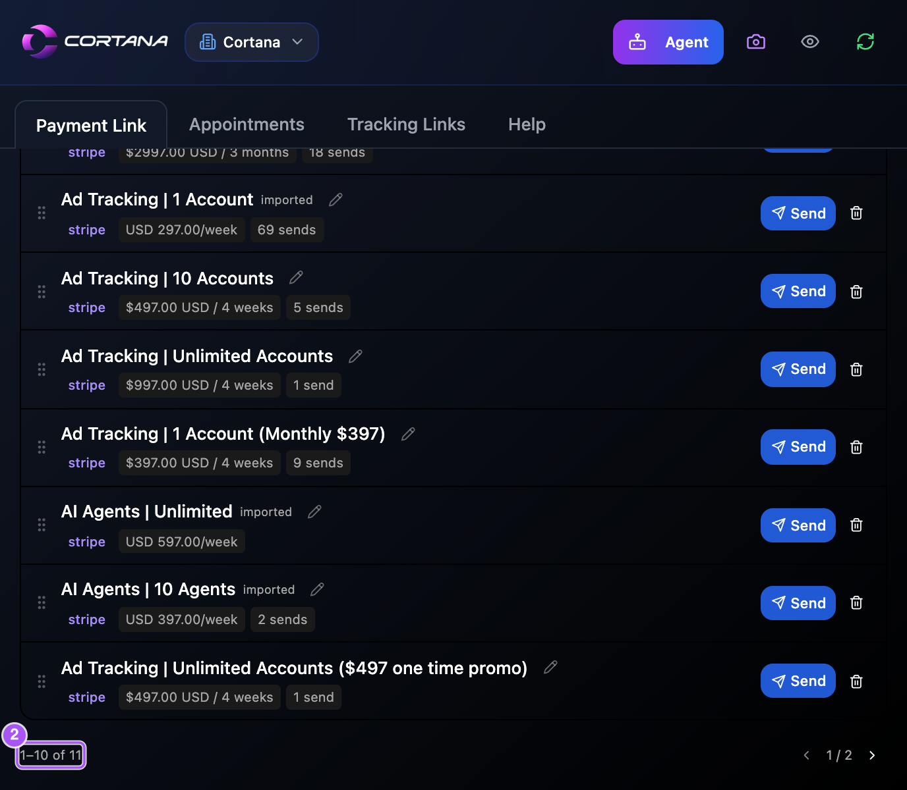
</Frame>

**My Links** lists your templates. **Create Link** builds a new one. The count beside **Payment Links** tells you how many you have.

On a new business the list is empty until you make your first template.

<Frame caption="The Payment Link tab before any templates exist.">
  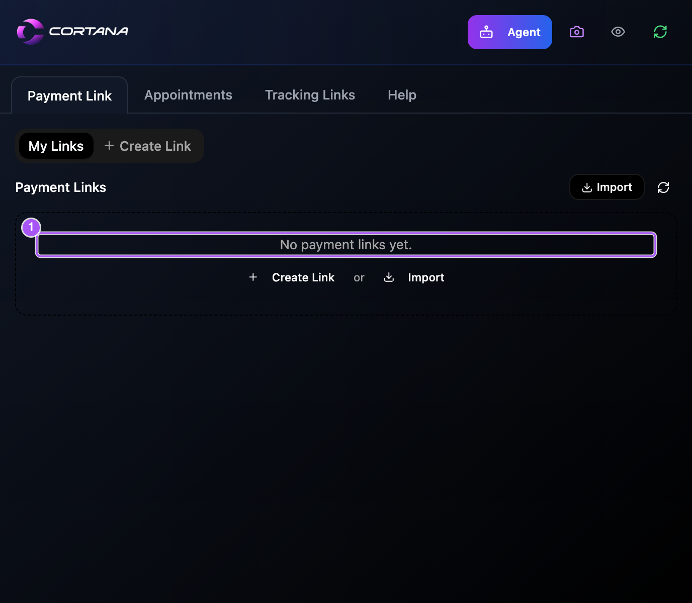
</Frame>

## Create a template

<Steps>
  <Step title="Open Create Link and choose a platform">
    Click **Create Link**. Under **Platform**, four tiles sit in one row, each with its logo and name: **Whop**, **Stripe**, **Commas** and **PayPal**. Click one and its fields appear below the row.

    **Commas** is Fanbasis. The fields under the Commas tile say **Commas (Fanbasis)**.

    <Frame caption="Choosing the payment platform for a new template.">
      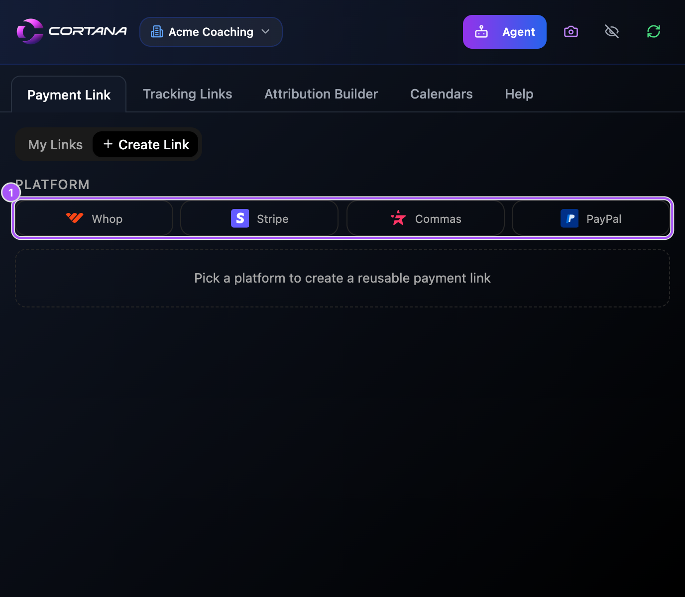
    </Frame>

    Until you pick one, the tab reads **Pick a platform to create a reusable payment link**. Switching to another tile clears what you had picked.
  </Step>

  <Step title="Fill in the platform's fields">
    Stripe, Whop and Commas work the same way: the account, then the **Product**, then its **Price**. Each field appears once the one above it is chosen, and **Price** lists only the prices of the product you picked. Picking another product clears the price. PayPal keeps its own fields.

    <AccordionGroup>
      <Accordion title="Stripe">
        1. **Stripe account**: the account to charge through. Each account shows **Live** or **Test** after its name. When the business has only one connected Stripe account, it is picked for you.
        2. **Product**: open the list and pick the product. Type in **Search products** to filter a long list.
        3. **Price**: pick one of that product's prices, for example **$397.00 USD / month**. When the product has only one price, it is picked for you.

        <Frame caption="Building a Stripe template: account, product, then price.">
          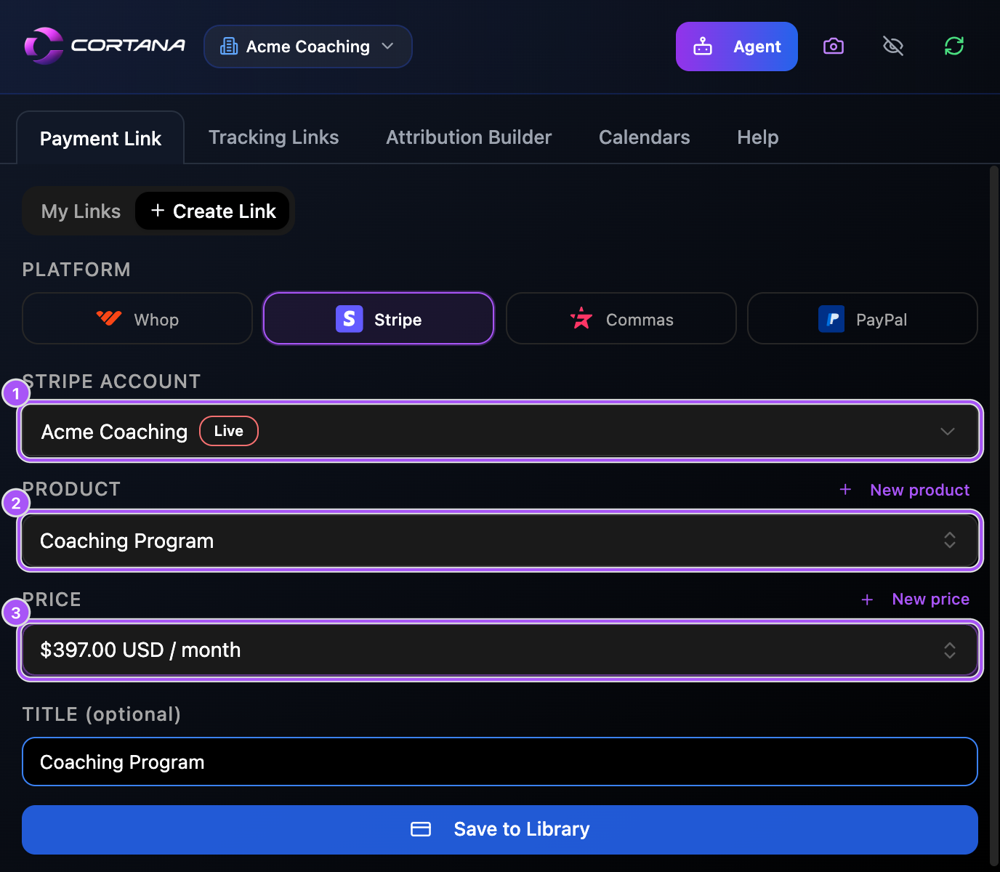
        </Frame>
      </Accordion>

      <Accordion title="Whop">
        1. **Whop company**: pick the company.
        2. **Product**: pick the product. Type in **Search products** to filter a long list.
        3. **Price**: pick one of that product's plans. Each plan reads by what it charges, for example **$997.00 USD** or **$500.00 USD / month · 2 payments**. When the product has only one plan, it is picked for you.

        <Frame caption="Building a Whop template, with the picked product's prices open.">
          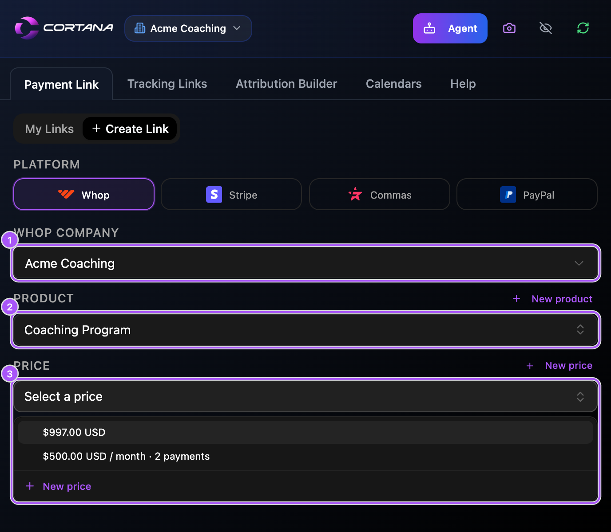
        </Frame>
      </Accordion>

      <Accordion title="PayPal">
        Pick the PayPal account and set the payment details.

        <Frame caption="Building a PayPal template.">
          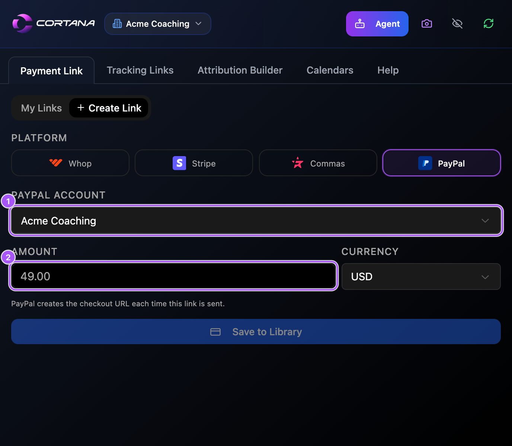
        </Frame>
      </Accordion>

      <Accordion title="Commas (Fanbasis)">
        1. **Commas (Fanbasis) account**: pick the account. A sandbox account shows **Sandbox** after its name.
        2. **Product**: pick the product. Each product shows its Commas price after its name, when it has one.
        3. **Price** and **Billing**: Commas keeps no list of prices, so you set this link's own price and billing under the product.
           - **Price**, in the product's currency (for example **Price (USD)**): leave it empty to sell at the product's price, which the line under the field names. Type another amount to sell this link at a different price. A product with no price on Commas needs one typed here. Commas prices start at 1.00.
           - **Billing**: **One-time**, **Weekly**, **Every 2 weeks**, **Every 4 weeks**, **Monthly**, **Every 3 months**, **Yearly** or **Custom** (every 1 to 365 days).
           - **Stop after** and **Free trial**: on a recurring link only. **Stop after** ends it after 1 to 999 payments; empty means **Until canceled**. **Free trial** delays the first charge by 1 to 365 days; empty means **None**.

        A line under the fields says what the buyer pays, for example **Commas charges the buyer $797.00 USD every 30 days, 3 times in all.**

        <Frame caption="Building a Commas (Fanbasis) template: account, product, then this link's price and billing.">
          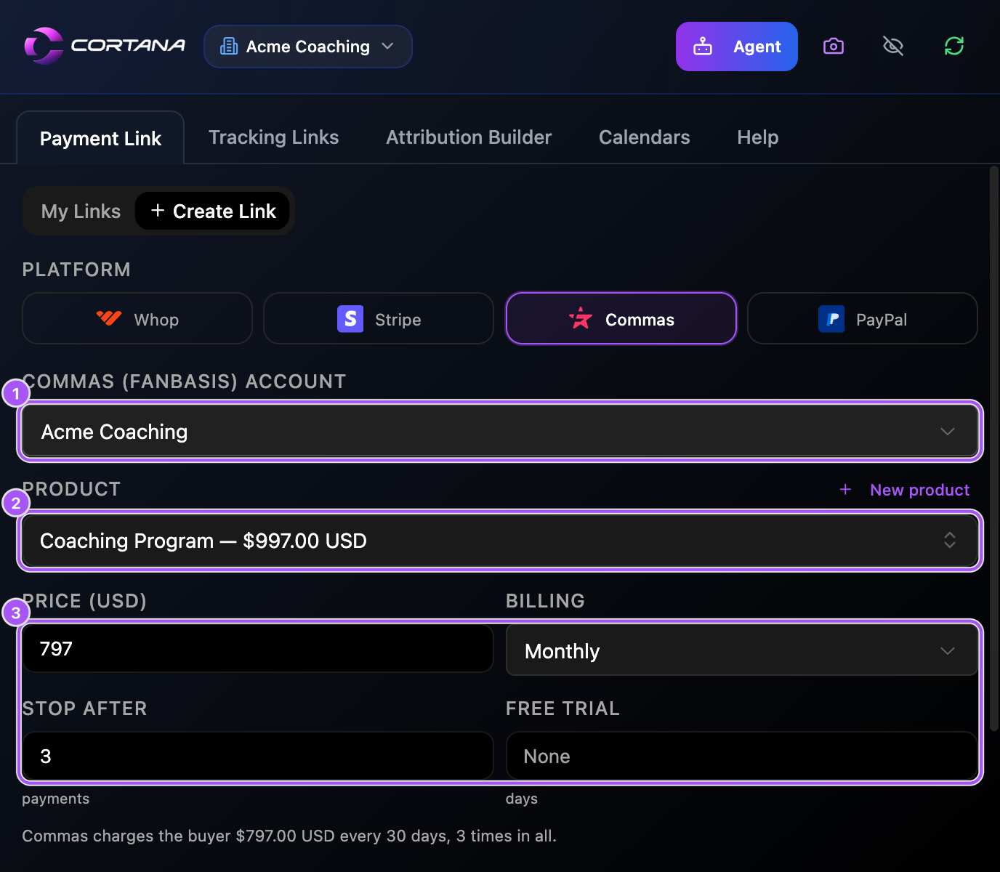
        </Frame>

        In **My Links**, a template made here is tagged **fanbasis**.
      </Accordion>
    </AccordionGroup>

    If the account field says **No connected Stripe accounts.**, **No active Whop connections.**, **No active Commas (Fanbasis) connections.** or **No connected PayPal accounts.**, that platform is not connected to this business yet. Connect it in the web app.

    The product or price you need is not there? Make it on the spot with **+ New product** or **+ New price**. See [New product and new price](#new-product-and-new-price).
  </Step>

  <Step title="Save the template">
    Once the pick is complete (on Commas, once a product is picked), **Title (optional)** appears, filled with the product's name. Type your own to rename the template. Click **Save to Library**. The toast says **Payment link saved** and the template appears in **My Links** ready to send. Templates are per business.

    On Commas, **Save to Library** opens as soon as a product is picked. If the price or billing is not finished, clicking it says what is missing, for example **Commas prices start at 1.00.**, and saves nothing.
  </Step>
</Steps>

## New product and new price

Make a missing product, or a new price on a product, without leaving **Create Link**. **+ New product** works on Stripe, Whop and Commas. **+ New price** works on Stripe and Whop.

Each one opens from two places:

- The **+ New product** or **+ New price** link to the right of the field's label.
- The last row of the open list, **New product** or **New price**.

An empty list offers the same thing in its place: **No products yet** with **Create one**, or **No prices yet** with **Add one**.

<Steps>
  <Step title="Open New price">
    Pick the product first. Then click **+ New price** beside **Price**, **New price** at the bottom of the price list, or **Add one** when the product has no prices yet. The popover names the product it adds to, for example **Adds a price to Coaching Program on your Stripe account, ready to sell immediately.** It never asks which product.
  </Step>

  <Step title="Set the price and billing">
    Enter the **Price** and choose the **Billing**: **One-time**, **Weekly**, **Every 4 weeks**, **Monthly**, **Every 3 months**, **Yearly** or **Custom** (every so many **days**, **weeks** or **months**, up to a year). On Whop, a recurring price also has **More options**: **Stop after** (2 to 115 payments) and **Free trial** (1 to 365 days).
  </Step>

  <Step title="Click Create price">
    The price is made on the platform, added to the product you picked, and selected for you. The toast says **New price on** and the product's name.
  </Step>
</Steps>

<Frame caption="Adding a price to the picked product from the Price label.">
  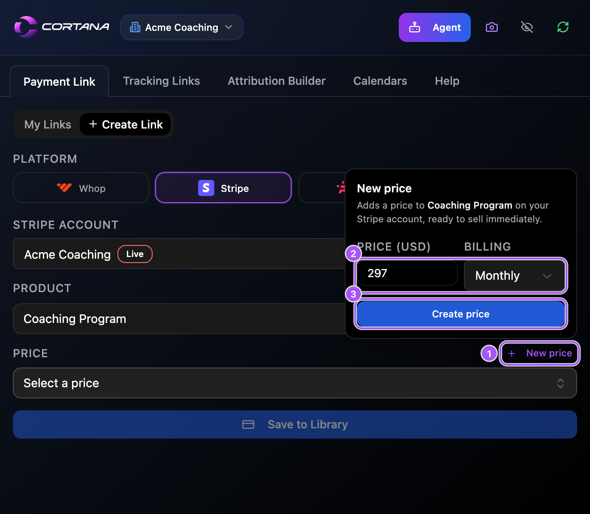
</Frame>

**+ New product** asks for a **Name**, a **Price** and, on Stripe and Whop, the **Billing**. Click **Create product** and the new product is selected for you, with its price.

- **Stripe**: the product and its first price are made on your Stripe account, in the account's currency, ready to sell immediately.
- **Whop**: the product is made on your Whop company with its priced plan, in USD. Names run up to 80 characters and prices start at $1.00.
- **Commas**: nothing is made on Commas. The name and price become this link's own offer, created fresh on every checkout. Set how often it bills under **Billing**, below the product. Prices start at $1.00. The toast ends **ready: save the link to finish**.

Commas has no **+ New price**: its price and billing are set on each link, under the product.

## Send a link to a contact

<Steps>
  <Step title="Find the contact">
    Use the **Send to** search at the top of the tab. It searches by name, email or phone, with the placeholder **Search by name, email, or phone...**

    <Frame caption="Choosing the contact to send a payment link to.">
      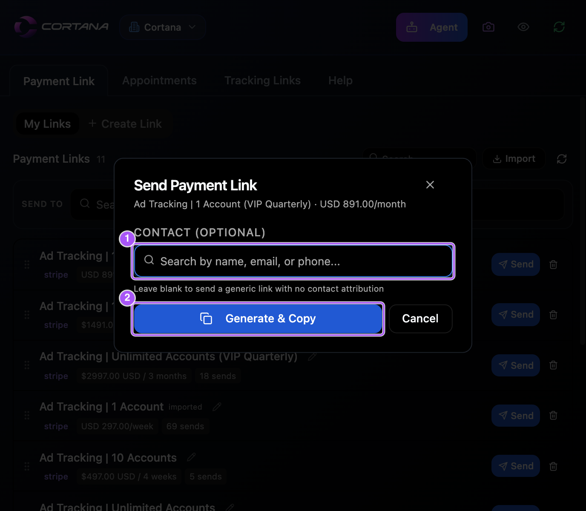
    </Frame>
  </Step>

  <Step title="Send from the template">
    With a contact chosen, press **Send** on the template you want. Cortana makes a link for that contact and sends it.

    A toast confirms the send, naming the contact. When the link is also copied to your clipboard the toast says so, ending in **· copied**.

    <Warning>
      **Send makes a real payment link and sends it to a real person.** There is no preview step between the button and the customer. Check the contact and the template before you press it.
    </Warning>
  </Step>

  <Step title="Send the same template to several people">
    Pick a contact in the bar at the top and press **Send** on each template you want them to get, without re-searching each time.

    <Frame caption="The contact bar used for sending several templates to one person.">
      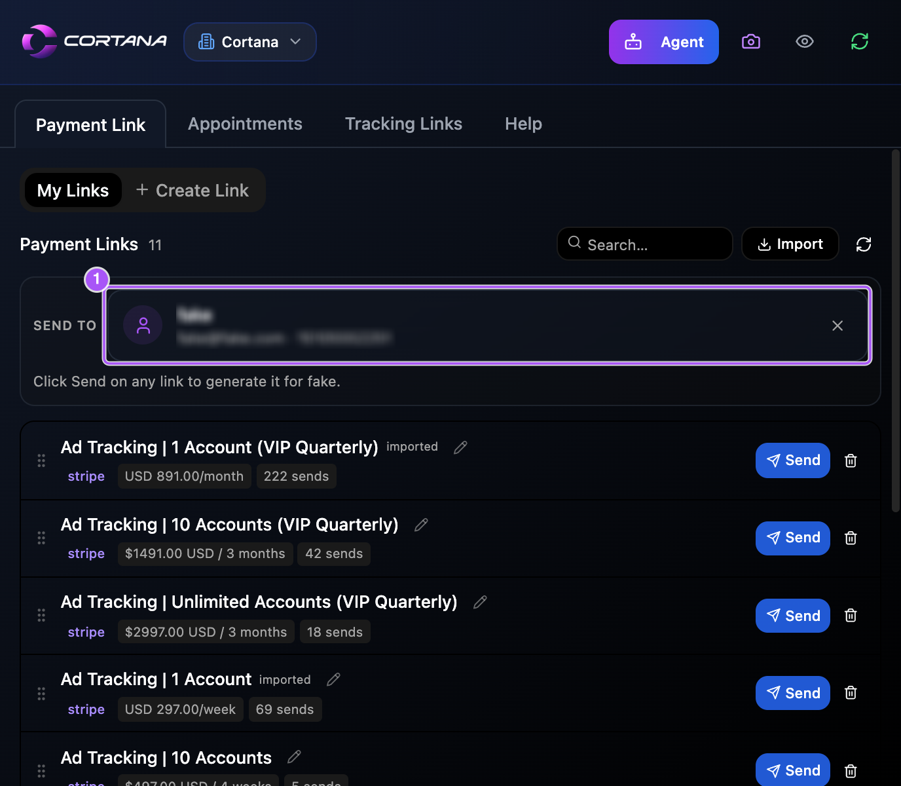
    </Frame>
  </Step>
</Steps>

## Sub-functionality

<AccordionGroup>
  <Accordion title="Import existing Stripe links">
    **Import** pulls payment links that already exist in your Stripe account into Cortana as templates, so you do not rebuild them by hand.

    <Frame caption="Importing existing links from Stripe.">
      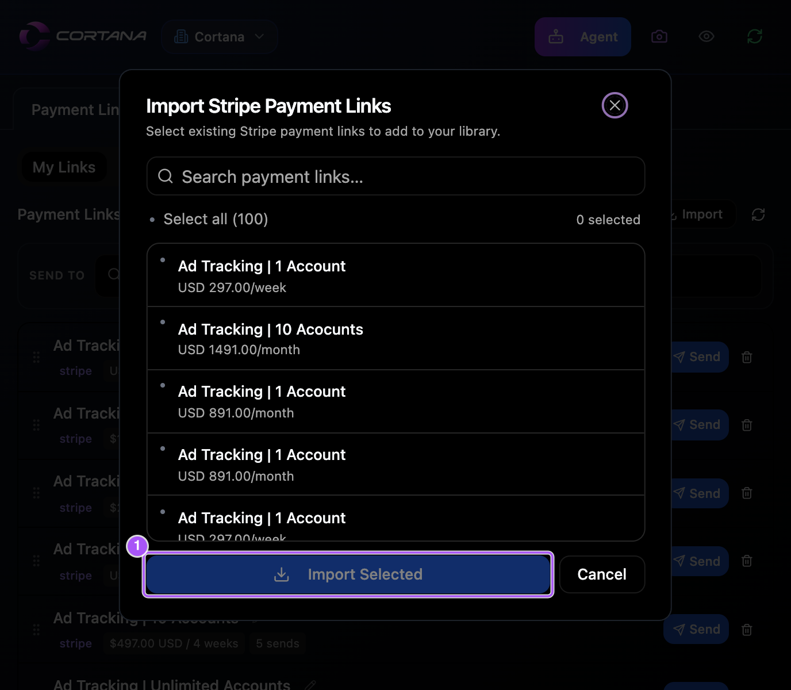
    </Frame>

    Imported templates are marked as imported in the list.
  </Accordion>

  <Accordion title="Rename and remove templates">
    Each row carries a rename control and a delete control. Renaming confirms with **Renamed**, removing with **Removed**. Removing a template does not revoke links already sent.
  </Accordion>

  <Accordion title="Search your templates">
    Once you have more than a screenful, the **Search…** box above the list filters by name.
  </Accordion>

  <Accordion title="No business selected">
    Every tab needs a business. Until you pick one the tab reads **You have to select a business first.**

    <Frame caption="The Payment Link tab with no business selected.">
      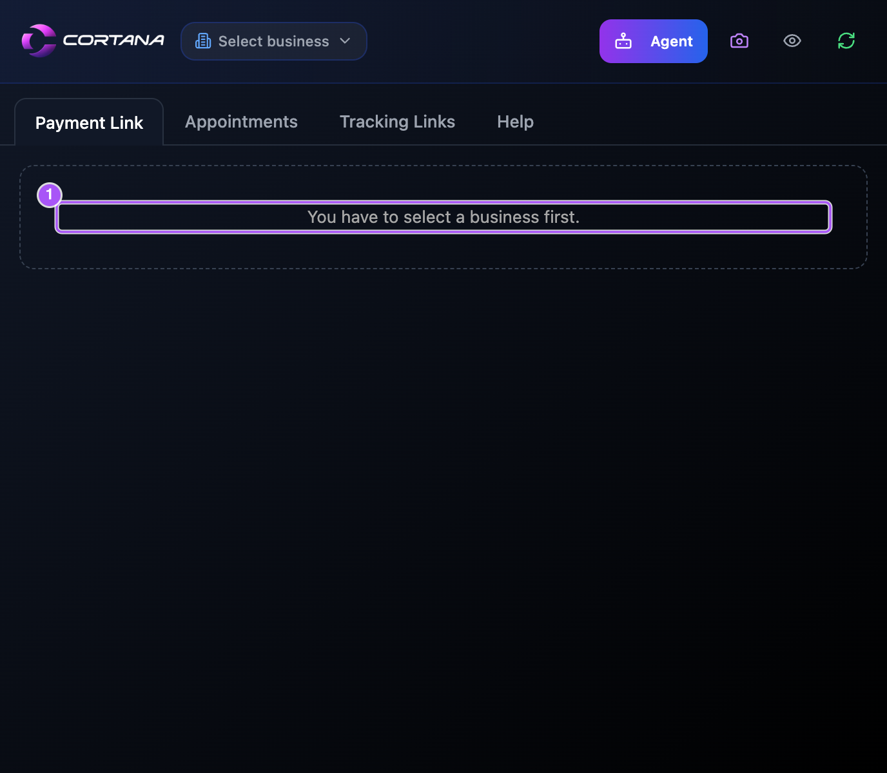
    </Frame>
  </Accordion>
</AccordionGroup>

## Settings reference

| Setting | What it does | Default | Our recommendation | Caveat |
|---|---|---|---|---|
| **Platform** | Which processor the template uses: **Whop**, **Stripe**, **Commas** (Fanbasis) or **PayPal** | None | Match where the business takes payment | Only connected platforms load options |
| **Account** | Which connected account to charge through | Stripe and PayPal: the only account, when there is one. Whop and Commas: none | Check on multi-account businesses | A "No connected" or "No active" line means not connected |
| **Product** | What the customer buys (Stripe, Whop, Commas) | None | Type in **Search products** rather than scroll | Comes from the platform; **+ New product** makes one from the popup |
| **Price** | Which of the picked product's prices the link charges (Stripe, Whop) | The product's only price, when it has one | Pick the product first: the list shows only its prices | **+ New price** adds one to the picked product |
| **Price** and **Billing** (Commas) | This link's own amount and how often it charges | The product's price, **One-time** | Leave **Price** empty to sell at the product's price | Commas prices start at 1.00 |
| **Stop after** and **Free trial** (Commas) | End a recurring link after 1 to 999 payments, and delay its first charge by 1 to 365 days | **Until canceled**, **None** | Set **Stop after** for a payment plan | Recurring billing only |
| **Title (optional)** | The template's name in **My Links** | The product's name | Rename to tell two prices of one product apart | Stops following the product once you type |
| **Send to** | The contact who receives the link | Empty | Always set before pressing Send | The link is made for this person |
| **Import** | Brings existing Stripe links in as templates | Not applicable | Use it instead of rebuilding | Stripe only |
| **Search…** | Filters your template list | Empty | Use past a screenful | Filters names |

## Troubleshooting

<AccordionGroup>
  <Accordion title="The tab says I have to select a business first">
    Pick a business in the popup header. Every tab reads from it.
  </Accordion>

  <Accordion title="My platform's dropdown is empty">
    The account field reads **No connected Stripe accounts.**, **No active Whop connections.**, **No active Commas (Fanbasis) connections.** or **No connected PayPal accounts.** That platform is not connected to this business. Connect it in the Cortana web app, then reopen the popup.

    If the account is there but its product list is empty, the field reads **No products yet**. Click **Create one** to make a product from the popup.
  </Accordion>

  <Accordion title="Create product or Create price says No answer from the server">
    The request may have gone through before the answer was lost.

    - After **Create price**, try again from the same form. It will not make a second price.
    - After **Create product**, check your products on the platform first. The product may have been made, and a second try can make another.
  </Accordion>

  <Accordion title="Send fails or nothing happens">
    If you connected with an API key, check it is **All Access**. Sending is a write, and a **Read Only** key cannot do it. See [Install and connect](/extension/install-and-connect).
  </Accordion>

  <Accordion title="The popup says I am not signed in">
    Reconnect from the popup.
  </Accordion>

  <Accordion title="I created a template in the web app and cannot see it here">
    Close and reopen the popup to refetch. The extension caches what it has already loaded.
  </Accordion>

  <Accordion title="Nothing above helped">
    Reload the extension at `chrome://extensions`, then reopen the popup.
  </Accordion>
</AccordionGroup>

## FAQ

<AccordionGroup>
  <Accordion title="What is the difference between a template and a link?">
    A **template** is the saved configuration, for example a Stripe product at a price. A **link** is what it makes for one contact when you press Send.
  </Accordion>

  <Accordion title="Which platforms are supported?">
    Four: Stripe, Whop, Commas and PayPal. Commas is Fanbasis: its tile says **Commas** and its fields say **Commas (Fanbasis)**.
  </Accordion>

  <Accordion title="I picked my product but the price I want is not in the list">
    **Price** lists only the prices of the product you picked. Check the product, or add the price with **+ New price** beside **Price**. It is made on Stripe or Whop, added to that product, and selected for you. See [New product and new price](#new-product-and-new-price).
  </Accordion>

  <Accordion title="Why won't my Commas link save?">
    Commas prices start at 1.00. Under that, the form says **Commas prices start at 1.00.** and **Save to Library** saves nothing, whether the amount is one you typed or the product's own. Type a price of 1.00 or more. A custom billing period, **Stop after** or **Free trial** outside its range stops the save the same way, with a line saying the allowed range.
  </Accordion>

  <Accordion title="Can I send without choosing a contact?">
    No, and that is deliberate. The contact is what ties the payment back to the person and their journey.
  </Accordion>

  <Accordion title="Can I add testimonials to the payment link?">
    Not on the checkout form. Put testimonials on your sales page, embed the checkout there, and send that page from the **Tracking Links** tab. See [Send a sales page](/sales/send-a-sales-page).
  </Accordion>

  <Accordion title="Does deleting a template kill links I already sent?">
    No. Removing a template stops you sending new links from it.
  </Accordion>

  <Accordion title="Where do payments show up afterwards?">
    Against the contact, and in your conversion columns if that payment is one of your tracked conversion sources. See [Contact details and journey](/extension/contact-details-and-journey).
  </Accordion>
</AccordionGroup>

## Next step

<CardGroup cols={2}>
  <Card title="Appointments" icon="calendar" href="/extension/appointments">
    See the calendar, change a status, and create a booking from the popup.
  </Card>

  <Card title="Tracking links" icon="link" href="/extension/tracking-links">
    Make a tracking link for one contact from a saved destination.
  </Card>
</CardGroup>
