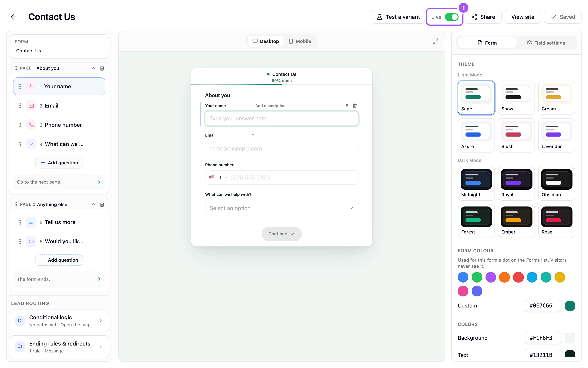
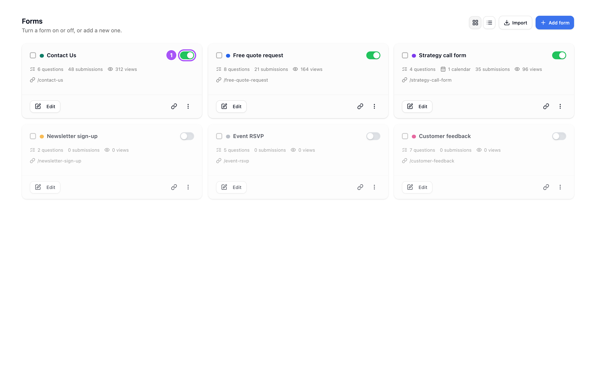
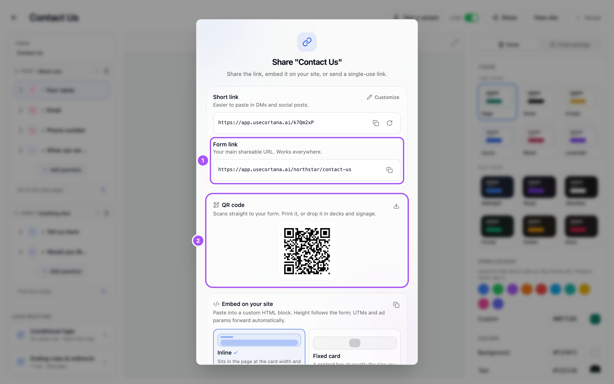
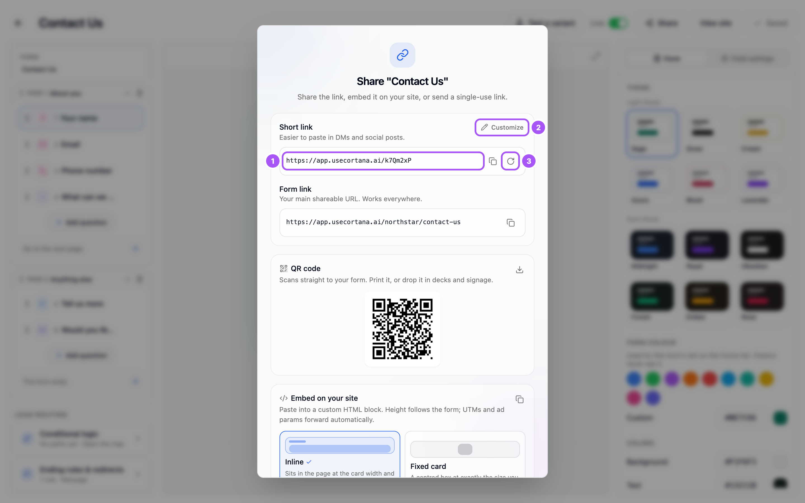
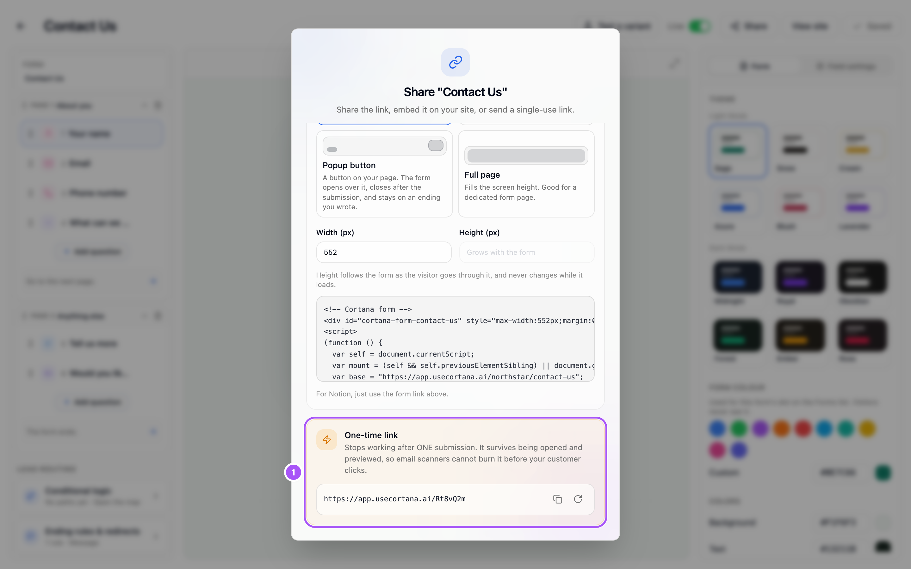
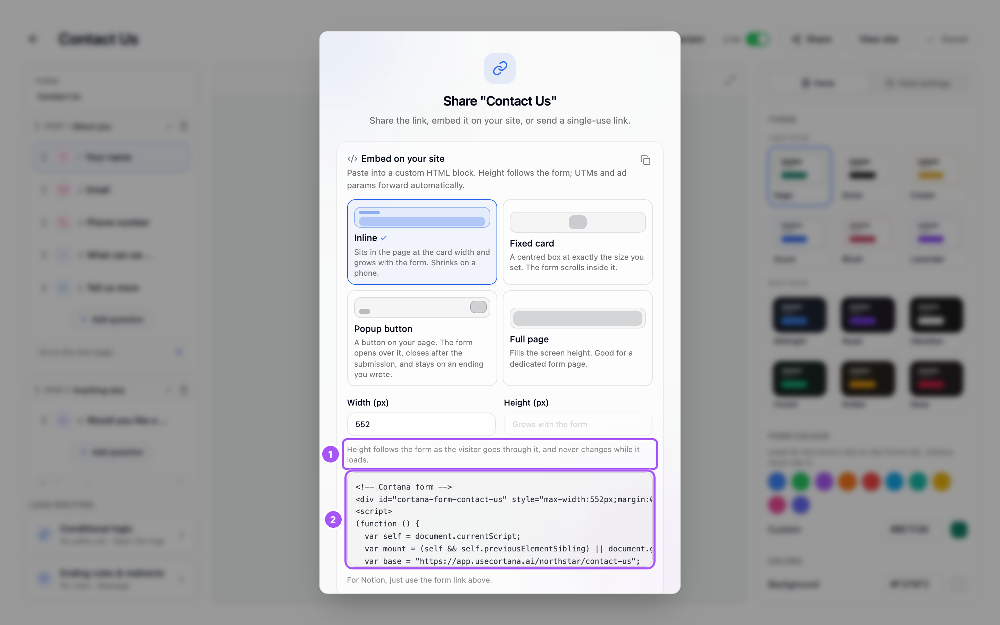
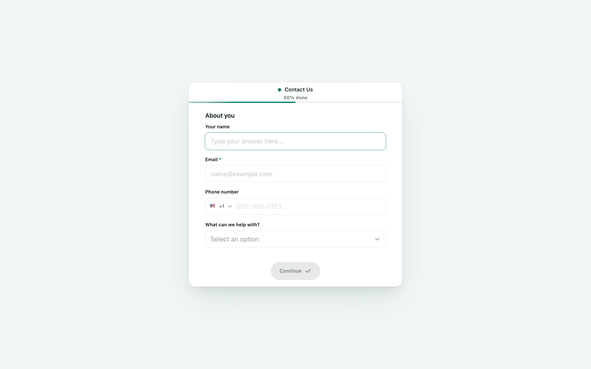
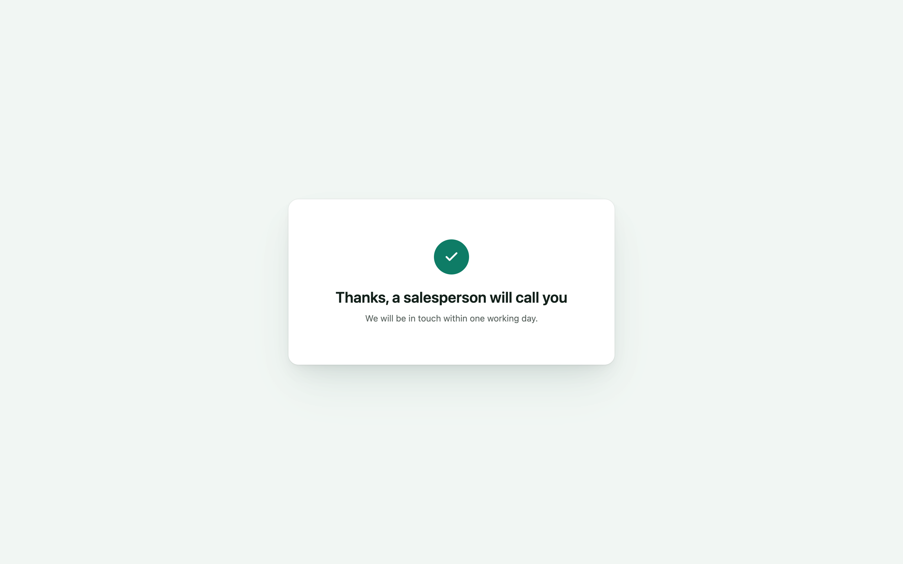

{/* last-verified: 2026-11-28 (the whole page against the app: the builder's top bar, the Share box top to bottom (Short link, Form link, QR code, Embed on your site, One-time link), the Forms list card, the public form and its ending; every picture retaken from today's app on the Sage theme, one light picture each) · route: /business/[businessId]/forms/[formId], Share dialog */}

A form is off when you make it. Off means it has no page, so nobody can reach it.

This page turns it on and hands you five ways to get it in front of people. Then it walks you through filling your own form in, which you should always do once.

<Note>
  **Before you start.** Your form should be finished. See [Build your form](/forms-build) and [Design and endings](/forms-design).

  Rewrite the ending first. A new form thanks people in our wording, not yours. Nothing here needs a domain or a paid plan.
</Note>

## 1. Turn the form on

In the builder, the switch sits at the top right, just left of **Share**. The word beside it reads **Off** or **Live**. Click it. The word changes to **Live** and a **View site** button appears next to **Share**.

<Frame caption="The switch at the top of the builder. Live means the form's page is online.">
  
</Frame>

The same switch sits on the form's card in the Forms list, at the right end of the line with its name. Either one does the job.

<Frame caption="The same switch on the Forms list. A form that is off looks faded.">
  
</Frame>

<Warning>
  **Fill your own form in before you send the link anywhere.**

  Nothing checks it for you, so a form with no questions can be switched on, and so can one whose ending still says *Your answers have been received*.

  Section 6 walks you through it and takes two minutes.
</Warning>

## 2. Get the link

Click **Share** at the top of the builder, between the switch and **View site**. On the Forms list, the link button at the bottom right of a form's card, beside its three-dot menu, opens the same box.

A box opens headed **Share "Contact Us"**, with your form's name, and the line *Share the link, embed it on your site, or send a single-use link.* On a form that is still off, the box only says *Turn this form on first. Until then it has no public address to share.*

<Frame caption="Share opens everything at once. There are no tabs inside it.">
  
</Frame>

**Form link** is the second row, under **Short link**, described as *Your main shareable URL. Works everywhere.* This is the address to give people. Click the copy button at the right of the row. It turns into a green tick for a moment.

<Frame caption="1 is the Form link: copy it here. 2 is the QR code, which opens the same address.">
  
</Frame>

### What the address looks like

The Form link already carries your handle, the short word your booking links use. Send it as it is.

| Address | Looks like |
| --- | --- |
| **The Form link**, with your handle | `https://app.usecortana.ai/your-handle/contact-us` |
| **Your business id**, which is what **View site** opens | `https://app.usecortana.ai/f/8f3c…/contact-us` |

Both open exactly the same form. An address you copied before, such as `https://app.usecortana.ai/your-handle/f/contact-us`, keeps working too.

If you connected your own domain, a **Domain** box sits at the top of **Share**. With your domain picked, the Form link reads `https://yourdomain.com/contact-us`, with the line *Served straight from your domain, with no redirect.* Pick the Cortana address in the box to share that one instead.

<Note>
  **Where the ending of the address comes from.**

  The first real name you gave the form set it, and it is fixed after that. [Create your form](/forms-create) covers that in full.
</Note>

### Print the QR code

Under the links sits **QR code**, with the line *Scans straight to your form. Print it, or drop it in decks and signage.* It opens your Form link.

Click the download arrow at the top right of the card to save it as a picture.

## 3. Use the short link

The **Short link** row sits above **Form link**, described as *Easier to paste in DMs and social posts.* Cortana makes it the first time you open **Share**, so it is ready to copy: a short address ending in seven letters and numbers. It works as many times as you like.

To choose how it ends, click **Customize** above the row. Type up to 12 letters, numbers, hyphens or underscores, then press **Enter** or click the tick. If that ending is already in use, you see *That short link is already taken* and your link stays as it was.

<Frame caption="Short link. 1 is the address to copy, 2 chooses your own ending, 3 makes a new code.">
  
</Frame>

<Warning>
  **A new code breaks the short link you already sent out.**

  The circular arrow at the end of the row makes a new code, and so does a new ending under **Customize**. Neither adds a second link. Each replaces the code, and the old short address stops working straight away.

  Picking another address in the **Domain** box moves the short link too.

  Only do these if you want to kill the link you handed out before.
</Warning>

## 4. Make a one-time link

At the bottom of the **Share** box, under **Embed on your site**, sits **One-time link**. Click **Generate one-time link**. You get a short address that looks just like the short link.

Its line reads *Stops working after ONE submission. It survives being opened and previewed, so email scanners cannot burn it before your customer clicks.*

For another one, click the circular arrow beside the copy button. Each click makes a fresh link, so you can hand a different one to each person. The ones you made before keep working until someone answers through them.

<Frame caption="One-time link. Good for one named person, and it dies after they submit.">
  
</Frame>

<Note>
  **It is used up by the answer, not by the click.**

  Someone can open it, read it, close it, and come back tomorrow. It only dies once they press the button at the end.

  That is on purpose. Email systems open every link in a message to check it is safe, and dying when a link is opened would kill yours before your customer ever saw it.

  Once it is used, the link no longer opens the form. Anyone who goes back to the form from it, by refreshing or from a tab left open, sees **This link has already been used**, with the line *It was a single-use link, so it only works once. Ask whoever sent it for a new one.*
</Note>

## 5. Put the form on your own website

In the **Share** box, scroll to **Embed on your site**. Pick how the form sits on your page: **Inline**, **Fixed card**, **Popup button** or **Full page**.

Click the block of code to copy it, then paste it into your website wherever you want the form to appear. Most site builders call this a custom HTML block, an embed block, or a code block.

With **Inline** picked, the line above the code reads *Height follows the form as the visitor goes through it, and never changes while it loads.*

<Frame caption="One block of code. 1 is the line about its height, 2 the code: click it to copy.">
  
</Frame>

With the latest update, the embedded form keeps one height while your page loads, so nothing on your page jumps as it opens. It follows the form only once the person starts filling it in.

Code you copy with the latest update also fills its space on your page, with the form in the middle of it. Code you pasted earlier keeps the form as it looks today. Copy the code again from **Share** to get the new look. The **Popup button** keeps its own look either way.

<Note>
  **The code does two things for you, so paste it exactly as copied.**

  It holds the form's height steady while your page loads, then follows the form as the person goes through it.

  It also carries the tracking tags from your ad links through to the form, so a person who came from an ad stays joined up to the answers they leave.

  To open the form on top of your page from a button, pick **Popup button** before you copy the code.
</Note>

## 6. Test it yourself

Always fill your own form in once before you send it anywhere.

Click **View site** in the builder, or paste the link into a private browser window so you see it exactly as a stranger does. You should see your form in your chosen colours and font, with the form name and a progress line above the questions.

<Frame caption="The real page. This is what everyone you send the link to will see.">
  
</Frame>

Answer the questions. The button at the bottom reads **Continue**, and **Submit** on the last page, unless you gave it your own word. It stays greyed out until every required question on the page is answered properly. Press **Enter** to move on, or click the button. From the second page on, **Back** takes you to the page before.

This is where you find out whether your rules work. A question you hid behind an answer should appear only when that answer is picked.

Finish the last page and press the button. You should see the ending you wrote: a rule's screen if one matched, the **Default** screen if none did.

<Frame caption="The ending. A rule's screen when one matched, the Default when none did.">
  
</Frame>

<Check>
  Did the right ending appear? Then your form works from start to finish. The link opens, the questions collect what you asked for, your rules fire, and the answer is stored.

  What happens to that answer next is a longer story. Read [Where your answers go](/forms-answers) before you send the link to real people.
</Check>

<AccordionGroup>
  <Accordion title="Settings reference">
    Every control in the **Share** box, top to bottom, plus the switch that fills it.

    | Setting | What it does | Default | We recommend | Watch out for |
    | --- | --- | --- | --- | --- |
    | **Live / Off switch** | Puts the form's page online, or takes it down. | Off on a new form | Leave it off until you have filled the form in yourself. | Nothing checks the form first. An empty form can go live. |
    | **Domain** | Picks the address your links, QR code and code use. | Your own domain, unless your short link already lives on another address | Use your own domain when you have one. | Only shows once your own domain is connected and verified. Switching it moves your short link. |
    | **Short link** | A short address for the same form. | Made for you the first time you open **Share** | Use it in text messages and social posts. | The circular arrow and **Customize** replace the code. The one you sent out stops working. |
    | **Form link** | The form's own address, with your handle in it. Works everywhere. | Made from the form's name | Send this one. | You cannot change how it ends. |
    | **QR code** | A picture that scans straight to the Form link. | Always there on a live form | Download it for anything printed. | It follows the **Domain** box. |
    | **Embed on your site** | A block of code that puts the form in your own page. | **Inline** | Paste it exactly as copied. | Pick how the form sits before you copy. The code changes with it. |
    | **One-time link** | An address that dies after one answer. | None until you click **Generate one-time link** | One per person, for private invites. | Each click makes a new one. There is no list of the ones you made. |
    | **View site** | Opens the form's page in a new tab. | Not applicable | Use it after every change you make. | Only appears once the form is live. |
  </Accordion>

  <Accordion title="Troubleshooting">
    **The Share box only says Turn this form on first.** The form is off, so it has no public address. Turn the switch on at the top of the builder, then open **Share** again.

    **My link shows an error page.** Three things to check. The form may be off: look at the switch on its card. The address may be wrong: copy it again from **Share** rather than typing it. Or it was a one-time link someone has already answered through: make a fresh one.

    **A short link I sent out has stopped working.** Someone gave that form a new code: the circular arrow, a new ending under **Customize**, or another address in the **Domain** box. Each one replaces the code rather than adding one. Copy the new short link and send it again.

    **Someone says my one-time link is already used.** Either they already filled the form in on it, or someone else did. Open **Share** and click **Generate one-time link** for a fresh one.

    **The form is squashed or scrolls inside a box on my website.** Something is holding the block at a fixed height, or the code was changed on the way in. Paste the code again exactly as copied, then remove any height setting on the block.

    **The embed shows a black rectangle on my page.** Copy the code again from **Share** and paste it in place of the old one. With the latest update, the embed draws in your form's own colours.

    **My conditional question does not appear on the real page.** Check the rule against the choice's exact wording: `Sales` will not match `Sales question`. Also check the rule is on the question you meant to hide.

    **I get the Default ending instead of my rule's.** Rules run top to bottom and the first match wins, so an earlier rule may have caught you first. Also check the value matches the answer exactly.
  </Accordion>
</AccordionGroup>

## FAQ

<AccordionGroup>
  <Accordion title="How do I get a tidier link?">
    The **Form link** already carries your handle, as section 2 explains. For a shorter one, copy the **Short link**, and click **Customize** to choose how it ends.
  </Accordion>

  <Accordion title="How do I make a QR code for my form?">
    Open **Share** and use the **QR code** card. It scans straight to your Form link. Click the download arrow to save it as a picture for anything printed.
  </Accordion>

  <Accordion title="How do I choose my form's web address?">
    Name the form properly the moment you create it. That first name sets the address and it is fixed after that. [Create your form](/forms-create) covers it.
  </Accordion>

  <Accordion title="What happens when I turn a form off?">
    The page comes down and the form stops taking answers. Everything you built stays exactly as it is, and turning it back on makes the same address work again.
  </Accordion>

  <Accordion title="How do I open the form from a button on my site?">
    In **Share**, under **Embed on your site**, pick **Popup button**, set its label, then copy the code and paste it where the button should sit. Or put the form's link on a button of your own.
  </Accordion>

  <Accordion title="Will people who came from an ad stay joined up?">
    Yes, on both the form's own page and the embed. The form's page counts its own visits, and the embed code carries your ad link's tracking tags across.
  </Accordion>

  <Accordion title="How do I give each person their own link?">
    Click **Generate one-time link**, then the circular arrow beside it once for each next person. Keep your own note of who got which, so you can tell them apart later.
  </Accordion>
</AccordionGroup>

## Next step

<Card title="5) Where your answers go" icon="inbox" href="/forms-answers">
  What happens after someone presses the button, where to read the answers, and how to count them in your ad reports.
</Card>
