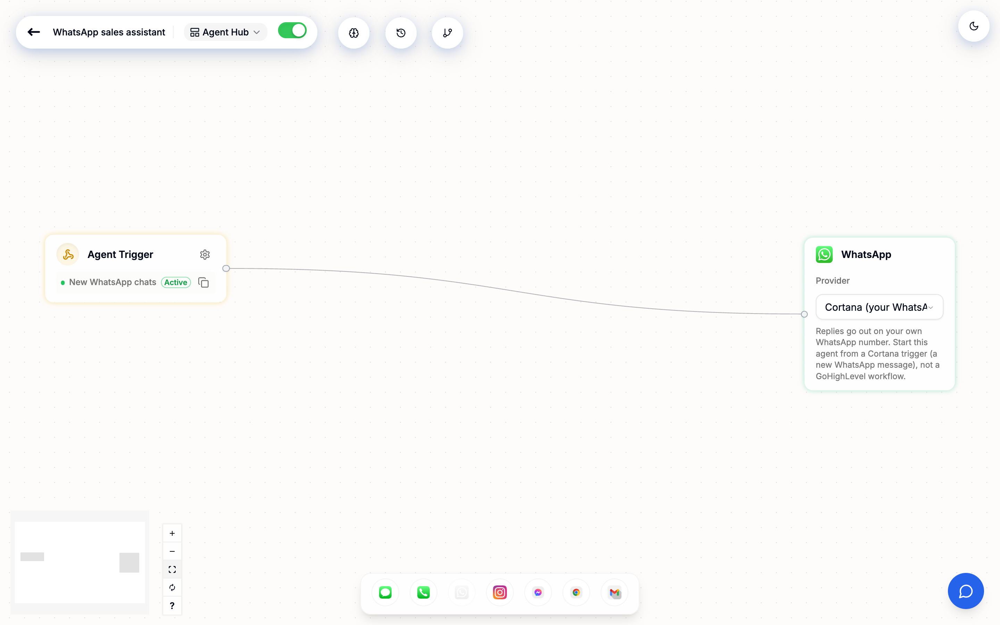
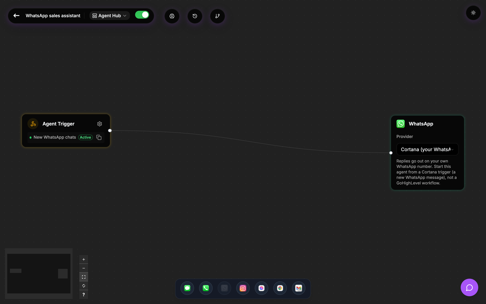
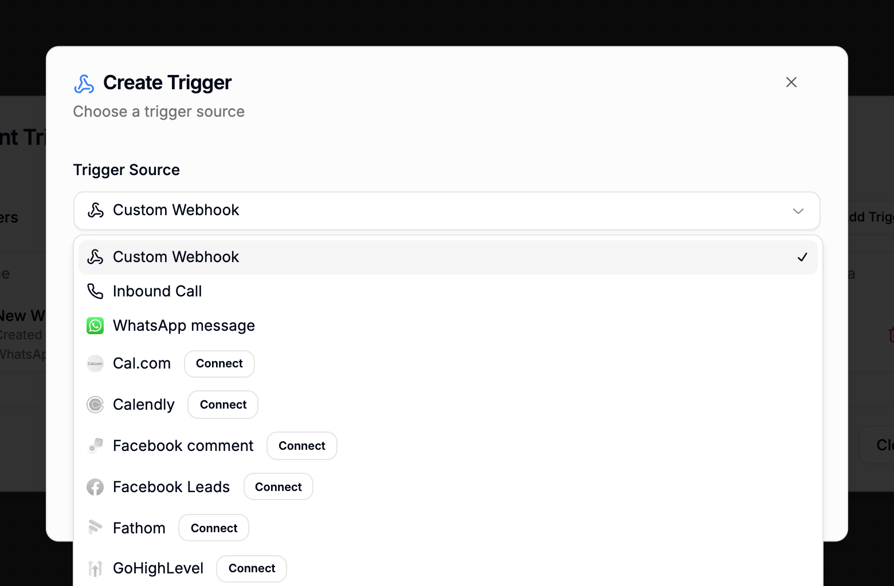
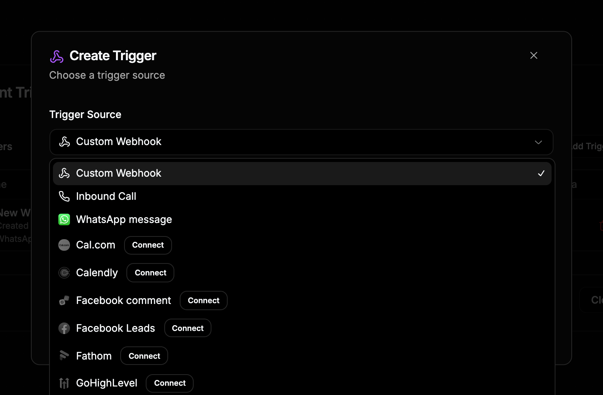
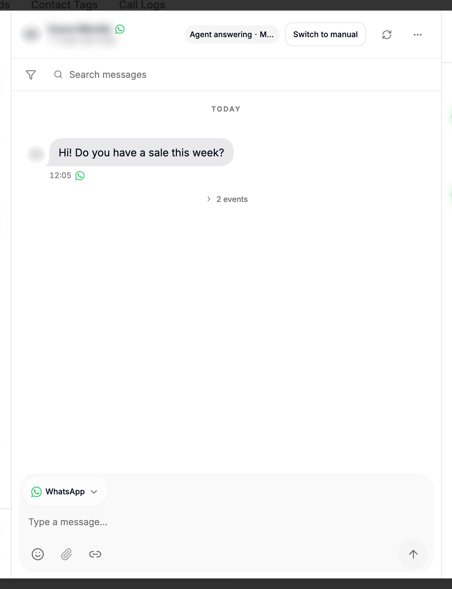
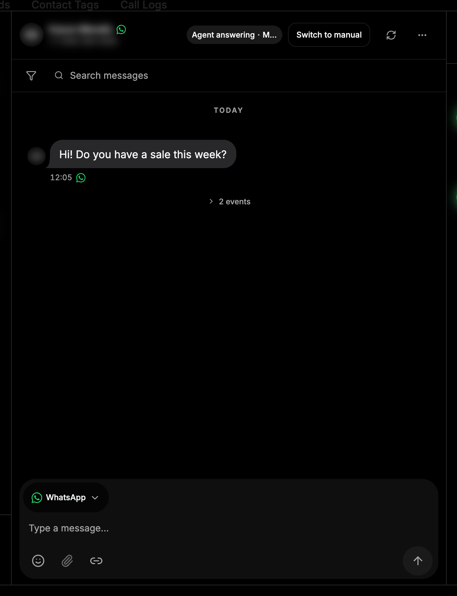

{/* last-verified: 2026-11-24 · route: /business/[businessId]/ai-agents and /business/[businessId]/agent/[agentId]/flow · source: src/lib/agent/cortana-meta-channel.ts, src/components/flow-builder/dialogs/whatsapp-trigger-source.ts, src/lib/whatsapp/agent-wake.ts, agent-send.ts */}

## Overview

Your AI agent can answer WhatsApp chats for you. It replies from your own number.

You set two things:

1. **The WhatsApp app** on your agent, with **Cortana (your WhatsApp number)**.
2. **A trigger**, **WhatsApp message**, that starts the agent on a new chat.

You need a connected number first. See [Connect WhatsApp](/platform/business/whatsapp-connect).

---

## 1. Open your agent

<Steps>
  <Step title="Go to AI Agents">
    Click **AI Agents** in the left menu.
  </Step>
  <Step title="Open an agent">
    Click its name. Or click **New Agent** to make one.
  </Step>
</Steps>

The agent's builder opens on **Agent Hub**.

---

## 2. Add WhatsApp to your agent

<Steps>
  <Step title="Click the WhatsApp app">
    The apps sit at the bottom of the builder. WhatsApp is the green one.
  </Step>
  <Step title="Choose the provider">
    Under **Provider**, pick **Cortana (your WhatsApp number)**.
  </Step>
  <Step title="Build what the agent says">
    Set up the conversation, like any channel. See [Train your AI and connect channels](/training/ai-agents/train-ai-connect-channels).
  </Step>
</Steps>

Under the provider, Cortana says:

*Replies go out on your own WhatsApp number. Start this agent from a Cortana trigger (a new WhatsApp message), not a GoHighLevel workflow.*

<Frame caption="The WhatsApp app with Cortana as the provider, and its trigger.">
  
  
</Frame>

---

## 3. Add the WhatsApp message trigger

<Steps>
  <Step title="Click the gear on Agent Trigger">
    A window opens with your triggers.
  </Step>
  <Step title="Click Add Trigger">
    On a new agent it says **Add Your First Trigger**.
  </Step>
  <Step title="Pick WhatsApp message">
    It is in the **Trigger Source** list.
  </Step>
  <Step title="Give it a name">
    For example, *New WhatsApp chats*.
  </Step>
  <Step title="Click Save Trigger Source">
    The trigger shows **Active** on the builder.
  </Step>
</Steps>

<Frame caption="WhatsApp message in the trigger list.">
  
  
</Frame>

Make sure the agent is on. Use the switch at the top of the builder.

---

## 4. What happens next

Someone writes to your number. No agent is on that chat yet. Your agent starts and answers them.

The chat shows **Agent answering** with your agent's name.

<Frame caption="The agent took the chat.">
  
  
</Frame>

Want to answer yourself? Click **Switch to manual**.

---

<AccordionGroup>
  <Accordion title="The 24-hour rule for the agent">
    The agent can reply only inside 24 hours of the customer's last message. After that, its message is not sent. The chat says why.

    The agent never sends a template. You can, from your inbox. See [Chat On WhatsApp](/platform/business/whatsapp-inbox#2-after-24-hours-send-a-template).
  </Accordion>
  <Accordion title="When the trigger starts the agent">
    - Only on a chat with no agent yet.
    - Not when a rep took the chat with **Switch to manual**.
    - Not when the agent is off.
    - It needs a conversation set up on the WhatsApp app. If there is none, the chat notes why.
  </Accordion>
  <Accordion title="A number Meta disconnected">
    If Meta disconnects your number, the agent stops answering on it. Connect the number again to fix it.
  </Accordion>
  <Accordion title="Photos and voice notes">
    The agent answers words. A photo or voice note with no words does not start a reply.
  </Accordion>
</AccordionGroup>

## FAQ

<AccordionGroup>
  <Accordion title="Why can't I pick Cortana (your WhatsApp number)?">
    Connect a WhatsApp number first. See [Connect WhatsApp](/platform/business/whatsapp-connect).
  </Accordion>
  <Accordion title="Why did my agent not answer?">
    Check three things. The agent is on. The trigger is **Active**. The chat had no agent and is not on manual.
  </Accordion>
  <Accordion title="Why did my agent stop after a day?">
    WhatsApp allows replies only inside 24 hours. Send a template from your inbox to reach them again.
  </Accordion>
  <Accordion title="Can I use GoHighLevel workflows instead?">
    Not for this provider. With **Cortana (your WhatsApp number)**, the **WhatsApp message** trigger starts the agent.
  </Accordion>
</AccordionGroup>
