{/* last-verified: 2026-11-24 · route: /business/[businessId]/settings?tab=integrations (the WhatsApp card) and /connect/whatsapp/[token] · source: src/components/integrations/whatsapp/WhatsAppConnectDialog.tsx, WhatsAppDialogSteps.tsx, WhatsAppNumberRow.tsx, WhatsAppTemplatesPanel.tsx, src/app/connect/whatsapp/[token]/page.tsx */}

## Overview

Connect your WhatsApp Business number to Cortana.

Then Cortana can:

- Show which ad started each chat.
- Put every chat in your inbox.
- Let you and your AI agent reply.

It takes about a minute.

<Note>
  **WhatsApp is new.** It is open to a few businesses first. If the card says it is coming soon, it is not open for you yet.
</Note>

---

## 1. Open the WhatsApp card

<Steps>
  <Step title="Go to Settings">
    Click **Settings** in the left menu. The **Integrations** tab opens.
  </Step>
  <Step title="Find the WhatsApp card">
    Type `WhatsApp` in the search box if you need to.
  </Step>
  <Step title="Click the button on the card">
    It says **Connect** before you connect. It says **Manage** after. It says **Reconnect** if a number stopped working.
  </Step>
</Steps>

<Frame caption="The WhatsApp card on Integrations.">
  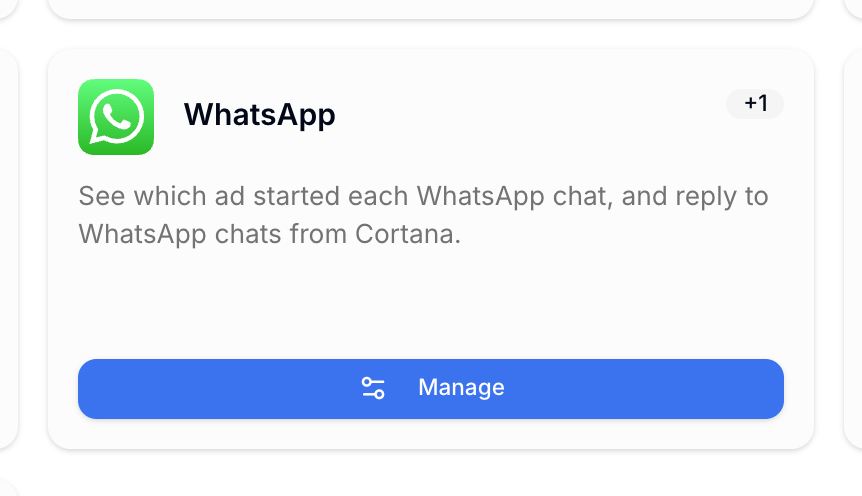
  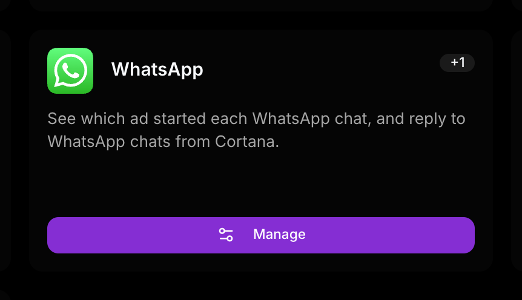
</Frame>

---

## 2. Connect your number

<Steps>
  <Step title="Click Connect WhatsApp">
    Meta opens a small window. Cortana shows **Finish in Meta's window**.
  </Step>
  <Step title="Pick your business">
    Choose your Meta business in Meta's window.
  </Step>
  <Step title="Pick your WhatsApp number">
    Choose the number you want in Cortana.
  </Step>
  <Step title="Done">
    Cortana shows your number with **Connected.**
  </Step>
</Steps>

<Tip>
  **Use the WhatsApp Business app on your phone?** Meta shows a QR code. Scan it with the app. Your phone keeps working.
</Tip>

<Note>
  **Personal WhatsApp numbers cannot connect.** Use a number on WhatsApp Business.
</Note>

<Frame caption="The WhatsApp window with two numbers connected.">
  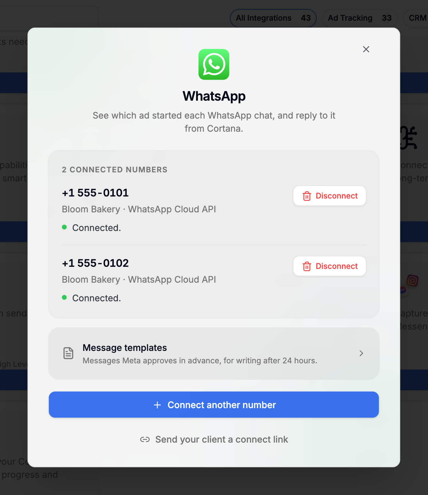
  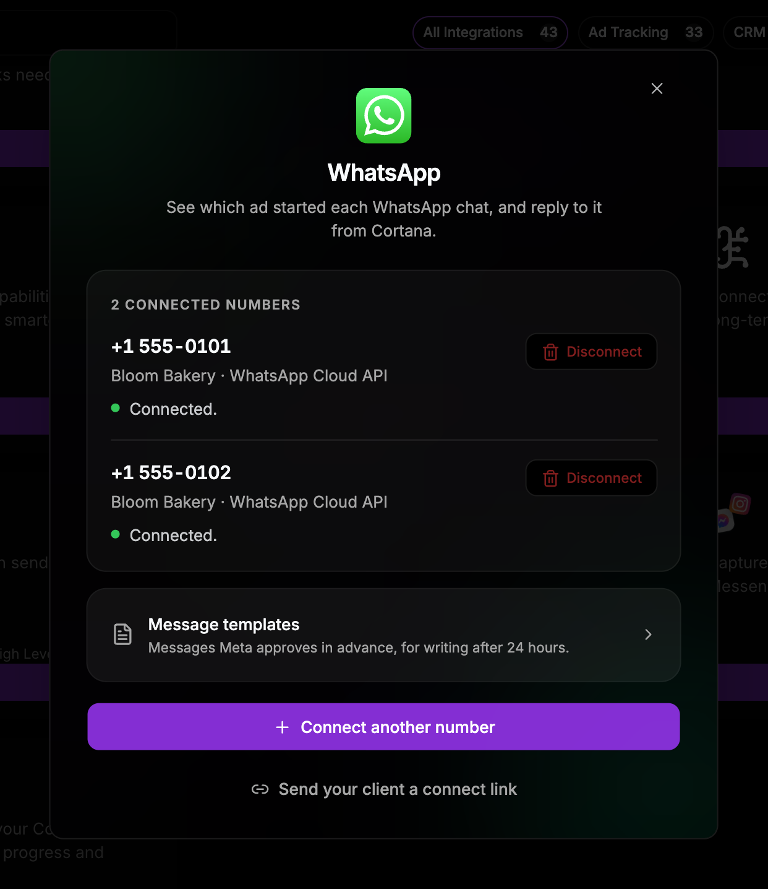
</Frame>

You can connect more than one number. Click **Connect another number**.

---

## 3. Send your client a link

Do you run ads for a client? They can connect their own number. They do not need a Cortana login.

<Steps>
  <Step title="Click Send your client a connect link">
    It is at the bottom of the WhatsApp window.
  </Step>
  <Step title="Click Make a link">
    Cortana makes the link.
  </Step>
  <Step title="Click Copy">
    Send the link to your client. Use email or chat.
  </Step>
</Steps>

<Frame caption="Make a link for your client.">
  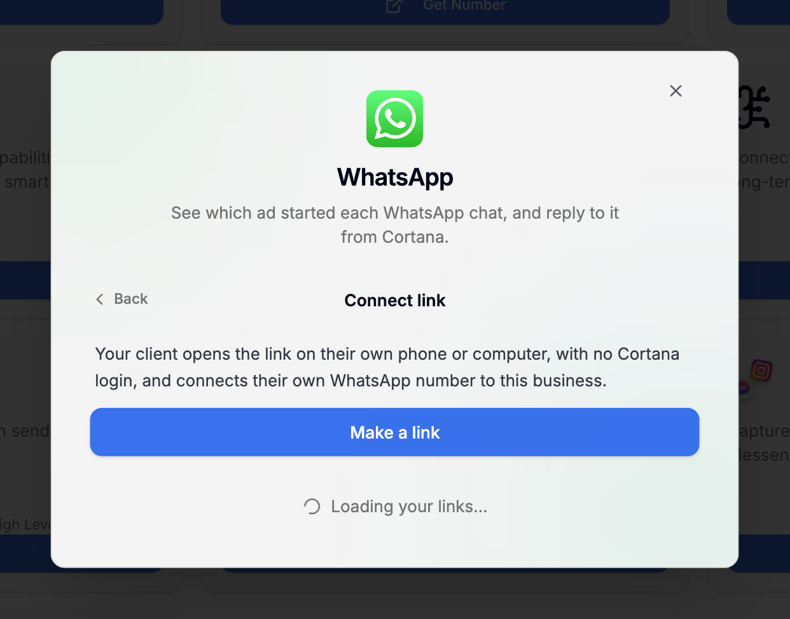
  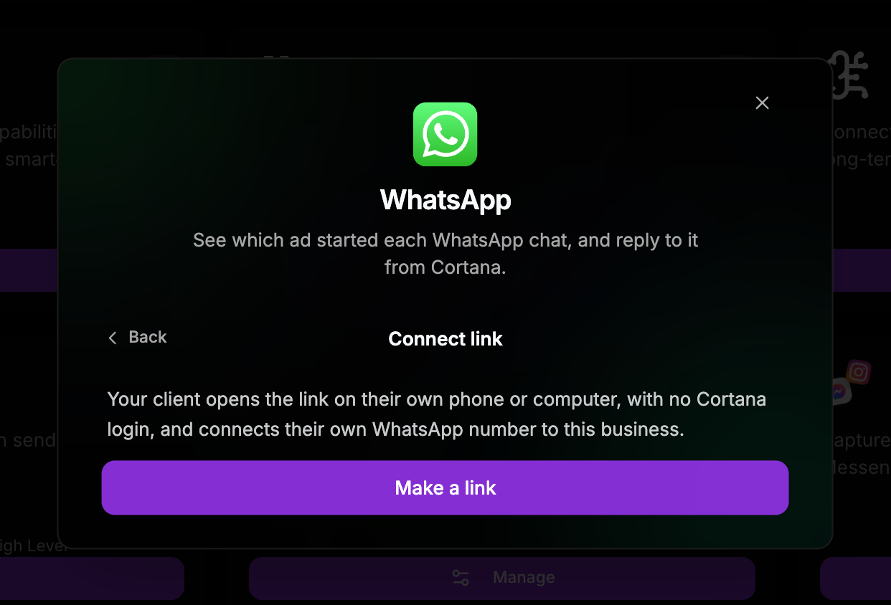
</Frame>

<Frame caption="The link, ready to copy. Your links are listed below it.">
  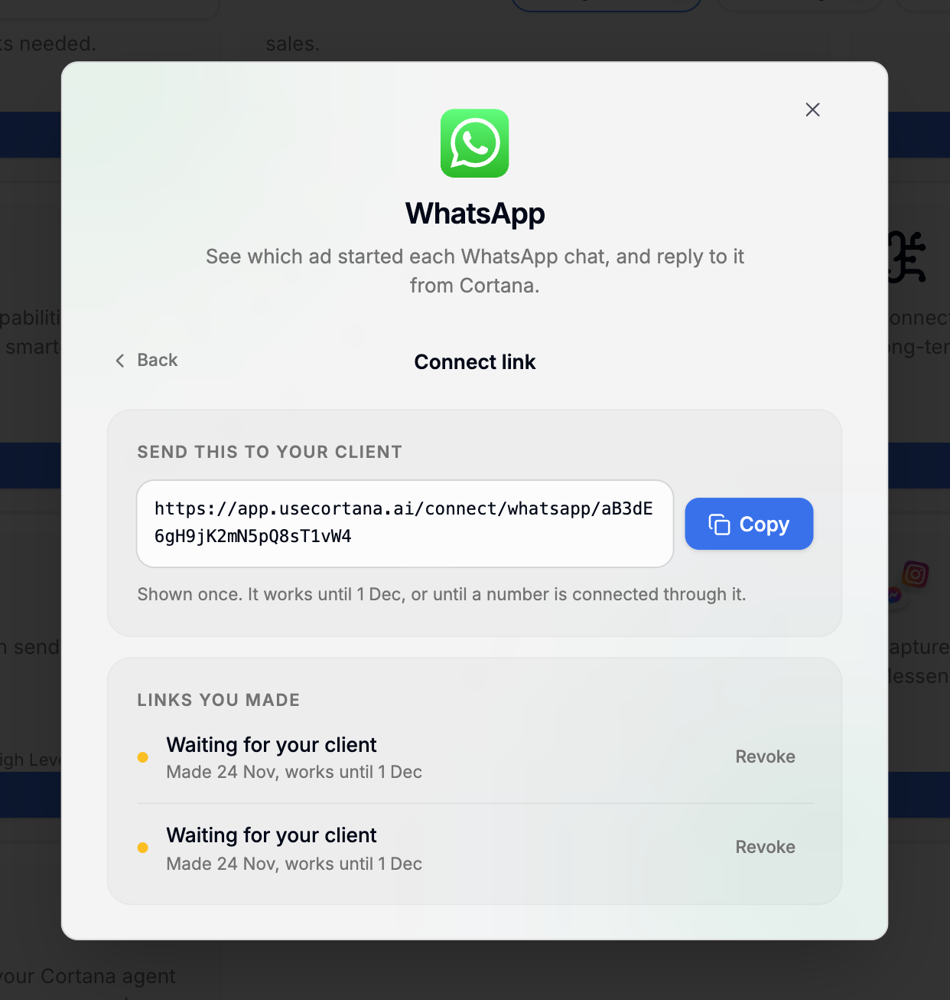
  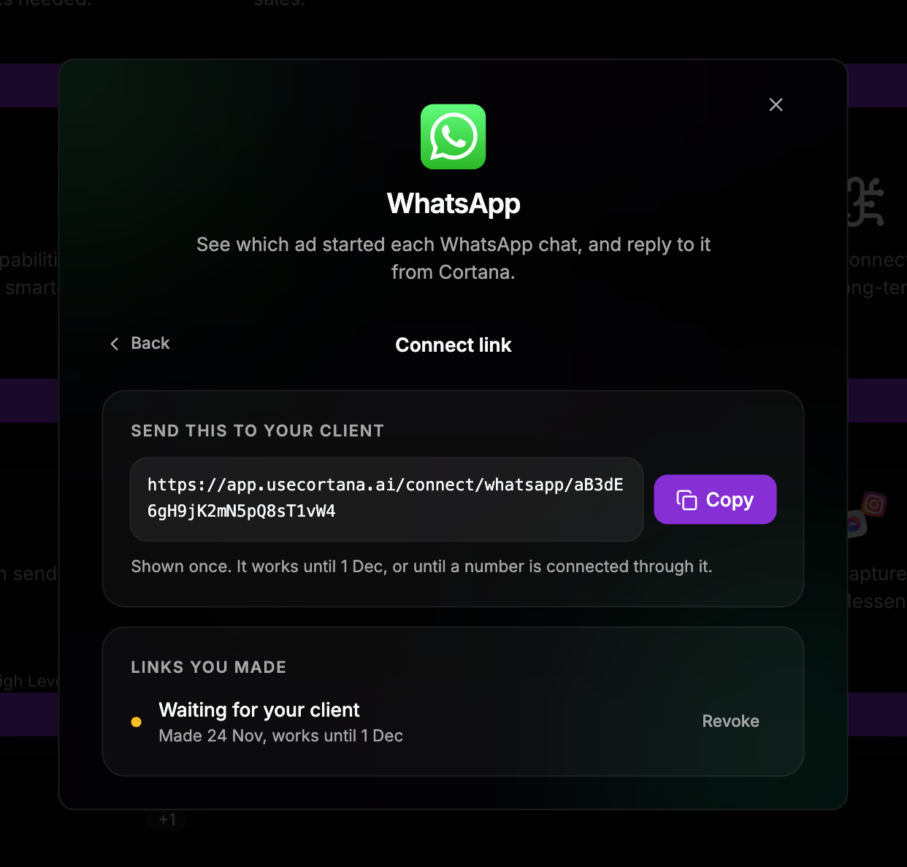
</Frame>

Good to know:

- **Copy it now.** Cortana shows the link only once.
- **It works for 7 days.**
- **It connects one number.** Then it stops working.
- **Changed your mind?** Click **Revoke**.

Your client opens the link. They click **Connect WhatsApp**. Meta's window opens, and they pick their number.

<Frame caption="What your client sees.">
  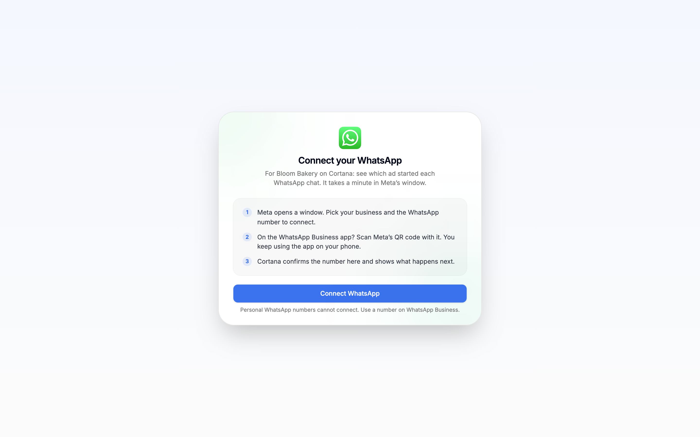
  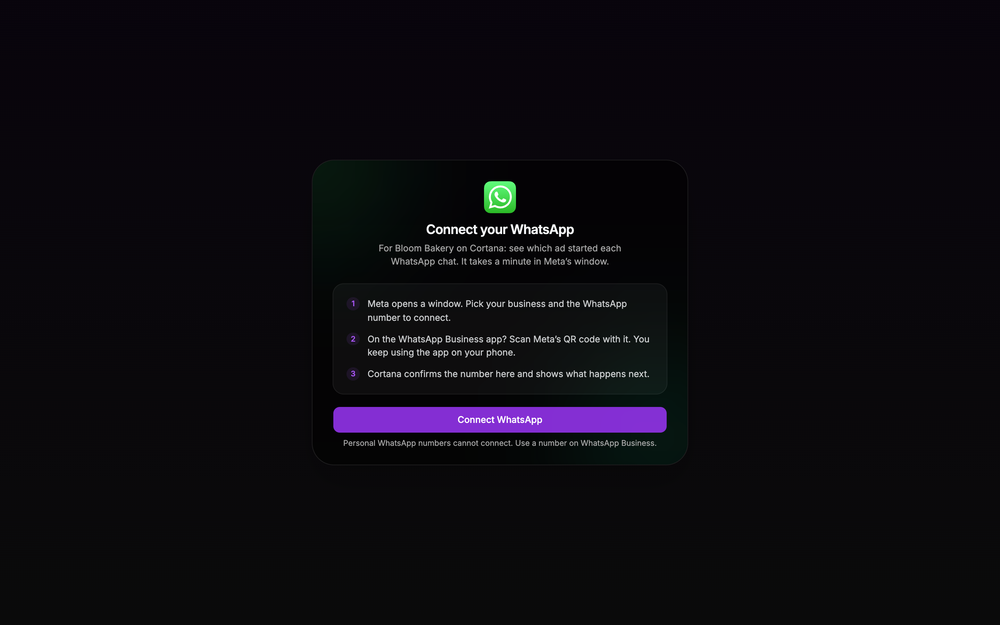
</Frame>

---

## 4. See your message templates

After 24 hours, WhatsApp only lets you send a template. Meta must approve each template first.

Click **Message templates** in the WhatsApp window. You see each template and its status.

<Frame caption="Your templates and their status from Meta.">
  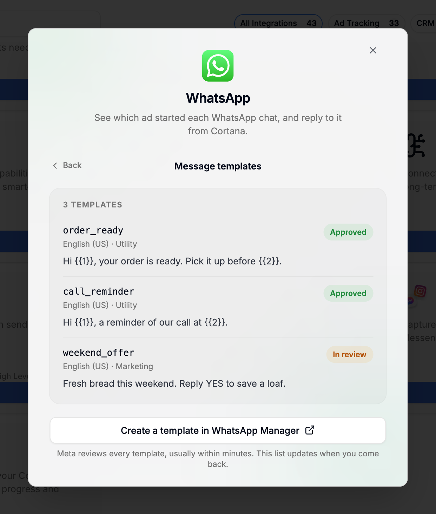
  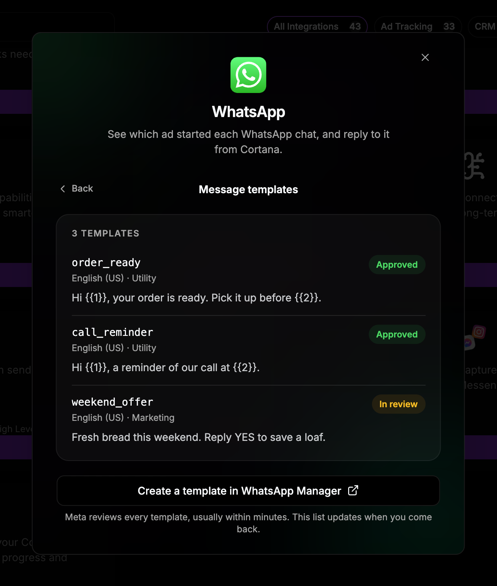
</Frame>

To make a new one, click **Create a template in WhatsApp Manager**. You make it in Meta. Meta checks it, often in minutes.

---

## 5. Disconnect a number

<Steps>
  <Step title="Click Disconnect">
    It is the red button next to the number.
  </Step>
  <Step title="Click Disconnect again to confirm">
    Or click **Keep it** to stop.
  </Step>
</Steps>

<Frame caption="Cortana asks before it disconnects.">
  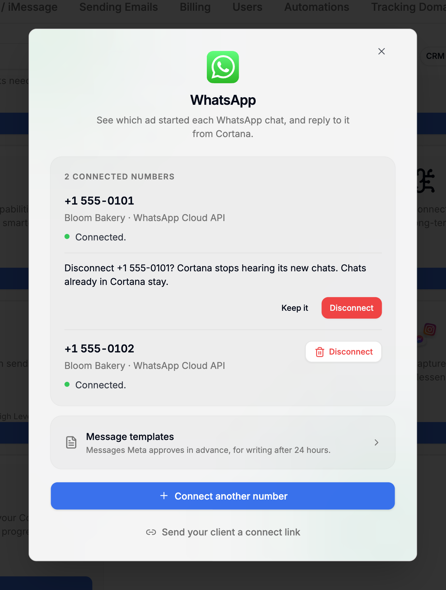
  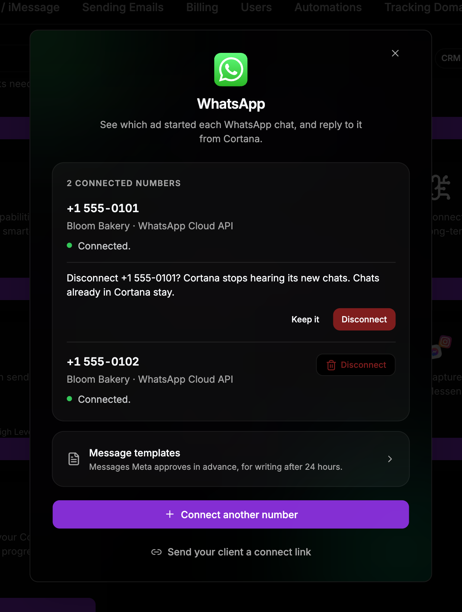
</Frame>

Cortana stops hearing new chats on that number. Old chats stay in Cortana.

---

<AccordionGroup>
  <Accordion title="What Cortana does with your number">
    - Every message a customer sends lands in your inbox.
    - A chat from a click-to-WhatsApp ad keeps the ad. Your reports show the campaign, ad set and ad.
    - A chat with no ad shows as **WhatsApp DM (Organic)**.
    - You and your AI agent can reply from the number.
  </Accordion>
  <Accordion title="The WhatsApp Business app on your phone">
    If your number is on the WhatsApp Business app, it keeps working there.

    - Replies you send from your phone show in Cortana too.
    - You can share your last 180 days of chats once, when you connect. They show up in Cortana over a few minutes.
    - Old chats never count as new conversions.
  </Accordion>
  <Accordion title="When a number stops working">
    Meta can disconnect a number. It happens if the WhatsApp Business app is not opened for about 14 days. A new phone can do it too.

    Then:

    - The WhatsApp window says why, in plain words.
    - The WhatsApp card's button says **Reconnect**.
    - Cortana emails you.

    Connect the number again to fix it.
  </Accordion>
  <Accordion title="Connect link rules">
    - It works for 7 days.
    - It connects one number, then it stops.
    - Cortana shows it once. Only a scrambled copy is kept.
    - Up to 10 links can wait at once. Your links show under **Links you made**.
    - A wrong, old or revoked link says **This link does not work**.
  </Accordion>
</AccordionGroup>

## FAQ

<AccordionGroup>
  <Accordion title="Why can't I click Connect on the WhatsApp card?">
    WhatsApp is open to a few businesses first. If the card says it is coming soon, it is not open for you yet.
  </Accordion>
  <Accordion title="Meta's window did not open. What do I do?">
    An ad blocker can stop it. Allow facebook.com, then close and open the WhatsApp window again.
  </Accordion>
  <Accordion title="Can I connect my personal WhatsApp?">
    No. Use a number on WhatsApp Business.
  </Accordion>
  <Accordion title="Will my phone app stop working?">
    No. If you scan Meta's QR code, your WhatsApp Business app keeps working.
  </Accordion>
  <Accordion title="I lost the client link. Can I see it again?">
    No. Cortana shows it once. Revoke the old one and make a new link.
  </Accordion>
</AccordionGroup>

<Card title="Next: 2) Chat On WhatsApp" icon="arrow-right" href="/platform/business/whatsapp-inbox">
  Reply to WhatsApp chats from your inbox.
</Card>
