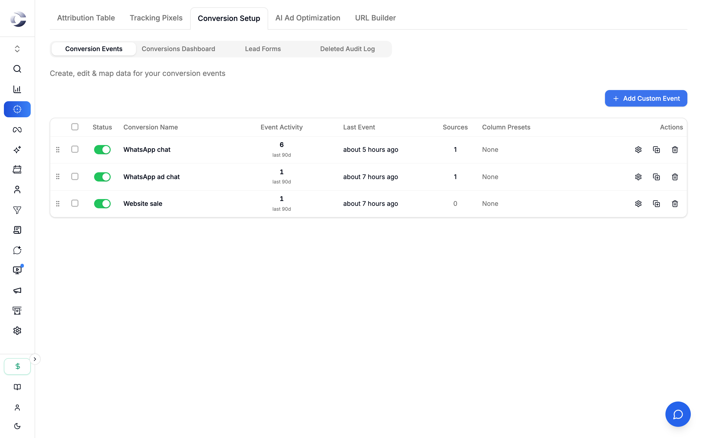
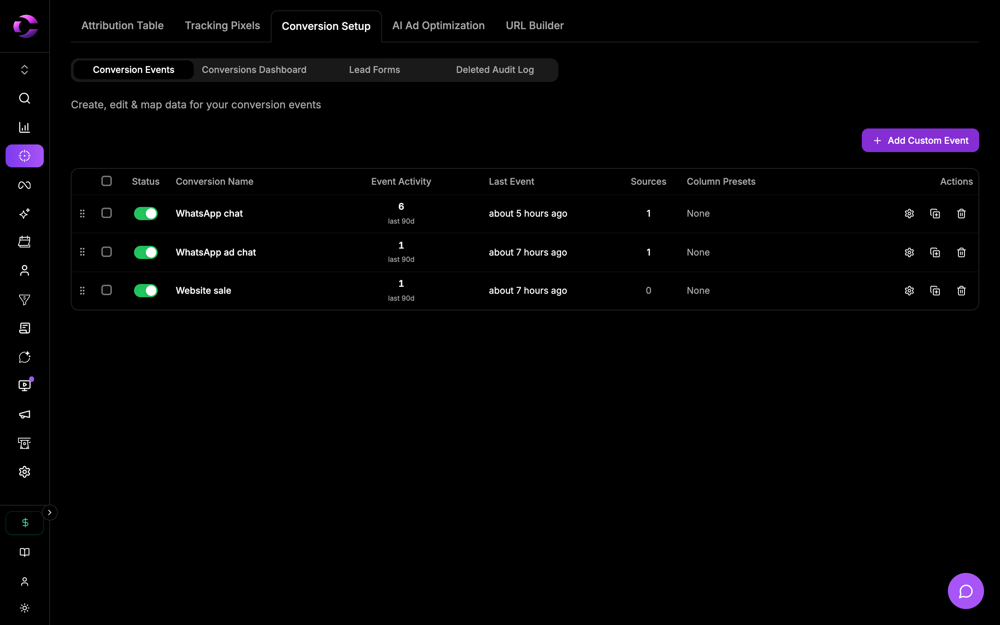
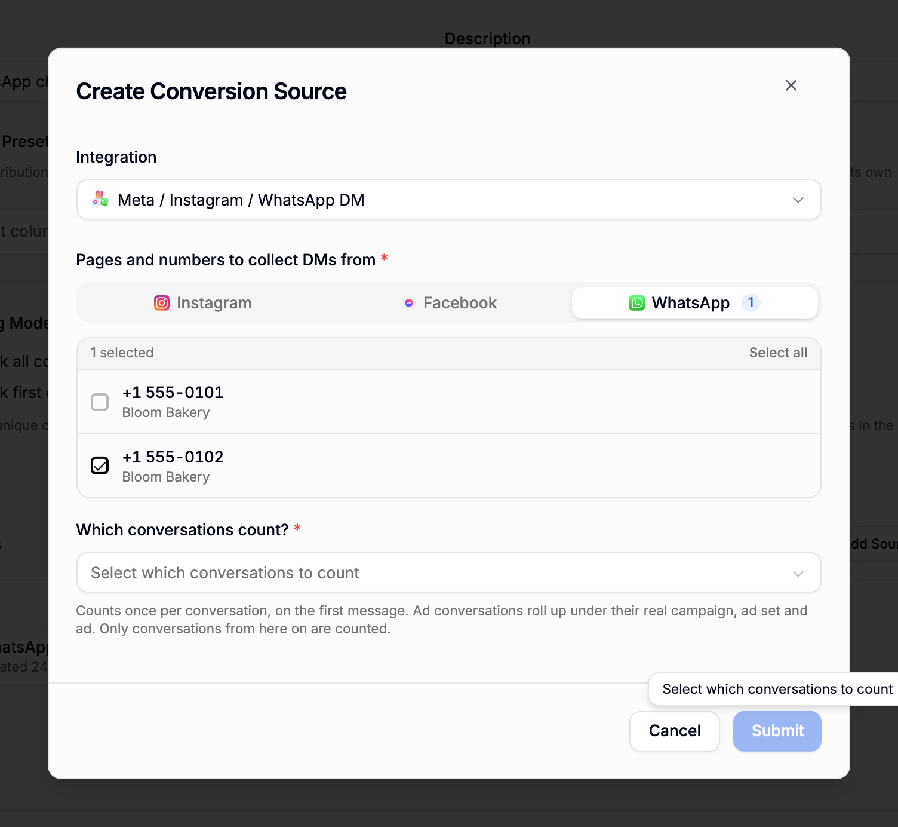
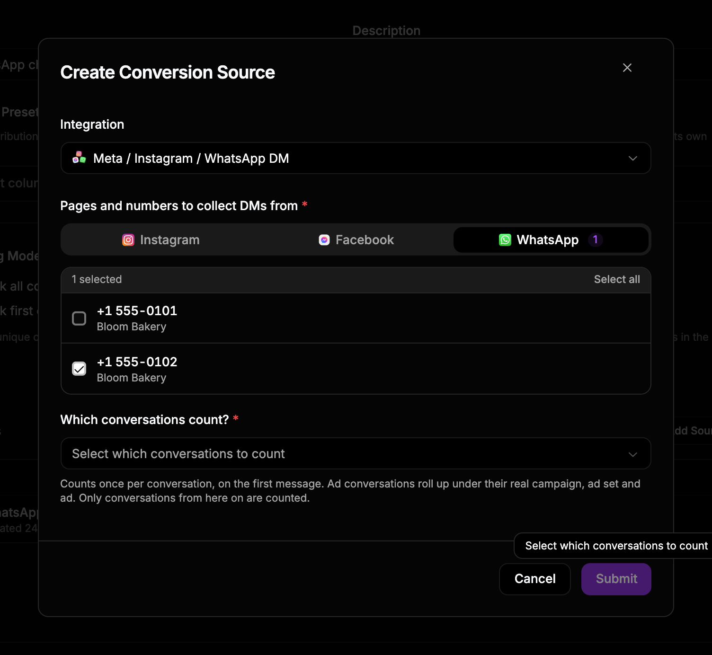
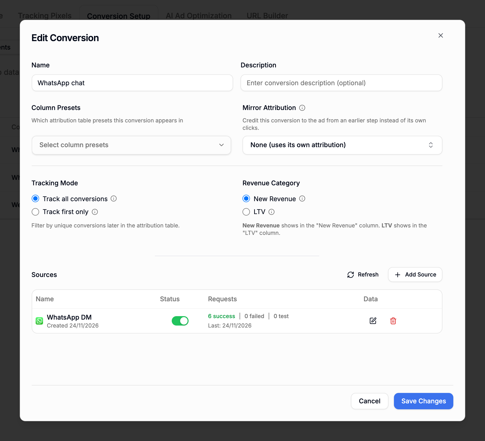
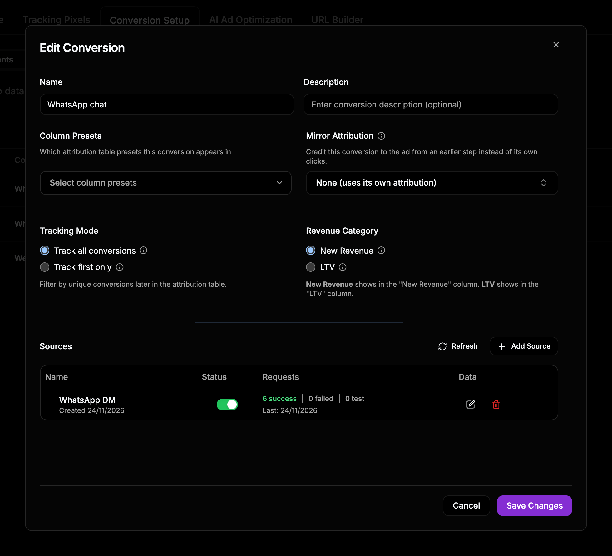
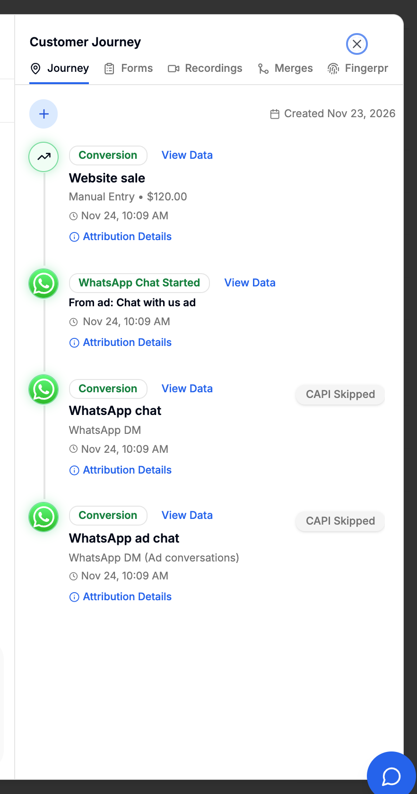
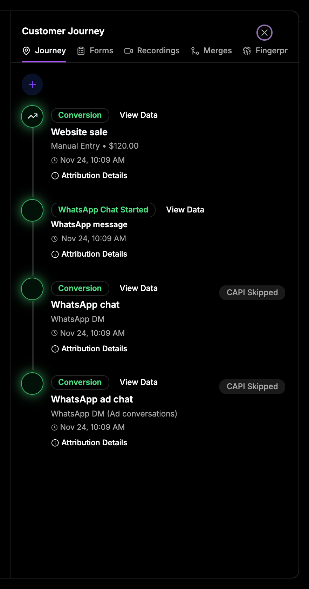

{/* last-verified: 2026-11-24 · route: /business/[businessId]/tracking?tab=conversions (Conversion Setup) · source: src/components/tracking/conversion-source-dialog.tsx, meta-dm-source-fields.tsx, meta-dm-page-selector.tsx, src/lib/facebook/record-dm-conversion-sources.ts, src/lib/whatsapp/inbound.ts */}

## Overview

A new WhatsApp chat can count as a conversion. It works like [Instagram and Messenger DMs](/11-instagram-messenger-dms).

- Each chat counts **once**, on its first message.
- A chat from an ad shows under its **campaign, ad set and ad**.
- A chat with no ad shows as **WhatsApp DM (Organic)**.

You need a connected number first. See [Connect WhatsApp](/platform/business/whatsapp-connect).

---

## 1. Open your conversion

<Steps>
  <Step title="Go to Ad Tracking">
    Click **Ad Tracking** in the left menu.
  </Step>
  <Step title="Open Conversion Setup">
    Click the **Conversion Setup** tab.
  </Step>
  <Step title="Click the conversion's name">
    Or make a new one with **Add Custom Event**.
  </Step>
</Steps>

<Frame caption="Your conversions on Conversion Setup.">
  
  
</Frame>

---

## 2. Add the WhatsApp source

<Steps>
  <Step title="Click Add Source">
    It is next to **Sources** in the conversion's window.
  </Step>
  <Step title="Pick the integration">
    Under **Integration**, pick **Meta / Instagram / WhatsApp DM**.
  </Step>
  <Step title="Click the WhatsApp tab">
    It is under **Pages and numbers to collect DMs from**.
  </Step>
  <Step title="Tick your numbers">
    Tick each number that should count.
  </Step>
  <Step title="Choose which conversations count">
    Pick **All conversations** or **Ad conversations only**.
  </Step>
  <Step title="Click Submit">
    Your source is ready.
  </Step>
</Steps>

<Frame caption="Tick your number, then choose which conversations count.">
  
  
</Frame>

<Note>
  **Submit stays grey until you are done.** Point at it to see what is missing.
</Note>

The two choices:

| Choice | What counts |
| --- | --- |
| **All conversations** | Every new chat, from ads and not from ads. |
| **Ad conversations only** | Only chats that started from a click-to-WhatsApp ad. |

<Frame caption="The source shows under the conversion.">
  
  
</Frame>

---

## 3. See it on a contact

Open a contact who wrote to you. Their **Customer Journey** shows:

- **WhatsApp Chat Started**, with the ad if there was one.
- **Conversion**, with the green WhatsApp mark.

<Frame caption="A chat from an ad, then its conversions.">
  
  
</Frame>

Your **Attribution Table** shows the chats under the campaign, ad set and ad that started them.

---

<AccordionGroup>
  <Accordion title="How chats are counted">
    - One chat counts once per source. Writing again later does not add more.
    - It counts on the chat's first message.
    - Only chats from now on count. Older chats do not.
    - Chats you shared from the WhatsApp Business app history never count. The customer's next new message does.
  </Accordion>
  <Accordion title="How an ad is found">
    When someone taps a click-to-WhatsApp ad, Meta tells Cortana which ad it was. Cortana keeps it with the chat.

    - Meta may send the ad a bit late. Cortana still adds it.
    - A chat with no ad shows as **WhatsApp DM (Organic)**.
    - A post someone tapped is not an ad. **Ad conversations only** does not count it.
  </Accordion>
  <Accordion title="Instagram, Messenger and WhatsApp in one source">
    One source can count all three. Use the **Instagram**, **Facebook** and **WhatsApp** tabs. Tick what should count on each.
  </Accordion>
  <Accordion title="Two numbers">
    Tick each number you want. Each number counts on the source that has it.
  </Accordion>
</AccordionGroup>

## FAQ

<AccordionGroup>
  <Accordion title="Why is the Submit button grey?">
    Something is missing. Tick a number on the WhatsApp tab. Then choose **Which conversations count?**
  </Accordion>
  <Accordion title="Meta / Instagram / WhatsApp DM is grey with a lock.">
    Connect a WhatsApp number first. See [Connect WhatsApp](/platform/business/whatsapp-connect).
  </Accordion>
  <Accordion title="Why did a customer only count once?">
    One chat counts once. That keeps a chatty customer from counting forty times.
  </Accordion>
  <Accordion title="Why does an old chat not show as a conversion?">
    Only chats from after you made the source count.
  </Accordion>
</AccordionGroup>

<Card title="Next: 4) Send WhatsApp Chats To Meta" icon="arrow-right" href="/platform/business/whatsapp-meta-capi">
  Tell Meta which ad chats turned into conversions.
</Card>
