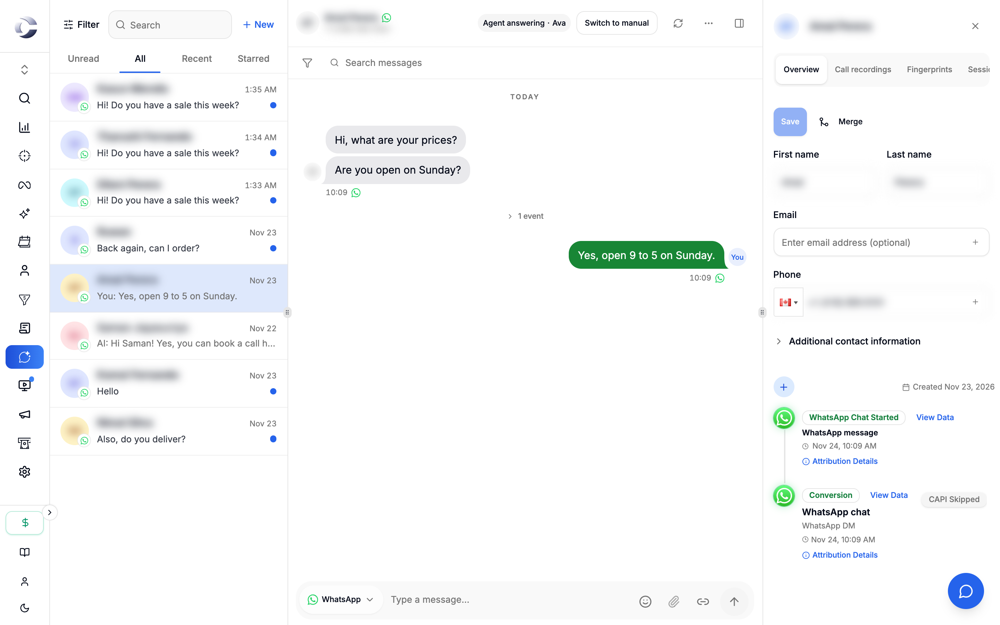
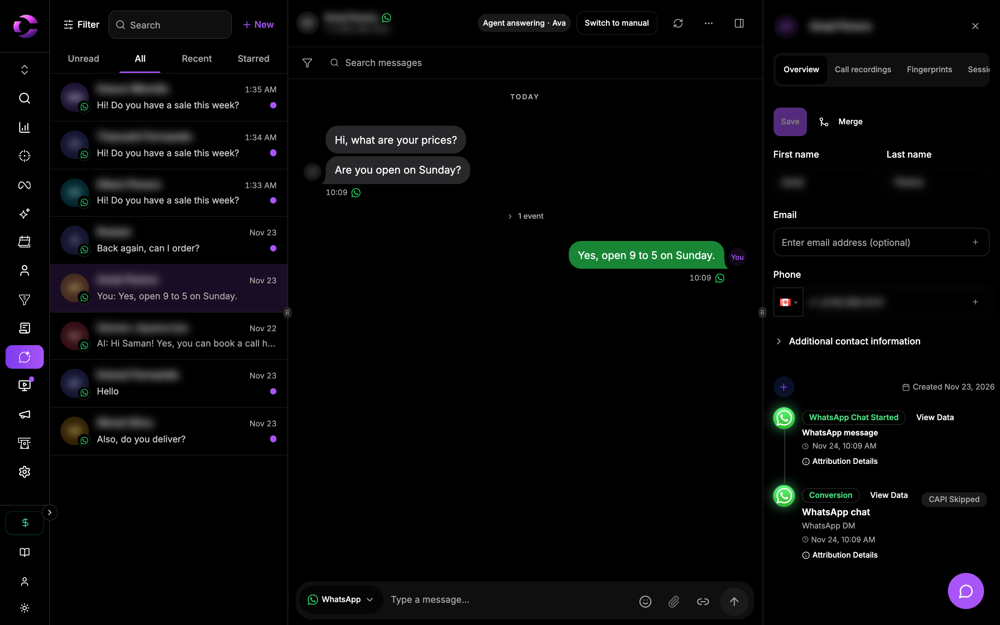
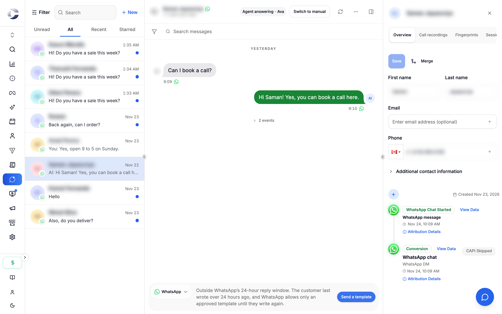
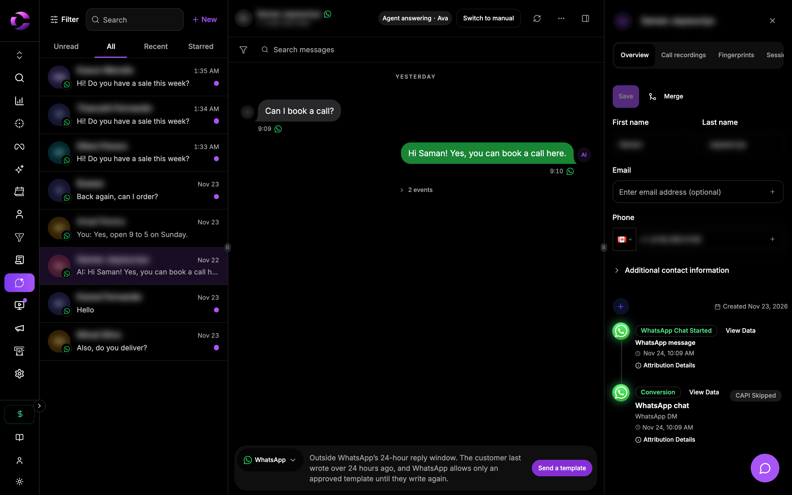
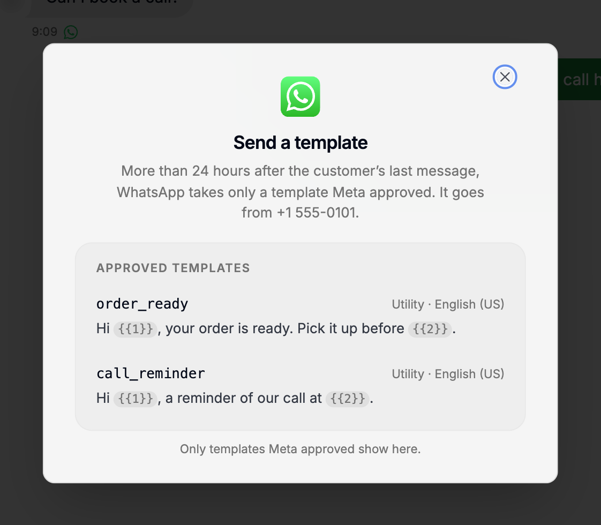
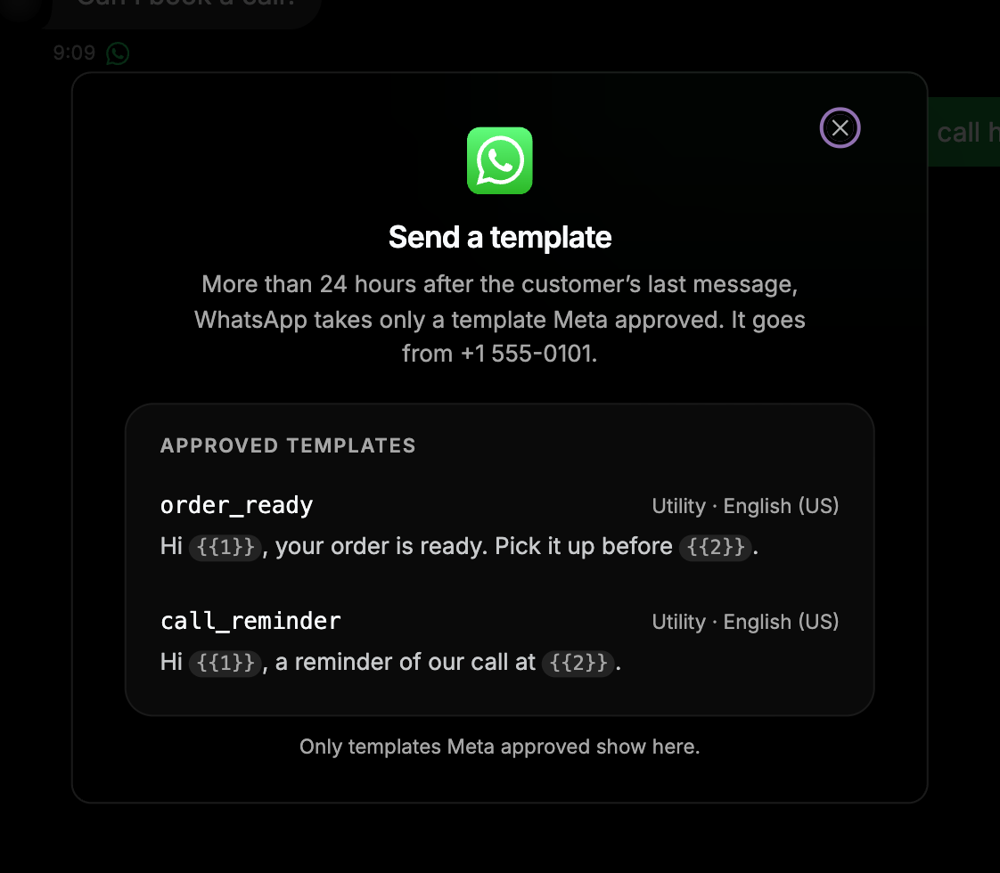
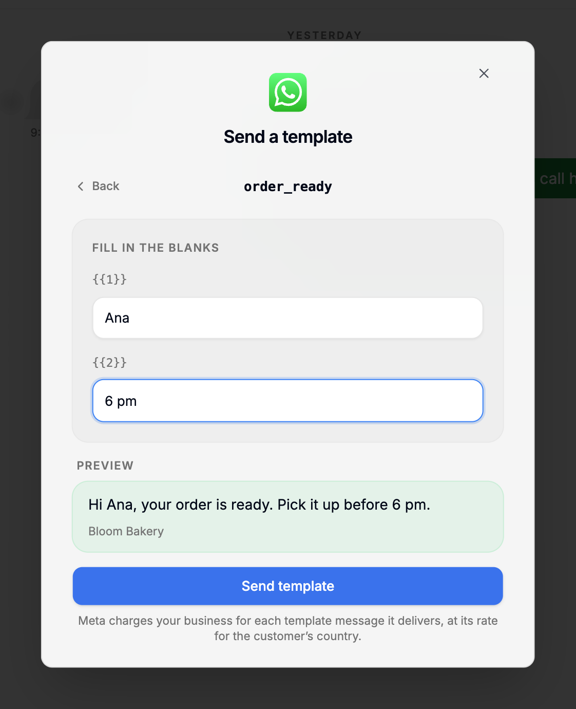
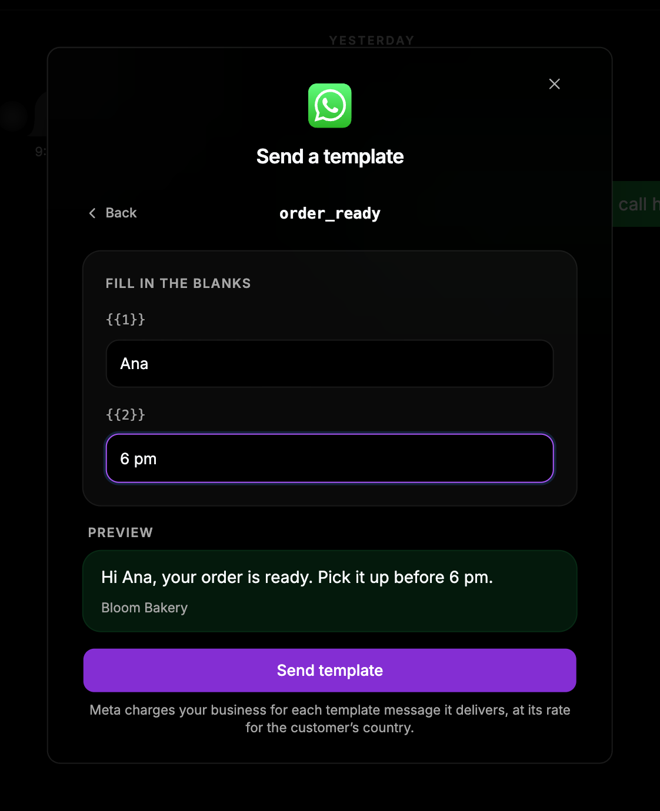

{/* last-verified: 2026-11-24 · route: /business/[businessId]/conversations · source: src/lib/whatsapp/inbound.ts, send.ts, src/components/conversation/message/whatsapp-template-picker.tsx */}

## Overview

When a customer writes to your WhatsApp number, the chat lands in your **Inbox**.

You can reply from there. WhatsApp has one big rule: the **24-hour window**.

- Inside 24 hours, you can type anything.
- After 24 hours, you can only send an approved template.

---

## 1. Reply to a chat

<Steps>
  <Step title="Open your inbox">
    Click **Inbox** in the left menu.
  </Step>
  <Step title="Click a chat">
    WhatsApp chats have a small green WhatsApp mark.
  </Step>
  <Step title="Type and send">
    Your reply goes out on the number the customer wrote to.
  </Step>
</Steps>

<Frame caption="A WhatsApp chat in your Inbox.">
  
  
</Frame>

Under your message, you see **Delivered**, then **Read**. WhatsApp tells Cortana when it happens.

<Tip>
  **Reply from your phone?** If your number is on the WhatsApp Business app, those replies show here too.
</Tip>

---

## 2. After 24 hours, send a template

The customer wrote more than 24 hours ago? The message box changes. It says:

*Outside WhatsApp's 24-hour reply window. The customer last wrote over 24 hours ago, and WhatsApp allows only an approved template until they write again.*

<Frame caption="After 24 hours, the box shows Send a template.">
  
  
</Frame>

<Steps>
  <Step title="Click Send a template">
    You see only templates Meta approved.
  </Step>
  <Step title="Pick a template">
    Click the one you want.
  </Step>
  <Step title="Fill in the blanks">
    The **Preview** shows what the customer will get.
  </Step>
  <Step title="Click Send template">
    It goes out from your number.
  </Step>
</Steps>

<Frame caption="Pick an approved template.">
  
  
</Frame>

<Frame caption="Fill in the blanks and check the preview.">
  
  
</Frame>

<Warning>
  **Meta charges for templates.** Meta charges your business for each template it delivers. The price depends on the customer's country.
</Warning>

When the customer writes back, the 24 hours start again. Then you can type anything.

---

<AccordionGroup>
  <Accordion title="Which number a reply goes from">
    A reply goes from the number the customer last wrote to. If you have two numbers, Cortana picks the right one for you.
  </Accordion>
  <Accordion title="Customers who never wrote to your number">
    Some customers only wrote to you through GoHighLevel's WhatsApp. Those replies still go through GoHighLevel, the same as before.
  </Accordion>
  <Accordion title="Photos and files">
    For now you can send text only. A customer's photo or voice note shows in the chat as a short note.
  </Accordion>
  <Accordion title="Where templates come from">
    You make templates in Meta's WhatsApp Manager. Meta checks each one. See [Connect WhatsApp](/platform/business/whatsapp-connect#4-see-your-message-templates).
  </Accordion>
  <Accordion title="A message that may or may not have gone">
    Sometimes WhatsApp does not answer in time. Then Cortana says to check the chat before you send again. It never sends twice by itself.
  </Accordion>
</AccordionGroup>

## FAQ

<AccordionGroup>
  <Accordion title="Why can't I type a reply on WhatsApp?">
    The customer wrote more than 24 hours ago. WhatsApp only allows an approved template. Click **Send a template**.
  </Accordion>
  <Accordion title="Why is my template not in the list?">
    Only approved templates show. If Meta is still checking it, wait a few minutes.
  </Accordion>
  <Accordion title="Do I pay for WhatsApp messages?">
    Meta charges for each template it delivers. Normal replies inside 24 hours are not templates.
  </Accordion>
  <Accordion title="I replied from my phone. Will Cortana show it?">
    Yes, if your number is on the WhatsApp Business app and connected to Cortana.
  </Accordion>
</AccordionGroup>

<Card title="Next: 3) Count WhatsApp Chats" icon="arrow-right" href="/platform/business/whatsapp-conversions">
  Turn WhatsApp chats into conversions.
</Card>
