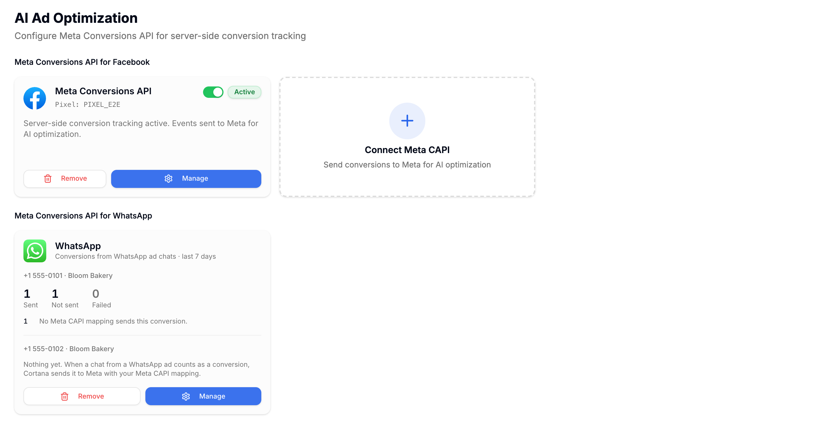
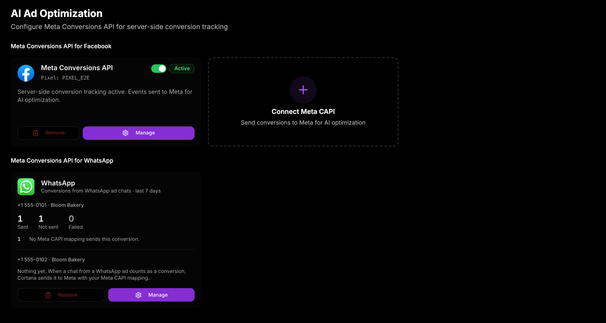
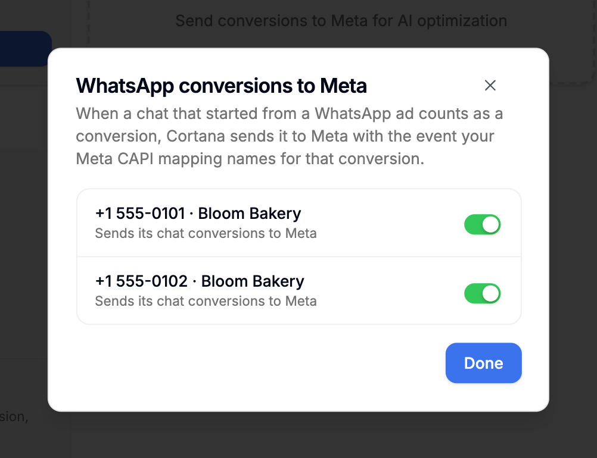
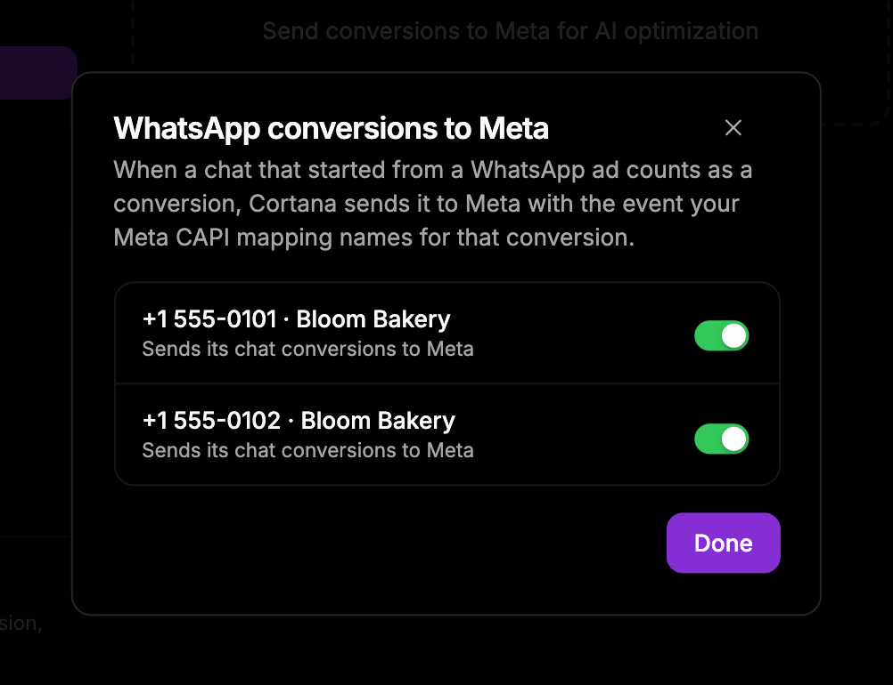
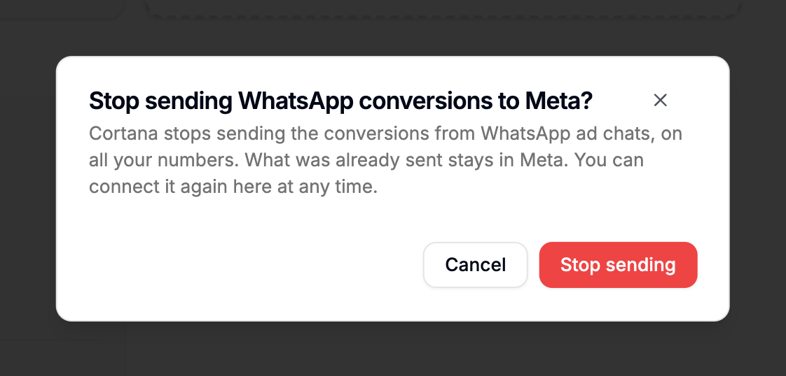
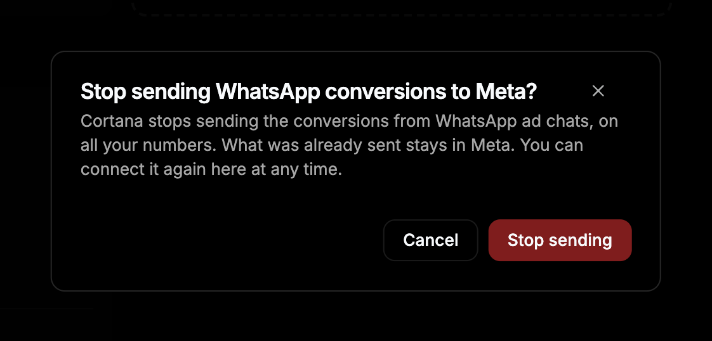
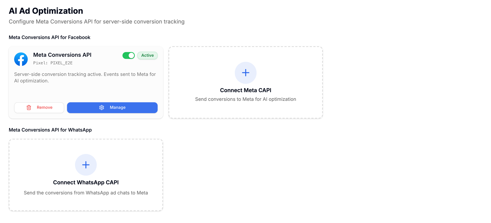
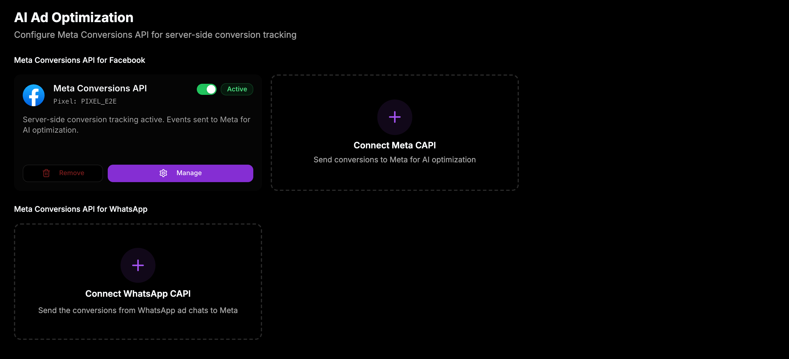

{/* last-verified: 2026-11-24 · route: /business/[businessId]/tracking (AI Ad Optimization tab) and /business/[businessId]/tracking/meta-capi · source: src/components/tracking/whatsapp-capi-channel-card.tsx, whatsapp-capi-manage-dialog.tsx, src/lib/whatsapp/capi/process-conversion.ts, sweep.ts, business-messaging-event.ts */}

## Overview

When a chat from a WhatsApp ad becomes a conversion, Cortana tells Meta. Meta then learns which ads bring good chats.

It happens by itself, every 5 minutes.

You need three things:

1. A connected number. See [Connect WhatsApp](/platform/business/whatsapp-connect).
2. A WhatsApp source on the conversion. See [Count WhatsApp Chats](/platform/business/whatsapp-conversions).
3. Your Meta pixel connected and on, with a mapping for that conversion. See [AI Ad Optimization](/6-ai-ad-optimization).

---

## 1. Find the WhatsApp card

<Steps>
  <Step title="Go to Ad Tracking">
    Click **Ad Tracking** in the left menu.
  </Step>
  <Step title="Open AI Ad Optimization">
    Click the **AI Ad Optimization** tab.
  </Step>
  <Step title="Look under Meta Conversions API for WhatsApp">
    Your pixel is above it, under **Meta Conversions API for Facebook**.
  </Step>
</Steps>

<Frame caption="Two sections: Facebook on top, WhatsApp below.">
  
  
</Frame>

---

## 2. Read the card

Each number has its own line. It shows the last 7 days:

| Word | What it means |
| --- | --- |
| **Sent** | Meta got it. |
| **Not sent** | Cortana did not send it. The reason is under it. |
| **Failed** | It did not reach Meta. Cortana tries again every 30 minutes, 5 times in all. |

A common reason: *No Meta CAPI mapping sends this conversion.* Add a mapping on your pixel to fix it.

---

## 3. Turn a number on or off

<Steps>
  <Step title="Click Manage">
    It is at the bottom of the WhatsApp card.
  </Step>
  <Step title="Flip the switch">
    Green means it sends. Grey means it does not.
  </Step>
  <Step title="Click Done">
    The card shows which numbers are off.
  </Step>
</Steps>

<Frame caption="One switch for each number.">
  
  
</Frame>

---

## 4. Stop it for every number

<Steps>
  <Step title="Click Remove">
    It is the red button on the WhatsApp card.
  </Step>
  <Step title="Click Stop sending">
    Or click **Cancel** to keep it.
  </Step>
</Steps>

<Frame caption="Cortana asks first.">
  
  
</Frame>

What was already sent stays in Meta.

---

## 5. Turn it back on

When every number is off, the card changes. It says **Connect WhatsApp CAPI**.

Click it. Every number sends again.

<Frame caption="One click turns it back on.">
  
  
</Frame>

<Note>
  **You need the Ad Tracking manage permission.** Without it, you see the card but not the buttons.
</Note>

---

<AccordionGroup>
  <Accordion title="What goes to Meta">
    Only the chat itself. That is the conversion your WhatsApp source made.

    A website sale goes to Meta through your pixel. It never goes twice.
  </Accordion>
  <Accordion title="When a chat is sent">
    - The chat started from a click-to-WhatsApp ad.
    - The conversion is within 28 days of the ad click.
    - Your pixel is on and has a mapping for the conversion.
    - The number is turned on in **Manage**.

    Each conversion goes once. Meta does not remove copies on WhatsApp, so Cortana is careful.
  </Accordion>
  <Accordion title="Which event Meta gets">
    The event comes from your pixel's mapping for that conversion. Meta's WhatsApp side takes a fixed list. **Lead** goes as **LeadSubmitted**. **Purchase**, **AddToCart**, **InitiateCheckout** and **ViewContent** go as they are.

    A mapping Meta's WhatsApp side does not take is not sent. The card says why.
  </Accordion>
  <Accordion title="What is never sent">
    - Test contacts.
    - Refunds.
    - Chats from an ad on WhatsApp Status. Meta gives no click for those.
    - Chats while the number is turned off. Turning it back on sends only new ones.
  </Accordion>
</AccordionGroup>

## FAQ

<AccordionGroup>
  <Accordion title="Why does it say Nothing yet?">
    No chat from a WhatsApp ad has become a conversion in the last 7 days.
  </Accordion>
  <Accordion title="Why does it say No Meta CAPI mapping sends this conversion?">
    Your pixel has no mapping for that conversion. Open your pixel with **Manage** and add one.
  </Accordion>
  <Accordion title="Will a website sale be sent twice?">
    No. Website sales go through your pixel only.
  </Accordion>
  <Accordion title="I turned it off by mistake.">
    Click **Connect WhatsApp CAPI**. Or turn the number back on in **Manage**.
  </Accordion>
  <Accordion title="Why don't I see Remove or Manage?">
    You need the Ad Tracking manage permission. Ask your account owner.
  </Accordion>
</AccordionGroup>

<Card title="Next: 5) Answer With An AI Agent" icon="arrow-right" href="/platform/business/whatsapp-ai-agent">
  Let an AI agent answer WhatsApp chats for you.
</Card>
