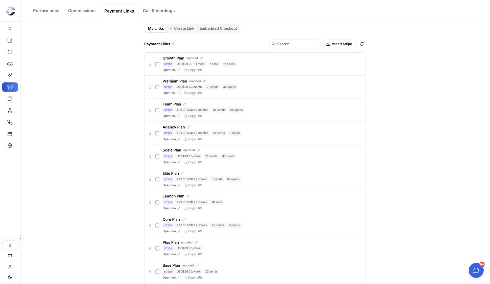

{/* last-verified: 2026-09-01 · Payment Links tab, My Links sub-tab */}

Every reusable payment link you have lives on the **My Links** tab. From here you copy a link to send it, watch how many times it was sent and opened, and pull in links you already have in Stripe.

<Tip>
  A payment link is a card form. If the buyer still needs testimonials or a what's-included list (typical on a high-ticket offer), send a [tracking link to your sales page](/sales/send-a-sales-page) instead. Same contact picker, different destination.
</Tip>

## Open My Links

Go to the **Payment Links** tab, then the **My Links** sub-tab. You will see your links with their platform, price, and send and open counts.

<Frame caption="The My Links library: each link shows its platform, price, sends, and opens, with Open link and Copy URL actions.">
  
</Frame>

## Send a link

Each link has two actions:

1. **Copy URL** puts the link on your clipboard to paste into a DM, email, or chat. The send is tracked to you, so it shows up in your rep numbers.
2. **Open link** opens the checkout in a new tab so you can preview exactly what the buyer sees.

The counts next to each link (**sends** and **opens**) update as reps share it and prospects open it, so you can see which offers get traction.

## Bring in existing links

Your library holds links from **all** connected platforms (Stripe, Whop, Fanbasis, PayPal), whether you built them here or they came from the platform. Links you build in **Create Link** work for any of the four.

There is a one-click shortcut for existing offers: click **Import** and choose **From Stripe**, **From Whop**, or **From Fanbasis**. Stripe pulls in your active Stripe payment links; Whop lists the plans on your connected company; Fanbasis lists the products on your connected account. Tick the offers you want and click **Import Selected**. Offers already in your library are marked **Already imported** and cannot be double-imported. Imported links are marked **imported** and behave like any other link. (PayPal has no listable catalog to import from; build PayPal links in Create Link.)

{/* TODO: capture the Import dropdown and the Import Whop Offers dialog once the release is live */}

## Find a link

Use the **Search** box to filter by link name. The number next to **Payment Links** is your total count.

<AccordionGroup>
  <Accordion title="What each link row shows">
    - **Platform badge**: stripe, whop, fanbasis, or paypal.
    - **Price**: the amount and cadence, for example USD 297.00, \$497 / 4 weeks, or \$1491 / 3 months.
    - **Sends**: how many times reps shared the link.
    - **Opens**: how many times a prospect opened it.
    - **Edit** (pencil): rename or adjust the link.
    - **Drag handle**: reorder links in your library.
  </Accordion>
  <Accordion title="Why does a link show more opens than sends?">
    A single send can be opened many times (the prospect revisits, or forwards it). Opens count every view, sends count every time a rep shared it.
  </Accordion>
</AccordionGroup>

## FAQ

<AccordionGroup>
  <Accordion title="I copied a link but my send count did not go up.">
    Copy the link with the Copy URL button on the link row, not from the browser address bar. Only the button records the send against you.
  </Accordion>
  <Accordion title="Can I use links from Whop, Fanbasis, or PayPal here too?">
    Yes. Links from all connected platforms appear together in My Links, each with its own platform badge.
  </Accordion>
  <Accordion title="How do I make a new link?">
    Use the Create Link sub-tab. See the next page.
  </Accordion>
  <Accordion title="Can I add testimonials or a what's-included list to a payment link?">
    Not on the checkout form itself. Put that copy on your own sales page, embed the Cortana checkout there, and send the page as a tracking link. See [Send a sales page](/sales/send-a-sales-page).
  </Accordion>
  <Accordion title="Can buyers pay with Klarna, Affirm, Afterpay or other financing?">
    Yes. Cortana never limits a link to cards: the buyer sees every payment method you have turned on in the platform the link is from.

    - **Stripe:** in your Stripe dashboard, open **Settings**, then **Payment methods**, and turn on Klarna, Affirm or Afterpay / Clearpay. Your Cortana links show them right away. Nothing to change in Cortana.
    - **Whop:** turn on the financing methods for that plan in Whop. Cortana links use the plan's payment methods.
    - **Commas (Fanbasis):** turn on the financing options in your Commas account, for example ClarityPay, Klarna, Sezzle or Zip. Cortana links show them.
    - **PayPal:** the buyer pays on PayPal's own page, and PayPal decides whether to offer them Pay Later.

    Still only cards on the checkout? Check three things:

    - The method is turned on in that platform's account.
    - The price is a one-time payment. Financing options mostly work on one-time payments only; PayPal Pay Later, Affirm and Afterpay never work on subscriptions.
    - The buyer's country, currency and the price are inside what that provider accepts. The provider hides itself when they are not.
  </Accordion>
</AccordionGroup>

## Next step

<CardGroup cols={2}>
  <Card title="Create a link" icon="plus" href="/sales/4-create-a-link">
    Build a new reusable payment link, and create a product on the fly if you need one.
  </Card>
  <Card title="Send a sales page" icon="file-invoice" href="/sales/send-a-sales-page">
    High-ticket? Send a tracking link to a page with testimonials and checkout, not a bare form.
  </Card>
</CardGroup>
