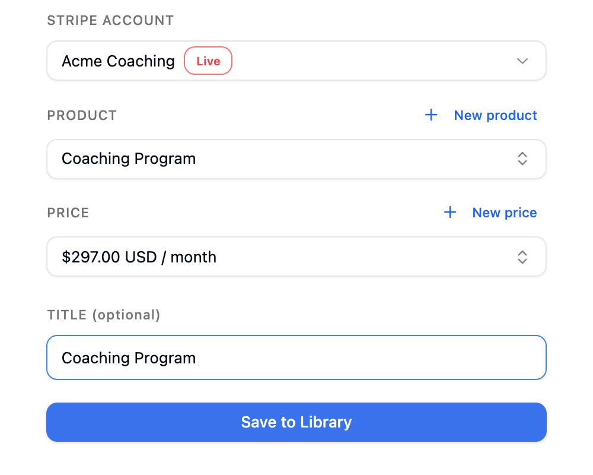

{/* last-verified: 2026-11-17 · Payment Links tab, Create Link sub-tab (product first, then price) */}

The **Create Link** tab builds a new reusable payment link. Pick where the money lands, pick what you are selling and at which price, and save it to your library so any rep can send it. If the product or the price does not exist yet, you can create it without leaving the page.

## 1. Pick a platform

Go to **Payment Links**, then **Create Link**. Choose the platform that will process the payment: **Whop**, **Stripe**, **Commas (Fanbasis)**, or **PayPal**. Clicking the platform that is already picked changes nothing.

<Frame caption="Stripe in Create Link: the account, then the product, then one of that product's prices. New product and New price sit beside their fields.">
  
</Frame>

## 2. Pick the account

Choose the account that gets paid: the **Stripe Account**, the **Whop Company**, or the **Commas (Fanbasis) Account**. Stripe accounts show a **Live** or **Test** badge. Picking another account clears the product and price you picked.

## 3. Pick the product, then its price

Stripe, Whop and Commas work the same way: first the **Product**, then the **Price**.

- **Product** lists the account's products. Type to search.
- **Price** appears once a product is picked and lists only that product's prices. On Whop these are the product's plans, shown by what they charge. When a product has exactly one price, it is picked for you. Picking another product clears the price.
- **Commas (Fanbasis)** has no saved prices. Under the product you set this link's own **Price** and **Billing** (one-time, a preset cadence, or a custom period). A recurring link can also **Stop after** a number of payments and start with a **Free trial**. The price starts at the product's price, and Commas prices start at 1.00.
- **PayPal**: a one-time link needs no product at all, just enter the **Amount**. For a subscription, click **New plan** to create the billing plan on your PayPal account, or pick an existing one.

## 4. Create a product or a price on the spot

If what you want to sell does not exist yet, create it here. Each create action opens from two places: the link beside the field's label, and the last row of that field's list.

- **New product** asks for a **Name**, a **Price** and a **Billing** cadence (one-time, weekly, every 4 weeks, monthly, every 3 months, yearly). It creates the product with that first price on the connected account and picks both for you. On Stripe the price is in the account's own currency; on Whop the name is up to 80 characters and prices start at 1.00. On Commas (Fanbasis), **New product** asks for a **Name** and a **Price** only, and you set its billing under the product; nothing is created on Commas, the link carries the offer itself.
- **New price** adds a price to the product you already picked. It asks for the **Price** and the **Billing**, including a custom period (every N days, weeks or months). On Whop, **More options** adds a number of payments and a free trial. The new price is picked for you.
- An account with no products shows **No products yet** with **Create one**; a product with no prices shows **No prices yet** with **Add one**.

## 5. Save to library

The **Title** fills in with the product name; change it if you like. Click **Save to Library**. The link now appears on the **My Links** tab, ready for any rep to copy and send.

<AccordionGroup>
  <Accordion title="New product and new price field rules">
    - **Name** is required and is what the buyer sees on checkout. Whop limits it to 80 characters.
    - **Price** is entered as a number, for example 297 or 49.99, up to 999,999.99. Do not add currency symbols or thousands separators. Whop and Commas prices start at 1.00.
    - **Billing** decides whether the price is one-time or recurring. A recurring price makes any checkout built from it a subscription.
    - A new product or price is created live on the selected connected account or company. Switching accounts while it is being created leaves it on the account it was made for.
  </Accordion>
  <Accordion title="Platforms and what they need">
    All four platforms (Stripe, Whop, Commas (Fanbasis), PayPal) can carry a reusable link. **Stripe** and **Whop** keep products with their own prices (on Whop, plans), and Create Link can make both. **Commas (Fanbasis)** stores the name, price and billing on the link itself and creates the offer at each checkout. **PayPal** needs no product for one-time amounts and creates a billing plan for subscriptions.
  </Accordion>
</AccordionGroup>

## FAQ

<AccordionGroup>
  <Accordion title="My new product did not show up.">
    Confirm you did not switch the account or company after creating it. The product is tied to the account that was selected when you created it. Re-select that account and it will be in the Product list.
  </Accordion>
  <Accordion title="I picked a product but the price I want is not in the list.">
    The Price list only shows the prices of the product you picked. Click **New price** beside **Price** (or the last row of the list) and add it; it is created on that product and picked for you.
  </Accordion>
  <Accordion title="Can a Commas (Fanbasis) link bill monthly?">
    Yes. Under the product, set **Billing** to a recurring cadence or a custom period. A recurring link can also stop after a number of payments and start with a free trial.
  </Accordion>
  <Accordion title="Why will my Commas link not save?">
    Commas prices start at 1.00. If the product's own price is lower, the form says "Commas prices start at 1.00." Type a price of 1.00 or more for this link.
  </Accordion>
  <Accordion title="Can I make a subscription link?">
    Yes. Pick a recurring price, or create one with **New product** or **New price** and a recurring billing cadence. The link then sells a subscription.
  </Accordion>
  <Accordion title="Where does the link go after I save it?">
    To My Links, where you and your reps copy and send it. See Send payment links.
  </Accordion>
  <Accordion title="Can this payment link show testimonials or what's included?">
    No. A payment link is the checkout form. For that copy, build a sales page, embed the checkout, and send a tracking link. See [Send a sales page](/sales/send-a-sales-page).
  </Accordion>
</AccordionGroup>

## Next step

<CardGroup cols={2}>
  <Card title="Embedded checkout" icon="code" href="/sales/5-embedded-checkout">
    Sell on your own pages by pasting one Cortana checkout snippet instead of a link.
  </Card>
  <Card title="Send a sales page" icon="file-invoice" href="/sales/send-a-sales-page">
    High-ticket: wrap that checkout in your page, then send it as a tracking link.
  </Card>
</CardGroup>
