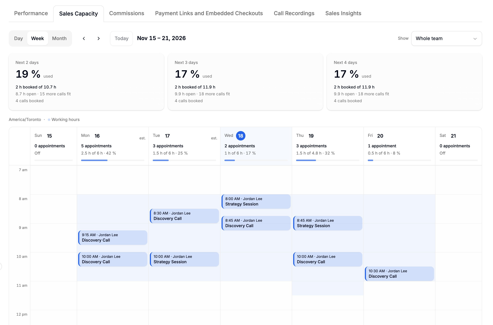
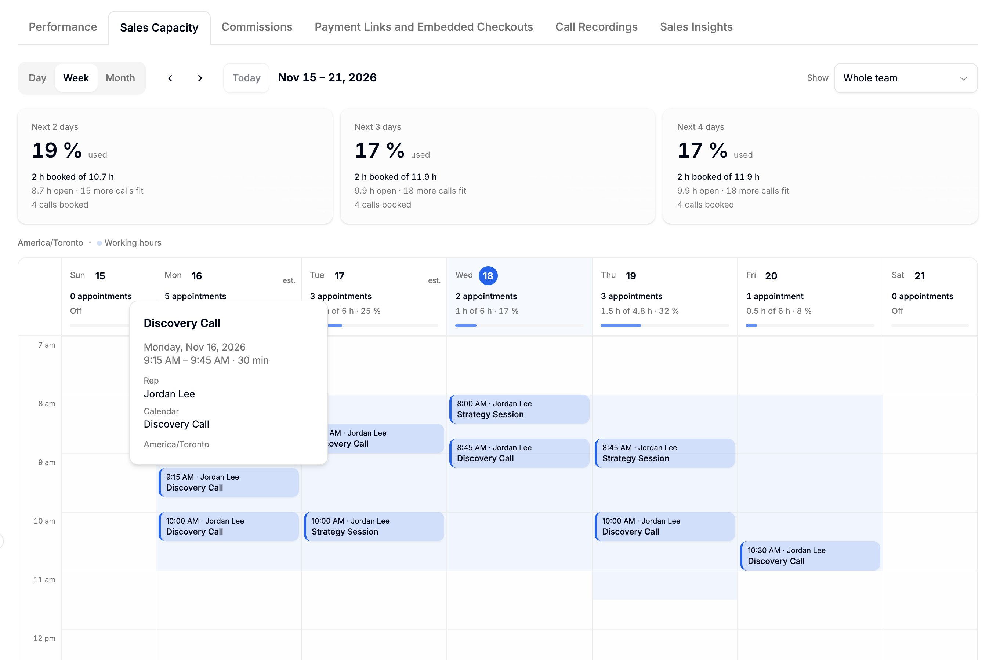
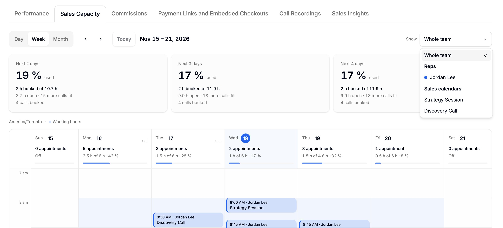
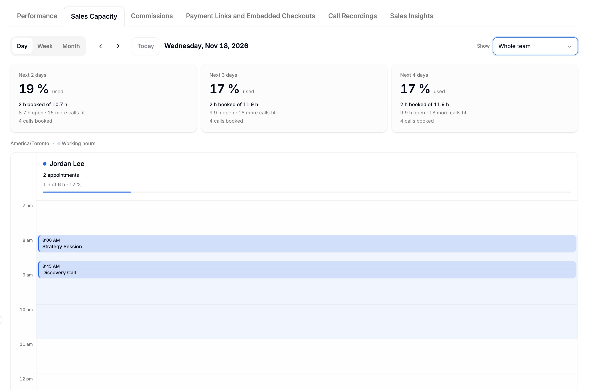
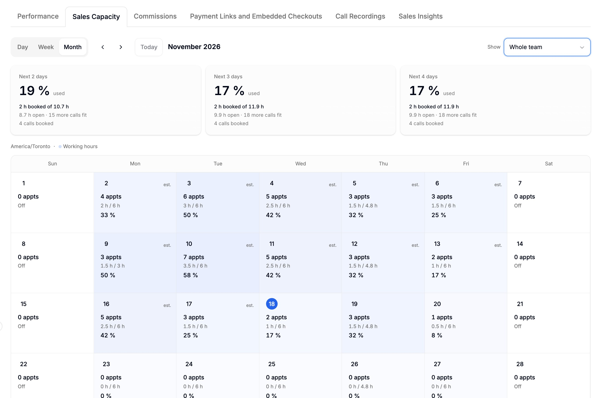

{/* last-verified: 2026-11-18 · Sales Dashboard → Sales Capacity (/business/<id>/sales-dashboard?tab=sales-capacity) */}

Sales Capacity answers one question: how full are my reps, and how much room is left to book? It reads each rep's working hours from their calendar, puts every sales call on a calendar, and tells you what is used and what is still open. Capacity belongs to the person: a rep on two calendars still has one person's hours.

## Open Sales Capacity

1. Open **Sales Dashboard** in the left menu.
2. Click the **Sales Capacity** tab, next to **Performance**.
3. The tab opens on this week, Sunday to Saturday, in your business time zone.

If the tab says **Tick a calendar as Sales call in Funnel setup**, click **Open funnel setup** and tick the calendars that book your sales calls. Sales Capacity reads the reps on those calendars. See [Funnel setup](/sales/2-funnel-setup).

<Frame caption="Sales Capacity: the next 2, 3 and 4 days on top, the week below with every sales call at its time.">
  
</Frame>

## Read the next 2, 3 and 4 days

The three cards on top count forward from right now, whatever week or month you are looking at. Time that has already passed today is never counted as open. Each card shows:

- **% used**: booked hours divided by available hours.
- **h booked of h**: the booked hours and the hours your reps are available.
- **h open · more calls fit**: the available time with no call in it, and how many more sales calls still fit in it.
- **calls booked**: the sales calls that start in that window.

Use them before you push more ads or open more slots: a high percentage means your reps are close to full.

## Read the week

Each day has a header and a column of the day's hours:

- **N appointments**: the sales calls that day.
- **X h of Y h · Z %**: booked hours out of available hours, and the percentage used. The bar fills with the percentage.
- **Off**: nobody on the view works that day and nothing is booked.
- **est.**: a past day estimated from the rep's current weekly hours. Hover it to see why.

Below the headers, every sales call sits at its real start time and length. The light blue shading is working hours. Today's date is highlighted.

## See a call's details

Click any call on the calendar to see its title, date, start and end time, length, the rep who took it and the calendar it was booked on.

<Frame caption="Click a call to see its time, rep and calendar.">
  
</Frame>

## Show the team, one rep or one calendar

1. Click **Show** at the top-right.
2. Pick **Whole team**, a rep under **Reps**, or a calendar under **Sales calendars**.

Everything on the tab follows your pick: the cards, the day headers and the calls on the calendar. When you pick a calendar, you see the people on that calendar with their whole days. Their calls on other calendars show faded, because those calls use the same person's time.

<Frame caption="Show picks the whole team, one rep, or one sales calendar.">
  
</Frame>

## Switch to Day or Month

- **Day** shows one column per rep for that day, with each rep's appointments, booked hours and percentage on top.
- **Month** shows a calendar of the month, each day with its appointments, booked hours out of available hours and percentage. Click a day to open it in Day view.
- Use the arrows to move back and forward, and **Today** to come back to the current day, week or month.

<Frame caption="Day view: one column per rep.">
  
</Frame>

<Frame caption="Month view: each day's appointments, hours and percentage.">
  
</Frame>

## When a rep shows No hours yet

Under the calendar, the **Reps** list shows each rep's booked hours out of available hours for the period. A rep whose calendar does not give us working hours shows **No hours yet**. Their booked time still shows, but it is left out of the percentage, so it never makes the team look emptier or fuller than it is.

To give them hours:

1. Click **Set hours** next to their name. A window opens on the same page.
2. Set their weekly hours, day by day.
3. Click **Save**. The tab refreshes with their hours.

**Set hours** appears only for a rep who has a Cortana login. These are the rep's weekly hours in Cortana. Sales Capacity uses them only on days their calendar gives no hours, and any Cortana booking calendar they are on books them in these hours.

<AccordionGroup>
  <Accordion title="Where the working hours come from">
    Sales Capacity reads each rep's working hours from the calendar their sales calls are booked on: GoHighLevel user schedules, Calendly availability schedules, and iClosed user availability. For a Cortana booking calendar, it uses the rep's weekly hours in Cortana. Busy time that is not a sales call (a personal block, another meeting, a busy slot on a connected Google or Outlook calendar) is taken out of the available hours. Hours are refreshed every hour for today and the next 13 days.
  </Accordion>
  <Accordion title="How booked, open and % used are counted">
    Available hours are working hours minus busy time. Booked hours are the rep's sales calls that are not cancelled, at their real length; two calls that overlap count once. Open hours are the available time with no call in it, in gaps long enough for one sales call; a gap too short to book is left out. Percentage used is booked hours divided by available hours. Calls that fit is the open time divided by the rep's shortest sales call.
  </Accordion>
  <Accordion title="One rep on several calendars">
    A rep is matched across calendars by email, so a rep on two calendars counts once, with one person's hours. Adding a second calendar does not add more availability; adding a second rep does.
  </Accordion>
  <Accordion title="Past days marked est.">
    Before Sales Capacity started recording a rep's days, a past day is estimated from the rep's current weekly hours minus their real calls. It is marked **est.** because their hours may have been different then.
  </Accordion>
  <Accordion title="Time zone and week start">
    Days are counted in your business time zone, shown above the calendar. Weeks run Sunday to Saturday.
  </Accordion>
  <Accordion title="Who can see whom">
    A teammate allowed to see every rep's numbers sees the whole team. Anyone else sees only their own capacity.
  </Accordion>
</AccordionGroup>

## FAQ

<AccordionGroup>
  <Accordion title="Why does my rep say No hours yet when they're connected to GoHighLevel?">
    Hours are read every hour. A rep added in the last hour shows them after the next refresh. If a rep still has none, their GoHighLevel user has no schedule for that calendar, or GoHighLevel refused the read. Check that their user has working hours in GoHighLevel, or click **Set hours** to give them Cortana hours.
  </Accordion>
  <Accordion title="Why is there no percentage on a day?">
    The percentage needs available hours. A day with no working hours reads **Off**. A rep with no hours at all shows booked time only, with **No hours yet**.
  </Accordion>
  <Accordion title="I changed a rep's hours in my calendar but the tab didn't change.">
    Calendar hours refresh every hour. Come back after the next refresh, or reload the tab.
  </Accordion>
  <Accordion title="Why are Next 3 days and Next 4 days the same?">
    The extra day has no working hours, for example a weekend. The cards count only the hours your reps work.
  </Accordion>
  <Accordion title="A rep who left still shows up.">
    A rep who is still on a sales calendar, or took calls in the period you are viewing, is listed. A user deleted in GoHighLevel shows as **Off**. Remove them from the calendar to take them off the list.
  </Accordion>
  <Accordion title="Why are some calls faded?">
    You picked one calendar in **Show**. Faded calls are the same reps' calls on their other calendars: they use the same person's time, so they count in that calendar's numbers.
  </Accordion>
  <Accordion title="Why don't the calendars add up to the team?">
    A rep on two calendars sits under both, with their whole day each time. Pick **Whole team** for the true total.
  </Accordion>
</AccordionGroup>

## Next step

<Card title="Commissions" icon="hand-holding-dollar" href="/sales/7-commissions">
  Turn your closes into what each rep gets paid.
</Card>
