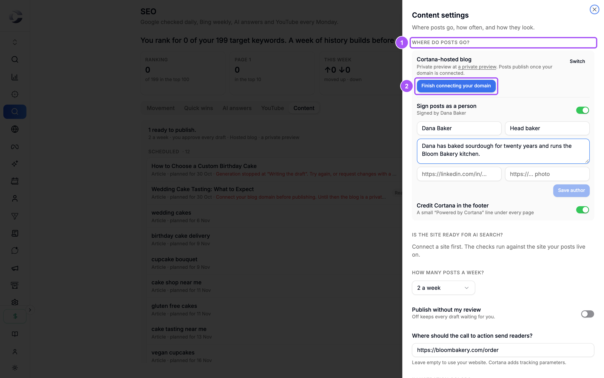
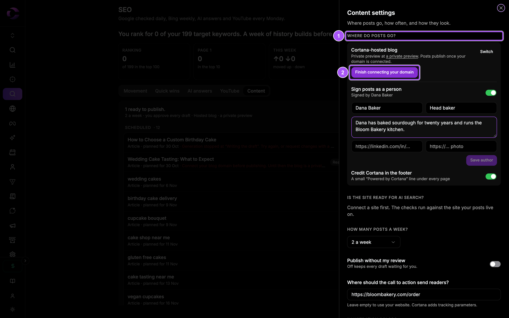

{/* last-verified: 2026-10-29 · route: /business/[businessId]/seo, Content tab, Content settings */}

## Overview

Your articles need a home. You have two choices:

- **Host with Cortana**: a blog on your own domain, with search setup, a sitemap and your pixel built in.
- **WordPress**: Cortana publishes to the WordPress site you already have.

Set it up in **Content settings**: open **SEO**, the **Content** tab, then the settings button next to **Add a brief**.

<Frame caption="Content settings. Where posts go is the first choice.">
  
  
</Frame>

---

## 1. Host your blog with Cortana

<Steps>
  <Step title="Pick Host with Cortana">
    Under **Where do posts go?**, click **Host with Cortana**. Your blog starts as a private preview.
  </Step>
  <Step title="Connect your domain">
    Click **Connect your domain**. Pick `yourdomain.com/blog` (**Recommended**) or `blog.yourdomain.com`.
  </Step>
  <Step title="Point it at Cortana">
    For a folder, Cortana shows a short recipe for your platform, with copy buttons. For a subdomain, add it as a tracking domain.
  </Step>
  <Step title="Check it">
    Click **It is set up. Check it**. Cortana loads your blog's address and confirms it answers. Then click **Done**.
  </Step>
</Steps>

From now on, approved articles publish to your blog. If you started and did not finish, the button reads **Finish connecting your domain**.

**Sign your posts:** turn on **Sign posts as a person**, add a name and a short bio, and click **Save author**.

---

## 2. Or publish to WordPress

<Steps>
  <Step title="Switch to WordPress">
    In **Content settings**, click **Switch** if a Cortana blog is set up.
  </Step>
  <Step title="Fill in your site">
    Type your **Site address**, your **WordPress username**, and an **Application password**. Make one in WordPress under **Users**, **Profile**, **Application Passwords**.
  </Step>
  <Step title="Connect">
    Click **Connect WordPress**. Cortana says it is connected, with your username.
  </Step>
</Steps>

---

## 3. Choose how often and how

- **How many posts a week?**: from 1 a week up to 6 a week, or **Every day**.
- **Publish without my review**: off by default, so every draft waits for you. You can turn it on once a site is connected.
- **Where should the call to action send readers?**: the link at the end of each article. Leave it empty to use your website. Cortana adds tracking parameters.
- **Illustration colors**: the colors of the drawings in your articles.

Click **Save settings**.

<AccordionGroup>
  <Accordion title="Is the site ready for AI search?">
    Click **Run the checks**. Cortana runs eight checks on your blog's site: robots, sitemap, IndexNow, rendering and schema. Each row says **OK**, **Fix**, **Optional**, **Do once**, **Later** or **Retry**, and the one thing to do. It needs a connected, live site.
  </Accordion>

  <Accordion title="Credit Cortana in the footer">
    Adds a small *Powered by Cortana* line under every page of your hosted blog. Turn it off to remove it.
  </Accordion>

  <Accordion title="Release the domain">
    In the hosted blog block, **Release the domain** takes your blog off your domain. Your posts stay, at the private preview address.
  </Accordion>

  <Accordion title="Disconnect WordPress">
    Click **Disconnect**. Approved posts wait until a site is connected again.
  </Accordion>
</AccordionGroup>

## FAQ

<AccordionGroup>
  <Accordion title="Why are my approved articles not live?">
    Your blog is still a private preview. Connect your domain, or connect WordPress. If you have a Cortana website, publish it: your blog goes live at its `/blog`. Then click **Publish now** on each approved article.
  </Accordion>

  <Accordion title="Where do I make a WordPress application password?">
    In WordPress, go to **Users**, **Profile**, and scroll to **Application Passwords**. Give it a name and copy the password Cortana asks for.
  </Accordion>

  <Accordion title="Do AI crawlers find my blog?">
    Yes, once it is on your domain. The **Content** tab shows **AI crawlers** for the last 7 days, counted on Cortana's server.
  </Accordion>
</AccordionGroup>

## Next step

<Card title="Design your blog" icon="palette" href="/seo-blog-design">
  Give your blog your own design, and preview articles in it.
</Card>
