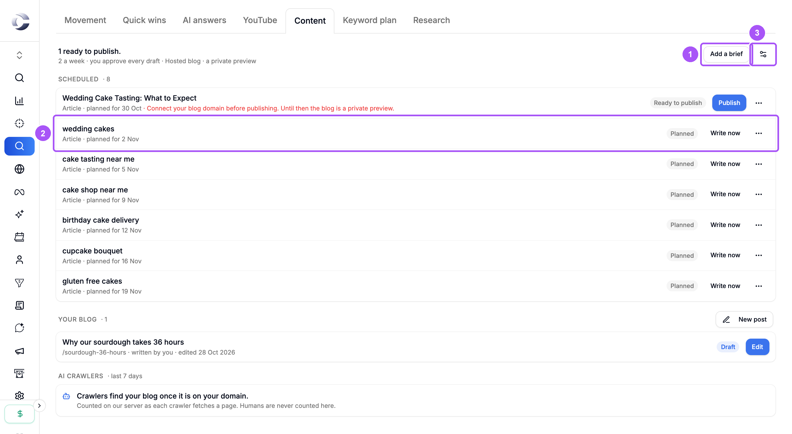
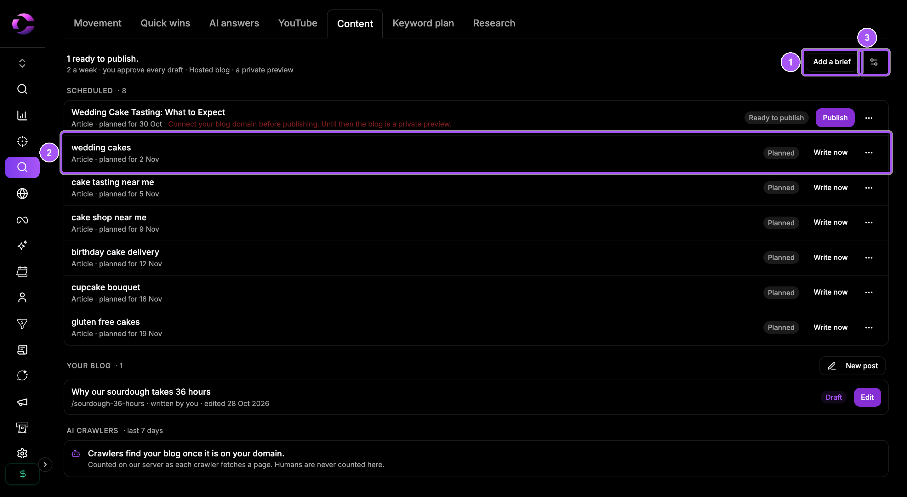
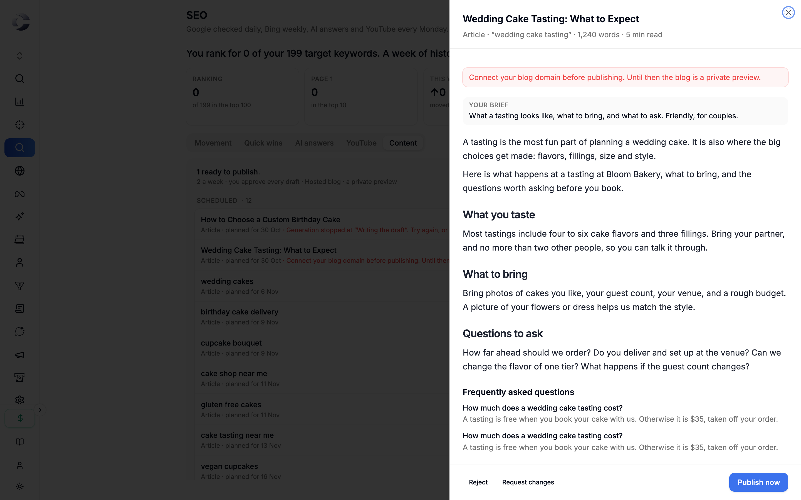
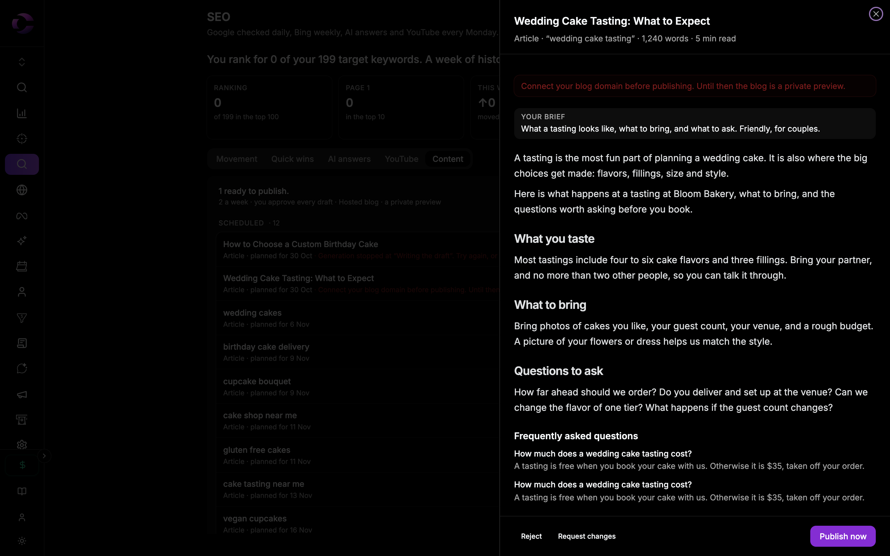

{/* last-verified: 2026-10-29 · route: /business/[businessId]/seo, Content tab */}

## Overview

Cortana plans and writes articles for the keywords in your approved plan. Every draft waits for you. You read it, ask for changes if you want, and approve it. Then it goes live on your blog.

Open **SEO**, then the **Content** tab.

<Note>
  **Before you start.** Approve a keyword plan first. See [2) Research Your Keywords](/seo-research). To publish, set up your blog. See [5) Set Up Your Blog](/seo-blog).
</Note>

---

## 1. Fill your calendar

The calendar fills itself every day from your approved keywords and quick wins. On a new calendar, click **Fill the calendar** to see the first four weeks now.

<Frame caption="The content calendar. Each row is one piece, with its state and its next step.">
  
  
</Frame>

**Add your own idea** (1): click **Add a brief**. Pick a **Target keyword** from your plan, write **Your brief** in a sentence, and click **Add to the calendar**.

**A planned piece** (2): click **Write now** to write it today. Click **⋯** to move it a week later or remove it.

**Content settings** (3): how many posts a week, and where they go. See [5) Set Up Your Blog](/seo-blog).

---

## 2. Watch a piece get written

Each row shows its state:

| State | What it means |
| --- | --- |
| **Planned** | On the calendar, not written yet. |
| **Writing** | Cortana is writing it. It takes a few minutes. |
| **Needs your review** | The draft is ready for you to read. |
| **Sent back** | You asked for changes. A rewrite is on the way. |
| **Ready to publish** | Approved. It goes live once your blog is connected. |
| **Publishing** | Going to your blog now. |
| **Live** | Published. |
| **Needs a retry** | Writing stopped. Click **Retry**. |

---

## 3. Review a draft

<Steps>
  <Step title="Open it">
    On a row in **Needs your review**, click **Review**.
  </Step>
  <Step title="Read it">
    Read the article. Open **SEO details** to see its search title, description, links and why it can rank.
  </Step>
  <Step title="Decide">
    Click **Approve and publish** to put it live. Not quite right? Click **Request changes**, type **What should change?**, and click **Send back for a rewrite**. Not wanted at all? Click **Reject**, then **Reject draft**.
  </Step>
</Steps>

<Frame caption="A draft, ready to read. The buttons to decide are at the bottom.">
  
  
</Frame>

If no blog is connected yet, the button reads **Approve**. The article waits as **Ready to publish** and goes live once you connect your blog.

---

## 4. Write your own post

Scroll the **Content** tab to **Your blog** and click **New post**. Type a title and click **Start writing**.

- Write in **Body**. Switch between **Write** and **Preview**.
- Open **Search details** for the search title, description and FAQ.
- Click **Save draft** to keep it private, or **Publish** to put it live.

Once published, **Unpublish** takes it off your blog. A published post keeps its address.

<AccordionGroup>
  <Accordion title="Refresh a page you already have">
    Save a quick win for a refresh (see [3) Track Your Rankings](/seo-rank-radar)). It shows on the calendar as a refresh. Click **Write now**, then **Review**.

    Switch between **What changes** and **Final version**. Click **Approve and update the page**. Only the page's body changes. Its title, address and settings stay.
  </Accordion>

  <Accordion title="YouTube scripts">
    Save a YouTube gap for a script. The script shows a hook for the first 15 seconds, chapters, the full script, and a title, description and tags. Click **Mark ready** when you are done. Nothing is published anywhere: copy it and record.
  </Accordion>

  <Accordion title="Publish without my review">
    In **Content settings**, turn on **Publish without my review**. New articles then go live the moment they are written. Cortana still checks every link first. A page refresh always waits for you. This needs a connected blog.
  </Accordion>
</AccordionGroup>

## FAQ

<AccordionGroup>
  <Accordion title="How long does an article take to write?">
    A few minutes. The row says **Writing**, then **Needs your review**.
  </Accordion>

  <Accordion title="My article says Ready to publish but it is not live.">
    Your blog is not connected yet. Connect your domain or WordPress in **Content settings**. See [5) Set Up Your Blog](/seo-blog).
  </Accordion>

  <Accordion title="A row says Needs a retry.">
    Writing stopped partway. Click **Retry**, or open it and request changes with a note.
  </Accordion>

  <Accordion title="Will a rejected draft come back?">
    No. It is not written again unless you add a brief for it.
  </Accordion>

  <Accordion title="How many articles does Cortana write?">
    As many a week as you set in **Content settings**, under **How many posts a week?**
  </Accordion>
</AccordionGroup>

## Next step

<Card title="5) Set Up Your Blog" icon="blog" href="/seo-blog">
  Choose where your articles go live.
</Card>
