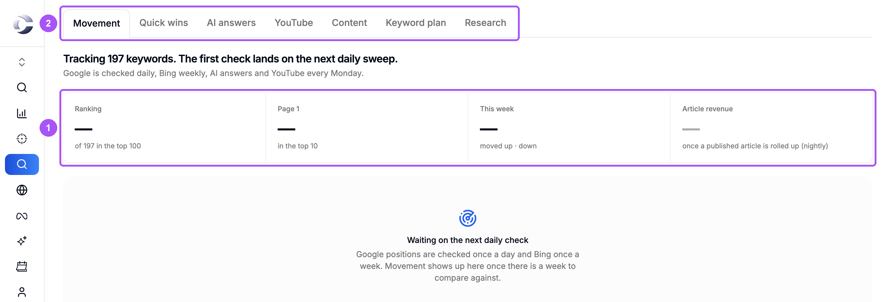
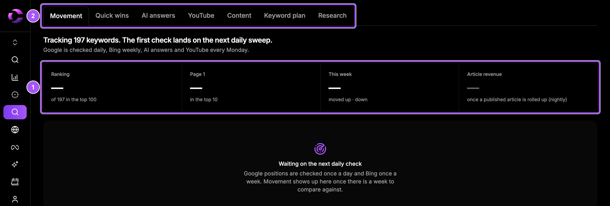

{/* last-verified: 2026-10-29 · route: /business/[businessId]/seo */}

SEO helps people find you on Google, Bing and AI assistants like ChatGPT. Cortana researches your market, gives you a keyword plan, tracks where you rank, and writes articles for you to approve.

Everything sits on one page. Click **SEO** in the menu on the left of your business.

<Frame caption="The SEO page. Your rankings at a glance, with a tab for each part.">
  
  
</Frame>

## The journey in five lines

1. **Connect Search Console**, so Cortana sees your real Google clicks.
2. **Run market research**. Cortana finds the keywords your buyers search for.
3. **Approve your keyword plan**. Remove what does not fit, add your own.
4. **Watch Rank Radar**. Google is checked every day, Bing every week, AI answers and YouTube every Monday.
5. **Approve articles**. Cortana writes them for your keywords and publishes them to your blog.

## Before you start

SEO uses your **product brief**, the same one your AI agents use. If you have not made one, the page says **Set up your business brain first**.

To make it, go to **Settings**, **Business Info**, and click **Start Onboarding** in the **Train your AI agents** card. Then come back to **SEO**.

## The steps

| Step | What you get done |
| --- | --- |
| [1) Connect Search Console](/seo-search-console) | See your real Google searches, clicks and positions. |
| [2) Research Your Keywords](/seo-research) | Run the research and approve your keyword plan. |
| [3) Track Your Rankings](/seo-rank-radar) | Read Rank Radar, quick wins, AI answers and YouTube gaps. |
| [4) Write And Publish Articles](/seo-content) | Fill your content calendar and approve drafts. |
| [5) Set Up Your Blog](/seo-blog) | Choose where articles go: a Cortana blog or WordPress. |

## FAQ

<AccordionGroup>
  <Accordion title="Does Cortana SEO cost extra?">
    Your first research run is free. After that, research runs and articles are paid from your Cortana wallet. If the wallet is empty, Cortana says **Insufficient wallet balance**.
  </Accordion>

  <Accordion title="Do I need Google Search Console?">
    Not to start. Research, the keyword plan and Rank Radar work without it. Search Console adds your real clicks, impressions and quick wins.
  </Accordion>

  <Accordion title="Does Cortana publish articles without asking me?">
    No, not by default. Every draft waits for you to approve it. You can turn on **Publish without my review** in **Content settings** if you want.
  </Accordion>

  <Accordion title="How often are my rankings checked?">
    Google every day, Bing every week, AI answers and YouTube every Monday.
  </Accordion>

  <Accordion title="It says No access to SEO.">
    Your role does not include tracking access for this business. Ask an admin to give it to you.
  </Accordion>
</AccordionGroup>

## Next step

<Card title="1) Connect Search Console" icon="google" href="/seo-search-console">
  Connect your Google Search Console account.
</Card>
