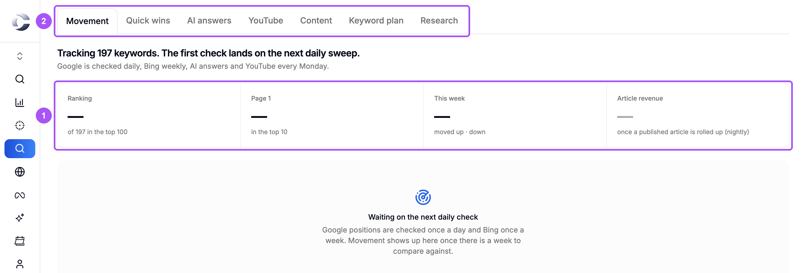
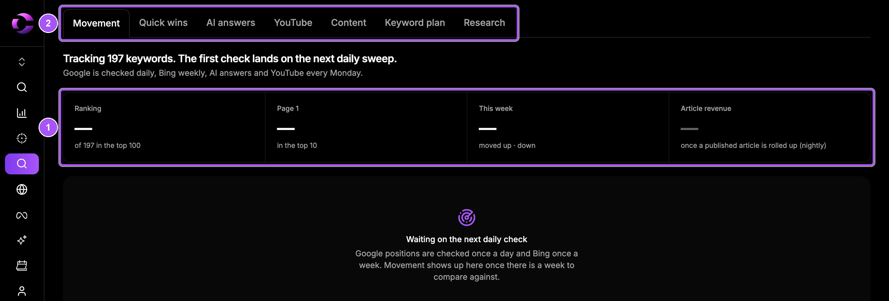
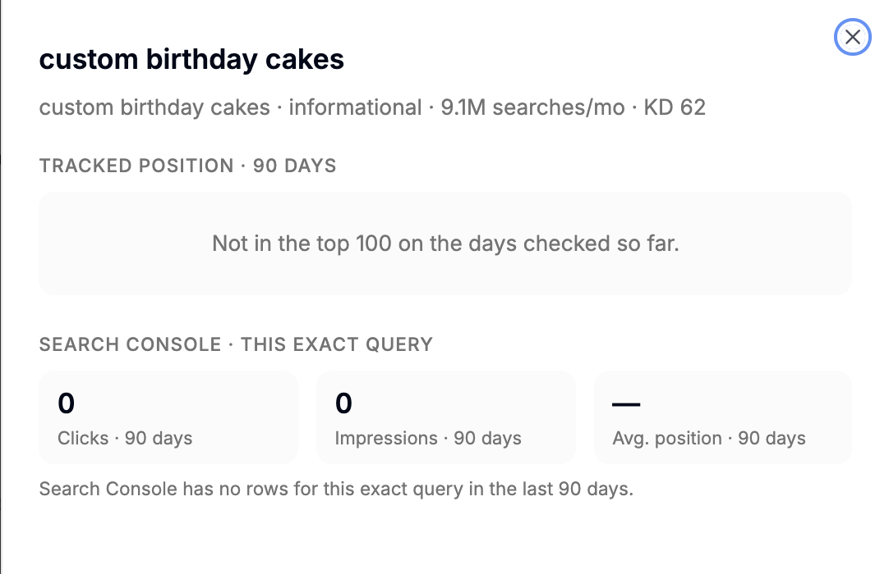
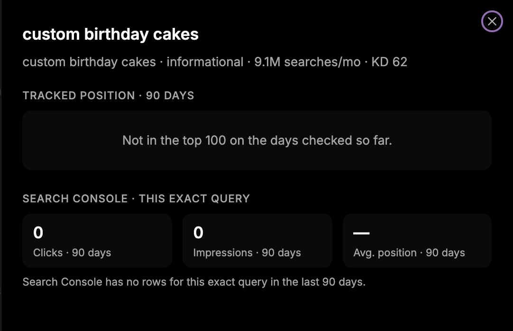

{/* last-verified: 2026-10-30 · route: /business/[businessId]/seo, tab Movement */}

## Overview

**Rank Radar** shows where you rank for the keywords in your approved plan. It is the **Movement** tab of the **SEO** page, the first tab once you approve a plan. The other tabs are **Quick wins**, **AI answers**, **YouTube**, **Content**, **Keyword plan** and **Research**.

Google is checked every day, Bing every week, AI answers and YouTube every Monday.

<Frame caption="Rank Radar. The headline and tiles sum it up, the tabs hold the detail.">
  
  
</Frame>

---

## 1. Read the headline and tiles

The headline says how many of your keywords you rank for, how many moved, and how many are close to page 1.

| Tile | What it shows |
| --- | --- |
| **Ranking** | Keywords in Google's top 100. |
| **Page 1** | Keywords in Google's top 10. |
| **This week** | How many moved up and down since a week ago. |
| **Article revenue** | Revenue from your published articles, counted each night. |

A new plan needs a week of checks before movement shows.

---

## 2. See every keyword

Under the tiles, the **Movement** tab lists your tracked keywords, 25 at a time. The arrows under the list move between pages. Each row shows:

- **30 days**: a small chart of its Google position.
- **Google**: today's position, with an up or down mark.
- **Bing**: this week's position.
- **Clicks / impr.**: from Search Console, when it is connected.

Click a keyword to see its detail: its position over 90 days, the page that ranks, the other sites on the same results page, and Search Console's clicks and impressions for that exact search.

<Frame caption="One keyword up close.">
  
  
</Frame>

---

## 3. Find quick wins

The **Quick wins** tab lists your pages that already sit at positions 8 to 15 on Google. A small push can bring them to page 1. It needs Search Console. See [1) Connect Search Console](/seo-search-console).

On a card, click **Save for a refresh**. Cortana adds a refresh of that page to your content calendar. Click **Dismiss** to hide a card. Quick wins are checked again every Monday.

---

## 4. See how AI assistants talk about you

The **AI answers** tab checks how often ChatGPT, Perplexity and Gemini recommend you.

<Steps>
  <Step title="Draft the questions">
    Click **Draft questions from my plan**. Cortana writes the questions your buyers ask, from your approved plan.
  </Step>
  <Step title="Edit the list">
    Turn a question on or off, remove it, or type your own in **Add a question your buyers ask**. Up to 15 questions are asked each week.
  </Step>
  <Step title="Read the answers">
    After the next Monday run, each assistant shows how often it mentioned you, who it mentioned instead, and which sites it cited.
  </Step>
</Steps>

<AccordionGroup>
  <Accordion title="YouTube gaps">
    Connect your channel under **Settings**, **Integrations**, **YouTube**. Then click **Analyze now** on the **YouTube** tab.

    Cortana finds keywords with no video yet, keywords your videos mention but never focus on, and videos that get fewer views than usual. Click **Save for a script** to add a video script to your content calendar.
  </Accordion>

  <Accordion title="Why does it say Not in top 100?">
    Google did not show your site in the first 100 results for that search on the day it was checked. New keywords often start here. Articles and page refreshes help you climb.
  </Accordion>

  <Accordion title="AI answers says to add my website">
    Cortana needs your website to tell your own pages apart in AI answers. Add it under **Business settings**.
  </Accordion>
</AccordionGroup>

## FAQ

<AccordionGroup>
  <Accordion title="Why do all my keywords show a dash?">
    The first check runs on the next daily sweep after you approve the plan. Come back tomorrow.
  </Accordion>

  <Accordion title="Why is Quick wins empty?">
    Quick wins come from Search Console. Connect it first. If it is connected, nothing is at positions 8 to 15 right now. Cortana checks again every Monday.
  </Accordion>

  <Accordion title="How often are AI answers checked?">
    Every Monday. The first answers show after the first Monday run.
  </Accordion>

  <Accordion title="What does difficulty mean?">
    Keyword difficulty, from 0 to 100. Lower is easier to rank for. A green dot is under 30, amber under 60, red 60 and up.
  </Accordion>
</AccordionGroup>

## Next step

<Card title="4) Write And Publish Articles" icon="newspaper" href="/seo-content">
  Fill your content calendar and approve your first article.
</Card>
