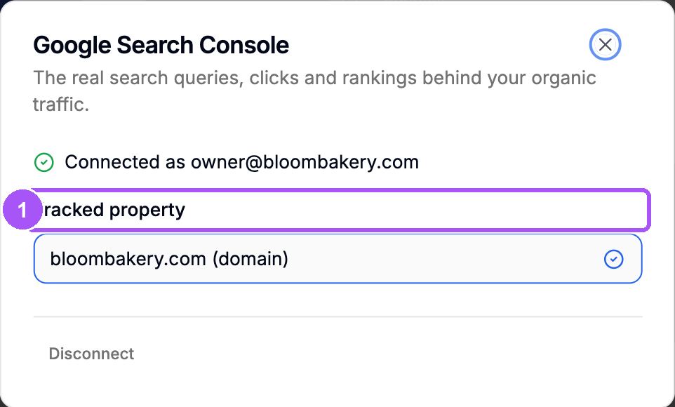
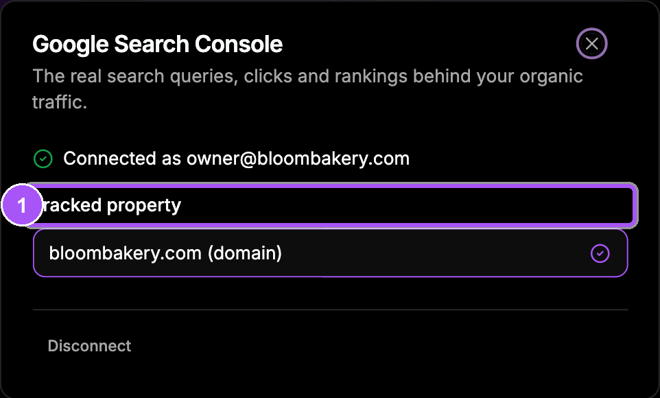
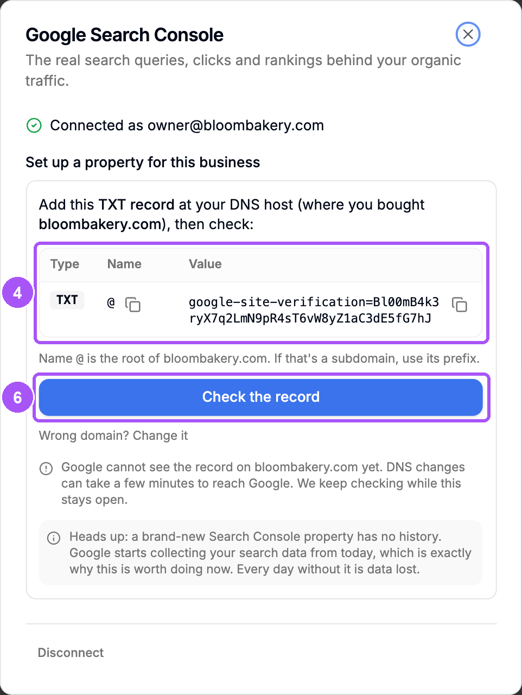
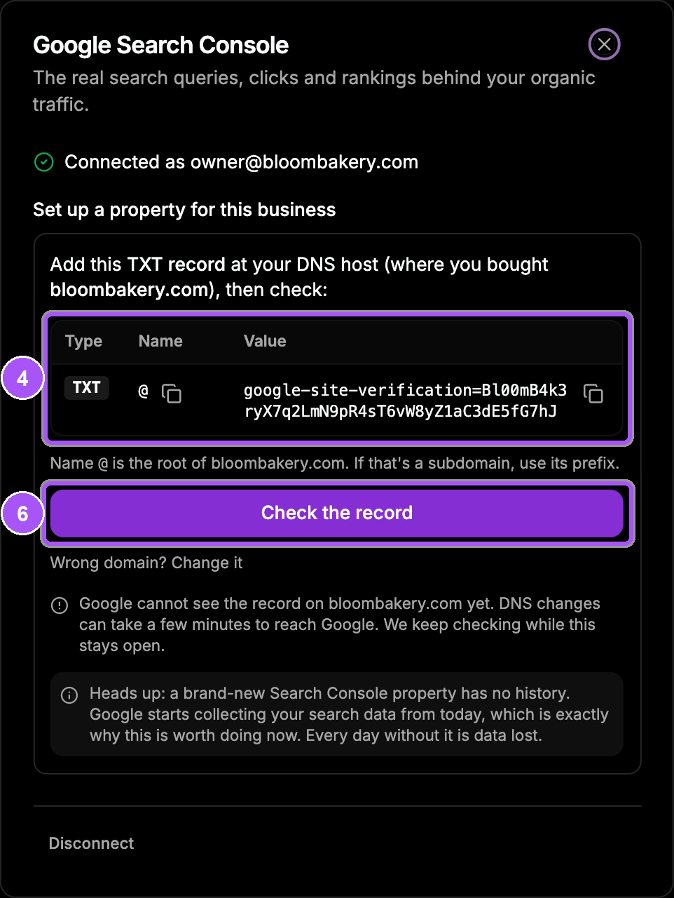
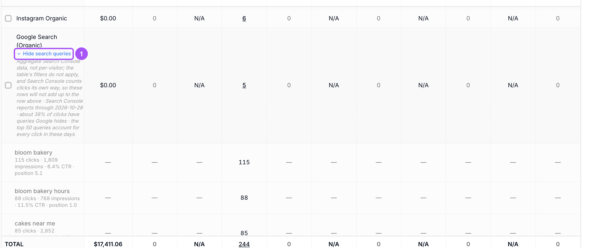
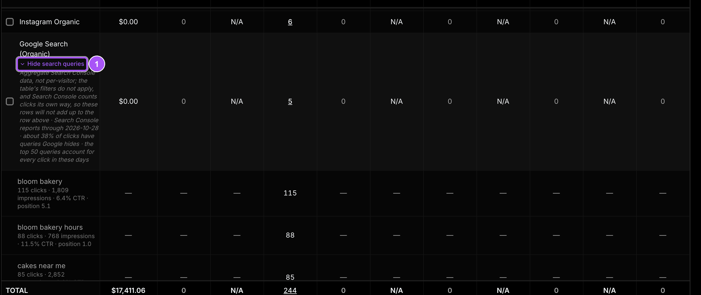

{/* last-verified: 2026-10-29 · route: /business/[businessId]/settings?tab=integrations, the Search Console tile */}

## Overview

Google Search Console tells you what people searched for before they clicked on your site. Connect it, and Cortana shows those searches next to your other traffic and uses them for SEO.

You need a Google account. If it already has your site in Search Console, you pick it. If not, Cortana makes it for you.

---

## 1. Connect your Google account

<Steps>
  <Step title="Open Integrations">
    Go to **Settings**, then **Integrations**. Find the **Search Console** tile and click **Connect**.
  </Step>
  <Step title="Sign in with Google">
    Click **Connect Google Search Console**. Sign in with the Google account that owns your Search Console, and allow access.
  </Step>
  <Step title="Pick your site">
    Back in Cortana, the box shows **Pick the property for this business**. Click your site.
  </Step>
</Steps>

Cortana says *Tracking* and your site's name. The heading becomes **Tracked property**, with a check next to your site. Cortana then brings in up to 16 months of history in the background.

<Frame caption="Connected. The tracked property has a check next to it.">
  
  
</Frame>

---

## 2. No property yet? Cortana makes one

If your Google account has no site in Search Console, the box says **Set up a property for this business**.

<Steps>
  <Step title="Allow setup access">
    Click **Allow setup access** and allow the extra Google screen. This lets Cortana create the property for you.
  </Step>
  <Step title="Type your domain">
    Type your website's domain, like `bloombakery.com`.
  </Step>
  <Step title="Click Set up Search Console">
    Cortana shows one TXT record to add.
  </Step>
  <Step title="Copy the record">
    Use the copy buttons next to **Name** and **Value**.
  </Step>
  <Step title="Add it at your DNS host">
    Log in where you bought your domain, like Cloudflare, GoDaddy or Namecheap. Add a **TXT** record with that name and value.
  </Step>
  <Step title="Check the record">
    Back in Cortana, click **Check the record**. Cortana also checks every 20 seconds while the box stays open.
  </Step>
</Steps>

<Frame caption="The TXT record to add, with a copy button for each part.">
  
  
</Frame>

When Google finds the record, Cortana says your domain *is verified. Search Console is live.* The property is then tracked.

<Note>
  **DNS can take a few minutes.** If Cortana says *Google cannot see the record yet*, wait and keep the box open. It checks again by itself.
</Note>

---

## 3. See the searches in Ad Tracking

<Steps>
  <Step title="Open Sources">
    Go to **Ad Tracking**, then the **Sources** tab.
  </Step>
  <Step title="Open the searches">
    Find the row **Google Search (Organic)** and click **See search queries** under it.
  </Step>
</Steps>

Each search shows as a row under it, with its clicks in the **Page Views** column. A small line shows impressions, click rate (CTR) and average position. Change the date range and the searches update. Click **Hide search queries** to close them.

<Frame caption="The top searches under Google Search (Organic), for the dates you picked.">
  
  
</Frame>

These numbers are Search Console's totals, not single visitors, so they will not add up to the row above. Google also hides some searches. The note under the button says how many.

<AccordionGroup>
  <Accordion title="Likely search terms on a contact">
    Open a contact who came from Google search. Their visit shows **Likely search terms**, marked **Estimated**. Google does not share the exact search for one visitor, so Cortana estimates it from what Search Console reported for that page around that day.
  </Accordion>

  <Accordion title="Disconnect Search Console">
    Open the **Search Console** tile and click **Disconnect**. Cortana asks first: click **Keep** to stay connected, or **Disconnect** to go. Your history in Cortana stays. Connect again any time.
  </Accordion>

  <Accordion title="Google access expired or was revoked">
    If Google stops Cortana's access, the box says so and shows **Reconnect Google Search Console**. Click it and sign in again.
  </Accordion>
</AccordionGroup>

## FAQ

<AccordionGroup>
  <Accordion title="I connected but my site is not in the list.">
    The Google account you used does not own that site in Search Console. Add that account as an owner in Search Console, or let Cortana create the property (section 2).
  </Accordion>

  <Accordion title="It says Google blocked access to Search Console.">
    Your Google Workspace admin may block outside apps. Ask them to allow Cortana, or disconnect and connect again with the Search Console box ticked on Google's screen.
  </Accordion>

  <Accordion title="Where do I add the TXT record?">
    Where you manage your domain's DNS. That is often where you bought the domain, like Cloudflare, GoDaddy or Namecheap.
  </Accordion>

  <Accordion title="I don't see See search queries.">
    It shows only when a Search Console property is tracked. Connect Search Console and pick your site first.
  </Accordion>
</AccordionGroup>

## Next step

<Card title="2) Research Your Keywords" icon="magnifying-glass-chart" href="/seo-research">
  Run the market research and approve your keyword plan.
</Card>
