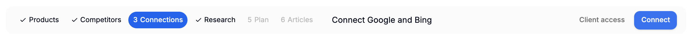
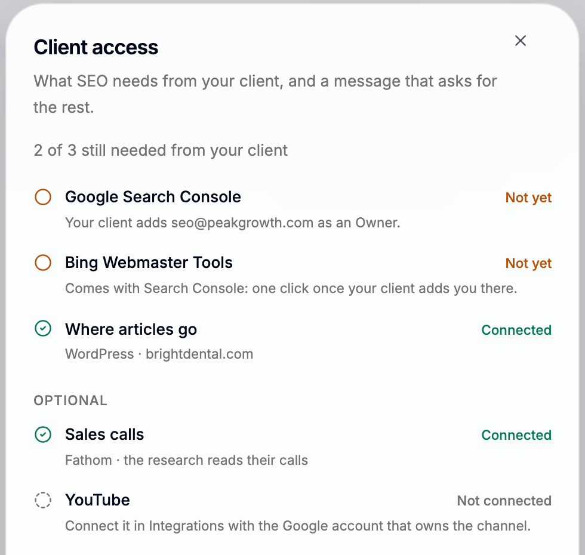
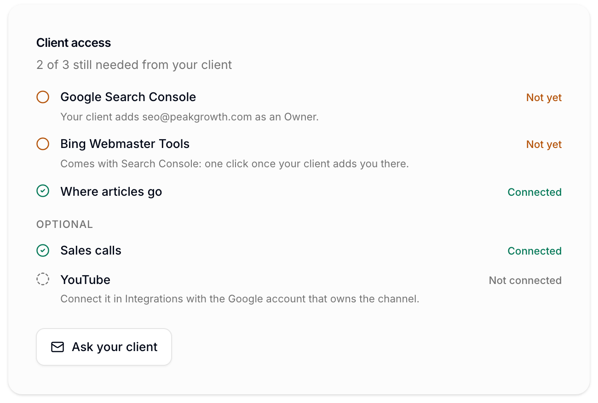
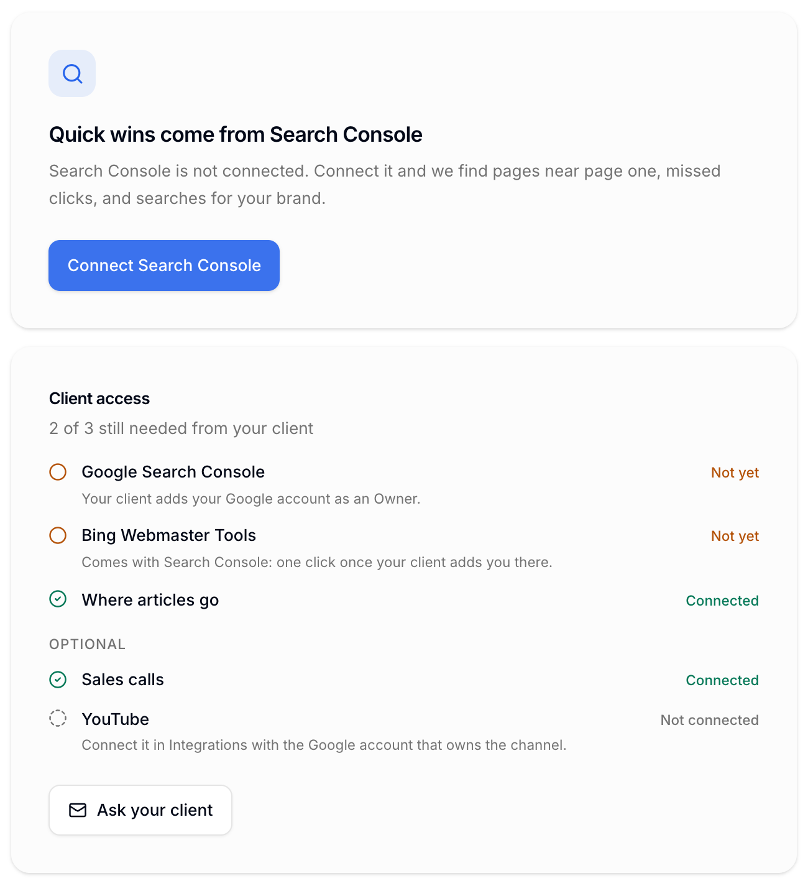

{/* last-verified: 2026-11-21 against AgentKong_App claude/seo-gp-agency e6058ee58 · routes: /business/[businessId]/seo (setup step Connections, the setup bar's Client access, Quick wins tab) · source: src/components/seo/client-access/*, src/server/services/seo-client-access.ts */}

When you run SEO for a client, three things have to come from them: access to their Google Search Console, Bing (which comes with it), and a place for the new articles to go.

The **Client access** card tracks all three for you, says what is still missing, and writes the message that asks for it, with every click spelled out. You send it from your own email. Cortana never contacts your client.

<Note>
  **The card only shows for a client's business.** A business you run for yourself has no client to ask, so it shows no card. Step 1 sets this.
</Note>

## 1. Mark the business as your client's

In the **Control Center**, open **Businesses**. Click the pencil next to the business to open **Edit Business**. Set **Who Owns This Business?** to **Client / Someone Else** and click **Update Business**.

For a new client, click **Add Business** on the same page and pick **Client / Someone Else** when you create it. See [Businesses](/platform/control-centre/businesses).

Then fill in the client's details, which the message uses. In the business, open **Settings**, then the **Business Info** tab:

| Field | What the message does with it |
| --- | --- |
| **Website** | Names the site in every step, such as *choose brightdental.com*. |
| **Business owner name** | Greets them by first name: *Hi Sarah,* |
| **Business email** | Fills the **To** line when you click **Open as email**. |

Click **Save Changes**.

## 2. Find the Client access card

It sits in three places, always the same card.

- **The SEO setup's Connections step**, under the Search Console and Bing cards. Click **Rank My Biz** in the menu on the left, then the **SEO & AEO** tab.
- **The setup bar's Client access button.** Once the research has made a keyword plan, the rest of the setup moves to a bar under the **SEO & AEO** tabs. While steps are left, the bar has a **Client access** button beside its main button. It opens a box headed **Client access**, with the line *What SEO needs from your client, and a message that asks for the rest.*
- **The Quick wins tab**, under the Search Console card, while Search Console is not connected or has stopped sharing. The tab appears once the plan is approved.

<Frame caption="The setup bar. Client access sits beside the step's main button.">
  
</Frame>

<Frame caption="Client access from the setup bar opens in its own box.">
  
</Frame>

## 3. Read the checklist

The top line counts what is still missing: **2 of 3 still needed from your client**. When nothing is, it says **Your client has given everything SEO needs** and the **Ask your client** button goes away.

The three that count are **Google Search Console**, **Bing Webmaster Tools** and **Where articles go**. Under **Optional** sit **Sales calls** and **YouTube**: they make the research better, but SEO runs without them.

<Frame caption="The card in the setup. Each item says whose move it is.">
  
</Frame>

Each item carries one of four marks:

| Mark | What it means |
| --- | --- |
| **Connected** | It is in. Nothing to do. |
| **Not yet** | Your client still has to do something. It goes in the message. |
| **Your step** | Your client's part is done. The next move is yours, such as a reconnect or Bing's import. |
| **Not connected** | An optional item that is not in. |

And the line under each item tells you what happens next:

| Item | The line says | What it means |
| --- | --- | --- |
| **Google Search Console** | *Your client adds you@youragency.com as an Owner.* | Waiting on your client. |
| | *Access was removed. Your client adds you@youragency.com back as an Owner.* | Your client, or someone at their company, took your access away. See step 7. |
| | *Google disconnected. Reconnect it in Connections: your client has nothing to do.* | Your own Google sign-in expired. Click **Reconnect** on the Search Console card. |
| **Bing Webmaster Tools** | *Comes with Search Console: one click once your client adds you there.* | Nothing extra to ask. |
| | *Import it from Search Console in one click, in the Bing card under Connections.* | Your step. See [Connect Bing in one click](/seo/connect-bing). |
| **Where articles go** | *Not chosen yet. The message asks what their site runs on.* | No destination picked yet. |
| | *The hosted blog needs its address on their domain.* | The blog is ready but not on their domain yet. |
| | *WordPress needs a reconnect. Try it in Content settings first.* | The connection stopped working. Try reconnecting before you ask. |
| **Sales calls** | *If they record sales calls with Fathom, connect it in Integrations: their buyers' questions shape the research.* | Optional. |
| **YouTube** | *Connect it in Integrations with the Google account that owns the channel.* | Optional. |

In the setup and on Quick wins, a connected item hides its line to keep the card short. The **Client access** box shows every line.

## 4. Send the ask

Click **Ask your client**. The message opens in place, under **Ask your client**.

1. **Check Your Google email.** This box appears when the message names your account. It is filled in with the Google account connected to this business's Search Console, when Cortana knows it. Otherwise type the Google account you will connect with. Leave it empty and the message says `[your Google email]`, which you replace before sending.
2. **Read the message.** The subject reads like *Bright Dental: one quick thing for your SEO*. It greets your client, names only what is still missing, gives every click, and signs off with your company name.
3. **Send it your way.** Click **Copy message** and paste it anywhere: email, text, Slack, WhatsApp. Or click **Open as email** for a ready draft in your email app, addressed to the business email.

The line under the buttons says it plainly: *Nothing is sent from here: it goes from your own email when you send it.* The ✕ at the top right hides the message again.

<Frame caption="The message names only what is missing. Copy it, or open it as an email draft.">
  
</Frame>

<Tip>
  **White label agencies: your client never sees our name.** If your account has its own logos or a verified custom domain under **White Label**, the message names no platform anywhere. Only you speak.
</Tip>

## 5. What your client clicks

This is what the message asks for, so you know what your client is doing.

**Google Search Console.** *Open https://search.google.com/search-console, choose their site, then Settings → Users and permissions → Add user → your email → Permission: Owner → Add.*

If they have no Search Console, the message asks them to reply with where their domain is registered. You then create it from your own Google account and send them the one DNS record, with their provider's steps. See [Connect Google Search Console](/seo/connect-search-console).

**Bing Webmaster Tools.** Nothing. The message tells them *This covers Bing too*: once you are in Search Console, you import the site into Bing yourself.

**Where articles go.** It depends on their site:

| Their site | What the message asks |
| --- | --- |
| Nothing chosen yet | What their website runs on (WordPress, Shopify, Webflow, Wix, Squarespace or custom code), and who looks after it. If it is WordPress, they can add you straight away. |
| WordPress | *Users → Add New User → any username, your email as the email → Role: Editor → Add New User.* |
| The hosted blog | Who looks after their website, so you can send the one forwarding rule or DNS record that puts the blog on their domain. |
| Sanity | *Open sanity.io/manage, choose your project, then Members → Invite → your email → role: Administrator → send the invite.* |
| A webhook or GitHub | Their developer's email, so you can send the one-time setup. |

## 6. Finish once they reply

1. Go back to the **Connections** step, or the **Quick wins** tab, and the Search Console card. If you have not signed in with Google for this business yet, click **Connect Search Console** and use the Google account your client added.
2. The card finds their site in your account and connects it by itself. If it asks **Which one is your site?**, click theirs.
3. Bing turns to **Your step**. Do the import: see [Connect Bing in one click](/seo/connect-bing).

The checklist reads again whenever a connection lands on the Connections step, and each time you open the **Client access** box. When everything is in, it says **Your client has given everything SEO needs**.

## 7. When access is removed

Clients sometimes clean up their Google users and remove you by mistake. When that happens:

- **Google Search Console** goes back to **Not yet**, with *Access was removed. Your client adds you@youragency.com back as an Owner.*
- The **Quick wins** tab shows **Search Console stopped sharing this property's searches**, with the Search Console card and the Client access card under it.

Click **Ask your client** again. This time the message opens with *My access to brightdental.com in Search Console was removed, so it needs adding back*, followed by the same clicks.

Cortana sees the access come back at its next daily sync, so the card can say **Access was removed** for up to a day after your client adds you back.

<Frame caption="Quick wins while Search Console is not connected. The client access card sits right under it.">
  
</Frame>

## FAQ

<AccordionGroup>
  <Accordion title="Why don't I see the Client access card?">
    The business is marked as your own. Open the **Control Center**, then **Businesses**, edit the business, and set **Who Owns This Business?** to **Client / Someone Else**. The card shows from then on.

    On the Quick wins tab it also only shows while Search Console is not connected or has stopped sharing. Once everything is connected it steps aside.
  </Accordion>

  <Accordion title="Does Cortana email my client for me?">
    No. Nothing is sent from Cortana. **Copy message** puts it on your clipboard, and **Open as email** opens a draft in your own email app. You send it.
  </Accordion>

  <Accordion title="Will my client see the name Cortana?">
    Not if you are white label. When your account has its own logos or a verified custom domain under **White Label**, the message names no platform anywhere. Without white label, the only mention is on the hosted blog, which says *Cortana hosts it for you*.
  </Accordion>

  <Accordion title="Which email does my client need to add?">
    The Google account you will sign in to Search Console with in Cortana. The card fills it in once that account is connected for this business. Until then, type it in **Your Google email** before you send.
  </Accordion>

  <Accordion title="Why is Bing marked Not yet when my client has nothing to do for it?">
    Bing waits on Search Console. Once your client adds you to Search Console, Bing changes to **Your step** and you import it yourself in one click. The message tells your client the same: *This covers Bing too*.
  </Accordion>

  <Accordion title="My client added me back but it still says Access was removed">
    Cortana checks Search Console access once a day. The card updates at the next daily check, so give it up to a day.
  </Accordion>

  <Accordion title="Do I need sales calls and YouTube?">
    No. They are optional. If your client records sales calls with Fathom, their buyers' questions shape the research. A YouTube channel adds its videos. SEO runs well without either.
  </Accordion>
</AccordionGroup>

## Next step

<Card title="Run SEO for your clients" icon="briefcase" href="/seo/run-seo-for-clients">
  The whole playbook: what to ask on day one, what to set up the first week, what to promise, and how to report.
</Card>
