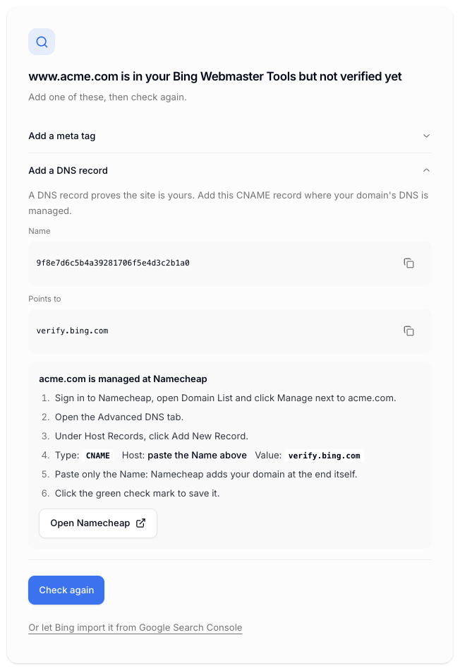

{/* last-verified: 2026-11-21 against AgentKong_App claude/seo-gp-agency e6058ee58 · routes: /business/[businessId]/seo (setup step Connections), Settings > Integrations > Bing Webmaster Tools · source: src/components/seo/seo-bing-card.tsx, src/components/seo/use-bing-card.ts, src/lib/dns-providers/providers.ts */}

Bing Webmaster Tools is Bing's version of Search Console: the searches, clicks and rankings Bing sends your site. Cortana shows them next to Google's.

Once Google Search Console is connected, Bing can copy your site from it, already proved, in one import. That is the quickest way, and the one this page leads with. The meta tag and the DNS record are still there for anyone who wants them.

<Note>
  **Before you start.** Connect Google Search Console first. See [Connect Google Search Console](/seo/connect-search-console). The one-click import needs it.

  The business also needs its **Website** set, under **Settings**, then **Business Info**.
</Note>

## 1. Open the Bing card

The Bing card sits in two places.

- **The SEO setup.** Click **Rank My Biz** in the menu on the left, then the **SEO & AEO** tab. On the setup's **Connections** step, the Bing card is under the Search Console card. Until Google is connected its button is an outline, because Google comes first.
- **Integrations.** Open **Settings**, then **Integrations**, and click **Connect** on the **Bing Webmaster Tools** card. A box headed **Bing Webmaster Tools** opens with the same card inside.

The card is headed **Connect Bing Webmaster Tools**, with the line **Bing's searches, clicks and rankings for your site, next to Google's.**

## 2. Sign in to Bing

Click **Connect Bing**. A Bing window opens and the card says **Finish in the Bing window**. Sign in there and allow access. The window closes and the card looks for your site.

What it says next:

| The card says | What it means | What you do |
| --- | --- | --- |
| **acme.com is connected to Bing** | The site was already proved in Bing and matches the business's website. | Nothing. You are done. |
| **acme.com isn't in your Bing Webmaster Tools yet** | The site is not in this Bing account. | Click **Add acme.com**. It then needs proving: step 3. |
| **acme.com is in your Bing Webmaster Tools but not verified yet** | The site is there but not proved. | Go to step 3. |
| **Which one is your site?** | The account has proved sites, but none matches the business's website. | Click the business's site. |
| **We need the business's website to find its Bing site** | No website is set and nothing matches. | Click **Add it in Business info**, fill in **Website**, and come back. |

## 3. Import it from Google

In the SEO setup, with Search Console connected, the card leads with a panel headed **The quickest way: import it from Google**, and the line **Search Console is connected, so Bing can bring your site over from it, already verified.**

1. Click **Import from Google Search Console**. Bing Webmaster Tools opens in a new tab.
2. In Bing Webmaster Tools, open **My Sites** and click **Import**.
3. Sign in with the Google account that has Search Console, then click **Allow**.
4. Choose your site and click **Import**.
5. Come back to Cortana and click **Check again**.

<Frame caption="With Google connected, the import leads. The codes wait underneath for anyone who wants them.">
  
</Frame>

Once Bing has it, the card reads **acme.com is connected to Bing**, with **Searches come in weekly.**

<Tip>
  **In Integrations, the import is a link.** The box there shows the codes first. Under **Check again**, click **Or let Bing import it from Google Search Console** for the same import.
</Tip>

## 4. Or add a code yourself

If you would rather prove the site directly, use one of the two codes under **Or add a code yourself**. Without Google connected, the card shows them straight away, under **Add one of these, then check again.**

### Add a meta tag

Open **Add a meta tag**. Copy the tag with its copy button and put it in the `<head>` of your home page. It looks like `<meta name="msvalidate.01" content="…" />`. Then click **Check again**.

### Add a DNS record

Open **Add a DNS record**. It says **A DNS record proves the site is yours. Add this CNAME record where your domain's DNS is managed.**

1. Copy the **Name**, a long code, with its copy button.
2. Under **Points to**, copy `verify.bing.com`.
3. Follow the steps under them. Cortana names where your domain's DNS is managed and lists that provider's own clicks, with a button to open it.
4. Click **Check again** once the record is saved.

<Frame caption="The DNS record, with the steps for the provider Cortana found. Here the domain is managed at Namecheap.">
  
</Frame>

<Note>
  **Paste only the Name.** Most providers add your domain to the end of the Name themselves. Cortana's steps say so for your provider, for example **Paste only the Name: Namecheap adds your domain at the end itself.**
</Note>

## 5. Connected

The card reads **acme.com is connected to Bing**, with **Searches come in weekly.** Bing shares its numbers once a week, so expect them a week at a time.

**Disconnect**, at the top right of the card, asks **Disconnect Bing?** with the line *We stop reading Bing's searches for acme.com. Stats already stored stay.* Click **Disconnect** to confirm, or **Keep connected**.

<AccordionGroup>
  <Accordion title="Your provider's steps for Bing's DNS record">
    Cortana shows these for you. The first clicks are the same as for Search Console's record, in [Steps for each domain provider](/seo/connect-search-console#steps-for-each-domain-provider), except that you pick `CNAME` as the type. The fields differ by provider:

    | Provider | Name goes in | `verify.bing.com` goes in | Watch out for |
    | --- | --- | --- | --- |
    | GoDaddy | **Name** | **Value** | |
    | Namecheap | **Host** | **Value** | Save with the green check mark. |
    | Cloudflare | **Name** | **Target** | Set **Proxy status** to **DNS only** (the grey cloud). Bing cannot see a proxied record. |
    | Squarespace | **Name** | **Data** | |
    | Wix | **Host Name** | **Value** | Add it in the **CNAME** section. Click **Save**, then **Save Changes**. |
    | Hostinger | **Name** | **Value** | |
    | Bluehost | **Refers to** | **Points to** | |
    | IONOS | **Host name** | **Points to** | Click **Add record**, then **CNAME**. |
    | Google Cloud DNS | **DNS name** | **Canonical name** | |
    | AWS Route 53 | **Record name** | **Value** | |
    | Vercel | **Name** | **Value** | |
    | Netlify | **Name** | **Value** | |
    | DigitalOcean | **Hostname** | **Is an alias of** | Choose the **CNAME** tab. |
    | Shopify | **Name** | **Points to** | Shopify does not add your domain to the Name, so Cortana leaves out the "paste only the Name" step. |
    | Any other provider | **Name (or Host)** | **Value** | Most providers add your domain to the Name themselves. |
  </Accordion>

  <Accordion title="What each message on the card means">
    | Message | What it means | What to do |
    | --- | --- | --- |
    | **Finish in the Bing window** | Bing's sign-in window is open. | Finish signing in there. |
    | **We are putting Bing's tag on acme.com** with **Nothing for you to do.** | Cortana hosts this site, so it proves it for you. | Wait. It finishes by itself. |
    | **We verify it right after.** | Under **Add acme.com**, on a site Cortana hosts. | Click **Add acme.com**. |
    | **Bing has not supplied a verification code.** | Bing gave no meta tag or DNS code for this site. | Import it from Google Search Console, then click **Check again**. |
    | **Bing Webmaster Tools disconnected** | Bing's access was revoked or expired. | Click **Reconnect**. |
    | **Bing could not be reached** | A read from Bing failed. | Click **Try again**. |
    | **Bing connects here soon** | Connecting Bing from inside Cortana is not available yet. The card adds *Until then, Bing can import your site from Google Search Console in one step.* | Click **Open Bing Webmaster Tools** and import the site from Google Search Console there. |
  </Accordion>
</AccordionGroup>

## FAQ

<AccordionGroup>
  <Accordion title="Do I need Search Console connected before Bing?">
    Not to connect, but it is what makes Bing one click. With Search Console connected, Bing imports your site from it already proved, with no code to add. Without it you add a meta tag or a DNS record instead.
  </Accordion>

  <Accordion title="I imported my site in Bing but Cortana still says not verified">
    Click **Check again** on the card. Cortana only looks again when you ask, or when you open the card again.
  </Accordion>

  <Accordion title="Why does Bing only update once a week?">
    Bing shares its search numbers weekly, so the card says **Searches come in weekly.** Google's come in daily.
  </Accordion>

  <Accordion title="I added the CNAME record on Cloudflare and Bing can't see it">
    Set the record's **Proxy status** to **DNS only**, the grey cloud. Bing cannot see a proxied record. Then click **Check again**.
  </Accordion>

  <Accordion title="Where do I put the meta tag?">
    In the `<head>` section of your home page, as it is. Most website builders have a "header code" or "custom code" setting for this. Then click **Check again**.
  </Accordion>

  <Accordion title="I run SEO for a client. Do they need to do anything for Bing?">
    No. Once your client has added your Google account to their Search Console, you do the import yourself, signed in with that Google account. The client access checklist marks Bing as **Your step** at that point. See [Get access from your client](/seo/client-access).
  </Accordion>
</AccordionGroup>

## Next step

<Card title="Get access from your client" icon="user-check" href="/seo/client-access">
  Running SEO for a client? See what they still need to give you, and send them the exact clicks.
</Card>
