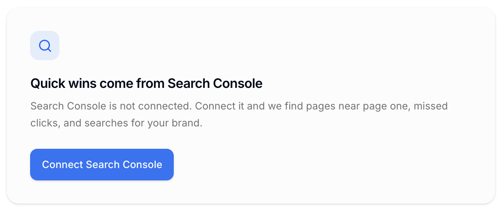
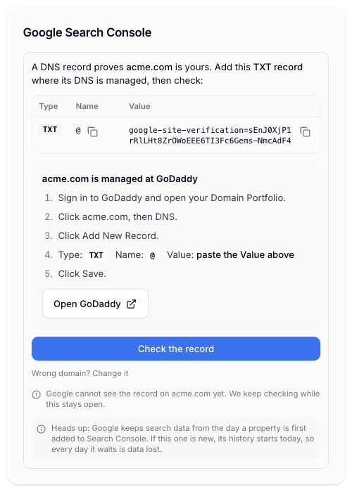
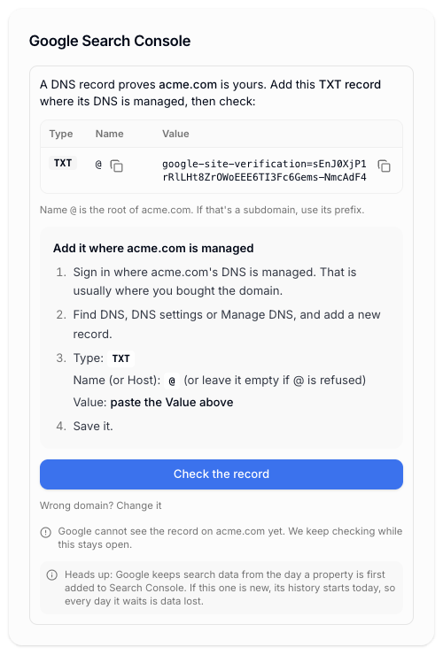

{/* last-verified: 2026-11-21 against AgentKong_App claude/seo-gp-agency e6058ee58 · routes: /business/[businessId]/seo (setup step Connections; Quick wins tab), Settings > Integrations > Search Console · source: src/components/seo/seo-search-console-card.tsx, src/components/integrations/GscSetupWizard.tsx, src/lib/dns-providers/providers.ts */}

Google Search Console is Google's free record of the searches a website shows up for: the words people typed, the clicks, and where the site ranked. Cortana reads it, 16 months back, and keeps it updated every day.

At the end of this page the business's site is connected, and its search history is coming in. If the site has never been in Search Console, Cortana creates it for you and walks you through the one DNS record that proves the domain is yours.

<Note>
  **Before you start.**

  Set the business's website. Open **Settings**, then the **Business Info** tab, fill in **Website**, and click **Save Changes**. Cortana uses it to find the right site in Search Console.

  Running SEO for a client? Your client first adds your Google account to their Search Console. See [Get access from your client](/seo/client-access).
</Note>

## 1. Open the Search Console card

The same card sits in three places. Use whichever you are on.

- **The SEO setup.** Click **Rank My Biz** in the menu on the left. It opens on the **SEO & AEO** tab. The setup's third step, **Connections**, is headed **Connect Google and Bing so we see your real rankings**. The first card on it is **Connect Google Search Console**.
- **The Quick wins tab.** While Search Console is not connected, the tab shows a card headed **Quick wins come from Search Console**.
- **Integrations.** Open **Settings**, then **Integrations**, and click **Connect** on the **Search Console** card. A box headed **Google Search Console** opens. After you sign in, you pick the site yourself from a list headed **Pick the property for this business**. With no site in the account, the box goes straight to step 4.

<Frame caption="The Search Console card on the Quick wins tab. In the setup it reads Connect Google Search Console.">
  
</Frame>

## 2. Sign in with Google

Click **Connect Search Console**. In the Integrations box the button reads **Connect Google Search Console**.

A Google window opens and the card says **Finish in the Google window**. Sign in with the Google account that has the site in Search Console, and allow access. The window closes by itself and the card reads your sites.

<Tip>
  **Use the account that owns the site in Search Console.** For a client's site, that is the Google account your client added as an **Owner**.
</Tip>

## 3. Pick the site

What the card says next depends on what Cortana finds in that Google account.

| The card says | What it means | What you do |
| --- | --- | --- |
| **acme.com is connecting to Search Console**, then **acme.com is connected to Search Console** | The site is there, verified, and matches the business's website. | Nothing. Cortana picked it for you. Skip to step 6. |
| **Which one is your site?** | The account has verified sites, but none matches the business's website. | Click the business's site in the list. Not there? Click **None of these** under the list to create one for the site. |
| **acme.com is in your Search Console but not verified yet** | The site was added to Search Console but never proved. | Click **Verify now**, then go to step 4. |
| **Create a Search Console property for acme.com** | The site is not in this account at all. The card adds **We create it for you.** | Click **Create it**, then go to step 4. |

## 4. Prove the domain with one DNS record

A DNS record is a line in your domain's settings. Adding the one Cortana gives you proves to Google that the domain is yours. It changes nothing on your website.

**If Google asks for one more permission.** The box says **To set up Search Console for you, we need Google's setup permissions (one extra consent screen).** Click **Allow setup access** and approve the Google window.

**If Cortana asks for the domain.** The box says **No Search Console property yet, so we'll create one for you. Confirm your website's domain:** with your website's domain filled in. Check it and click **Set up Search Console**.

Then the record appears, under the line **A DNS record proves acme.com is yours. Add this TXT record where its DNS is managed, then check:**

| Column | What it holds |
| --- | --- |
| **Type** | Always `TXT`. |
| **Name** | `@` for the domain itself, or a subdomain's prefix, such as `shop` for `shop.acme.com`. It has its own copy button. |
| **Value** | A long code starting `google-site-verification=`. It has its own copy button. |

Under the record, Cortana names where the domain's DNS is managed and lists that provider's own clicks, numbered, with a button to open it. It first says **Finding where acme.com is managed…** for a few seconds.

1. Click the **Open** button under the steps, such as **Open GoDaddy**. Your provider opens in a new tab.
2. Follow the numbered steps. Each one is written in your provider's own words.
3. Copy the **Name** and the **Value** from Cortana with their copy buttons, and paste each into the field the steps name.
4. Save the record at your provider.

<Frame caption="The record, and the steps for the provider Cortana found. Here the domain is managed at GoDaddy.">
  
</Frame>

Every provider's clicks are in [Steps for each domain provider](#steps-for-each-domain-provider) below.

**A site Cortana hosts needs no record.** The box says **We host acme.com, so there is nothing for you to add. We put Google's tag on your site and check it for you.** Leave it open and it finishes by itself.

## 5. Check the record

Back in Cortana, click **Check the record**.

- **It worked.** A message says **acme.com is verified. Search Console is live.** The card turns to connected.
- **Not yet.** A message says Google cannot see the record yet, such as **Not visible to Google yet. A new DNS record can take a few minutes to reach Google.** That is normal for a record you just added.

You do not have to keep clicking. While the box stays open, Cortana checks again every 20 seconds, and the line under the button says **We keep checking while this stays open.**

<Warning>
  **Do not wait days to do this.** The box explains why: *Google keeps search data from the day a property is first added to Search Console. If this one is new, its history starts today, so every day it waits is data lost.*
</Warning>

## 6. Watch the history come in

Once connected, the card reads **acme.com is connected to Search Console**. Under it, Cortana pulls the site's last 16 months of searches:

- **Preparing 16 months of history**, then **Pulling 16 months of history**, with a percentage and the oldest month reached so far.
- **16 months in · updated daily** once it is all in.

**Change**, beside that line, opens the **Google Search Console** box, where you can pick another site or disconnect.

## Steps for each domain provider

Cortana names your provider from your domain's nameservers and shows its steps for you, so you only need this section if you want to read ahead.

The steps are for a record on the domain itself. For a subdomain, use the subdomain's prefix wherever a step says `@` or "leave it empty". See [On a subdomain](#on-a-subdomain).

In every case: copy the **Name** and **Value** from Cortana, then click **Check the record** once you have saved.

<AccordionGroup>
  <Accordion title="GoDaddy">
    1. Sign in to GoDaddy and open your Domain Portfolio.
    2. Click your domain, then **DNS**.
    3. Click **Add New Record**.
    4. **Type**: `TXT`. **Name**: `@`. **Value**: paste the Value from Cortana.
    5. Click **Save**.

    Cortana's button: **Open GoDaddy**, which opens your Domain Portfolio.
  </Accordion>

  <Accordion title="Namecheap">
    1. Sign in to Namecheap, open **Domain List** and click **Manage** next to your domain.
    2. Open the **Advanced DNS** tab.
    3. Under **Host Records**, click **Add New Record**.
    4. **Type**: `TXT`. **Host**: `@`. **Value**: paste the Value from Cortana.
    5. Click the green check mark to save it.

    Cortana's button: **Open Namecheap**, which opens the domain's Advanced DNS page.
  </Accordion>

  <Accordion title="Cloudflare">
    1. Sign in to Cloudflare and choose your domain.
    2. Open **DNS**, then **Records**, and click **Add record**.
    3. **Type**: `TXT`. **Name**: `@`. **Content**: paste the Value from Cortana.
    4. Click **Save**.

    Cortana's button: **Open Cloudflare**.
  </Accordion>

  <Accordion title="Squarespace (and domains that were on Google Domains)">
    1. Open your Squarespace domains and click your domain.
    2. Open **DNS**, then **DNS Settings**.
    3. Under **Custom records**, click **Add record**. Squarespace may ask for your password again.
    4. **Type**: `TXT`. **Name**: `@`. **Text**: paste the Value from Cortana.
    5. Click **Save**.

    Domains Squarespace took over from Google Domains show as **managed at Squarespace (formerly Google Domains)**. The same nameservers also serve Google Cloud DNS, so Cortana adds a **Using Google Cloud DNS instead?** button that swaps the steps. **Back to Squarespace** swaps them back.
  </Accordion>

  <Accordion title="Wix">
    1. Open **Domains** in your Wix account.
    2. Click the **⋯** next to your domain, then **Manage DNS Records**.
    3. In the **TXT** section, click **+ Add Record**.
    4. **Host Name**: leave it empty (that is the `@`). **Value**: paste the Value from Cortana.
    5. Click **Save**.

    Wix has no type field: the section you add it in sets the type.
  </Accordion>

  <Accordion title="Hostinger">
    1. Open **Domains** in hPanel and click **Manage** next to your domain.
    2. Open **DNS / Nameservers**, then **DNS records**.
    3. **Type**: `TXT`. **Name**: `@`. **Value**: paste the Value from Cortana.
    4. Click **Add Record**.
  </Accordion>

  <Accordion title="Bluehost">
    1. Sign in to Bluehost, open **Domains** and choose your domain.
    2. Open the **DNS** tab, then **Manage Advanced DNS Records**.
    3. Click **+ Add Record**.
    4. **Type**: `TXT`. **Refers to**: `@`. **TXT Value**: paste the Value from Cortana.
    5. Click **Add**.
  </Accordion>

  <Accordion title="IONOS">
    1. Sign in to IONOS and open **Domains & SSL**.
    2. Click the gear icon next to your domain, then **DNS**.
    3. Click **Add record**, then **TXT**.
    4. **Host name**: `@`. **Value**: paste the Value from Cortana.
    5. Click **Save**.
  </Accordion>

  <Accordion title="Google Cloud DNS">
    1. Open **Cloud DNS** in the Google Cloud console and click the zone for your domain.
    2. Click **Add standard**.
    3. **Resource record type**: `TXT`. **DNS name**: leave it empty (that is the `@`). **TXT data**: paste the Value from Cortana.
    4. Click **Create**.
  </Accordion>

  <Accordion title="AWS Route 53">
    1. Open **Hosted zones** in Route 53 and click your domain.
    2. Click **Create record**.
    3. **Record type**: `TXT`. **Record name**: leave it empty (that is the `@`). **Value**: paste the Value from Cortana.
    4. Put the value inside double quotes (`"…"`). If the domain already has a TXT record, edit that record and add this value on a new line instead.
    5. Click **Create records**.
  </Accordion>

  <Accordion title="Vercel">
    1. Open **Domains** in your Vercel dashboard and click your domain.
    2. Go to the **DNS Records** form.
    3. **Type**: `TXT`. **Name**: leave it empty (that is the `@`). **Value**: paste the Value from Cortana.
    4. Click **Add**.
  </Accordion>

  <Accordion title="Netlify">
    1. Open **Domains** in your Netlify team and click your domain.
    2. Under **DNS records**, click **Add new record**.
    3. **Record type**: `TXT`. **Name**: `@`. **Value**: paste the Value from Cortana.
    4. Click **Save**.
  </Accordion>

  <Accordion title="DigitalOcean">
    1. Open **Networking**, then **Domains**, and click your domain.
    2. Choose the **TXT** tab.
    3. **Hostname**: `@`. **Value**: paste the Value from Cortana.
    4. Click **Create Record**.
  </Accordion>

  <Accordion title="Shopify">
    1. In your Shopify admin, open **Settings**, then **Domains**, and click your domain.
    2. Click **DNS settings**, then **Manage**, then **Add custom record**.
    3. **Type**: `TXT`. **Name**: leave it as it is. **Value**: paste the Value from Cortana.
    4. Click **Confirm**.
  </Accordion>

  <Accordion title="Any other provider">
    When Cortana cannot tell where the DNS is managed, the panel is headed **Add it where acme.com is managed** and gives steps that fit any provider:

    1. Sign in where the domain's DNS is managed. That is usually where you bought the domain.
    2. Find **DNS**, **DNS settings** or **Manage DNS**, and add a new record.
    3. **Type**: `TXT`. **Name (or Host)**: `@` (or leave it empty if `@` is refused). **Value**: paste the Value from Cortana.
    4. Save it.

    There is no **Open** button, because Cortana does not know which site to open.

    <Frame caption="When the provider is unknown, Cortana gives steps that fit any provider.">
      
    </Frame>
  </Accordion>
</AccordionGroup>

## On a subdomain

When the business's website is a subdomain, such as `shop.acme.com`, the record goes in the main domain's DNS, and its **Name** is the prefix: `shop`.

Cortana works this out for you. Once it has found the provider, the record table shows the prefix as the **Name**, and a line under it says so, for example **Name try puts the record on try.acme.com. AWS Route 53 adds acme.com itself.** The provider's steps use the same prefix.

<Frame caption="A subdomain. The Name is the prefix, and the steps are the main domain's provider.">
  
</Frame>

<Warning>
  **Wait for the provider's name before you copy the Name.** For the first few seconds, while Cortana is still finding the provider, the **Name** shows `@`. Copy it once the panel says where the domain is managed.
</Warning>

<AccordionGroup>
  <Accordion title="How Cortana finds your domain provider">
    Cortana reads the domain's nameservers, the public record that says which company runs its DNS. It matches them against fourteen providers: GoDaddy, Namecheap, Cloudflare, Squarespace, Wix, Hostinger, Bluehost, IONOS, Google Cloud DNS, AWS Route 53, Vercel, Netlify, DigitalOcean and Shopify.

    - **That is where the DNS is managed, not always where the site is built.** A Shopify or Wix site on a domain bought at GoDaddy is usually still managed at GoDaddy, so Cortana shows GoDaddy's steps. Follow what it shows.
    - **A subdomain** is looked up through its main domain: `shop.acme.com` is managed wherever `acme.com` is.
    - **A domain moving between providers** can list both for a while. Cortana names the one most of its nameservers belong to.
    - **Anything it cannot match**, or a lookup that fails, gets the general steps under **Add it where acme.com is managed**.

    Cortana reads this fresh each time the box opens. Nothing about your domain is stored.
  </Accordion>

  <Accordion title="What each message on the card means">
    | Message | What it means | What to do |
    | --- | --- | --- |
    | **Finish in the Google window** | Google's sign-in window is open. | Finish signing in there. When your browser blocks pop-ups, the sign-in opens in the same tab instead and brings you back to this step. |
    | **Preparing your site for verification…** | Cortana is setting up the property before showing the record. | Wait a moment. |
    | **Could not start the setup. Try again.** | The setup did not start. | Click **Try again**. |
    | **Google disconnected Search Console** | Google's access for this business was revoked or expired. | Click **Reconnect** and sign in again. Your history stays. |
    | **Search Console could not be reached** | A read from Google failed. | Click **Try again**. |
    | **Google blocked access to Search Console for this account.** | A Google Workspace admin has not allowed the app, or the Search Console box was unticked at sign-in. | Ask your Workspace admin to allow it, or disconnect and reconnect with the Search Console box ticked. |
    | **Wrong domain? Change it** | A link under the record. | Click it to type a different domain. **Keep acme.com** takes you back. |
  </Accordion>
</AccordionGroup>

## FAQ

<AccordionGroup>
  <Accordion title="I don't have Search Console at all. Can I still connect?">
    Yes. Sign in with any Google account, and Cortana offers **Create a Search Console property for acme.com**. Click **Create it**, add the one DNS record it shows, and click **Check the record**. The property is created in the Google account you signed in with.

    For a client, the message from [Get access from your client](/seo/client-access) asks them where their domain is registered. You create the property from your own account, then send them the record and their provider's steps, or add it yourself if you have their DNS login.
  </Accordion>

  <Accordion title="I added the record and it still says Not visible to Google yet">
    A new record can take a few minutes to reach Google, and sometimes longer. Leave the box open: Cortana checks every 20 seconds by itself.

    If it still fails after an hour, check three things at your provider: the type is `TXT`, the **Name** matches Cortana's exactly (`@`, empty, or the subdomain prefix), and the **Value** was pasted whole, starting `google-site-verification=`. On AWS Route 53 the value must be inside double quotes.
  </Accordion>

  <Accordion title="My website is a subdomain like shop.mysite.com. What do I put as the Name?">
    The prefix, `shop`, added in the main domain's DNS. Your provider adds `mysite.com` itself. Cortana shows this as the **Name** once it has found the provider, with the line **Name shop puts the record on shop.mysite.com**.

    If the subdomain already points somewhere with a CNAME record, many providers refuse a TXT record on the same name. Then click **Wrong domain? Change it** and prove the main domain, `mysite.com`, instead. A Search Console property for the main domain covers its subdomains too.
  </Accordion>

  <Accordion title="My domain is on Shopify, Wix or another website builder. Where do I add the record?">
    Wherever Cortana says the domain is managed. It reads that from the domain's nameservers, so it is right even when the site is built somewhere else. If it says Shopify or Wix, use those steps. If you bought the domain at GoDaddy and only pointed it at Shopify, it says GoDaddy.

    A site that only lives on the builder's own address, such as `yourstore.myshopify.com` or `yoursite.wixsite.com`, has no DNS you can edit, so a DNS record cannot prove it. Connect your own domain to the site first and set it as the **Website** in **Business Info**.
  </Accordion>

  <Accordion title="Which Google account should I sign in with?">
    The one that has the site in Search Console as an owner. If you run SEO for a client, that is your own Google account, after your client adds it as an **Owner**. If nobody has Search Console yet, any Google account you will keep: the property is created there.
  </Accordion>

  <Accordion title="Can I close the box while I wait for the record?">
    Yes. The record stays the same, so coming back shows the same one. Cortana only checks by itself while the box is open, so click **Check the record** when you come back.
  </Accordion>

  <Accordion title="How far back does Cortana read my searches?">
    16 months, which is as far back as Google keeps. After that it updates daily. A property created today starts its history today.
  </Accordion>
</AccordionGroup>

## Next step

<Card title="Connect Bing in one click" icon="magnifying-glass" href="/seo/connect-bing">
  With Search Console connected, Bing imports your site from it in one step.
</Card>
