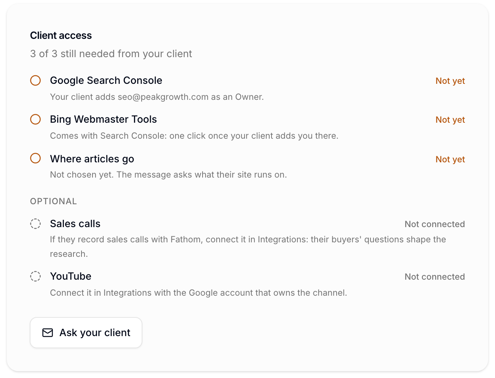

{/* last-verified: 2026-11-21 against AgentKong_App claude/seo-gp-agency e6058ee58 · routes: /business/[businessId]/seo (setup flow, setup bar, Scoreboard, Quick wins, Keywords) · source: src/components/seo/setup/*, src/components/seo/seo-scoreboard.tsx, src/components/seo/scoreboard/*, src/config/seo-program-offer.ts, src/config/seo-programs.ts */}

You do not need to know SEO to sell it. Cortana researches each client's market, builds the keyword plan, writes and publishes the articles, and tracks the rankings against their competitors. Your job is four things: get access, approve the plan, keep the articles flowing, and show your client the results.

This page is the whole routine, from the first call with a new client to the report you send them every week.

<Note>
  **One client, one business.** Every client gets their own business in Cortana, marked **Client / Someone Else** under **Who Owns This Business?**. That is what turns on the client access checklist. See [Get access from your client](/seo/client-access).
</Note>

## 1. Day one: what to ask each client

Get all of this on your kickoff call, or in your first email. The **Client access** card writes the access part for you.

**Access** (the card's message asks for these, with every click):

- [ ] **Google Search Console.** Your client adds your Google account as an **Owner**. No Search Console yet? Ask where their domain is registered: you create it, and they add one DNS record.
- [ ] **Bing.** Nothing to ask. It comes with Search Console.
- [ ] **Where the articles go.** What their website runs on (WordPress, Shopify, Webflow, Wix, Squarespace or custom code) and who looks after it. On WordPress they add you as an **Editor**.

**About the business** (the setup asks for these):

- [ ] **Their website address**, the owner's name and their business email. They go in **Settings**, then **Business Info**.
- [ ] **The products or services they want to be found for.** Each one gets its own research and keyword plan.
- [ ] **The competitors they want to beat.** The ones they lose deals to, by name.

**Optional, if they have them:**

- [ ] **Sales calls recorded with Fathom.** Their buyers' questions shape the research.
- [ ] **A YouTube channel**, connected with the Google account that owns it.

<Frame caption="A new client on day one: three things still needed, and one button that asks for them.">
  
</Frame>

Click **Ask your client**, then **Copy message** or **Open as email**, and send it from your own email. Cortana never contacts your client.

## 2. The first week: set it up

Click **Rank My Biz** in the menu on the left. It opens on **SEO & AEO**, and a new business opens straight into the setup. Six steps, shown as pills across the top:

| Step | What you see | What you do |
| --- | --- | --- |
| **Products** | **What product or service should SEO work on?**, or **Which products should SEO work on?** when the business has several | Create or tick the products your client wants found. *Each one gets its own research and keyword plan.* |
| **Competitors** | **Who do you compete with for** the product | Add the competitors your client named. *We compare your rankings with theirs and study their keywords.* |
| **Connections** | **Connect Google and Bing so we see your real rankings** | Connect Search Console and Bing, with the **Client access** card under them. Still waiting on your client? Click **Later: connect Google and Bing from Integrations** and carry on. |
| **Research** | **Research the market for** the product | Click **Start research**. *It takes a few minutes and runs in the background. You can leave this page.* |
| **Plan** | **Your keyword plan is ready** | Click **Open your plan**. It opens the **Keywords** tab. Read it and click **Approve plan**. |
| **Articles** | **Where should your articles go?** | Pick **On my site at /blog**, **Inside my CMS** (WordPress or Sanity) or **My site is code** (a webhook or a GitHub pull request), and connect it. |

When the last step is done, Cortana says **Your SEO is set up**, with the number of keywords tracked and the competitors to beat. Click **See your scoreboard**.

<Tip>
  **Do not wait on your client to start.** **Competitors**, **Connections** and **Articles** each have a **Later** button. Run the products, the competitors and the research while your client finds their logins. Once a plan exists, whatever is left waits in a bar under the **SEO & AEO** tabs, with its own **Client access** button.
</Tip>

**By the end of week one** you want: Search Console and Bing connected, the plan approved, and the article destination connected. That is when the work starts counting.

## 3. What to promise, and by when

**Never promise a #1 ranking.** Nobody can guarantee one, and Google says so itself. Promise what to expect, and show it moving every week.

Count from the day setup is done: the site connected, the plan approved and the articles going live. Here is what Cortana's SEO programs work towards, in their own words:

| When | Get found (3 months) | Outrank your competitors (6 months) | Own your market (12 months) |
| --- | --- | --- | --- |
| **Week 1** | Your market researched, your competitors named, where you rank today recorded, the first AI answers read. | Everything in Get found, and where you stand against each competitor from day one. | Everything in Outrank your competitors, at the most articles a week we write. |
| **Day 30** | Your new pages indexed and seen in search, and your first mention in an AI answer about your name. | The gap to your competitors shrinking, your first keywords on page 2, your first mention in an AI answer to a "best" question. | The gap shrinking on every competitor you track, keywords on page 2, mentions in AI answers. |
| **Day 90** | Your first keywords in Google's top 10 for your name, your services and your area. | Your first keywords in the top 10, and your first competitor passed on a keyword you track. | Several keywords in Google's top 10, and competitors passed on keywords you track. |
| **Month 6** | Month to month after the program: more keywords in the top 10, and more clicks than where you started. | Ahead of your competitors on more keywords and in more AI answers, with more clicks than where you started. | Your category's keywords moving into the top 10, ahead in AI answers, and the sales from search counted. |
| **Month 12** | | | The searches that define your category in reach. Google's own range for SEO is four months to a year. |

The promise in one line, per program:

- **Get found:** show up in Google and in AI answers for your name and your core services within 90 days.
- **Outrank your competitors:** close the gap to the competitors you name, and pass them on the searches that bring customers, within 6 months.
- **Own your market:** lead your category in Google and in AI answers within 12 months, with the sales it brings counted.

<AccordionGroup>
  <Accordion title="The work each program does every week">
    | | Get found | Outrank your competitors | Own your market |
    | --- | --- | --- | --- |
    | Articles written and published | 1 a week | 3 a week | 7 a week |
    | Keywords tracked on Google and Bing, every week | 100 | 300 | 450 |
    | Questions asked of the AI assistants, every week | Up to 10 | Up to 20 | Up to 30 |
    | Quick wins from Search Console | Yes | Yes | Yes |

    One product asks at most 20 AI questions a week, so a business with one product on Own your market asks 20 of its 30.
  </Accordion>

  <Accordion title="What to charge your client">
    Cortana does not set your price. For reference, here is what the same monthly work costs elsewhere:

    | Program | What the same work costs elsewhere |
    | --- | --- |
    | Get found | A freelancer charges $300 to $500 a month for this. |
    | Outrank your competitors | An agency charges $500 to $3,000 a month for this. |
    | Own your market | An SEO hire, or an agency retainer of $5,000 a month or more. |
  </Accordion>
</AccordionGroup>

## 4. How to report

Report from the **Scoreboard**, the first tab of **SEO & AEO** once the plan is approved. Open it with your client on a call, or send them a screenshot. Each part answers one question they will ask.

| Part of the Scoreboard | The question it answers |
| --- | --- |
| **Where you stand** | How many of their keywords they rank for in Google's top results, and how their strongest competitor compares. For example: *You rank for 12 of your 100 keywords in the top 20 on Google.* |
| **From organic & AI search** | The sales, or the visits, that Google, Bing and the AI assistants sent them. **Counted by:** switches between **Last click** and **Any touch**. |
| **You and your competitors** | A table with a row per website (theirs first, marked **You**) and a column per engine: Google and Bing show **Keywords ranked** with the date of the check, each AI assistant shows **AI mentions**. |
| **Are you catching up?** | Each competitor's gap on day one and now, and the change: *you gained 3* or *you lost 1*. |

**Refresh**, at the top right, reads the newest numbers.

Then open the **Quick wins** tab for what comes next: pages at positions 8 to 15 with at least 50 impressions over 28 days, the ones one push from page one. Cortana re-checks every Monday.

<Tip>
  **Report weekly, on the same day.** Keywords are checked once a week, so a weekly report always has a new check in it. **Are you catching up?** needs two checks a week apart: until the second one, the Scoreboard says *The first comparison lands after next week's check.*
</Tip>

### Your weekly routine

1. Open the **Scoreboard** and note **Where you stand** and **Are you catching up?**.
2. Open **Quick wins** and act on the top cards.
3. Open the **Content** tab of **Rank My Biz** and review the articles waiting for you, so they keep publishing.
4. Send your client the week's numbers.

<AccordionGroup>
  <Accordion title="What the Scoreboard says before the first check">
    | It says | What it means |
    | --- | --- |
    | *Your first keyword check will show where you stand.* | The plan was just approved and the first check has not run yet. |
    | **First check running** | Under an engine's column: that engine's first check is still running. |
    | *No Google check in the last five weeks. Your day-one baseline is saved.* | The weekly checks stopped for a while. Day one is still kept to compare with. |
    | *Add your website to see where you rank on Google.* | The business has no website set. Click **Add your website**. |
    | *No competitors in your product brief yet.* | Add the competitors your client named with **Add them in Business info**. |
  </Accordion>

  <Accordion title="Why day one matters">
    The first keyword check after the plan is approved records where your client ranks, and where each competitor ranks, on every tracked keyword. That is day one. Every Scoreboard after it compares against that day, so you can always show your client how far they have come.
  </Accordion>
</AccordionGroup>

## FAQ

<AccordionGroup>
  <Accordion title="I don't know anything about SEO. Can I still sell this to clients?">
    Yes. Cortana does the research, the keyword plan, the writing, the publishing and the tracking. You get access from your client, approve the plan, review the articles, and show them the Scoreboard every week. This page is the whole routine.
  </Accordion>

  <Accordion title="What should I promise a new SEO client?">
    Never a #1 ranking: nobody can guarantee one. Promise the roadmap in section 3, counted from the day setup is done, and show the Scoreboard moving every week.
  </Accordion>

  <Accordion title="How long until my client sees results?">
    Their first week brings the research, the competitors named and where they rank today. New pages are indexed and seen in search around day 30, and the first keywords reach Google's top 10 around day 90. Google's own range for SEO is four months to a year.
  </Accordion>

  <Accordion title="My client is slow to give access. Can I start anyway?">
    Yes. Click **Later** on the **Connections** step and run the products, the competitors and the research while you wait. The **Client access** card keeps track of what is still missing and writes the reminder for you.
  </Accordion>

  <Accordion title="How do I show my client the results?">
    Open the **Scoreboard** tab of **SEO & AEO**. It shows where they rank, how they compare with each competitor, how far they have come since day one, and the sales or visits that search sent them.
  </Accordion>

  <Accordion title="Do I set up a separate business for every client?">
    Yes. One client, one business, marked **Client / Someone Else**. Each business has its own research, plan, articles, Scoreboard and client access checklist.
  </Accordion>
</AccordionGroup>

## Where to go next

<CardGroup cols={2}>
  <Card title="Get access from your client" icon="user-check" href="/seo/client-access">
    The checklist, the message, and what your client clicks.
  </Card>
  <Card title="Connect Google Search Console" icon="magnifying-glass" href="/seo/connect-search-console">
    Connect the site and prove the domain, step by step for every provider.
  </Card>
</CardGroup>
