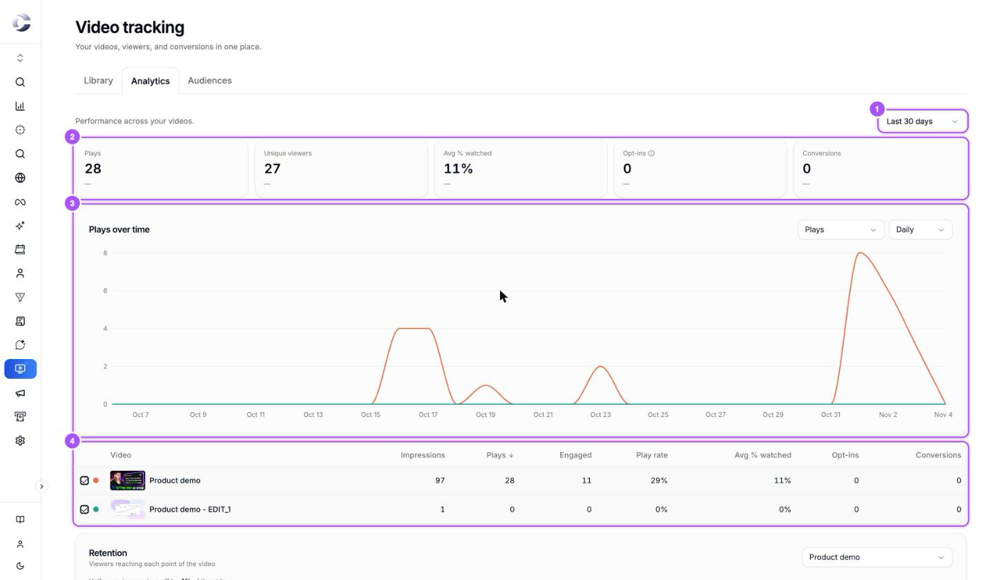
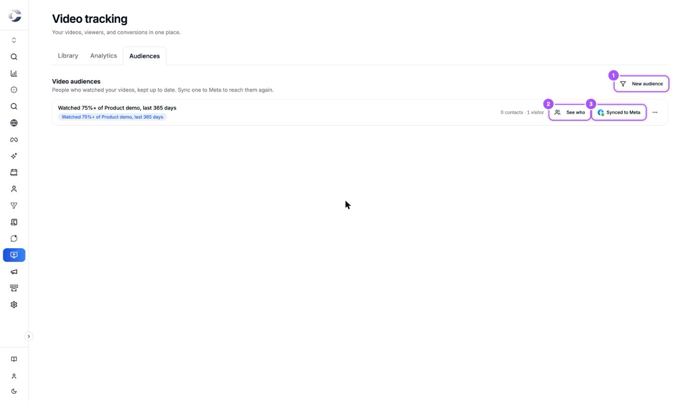
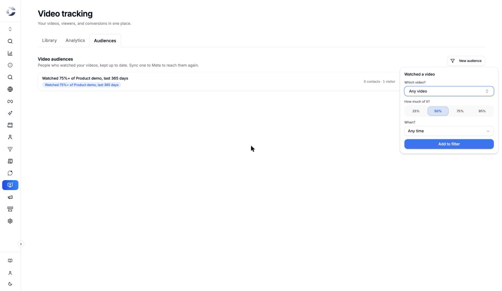

{/* last-verified: 2026-11-04 · route: /business/[businessId]/video-tracking?tab=analytics, ?tab=audiences */}

## Overview

**Analytics** shows how your videos perform: how many people played them, how much they watched, and how many filled in your form. **Audiences** turns the people who watched into lists you can reach again on Meta.

Each viewer's plays also show on their own customer journey, as **Played video**.

---

## 1. Read your analytics

<Steps>
  <Step title="Open Analytics">
    In **Video Tracking**, click the **Analytics** tab.
  </Step>
  <Step title="Pick the dates">
    Pick **Last 7 days**, **Last 30 days** or **Last 90 days** at the top right.
  </Step>
  <Step title="Read the totals">
    The cards at the top add up all your videos: **Plays**, **Unique viewers**, **Avg % watched**, **Opt-ins** and **Conversions**.
  </Step>
  <Step title="Read the chart">
    **Plays over time** draws one line per video. Pick what it shows in the first menu, and **Daily** or **Weekly** in the second.
  </Step>
  <Step title="Compare your videos">
    The table lists each video with its numbers. Tick or untick a video to add it to the chart or take it off. Click a column name to sort by it.
  </Step>
</Steps>

<Frame caption="Analytics: the date range 1, the totals 2, the chart 3 and one row per video 4.">
  
</Frame>

<Accordion title="What each number means">
  | Number | What it counts |
  | --- | --- |
  | **Impressions** | Times the player loaded on a page, played or not. |
  | **Plays** | Times the video started, muted autoplay included. |
  | **Engaged** | Plays where the viewer tapped play, turned on the sound, or answered or skipped a form. |
  | **Play rate** | **Plays** divided by **Impressions**. |
  | **Unique viewers** | Different browsers that played the video. |
  | **Avg % watched** | How far into the video plays got, on average. |
  | **Opt-ins** | People who filled in a form in the video. Each becomes a contact. |

  Plays, viewers and percent watched update once a day, for the day before. Impressions update as they happen.

  {/* TODO: verify what the Conversions column counts. On 2026-11-04 the daily stats rollup never writes it, so it reads 0 on every video. */}
</Accordion>

### Retention

Under the table, **Retention** shows how many viewers reach each point of a video, from **Start** to **End**. Pick the video in the menu at its top right. The line above the chart sums it up, for example *Half your viewers drop off by 40% of the video.*

A steep drop at one point shows where people lose interest. That is a good moment to move your offer earlier, or to open a form.

---

## 2. Build an audience of people who watched

<Frame caption="Audiences: New audience 1, See who 2, and the Meta sync button 3.">
  
</Frame>

<Steps>
  <Step title="Click New audience">
    On the **Audiences** tab, click **New audience** at the top right.
  </Step>
  <Step title="Describe who watched">
    Under **Watched a video**, pick **Which video?** (one video or **Any video**), **How much of it?** (**25%**, **50%**, **75%** or **95%**), and **When?**. Click **Add to filter**.
  </Step>
  <Step title="Name and save it">
    Cortana suggests a name from your choices. Change it if you like, and click **Save audience**. Cortana starts counting its viewers.
  </Step>
  <Step title="See who is in it">
    Click **See who** on the audience. Your contacts open, filtered to the people in it.
  </Step>
  <Step title="Send it to Meta">
    Click **Sync to Meta** to reach these people again with your ads. See [3) Send An Audience To Meta](/crm/meta-audience-settings).
  </Step>
</Steps>

<Frame caption="New audience: which video, how much of it, and when.">
  
</Frame>

<AccordionGroup>
  <Accordion title="Contacts and visitors in an audience">
    An audience counts two kinds of people. **Contacts** are viewers Cortana knows, for example from a form they filled in. **Visitors** are viewers Cortana has not identified yet. Both can be sent to Meta.
  </Accordion>

  <Accordion title="Archiving an audience">
    Open the audience's three-dot menu and click **Archive audience**. It stops counting and syncing. Its contact list stays in Meta as it is now. The list of anonymous viewers is removed from Meta once no ad set uses it.
  </Accordion>

  <Accordion title="An audience reads Paused">
    *Paused: a video in its rule was deleted.* Make a new audience with a video you still have.
  </Accordion>
</AccordionGroup>

---

## 3. See plays on a contact's journey

Open a contact who watched your video. Their customer journey shows **Played video** each time they played it.

Which plays show is set per video, on its **Conversions** tab under **Contact timeline**: **Only when they tap play** (the default for new videos), **Show all activity** (muted autoplay too) or **Don't show**. See [3) Capture Leads And Book Calls](/video-conversions).

## FAQ

<AccordionGroup>
  <Accordion title="Why don't I see today's plays?">
    Plays, viewers and percent watched are added up once a day, for the day before. Today's plays show tomorrow. Impressions show right away.
  </Accordion>

  <Accordion title="Why are my plays higher than my engaged plays?">
    **Plays** counts every start, muted autoplay included. **Engaged** counts only the plays where the viewer acted: tapped play, turned on the sound, or answered a form.
  </Accordion>

  <Accordion title="Why is a play missing from a contact's timeline?">
    The video's **Contact timeline** setting is probably **Only when they tap play**, and that viewer only saw muted autoplay. Analytics still counts the play.
  </Accordion>

  <Accordion title="How do I retarget people who watched most of my video?">
    On **Audiences**, click **New audience**, pick the video and **75%**, save it, and click **Sync to Meta**. Use it in an ad set like any other Meta audience.
  </Accordion>
</AccordionGroup>

## Next step

<Card title="Back to the overview" icon="circle-play" href="/video-overview">
  See the whole Video Tracking journey on one page.
</Card>

Stuck on a step? Click the support button at the bottom right of Cortana and we will help.
