{/* last-verified: 2026-11-04 · route: /business/[businessId]/video-tracking/[videoId] (Conversions tab) */}

## Overview

The **Conversions** tab has two steps. Both are optional, and each has its own switch.

1. **Capture their details**: one of your forms opens over the video, before it plays or at a moment you pick. Each viewer who answers becomes a contact.
2. **Book a call**: a button appears under the video. After the viewer has watched for a while, it unlocks and opens your calendar.

Use one step, both, or neither. **Book a call** works without a form: viewers then type their details in your calendar.

<Note>
  **Before you start.** Have a published form ready for step 1, and a calendar that is turned on for step 2. You can also make them from inside the editor. See [Create your form](/forms-create) and [Creating your booking calendar](/cal-calendars).
</Note>

---

## 1. Open the Conversions tab

<Steps>
  <Step title="Open your video">
    In **Video Tracking**, click your video's card.
  </Step>
  <Step title="Click Conversions">
    Click the **Conversions** tab on the right. With both steps off, it reads *Turn on a step to start.*
  </Step>
</Steps>

<Frame caption="The Conversions tab: Capture their details 1, Book a call 2, and Contact timeline 3.">
  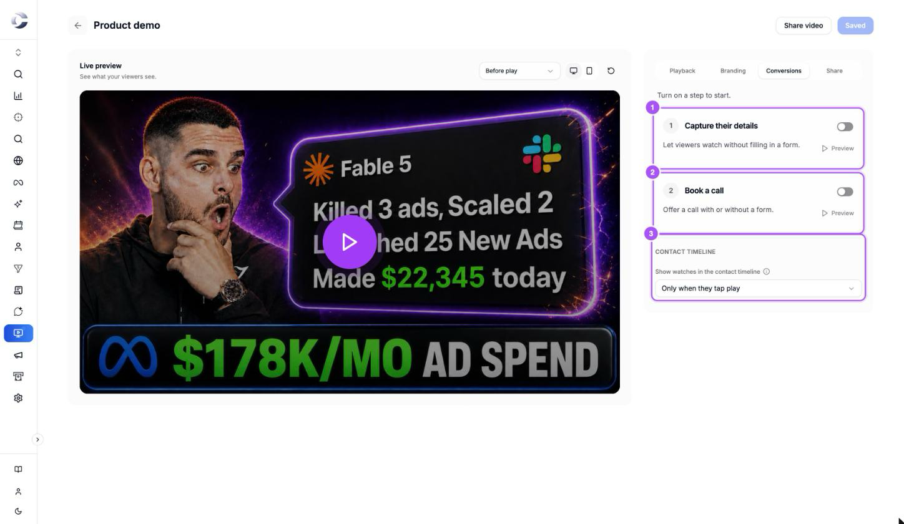
</Frame>

---

## 2. Step 1: Capture their details

<Steps>
  <Step title="Turn on the step">
    Turn on the switch beside **Capture their details**. Its settings open, and the line under the title says what viewers will see.
  </Step>
  <Step title="Choose your form">
    Click **Choose form**. Pick a form from the cards, or click **Create a form**. See *Choose a form* below.
  </Step>
  <Step title="Pick When">
    **Before they watch** opens the form before the video plays. **At a moment** pauses the video at a time you pick and opens the form there.
  </Step>
  <Step title="Pick Answering">
    **Required** means viewers answer to keep watching. **Optional** adds a **Skip and watch** link under the form.
  </Step>
  <Step title="Pick After they submit">
    **Keep watching** plays on. **Go to a page** sends the viewer to a page you choose. Type its full address, starting with `https://`.
  </Step>
  <Step title="Add more forms, if you want">
    Click **Add another form at a moment** to ask a second form later in the video. **Remove** takes a form off.
  </Step>
</Steps>

<Frame caption="Step 1's settings: Form 1, When 2, Answering 3, After they submit 4, and Add another form at a moment 5.">
  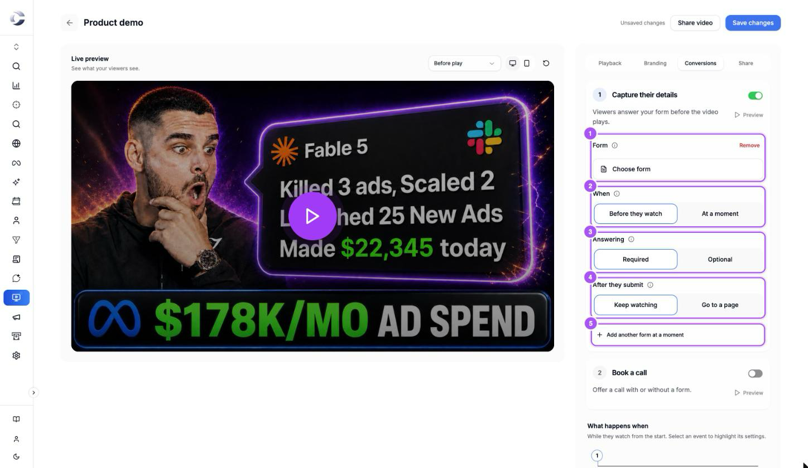
</Frame>

### Choose a form

The form picker shows every form in your business as a card: **Published** or **Draft**, how many questions it has and the first one, and when it was last edited.

<Frame caption="Choose a form: search 1, Create a form 2, and each card's Preview, Edit and Use this form 3.">
  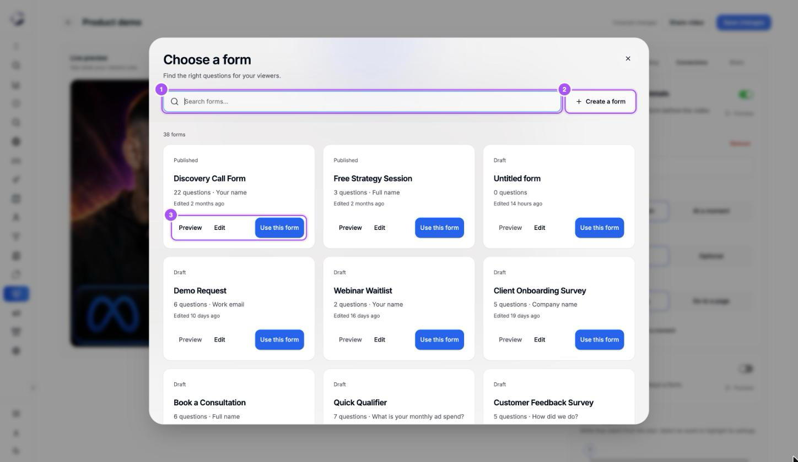
</Frame>

- **Preview** opens the real form as a viewer gets it. It is a test run: nothing you type is saved.
- **Edit** opens the form builder right here, over your video. Click its back arrow to return to the picker.
- **Use this form** picks it. The form's card then shows **Change**, **Preview** and **Edit**.

<Frame caption="Preview: try the form just as your viewer will. Test run, nothing is saved.">
  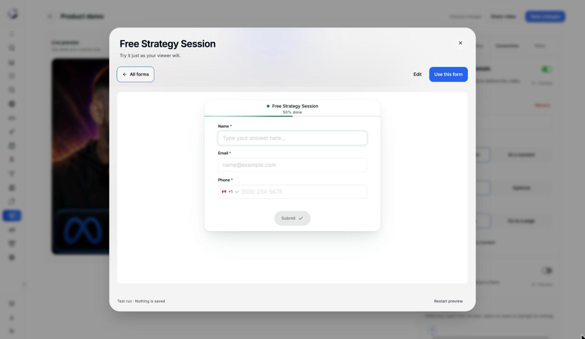
</Frame>

### Ask the form at a moment

Pick **At a moment** under **When**, and a **Moment** slider appears. Drag it, or type the exact second in the box beside it. The line under the step title updates, for example *At 1:30, the video pauses and your form opens.*

<Frame caption="A form at 1:30: the step's summary 1, the chosen form 2, and the Moment slider 3.">
  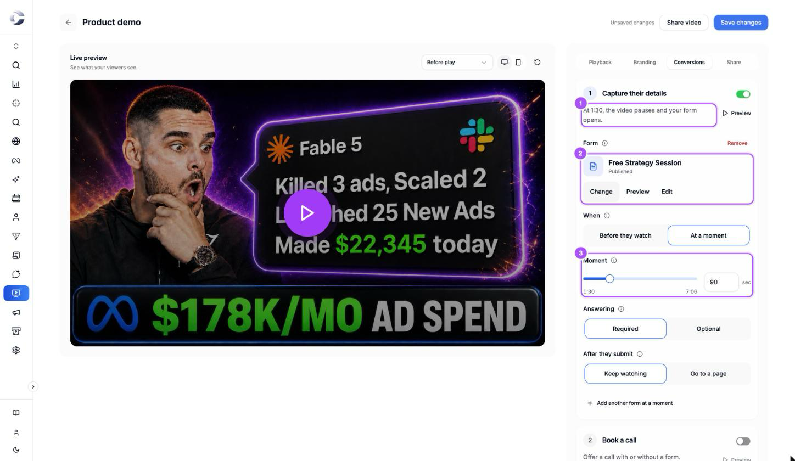
</Frame>

<AccordionGroup>
  <Accordion title="Every Step 1 setting">
    | Setting | Choices | Default |
    | --- | --- | --- |
    | **Form** | Any form in your business | None |
    | **When** | **Before they watch** or **At a moment** | Before they watch |
    | **Moment** | Any second of the video | Shows with **At a moment** |
    | **Answering** | **Required** or **Optional** | Required |
    | **After they submit** | **Keep watching** or **Go to a page** | Keep watching |
    | **Page address** | A full address starting with `https://` | Shows with **Go to a page** |

    Only one form can open before they watch. Every other form opens at a moment. A second form set to **Before they watch** shows *Another form already opens before they watch.*
  </Accordion>

  <Accordion title="Required or Optional: what changes for the viewer">
    **Required**: the viewer answers to keep watching. Autoplay waits for the form.

    **Optional**: a **Skip and watch** link sits under the form. Muted autoplay may run.

    Either way, a viewer who answers becomes a contact, and the answers land in your form's answers.
  </Accordion>

  <Accordion title="Messages you may see on a form">
    - *This form isn't published yet, so viewers go straight past it. Choose Edit to publish it.* Publish the form, and it shows.
    - *This form is unavailable. Choose another form.* The form was deleted or archived.
    - A warning under **Page address**: the address is not a full one starting with `https://`. Until you fix it, viewers keep watching after they answer.
  </Accordion>
</AccordionGroup>

---

## 3. Step 2: Book a call

<Steps>
  <Step title="Turn on the step">
    Turn on the switch beside **Book a call**. The line under the title says when the button appears and when it unlocks.
  </Step>
  <Step title="Choose your calendar">
    Click **Choose calendar** and pick a calendar, or click **Create a calendar**. It works like the form picker: **Preview**, **Edit** and **Use this calendar**.
  </Step>
  <Step title="Write the button text">
    Type the words on the button in **Button text**. It starts as *Book a call*.
  </Step>
  <Step title="Pick when the button appears">
    **After they answer your form** shows it once the viewer has answered or skipped their first form. With step 1 off, this choice reads **When they start watching**. **At a moment** shows it at a time you pick.
  </Step>
  <Step title="Set when it unlocks">
    Type how many seconds they watch before the button unlocks, in **Unlocks after**. It starts at 60. Type 0 to unlock it at once.
  </Step>
</Steps>

<Frame caption="Step 2's settings: Calendar 1, Button text 2, Button appears 3 and Unlocks after 4.">
  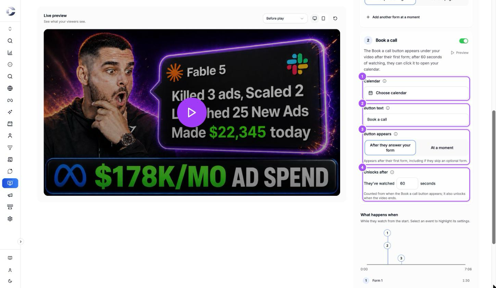
</Frame>

<Frame caption="Choose a calendar. Each card shows if the calendar is Active, its length and when it was edited.">
  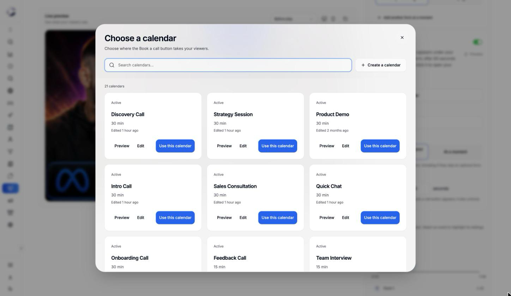
</Frame>

<Frame caption="Preview a calendar: the real booking page as a test run.">
  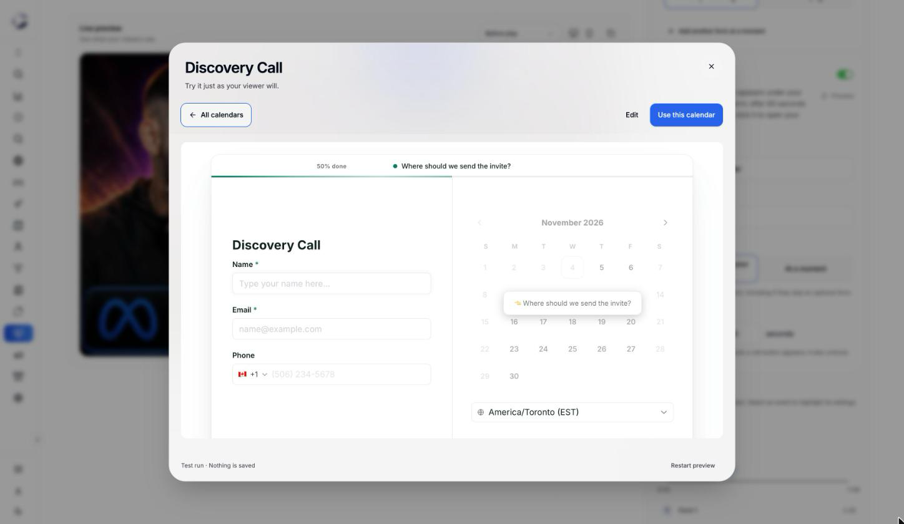
</Frame>

<Warning>
  **The Book a call button waits for a real viewer.** It appears and counts down only after the viewer taps play, turns on the sound, or answers or skips a form. A video that autoplays muted shows no button until the viewer acts.
</Warning>

<AccordionGroup>
  <Accordion title="Every Step 2 setting">
    | Setting | Choices | Default |
    | --- | --- | --- |
    | **Calendar** | Any calendar in your business | None |
    | **Button text** | Up to 60 characters | *Book a call* |
    | **Button appears** | **After they answer your form** (or **When they start watching** with no form) or **At a moment** | After they answer your form |
    | **Unlocks after** | 0 to 3,600 seconds of watching | 60 seconds |
  </Accordion>

  <Accordion title="How the unlock countdown works">
    The button shows *unlocks in 60s* and counts down in 5-second steps while the video plays. The count starts when the button appears, not when the video starts. Pausing stops it, and time spent answering a form doesn't count. The button also unlocks when the video ends.

    Once unlocked, a click opens your calendar over the video. The viewer picks a date and a time and books.
  </Accordion>

  <Accordion title="Book a call without a form">
    Turn on step 2 and leave step 1 off. The step says *No form needed. Viewers enter their booking details in your calendar.* The button appears when they start watching, or at your moment.
  </Accordion>

  <Accordion title="Messages you may see on a calendar">
    - *This calendar is turned off, so the Book a call button won't show. Choose Edit to turn it on.*
    - *This calendar is unavailable. Choose another calendar.* The calendar was deleted.
  </Accordion>
</AccordionGroup>

---

## 4. Check the flow: What happens when

Under the two steps, **What happens when** draws your video's length as a line, with a numbered mark for each event: each form, when the **Book a call** button appears, and when it unlocks. The list under it gives each event's time.

Click an event to highlight its settings above. You can't add anything from this line: you change times in the steps.

<Frame caption="What happens when: the form at 1:30, the button after the form, and its unlock at 2:30.">
  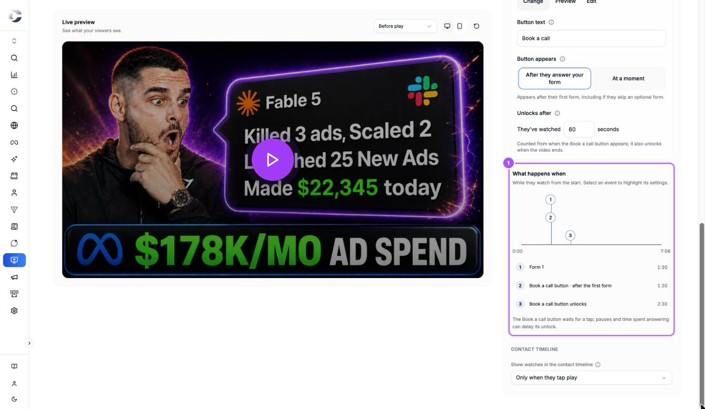
</Frame>

---

## 5. Preview what viewers see

Each step has a **Preview** button at the top right.

- Step 1's **Preview** plays the live preview and opens your form there, as viewers see it. A form at a moment plays from 2 seconds before it.
- Step 2's **Preview** opens your calendar's test run.

The live preview shows *Preview: nothing you enter is saved* over the form. Nothing you type or book in a preview is saved.

<Frame caption="Step 1's Preview: the form opens over the dimmed video. Optional forms add Skip and watch.">
  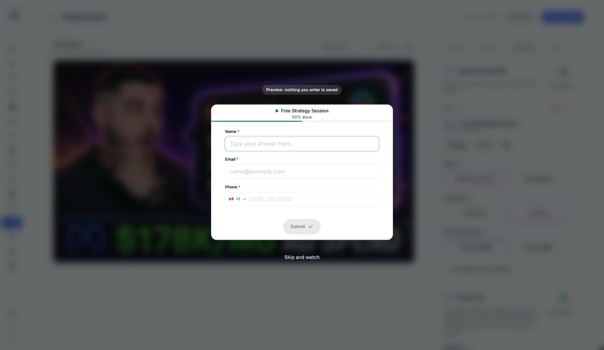
</Frame>

<Frame caption="After the form, the Book a call button appears under the video and counts down, marked 1.">
  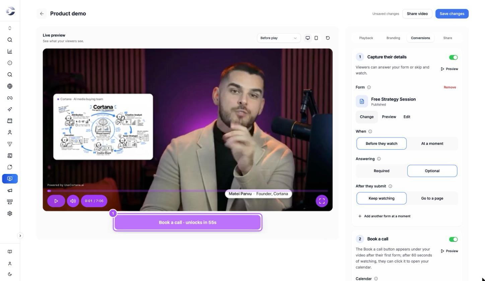
</Frame>

---

## 6. Choose what shows on the contact timeline

Under **Contact timeline**, **Show watches in the contact timeline** sets which plays appear on a contact's customer journey, as **Played video**:

- **Only when they tap play**: plays the viewer started themselves. New videos start here.
- **Show all activity**: every play, muted autoplay included.
- **Don't show**: no plays on the timeline.

This changes only the timeline. **Analytics** counts every play either way.

---

## 7. Save

Click **Save changes** at the top right. Your form and your **Book a call** button go live on every page with the video the next time it loads.

## FAQ

<AccordionGroup>
  <Accordion title="Do I have to choose a form to book a call?">
    No. Turn on **Book a call** and leave **Capture their details** off. Viewers type their name and email in your calendar when they book.
  </Accordion>

  <Accordion title="Why doesn't the Book a call button show on my video?">
    Check three things. The step is on and you clicked **Save changes**. The calendar is turned on. And the viewer has tapped play, turned on the sound, or answered a form: a muted autoplay alone shows no button.
  </Accordion>

  <Accordion title="Why is the Book a call button greyed out?">
    It is counting down. It unlocks after the viewer watches for the time in **Unlocks after**, or when the video ends. Set **Unlocks after** to 0 to unlock it at once.
  </Accordion>

  <Accordion title="My form doesn't show on the video">
    The form is probably a draft. Open the video's **Conversions** tab: a draft form shows *This form isn't published yet*. Click **Edit** and publish it.
  </Accordion>

  <Accordion title="Where do I see who filled in my video's form?">
    Each viewer who answers becomes a contact in your CRM, and their answers sit in the form's answers. The video's **Opt-ins** count on **Analytics** goes up too. See [Where your answers go](/forms-answers).
  </Accordion>

  <Accordion title="Can a viewer skip my form?">
    Only if **Answering** is **Optional**. A **Required** form must be answered to keep watching.
  </Accordion>

  <Accordion title="Did my preview create a contact or a booking?">
    No. Every preview is a test run, and nothing you enter in it is saved.
  </Accordion>
</AccordionGroup>

## Next step

<Card title="4) Share Or Embed Your Video" icon="share-nodes" href="/video-share">
  Send your video's own link, or put it on your website.
</Card>
