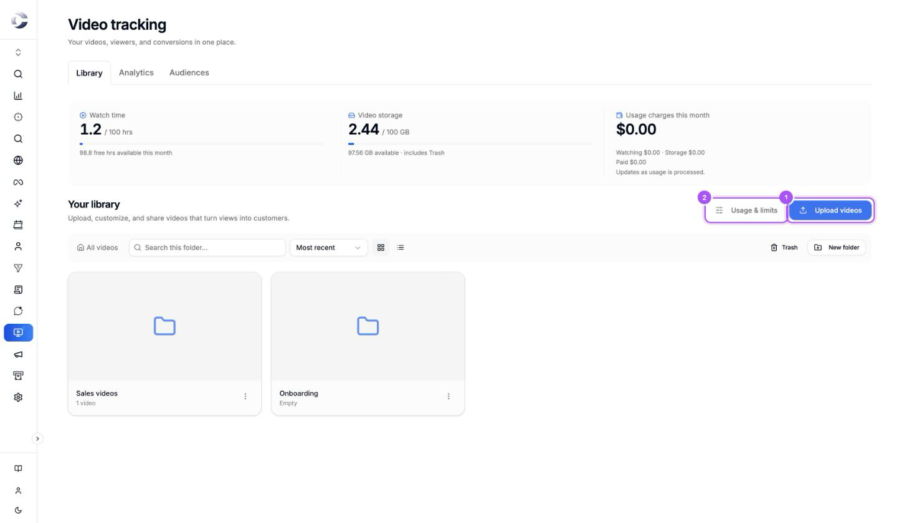

{/* last-verified: 2026-11-04 · route: /business/[businessId]/video-tracking */}

Video Tracking hosts your videos in Cortana and plays them in a player you control. Put a video on your website or send its link. Cortana sees who watched it and how far they got.

You can ask viewers for their details with one of your forms, and let them book a call from a button under the video. Every viewer who fills in a form becomes a contact, and their plays show on their customer journey.

<Frame caption="The Video tracking page. Your videos and folders sit under Your library.">
  
</Frame>

## The journey in five lines

1. **Upload a video** and choose what happens when your free watch hours run out.
2. **Set up the player**: autoplay, the progress bar, the controls, your colors and your logo.
3. **Turn on conversions** if you want them: a form that captures their details, and a **Book a call** button that opens your calendar.
4. **Share it**: send its own link, or paste its embed code on your website.
5. **See who watched**: plays, how much they watched, who filled in your form, and audiences you can send to Meta.

## What Cortana records

- **Each play.** When it started, how much of the video they watched, and whether they tapped play or only saw muted autoplay.
- **Each viewer.** Plays from the same browser count as one viewer.
- **How far people get.** Retention shows how many viewers reach each point of the video.
- **Each form answer.** A viewer who fills in your form becomes a contact, with their name, email and phone.
- **Each booking.** A call booked from the **Book a call** button lands in your calendar like any other booking.
- **Impressions.** How many times your video was seen on a page, played or not.

## The steps

Each page below is one job, in the order you do it.

| Step | What you get done |
| --- | --- |
| [1) Upload Your Videos](/video-upload) | Choose free limits or wallet billing, upload your videos and keep them in folders. |
| [2) Set Up Your Player](/video-player) | Choose how the video starts, what the viewer can control, and how it looks. |
| [3) Capture Leads And Book Calls](/video-conversions) | Ask for viewers' details with a form, and add a **Book a call** button under the video. |
| [4) Share Or Embed Your Video](/video-share) | Send the video's own link, or put it on your website with its embed code. |
| [5) See Who Watched](/video-analytics) | Read plays, viewers and retention, and build audiences of people who watched. |

## FAQ

<AccordionGroup>
  <Accordion title="Where is Video Tracking in the menu?">
    Click **Video Tracking** in the menu on the left of your business. It sits right above **Webinar Tracking**.
  </Accordion>

  <Accordion title="Is video hosting free?">
    Every business gets 100 hours of watch time each month and 100 GB of storage at no cost. Before your first upload, you choose what happens when the free hours run out: your videos pause until next month, or they keep playing and the extra is billed to your wallet. See [1) Upload Your Videos](/video-upload).
  </Accordion>

  <Accordion title="Do I need a form or a calendar to use Video Tracking?">
    No. Both are optional. A video with no form and no **Book a call** button still plays and still shows you who watched.
  </Accordion>

  <Accordion title="Can I use my YouTube or Vimeo video?">
    Not by link. Download the video file from where it lives now and upload it to Cortana. Cortana plays MP4, MOV and WebM files up to 8 GB each.
  </Accordion>

  <Accordion title="Who can see my videos?">
    Anyone with the video's link, or anyone on a page where you put its embed code. Cortana does not list your videos anywhere, so people reach a video only through its link or your page.
  </Accordion>
</AccordionGroup>

## Next step

<Card title="1) Upload Your Videos" icon="upload" href="/video-upload">
  Choose free limits or wallet billing, then upload your first video.
</Card>

Stuck on a step? Click the support button at the bottom right of Cortana and we will help.
