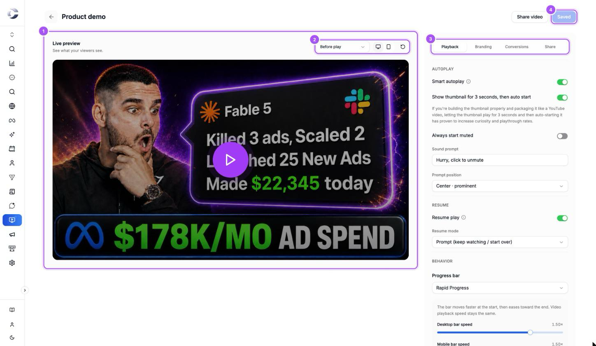
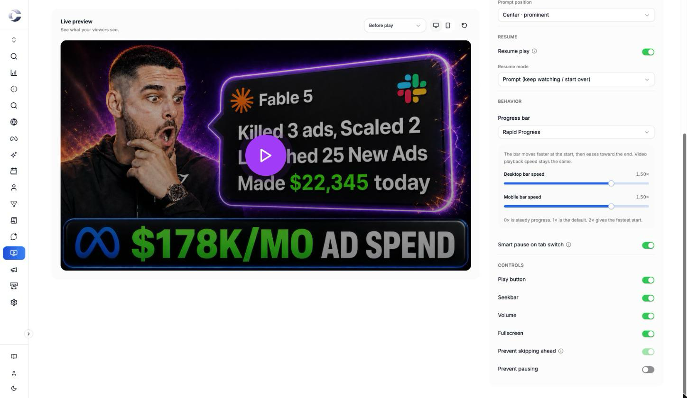
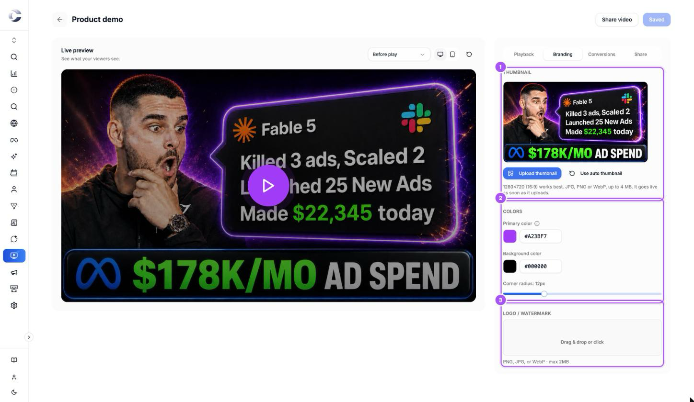

{/* last-verified: 2026-11-05 · route: /business/[businessId]/video-tracking/[videoId] (Playback and Branding tabs) */}

## Overview

Click a video's card in your library to open its editor. The live preview on the left shows your video exactly as viewers get it. The settings sit on the right, in four tabs: **Playback**, **Branding**, **Conversions** and **Share**.

Every video starts with settings that work as they are. Change only what you want to be different, then click **Save changes**.

---

## 1. Open the editor

<Steps>
  <Step title="Open your video">
    In **Video Tracking**, on the **Library** tab, click the video's card.
  </Step>
  <Step title="Look at the live preview">
    The preview plays your video with your settings, including changes you have not saved yet.
  </Step>
  <Step title="Check a screen">
    Use the menu above the preview to see one screen: **Before play**, **Thumbnail countdown**, **Sound prompt** or **Returning viewer**. The two buttons beside it switch between a desktop and a phone, and the round arrow restarts the preview.
  </Step>
</Steps>

<Frame caption="The video editor. The live preview is marked 1, its screen menu 2, the settings tabs 3 and the save button 4.">
  
</Frame>

---

## 2. Playback: how the video starts and plays

The **Playback** tab has four groups, from top to bottom: **Autoplay**, **Resume**, **Behavior** and **Controls**.

<Steps>
  <Step title="Autoplay">
    Leave **Smart autoplay** on so the video starts on its own. Browsers start it muted, so a sound prompt invites the viewer to turn the sound on. Type your own words in **Sound prompt**, and pick **Center · prominent** or **Corner · subtle** in **Prompt position**.
  </Step>
  <Step title="Resume">
    Leave **Resume play** on so a returning viewer can pick up where they left off. **Prompt (keep watching / start over)** asks them. **Silent** carries on without asking.
  </Step>
  <Step title="Behavior">
    Pick a **Progress bar**: **Rapid Progress**, **Standard** or **Hidden**. Leave **Smart pause on tab switch** on so the video pauses when the viewer leaves the tab.
  </Step>
  <Step title="Controls">
    Turn off any control you don't want viewers to have: **Play button**, **Seekbar**, **Volume**, **Time display** or **Fullscreen**. Turn on **Prevent skipping ahead** or **Prevent pausing** to keep viewers watching.
  </Step>
</Steps>

<Frame caption="The Behavior and Controls groups of the Playback tab.">
  
</Frame>

<Tip>
  **Rapid Progress** makes a long video feel shorter. The bar moves faster at the start, then eases toward the end. The video itself plays at normal speed. Turn off **Time display** too, so viewers don't see the full length.
</Tip>

<AccordionGroup>
  <Accordion title="Every Playback setting, its default and our pick">
    | Setting | What it does | Default | Our pick |
    | --- | --- | --- | --- |
    | **Smart autoplay** | Starts the video when the browser allows it. Muted playback invites viewers to turn on sound. | On | On |
    | **Show thumbnail for 3 seconds, then auto start** | Shows your thumbnail for 3 seconds, then starts the video. Shows only with **Smart autoplay** on. | Off | On, if your thumbnail is designed like a YouTube thumbnail |
    | **Always start muted** | Starts muted even when the browser would allow sound. | Off | Off |
    | **Sound prompt** | The words on the prompt over a muted video. | *Hurry, click to unmute* | Your own short line |
    | **Prompt position** | **Center · prominent** over the middle of the video, or **Corner · subtle** in a corner. | Center · prominent | Center · prominent |
    | **Resume play** | Offers returning viewers to pick up where they left off. | On | On |
    | **Resume mode** | **Prompt** asks *Pick up where you left off?* with **Keep watching** and **Start over**. **Silent** resumes without asking. | Prompt | Prompt |
    | **Progress bar** | **Rapid Progress**, **Standard** (moves at the real pace) or **Hidden**. | Rapid Progress | Rapid Progress |
    | **Desktop bar speed** and **Mobile bar speed** | How fast Rapid Progress starts. 0× is steady progress, 1× is the default, 2× gives the fastest start. | 1× | 1× to 1.5× |
    | **Smart pause on tab switch** | Pauses when the viewer switches tabs. They press play when they return. | On | On |
    | **Play button** | The play and pause button. | On | On |
    | **Seekbar** | The progress bar under the video. | On | On |
    | **Volume** | The sound button and its slider. Hidden with the **Performance** style. | On | On |
    | **Time display** | The time pill, for example *0:42 / 7:06*. Hidden with the **Performance** style. | On | Off for sales videos |
    | **Fullscreen** | The fullscreen button. | On | On |
    | **Prevent skipping ahead** | Viewers can't drag the seekbar past what they have watched. Always on with **Rapid Progress**. | Off | On |
    | **Prevent pausing** | Hides the pause button while the video plays. | Off | Off |
  </Accordion>

  <Accordion title="Why is Prevent skipping ahead greyed out?">
    Your **Progress bar** is set to **Rapid Progress**. Rapid Progress always prevents skipping, because its bar does not match the real time. Pick **Standard** to choose it yourself.
  </Accordion>
</AccordionGroup>

---

## 3. Branding: player style, thumbnail, colors and logo

{/* TODO: retake 03-branding once Player style is live (PR AgentKong_App#3093), with Player style marked 1. */}

<Frame caption="The Branding tab: the thumbnail 1, the colors 2 and the logo 3.">
  
</Frame>

<Steps>
  <Step title="Player style">
    Pick **Performance** or **Sleek** under **Player style**. The live preview switches as you click.
  </Step>
  <Step title="Thumbnail">
    Click **Upload thumbnail** and pick an image. 1280×720 (16:9) works best: JPG, PNG or WebP, up to 4 MB. It goes live as soon as it uploads, without **Save changes**. **Use auto thumbnail** goes back to a frame from your video.
  </Step>
  <Step title="Colors">
    Set **Primary color** for the seekbar, the buttons and the prompts. Set **Background color** for the space around the video. Drag **Corner radius** to round the player's corners.
  </Step>
  <Step title="Logo">
    Drop an image on **Drag & drop or click**: PNG, JPG or WebP, up to 2 MB. Then pick a corner in **Logo position**, or drag the logo on the preview. Set **Logo size** and **Logo opacity** with their sliders.
  </Step>
</Steps>

<Accordion title="Performance or Sleek: which player style to pick">
  - **Performance**: a thick progress gauge along the bottom of the video that stays on screen the whole time, and a small play button at the bottom left. A soft dark shade sits behind it while the video is paused, and slides down once it plays. Fullscreen shows when the mouse is over the video. There are no sound or time buttons: viewers turn the sound on from the sound prompt. With **Rapid Progress**, the gauge fills fast at the start, which keeps people watching. New videos start on Performance.
  - **Sleek**: rounded buttons in your primary color for play, sound, time and fullscreen, with a thin progress bar. They fade while the video plays and come back when the viewer moves the mouse or taps.

  With **Performance**, the **Volume** and **Time display** switches under **Controls** are greyed out, because this style keeps them hidden. They come back if you switch to **Sleek**.
</Accordion>

<Accordion title="Every Branding setting and its default">
  | Setting | Default | Range |
  | --- | --- | --- |
  | **Player style** | Performance for new videos. Videos uploaded before this style existed stay on Sleek until you switch. | Performance or Sleek |
  | **Primary color** | Blue, #3B82F6 | Any color |
  | **Background color** | Black, #000000 | Any color |
  | **Corner radius** | 12 px | 0 to 48 px |
  | **Logo size** | 15% of the player's width | 5% to 40% |
  | **Logo opacity** | 60% | 10% to 100% |

  You can change the thumbnail only once the video has finished processing.
</Accordion>

---

## 4. Save your changes

<Steps>
  <Step title="Click Save changes">
    **Unsaved changes** shows at the top while you have changes. Click **Save changes**. The button reads **Saved** when it is done.
  </Step>
  <Step title="Your video updates everywhere">
    Every page where the video is embedded, and its own link, show the new settings the next time they load. You don't paste the embed code again.
  </Step>
</Steps>

<Accordion title="What happens when a viewer right-clicks the video">
  Instead of the browser's menu, a small box offers a link to Cortana. That also keeps **Save video as** out of reach, on both player styles.
</Accordion>

## FAQ

<AccordionGroup>
  <Accordion title="How do I hide the time on my video?">
    Open the video, go to **Playback**, and turn off **Time display** under **Controls**. Click **Save changes**. With the **Performance** player style, the time is already hidden.
  </Accordion>

  <Accordion title="Why does my video start without sound?">
    Browsers only let a video start on its own if it is muted. **Smart autoplay** starts it muted and shows your **Sound prompt** so viewers can turn the sound on. A viewer who clicks play themselves hears sound right away.
  </Accordion>

  <Accordion title="The progress bar doesn't match the length of my video, is that a bug?">
    No. That is **Rapid Progress**: the bar moves faster at the start so the video feels shorter. Pick **Standard** under **Progress bar** for a bar that matches the real time.
  </Accordion>

  <Accordion title="I changed a setting but my website still shows the old player">
    Click **Save changes** in the editor. Changes show in the live preview right away, but reach your website only after you save.
  </Accordion>
</AccordionGroup>

## Next step

<Card title="3) Capture Leads And Book Calls" icon="calendar-check" href="/video-conversions">
  Ask viewers for their details with a form, and add a Book a call button under your video.
</Card>
