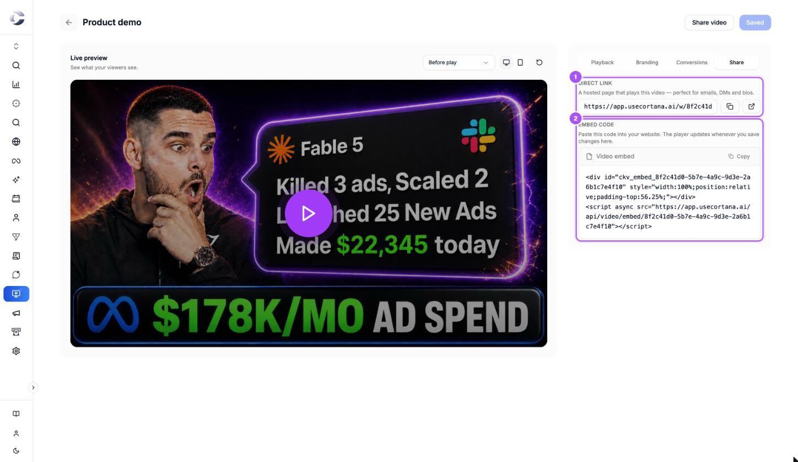

{/* last-verified: 2026-11-04 · route: /business/[businessId]/video-tracking/[videoId] (Share tab) */}

## Overview

Every video has two ways out:

- **Its own link**: a page that plays the video. Good for emails, DMs and bios.
- **Its embed code**: a short piece of code that puts the player on your own website.

Both play the same video with the same settings. When you save a change in the editor, both show it the next time they load.

---

## 1. Open the Share tab

<Steps>
  <Step title="Open your video">
    In **Video Tracking**, click your video's card.
  </Step>
  <Step title="Click Share">
    Click the **Share** tab on the right, or **Share video** at the top of the editor.
  </Step>
</Steps>

<Frame caption="The Share tab: Direct link 1 and Embed code 2.">
  
</Frame>

---

## 2. Send the direct link

<Steps>
  <Step title="Copy the link">
    Under **Direct link**, click the copy button beside the link. Cortana says *Link copied*.
  </Step>
  <Step title="Check it">
    Click the open button beside it to see the page in a new tab, just as your viewers will.
  </Step>
  <Step title="Send it">
    Paste the link in your email, message or bio.
  </Step>
</Steps>

---

## 3. Put the video on your website

<Steps>
  <Step title="Copy the embed code">
    Under **Embed code**, click **Copy**. You can also copy it from your library: open the video card's three-dot menu and click **Copy embed code**.
  </Step>
  <Step title="Paste it on your page">
    In your website builder, add an HTML or custom code block where the video should go, and paste the code in it.
  </Step>
  <Step title="Publish your page">
    Publish the page, then open it. The video fills the width of the block and keeps its shape on phones.
  </Step>
</Steps>

<Accordion title="What the embed code looks like">
  Two lines: an empty box that holds the player's space, and a script that loads the player into it. Your video's ID is in both.

  ```html
  <div id="ckv_embed_YOUR-VIDEO-ID" style="width:100%;position:relative;padding-top:56.25%;"></div>
  <script async src="https://app.usecortana.ai/api/video/embed/YOUR-VIDEO-ID"></script>
  ```

  Copy the code from Cortana rather than typing it: the padding number matches your video's shape.
</Accordion>

## FAQ

<AccordionGroup>
  <Accordion title="Do I need to paste the embed code again after I change my video?">
    No. The code always loads your latest saved settings. Change the video in the editor, click **Save changes**, and every page shows it the next time it loads.
  </Accordion>

  <Accordion title="Can I put the same video on several pages?">
    Yes. Paste the same embed code on each page. Plays from every page add up on the video's **Analytics**.
  </Accordion>

  <Accordion title="My embedded video doesn't show">
    Check that the block you pasted into accepts HTML and scripts, and that you pasted both lines. Then check that the video is **Ready** in your library and not in Trash.
  </Accordion>

  <Accordion title="Does the video work on phones?">
    Yes. The player takes the full width of its block and keeps the video's shape, on any screen.
  </Accordion>
</AccordionGroup>

## Next step

<Card title="5) See Who Watched" icon="chart-line" href="/video-analytics">
  Read plays, viewers and retention, and build audiences of people who watched.
</Card>
