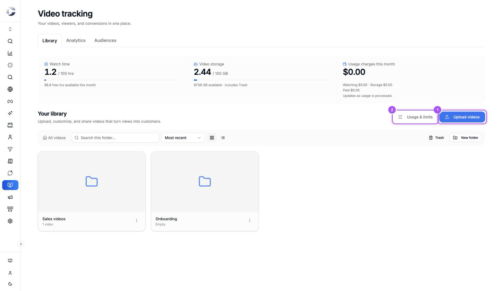
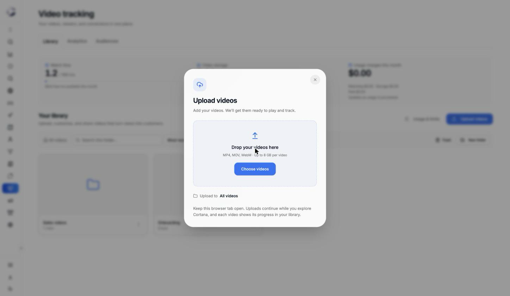
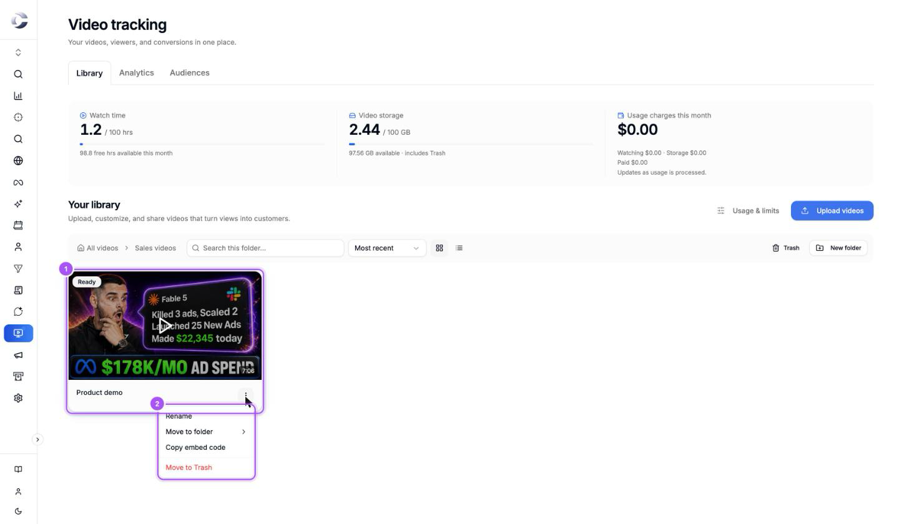
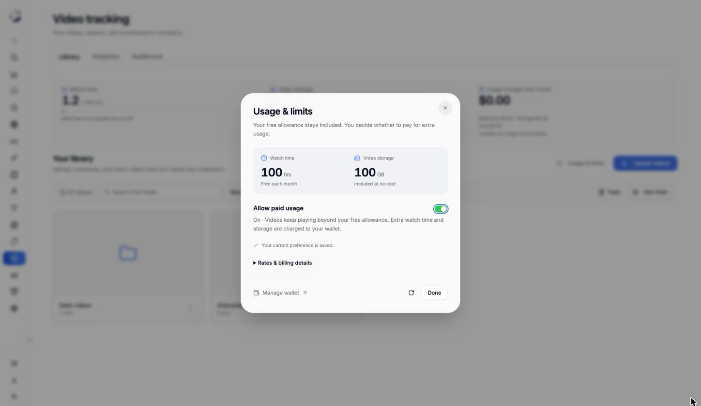

{/* last-verified: 2026-11-04 · route: /business/[businessId]/video-tracking (Library tab, Upload videos, Usage & limits) */}

## Overview

The **Library** tab holds every video and folder in your business. You upload videos here, and you open a video here to set it up.

Before your first upload, the account owner makes one choice: what happens when the free watch hours run out. You make it once, and you can change it later in **Usage & limits**.

---

## 1. Open Video Tracking

<Steps>
  <Step title="Click Video Tracking">
    In your business, click **Video Tracking** in the menu on the left. It sits right above **Webinar Tracking**.
  </Step>
  <Step title="Stay on Library">
    The page opens on the **Library** tab. **Analytics** and **Audiences** sit beside it.
  </Step>
</Steps>

<Frame caption="The Library tab. Upload videos is marked 1, Usage & limits is marked 2.">
  
</Frame>

---

## 2. Choose free limits or wallet billing

The first time anyone clicks **Upload videos**, Cortana asks the account owner to choose. Other team members see *Ask your account owner to choose free limits or wallet billing before the first upload.*

<Steps>
  <Step title="Read Start with free video hosting">
    Both options include 100 free watch hours each month and 100 GB of storage. Click **Choose my limit**.
  </Step>
  <Step title="Pick one">
    Under **Choose your watch-time limit**, click one:

    - **Limit watch time to 100 free hours.** Videos pause when your monthly watch time runs out and resume when it resets. No overage charges.
    - **Accept 100 free hours and use wallet for overages.** Videos keep playing beyond your free allowance. Extra watch time and storage are billed to your wallet.
  </Step>
  <Step title="Set up your wallet, if you picked it">
    If your business needs a wallet first, Cortana walks you through setting it up.
  </Step>
</Steps>

<Note>
  **Watch time adds up across all viewers and videos.** Ten people watching a 6-minute video use one hour.
</Note>

<Accordion title="Wallet rates and what happens when the wallet runs out">
  With wallet billing, the free allowance is still used first. After it:

  | What | Rate |
  | --- | --- |
  | Watch time | $0.03 per watch hour |
  | Watch time after 10,000 hours in a month | $0.015 per watch hour |
  | Storage above 100 GB | $0.15 per GB per month |

  If your wallet can't cover the extra usage, you have 24 hours to add funds before your videos pause. Usage during those 24 hours is still payable.

  The rates on your own account always show in **Usage & limits**, under **Rates & billing details**.
</Accordion>

---

## 3. Upload your videos

<Steps>
  <Step title="Click Upload videos">
    Click **Upload videos** at the top right of **Your library**. To upload into a folder, open the folder first.
  </Step>
  <Step title="Add your files">
    Drop your videos on **Drop your videos here**, or click **Choose videos**. You can add several at once.
  </Step>
  <Step title="Keep the tab open">
    Each video shows its progress on its card in your library. You can keep working in Cortana while it uploads, as long as this browser tab stays open.
  </Step>
  <Step title="Wait for Ready">
    After the upload, Cortana prepares the video to play. The card shows **Ready** when it can be shared.
  </Step>
</Steps>

<Frame caption="Upload videos. The line under the box says which folder the videos go to.">
  
</Frame>

<AccordionGroup>
  <Accordion title="Files you can upload">
    MP4, MOV and WebM, up to 8 GB per video.
  </Accordion>

  <Accordion title="What each upload status means">
    - **Waiting to upload**: queued behind your other uploads.
    - **Uploading**: the file is on its way, with a percentage.
    - **Connection interrupted · Retrying…**: your connection dropped. Cortana picks the upload back up on its own.
    - **Upload complete · Preparing playback**: the file arrived and Cortana is getting it ready to play.
    - **Upload complete · Playback preparation needs attention**: getting it ready failed. Retry it from the library.
    - **Ready**: the video can be set up and shared.
    - **Upload interrupted**: the upload stopped before it finished. Click **Retry upload** to try again, or **Cancel upload** to drop it.

    The **X** on an upload that is still going cancels it.
  </Accordion>

  <Accordion title="Why an upload is refused">
    With free limits, an upload that would take you past 100 GB of storage is refused with *This upload exceeds your available storage. Use wallet overages or free up storage first.* Move old videos to Trash and wait for them to be deleted, or turn on **Allow paid usage**.
  </Accordion>
</AccordionGroup>

---

## 4. Keep your library tidy

<Frame caption="A video card. Click the card to open the video. The three-dot menu holds the rest.">
  
</Frame>

- **Open a video**: click its card. The video editor opens. See [2) Set Up Your Player](/video-player).
- **Rename**, **Move to folder** and **Copy embed code**: in the card's three-dot menu.
- **Make a folder**: click **New folder** and type its name. Folders keep related videos together. Click a folder to open it, and click **All videos** to go back.
- **Find a video**: type in **Search this folder…**.
- **Sort**: **Most recent**, **Longest** or **Name (A–Z)**.
- **Grid or list**: the two buttons beside the sort menu.

<AccordionGroup>
  <Accordion title="Trash: deleting and restoring videos">
    **Move to Trash** takes a video off your library and stops it playing. Open **Trash** to see it. You can restore a video for 30 days. After that it is deleted for good.

    Videos in Trash still count toward your storage until they are deleted for good.

    Only the account owner can view and restore videos in Trash.
  </Accordion>

  <Accordion title="Deleting a folder">
    Deleting a folder keeps its videos. They move up into the folder above it.
  </Accordion>
</AccordionGroup>

---

## 5. Watch your usage

The three meters at the top of the **Library** tab show this month:

- **Watch time**: hours watched across all your videos, out of your 100 free hours.
- **Video storage**: space your videos use, out of your 100 free GB. It includes Trash.
- **Usage charges this month**: what extra watch time and storage cost so far, and what is paid. It updates as usage is processed.

<Frame caption="Usage & limits. Allow paid usage is your choice from step 2, and you can change it here.">
  
</Frame>

<Steps>
  <Step title="Click Usage & limits">
    Click **Usage & limits** beside **Upload videos**.
  </Step>
  <Step title="Turn paid usage on or off">
    Flip **Allow paid usage**. Cortana asks you to confirm. On means videos keep playing past the free allowance and the extra goes to your wallet. Off means videos pause when the free hours run out.
  </Step>
  <Step title="Check your rates">
    Open **Rates & billing details** to see what extra watch time and storage cost. **Manage wallet** opens your wallet.
  </Step>
</Steps>

## FAQ

<AccordionGroup>
  <Accordion title="My video stopped playing, why?">
    On free limits, videos pause when the month's 100 free watch hours are used, and play again when the month resets. With wallet billing, videos pause if the wallet can't cover extra usage for 24 hours. Open **Usage & limits** to see which one applies, and add funds or turn on **Allow paid usage**.
  </Accordion>

  <Accordion title="Why can't I upload a video?">
    The account owner has to choose free limits or wallet billing first. If you are not the owner, ask them to click **Upload videos** once and make the choice. If you are on free limits, check that the upload fits in your 100 GB of storage.
  </Accordion>

  <Accordion title="Does deleting a video free up storage right away?">
    No. A video in Trash still counts for 30 days, so you can restore it. It stops counting once it is deleted for good.
  </Accordion>

  <Accordion title="Can I close the tab while my video uploads?">
    No. Keep the tab open until the card shows **Upload complete**. You can move around Cortana in that tab while it uploads.
  </Accordion>
</AccordionGroup>

## Next step

<Card title="2) Set Up Your Player" icon="sliders" href="/video-player">
  Choose how your video starts, what viewers can control, and how it looks.
</Card>
