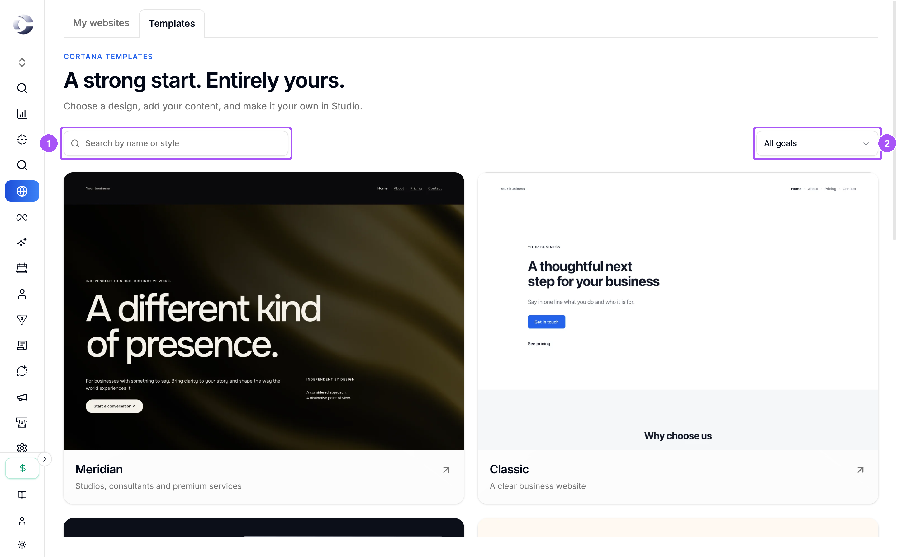
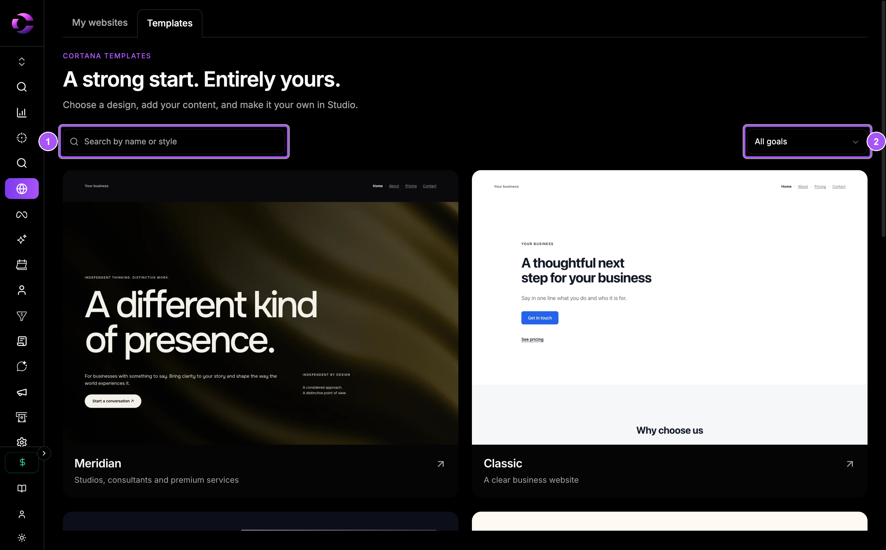
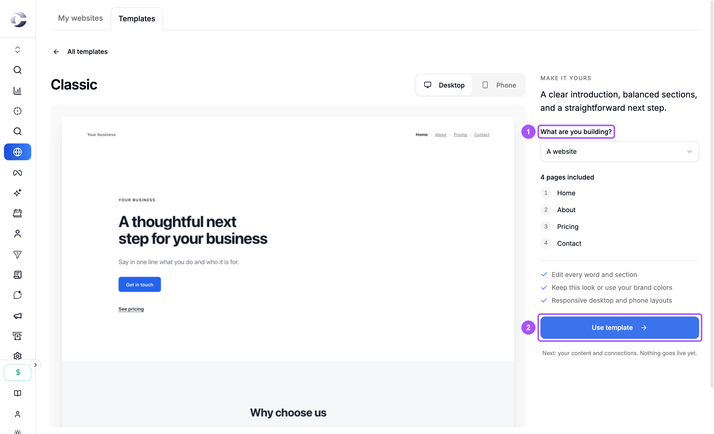
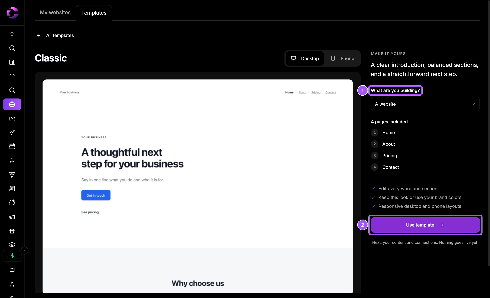
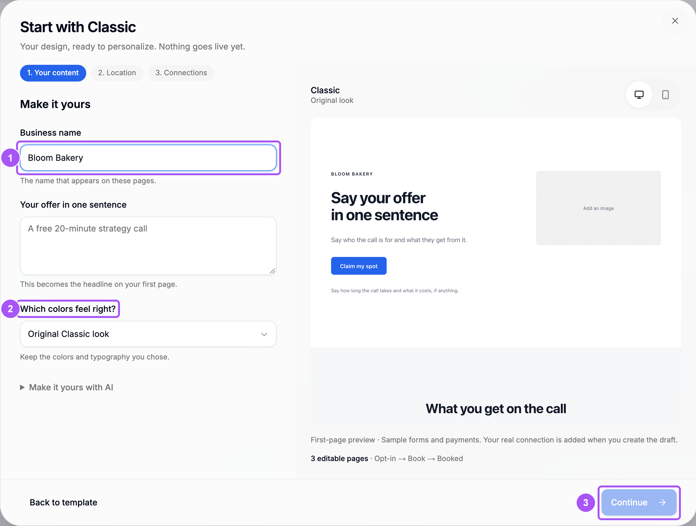
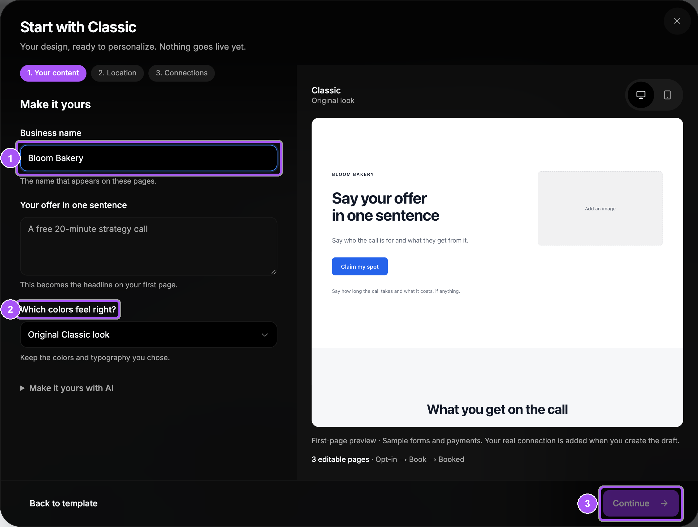

{/* last-verified: 2026-10-29 · route: /business/[businessId]/websites, Templates tab and the setup dialog */}

## Overview

Every site starts from a template. You pick a design, say what you are building, and answer two or three short questions. Cortana then makes a draft and opens it in the **Studio**.

Nothing goes live yet. A draft stays private until you publish it.

---

## 1. Pick a template

<Steps>
  <Step title="Open Templates">
    Click **Websites** in the menu on the left, then the **Templates** tab. On a new business the page opens there by itself.
  </Step>
  <Step title="Find a design">
    Type in **Search by name or style**, or pick a goal in the filter next to it, like **Book a call** or **Sell a product**.
  </Step>
  <Step title="Open it">
    Click a template card to see it up close.
  </Step>
</Steps>

<Frame caption="The template gallery. Search by name, or filter by what you are building.">
  
  
</Frame>

---

## 2. Choose what you are building

<Steps>
  <Step title="Pick the goal">
    Under **What are you building?**, pick one. The page list under it changes to match.
  </Step>
  <Step title="Look at it on a phone">
    Use **Desktop** and **Phone** above the preview to see both sizes.
  </Step>
  <Step title="Click Use template">
    This opens a short setup.
  </Step>
</Steps>

<Frame caption="A template up close. Pick what you are building, then Use template.">
  
  
</Frame>

| What are you building? | What you get | Its address |
| --- | --- | --- |
| **A website** | Your main pages, like home, about and pricing. | `/` |
| **Book a call** | A sign-up page, a booking page with your calendar, and a confirmation page. | `/call` |
| **Sell a product** | A sales page, a checkout page and a thank-you page. You can add an upsell page. | `/buy` |
| **Collect leads** | A page with a form, and a thank-you page. | `/free` |
| **Webinar** | A sign-up page and a watch page with your video. | `/webinar` |

---

## 3. Answer the setup questions

The setup is one box with up to three steps. A website has only the first.

<Steps>
  <Step title="Your content">
    Type your **Business name**. For a funnel, add **Your offer in one sentence**. It becomes the headline of the first page. For a webinar you can paste a **Video link (optional)** from YouTube, Vimeo, Loom or Wistia.
  </Step>
  <Step title="Pick your colors">
    Under **Which colors feel right?**, keep the template's look or pick **Use my brand colors**.
  </Step>
  <Step title="Location">
    For a funnel, pick the **Website** it lives on and check the **Funnel address**, like `/call`. Use one word of letters, digits and dashes.
  </Step>
  <Step title="Connections">
    For **Book a call**, pick a calendar under **Which calendar?**. For **Sell a product**, pick a checkout under **Which checkout?**. No calendar or checkout yet? Click **Make a calendar** or **Make a checkout**, make one in the new tab, then click **Check again**.
  </Step>
  <Step title="Create it">
    Click **Create website** or **Create funnel**. The Studio opens on your first page.
  </Step>
</Steps>

<Frame caption="The setup for a Book a call funnel. The preview updates as you type.">
  
  
</Frame>

<Tip>
  **Selling something?** Turn on **Offer an upsell after they pay** and pick a second checkout under **Checkout for the upsell**. Cortana adds an upsell page with a **No thanks** link.
</Tip>

---

## 4. Add a funnel to a site you have

On **My websites**, click **New funnel here** on the site's card. Pick a template and a goal, then answer the same setup. The new funnel shows on the card, like **Book a call /call**.

<AccordionGroup>
  <Accordion title="Where do my brand colors come from?">
    From **SEO**, **Content settings**, **Illustration colors**. If none are saved, the setup says so and keeps the template's own colors.
  </Accordion>

  <Accordion title="Make it yours with AI">
    Open **Make it yours with AI** in the setup and click **Copy prompt**. After the draft is made, paste the prompt into Claude or ChatGPT connected to Cortana. It can then write your pages for you. See [Let Your AI Edit Your Pages](/websites-your-ai) to connect it.
  </Accordion>
</AccordionGroup>

## FAQ

<AccordionGroup>
  <Accordion title="Does creating a website put it live?">
    No. It makes a private draft. It goes live only when you click **Publish**. See [5) Publish Your Site](/websites-publish).
  </Accordion>

  <Accordion title="Why is Create funnel greyed out?">
    A step is missing something. Check that the business name is filled in, the offer has at least three characters, the funnel address is one word like `/call`, and a calendar or checkout is picked on **Connections**.
  </Accordion>

  <Accordion title="It says No active calendar yet. What do I do?">
    Click **Make a calendar**. Make and turn on a calendar in the new tab, come back and click **Check again**. The setup stays open while you do it.
  </Accordion>

  <Accordion title="Can I change the template later?">
    You can change every word, picture, section and color in the Studio. To start from another design, create a new site or funnel from that template.
  </Accordion>
</AccordionGroup>

## Next step

<Card title="2) Edit In The Studio" icon="pen-to-square" href="/websites-studio">
  Change the words, pictures and colors of your pages.
</Card>
