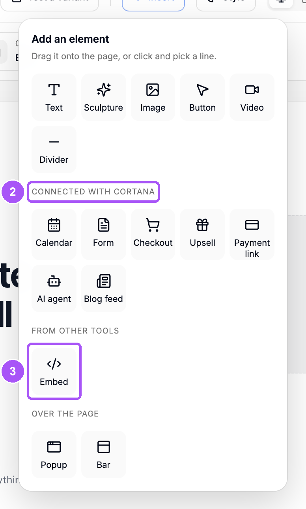
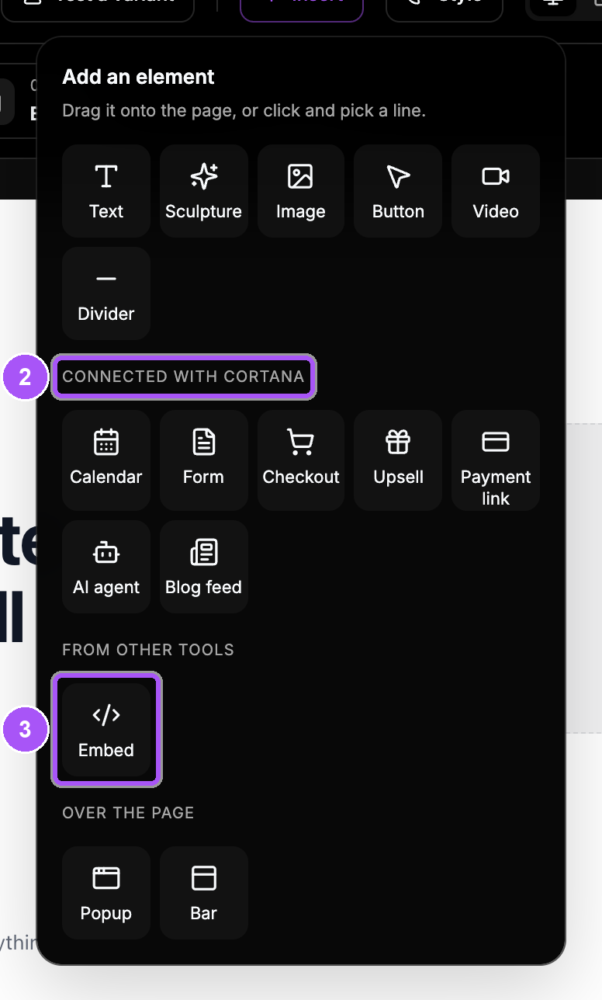

{/* last-verified: 2026-10-29 · route: /studio/..., Insert library and element settings */}

## Overview

Cortana elements are the parts of a page that do something: a booking calendar, a form, a checkout, an AI agent. They use the real calendars, forms and checkouts in your business, so every booking, lead and sale is tracked.

You can also embed a form or calendar from another tool, like GoHighLevel or Calendly.

---

## 1. Place an element

<Steps>
  <Step title="Click Insert">
    Click **Insert** in the Studio's header.
  </Step>
  <Step title="Pick a Cortana element">
    Under **Connected with Cortana**, click **Calendar**, **Form**, **Checkout**, **Upsell**, **Payment link**, **AI agent** or **Blog feed**.
  </Step>
  <Step title="Or embed one from another tool">
    Under **From other tools**, click **Embed**. See section 4.
  </Step>
  <Step title="Pick which one">
    Cortana asks which one, like **Which calendar?** or **Which form?** Click yours.
  </Step>
  <Step title="Place it">
    Click a line on the page where it should go.
  </Step>
</Steps>

<Frame caption="The Insert library. Cortana elements are in the middle, Embed is under From other tools.">
  
  
</Frame>

| Element | What it does |
| --- | --- |
| **Calendar** | People book a call with you. |
| **Form** | Collects leads and answers, using a form you published under **Forms**. |
| **Checkout** | Sells a product with your Stripe checkout. |
| **Upsell** | One more offer after they pay, with a decline link. |
| **Payment link** | A button that opens one of your payment links. |
| **AI agent** | Your Cortana agent chats with visitors on the page. One per page. |
| **Blog feed** | Shows your latest blog posts. |

---

## 2. Change its settings

Hover over the element and click **Settings** (the sliders icon) on its toolbar. The settings open on the right. Every change saves by itself.

**How does it show up?** Most elements can sit **On the page** or be **A button that opens it** in a popup. With a button, type its words in **What should the button say?**

Click **See it on the page** to check how it looks.

---

## 3. Say where people go next

Under **Keep the journey going**, choose what happens after the visitor acts.

| Element | The question | Your choices |
| --- | --- | --- |
| **Calendar** | **After they book** | **Use calendar logic (default)**, a page of this funnel, or **Another website** |
| **Calendar** | **If they leave without booking** | **End here**, a page, or **Another website** |
| **Form** | **After they submit** | **The form’s own ending (default)**, a page, or **Another website** |
| **Checkout** | **After they pay** | **The checkout’s own return (default)**, a page, or **Another website** |
| **Upsell** | **If they decline** | **End here**, a page, or **Another website** |

<Tip>
  **A thank-you page with URL parameters.** Pick **Another website** and paste the full link, starting with `https://`. To keep the visitor's UTMs on the way, open **Tracking & UTMs** and leave **Keep the visitor's own UTMs** on.
</Tip>

---

## 4. Embed a form or calendar from another tool

<Steps>
  <Step title="Place an Embed">
    Click **Insert**, then **Embed** under **From other tools**, and place it.
  </Step>
  <Step title="Paste the code or the link">
    Under **What does it show?**, paste the embed code or the link the tool gives you. Cortana reads which tool it is, like *GoHighLevel form* or *Calendly calendar*.
  </Step>
  <Step title="Set its height">
    Under **How tall is it on the page?**, type a height in pixels. Make it tall enough that the form never scrolls inside its box.
  </Step>
  <Step title="Choose where people go next">
    Under **Keep the journey going**, pick a page or **Another website**.
  </Step>
</Steps>

Cortana knows these tools by name: GoHighLevel, Calendly, Cal.com, Typeform, Tally, HubSpot, Jotform, Google Forms, Acuity and iClosed. Any other `https` page works as a plain embed.

<Note>
  **Sending people on after an embed.** Only GoHighLevel, Calendly, Typeform and Tally tell the page when someone fills them in. With other tools, the tool's own thank-you shows. To send people somewhere else, set the redirect inside that tool.
</Note>

An embed is not clickable in the Studio, because a submission there would be real. Try it on the live page.

<AccordionGroup>
  <Accordion title="Checkout settings">
    - **Which checkout?** lists your checkouts with their price. **Create a checkout ↗** opens a new one in a new tab.
    - **How does it show up?**: **On the page**, **In a popup**, or **Stripe's page** (Stripe only).
    - **Add an order bump**: offer an add-on at checkout. Search for a price, then pick it under **Which add-on?**
    - In the Studio, the checkout is in test mode. Nothing is charged.
  </Accordion>

  <Accordion title="Upsell settings">
    The same as a checkout, plus **If they decline** and **What should the decline link say?**
  </Accordion>

  <Accordion title="Payment link settings">
    Pick the link under **Which payment link?** and set **What should the button say?** A payment link takes the visitor out of the funnel, so it has no next page.
  </Accordion>

  <Accordion title="AI agent settings">
    Show your agent as **A bubble** in the corner, **On the page**, or **A button**. If the agent can talk, turn on **Let visitors talk to it by voice**. An agent needs chat or voice turned on under **AI Agents**. A page holds one AI agent.
  </Accordion>

  <Accordion title="Blog feed settings">
    Pick **How many posts?** to show, and type an optional heading. **Write a post ↗** opens SEO in a new tab.
  </Accordion>

  <Accordion title="Tracking & UTMs">
    Calendars, forms and upsells have **Tracking & UTMs**. **Keep the visitor's own UTMs** carries the visitor's UTMs to the next page. You can also set your own, like `utm_source`.
  </Accordion>
</AccordionGroup>

## FAQ

<AccordionGroup>
  <Accordion title="It says No active calendar yet. What do I do?">
    Make a calendar under **Calendars** and turn it on, then come back and pick it.
  </Accordion>

  <Accordion title="My form is not in the list.">
    Only published forms show. Publish it under **Forms**, then come back.
  </Accordion>

  <Accordion title="Are bookings and payments real in the Studio?">
    No. In the Studio and in **Test flow**, nothing is booked, saved or charged. They are real once the page is published.
  </Accordion>

  <Accordion title="Can I put two AI agents on one page?">
    No. A page holds one AI agent.
  </Accordion>

  <Accordion title="My GoHighLevel form redirects on its own. Do I set anything in Cortana?">
    If you set the redirect in GoHighLevel, you can leave Cortana's choice on the tool's own ending. If you want Cortana to send people on, pick a page under **Keep the journey going**.
  </Accordion>
</AccordionGroup>

## Next step

<Card title="4) Test And Get Feedback" icon="flask" href="/websites-test">
  Walk your funnel from start to finish, with nothing saved.
</Card>
