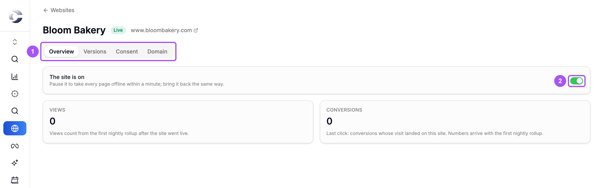
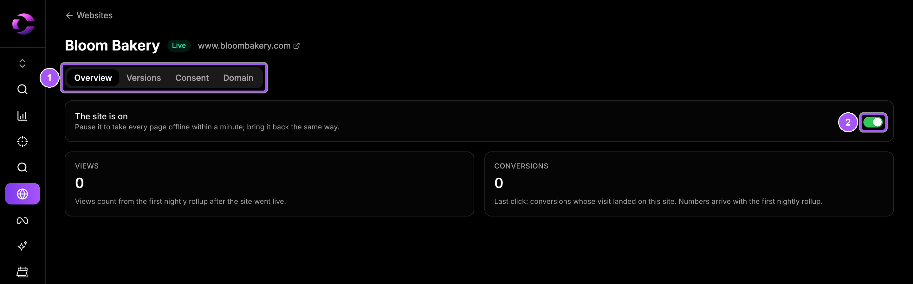
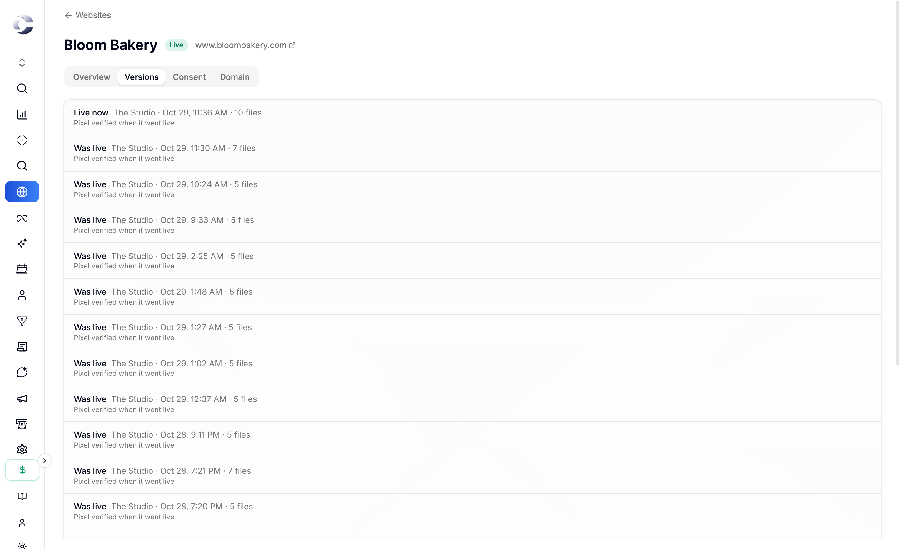
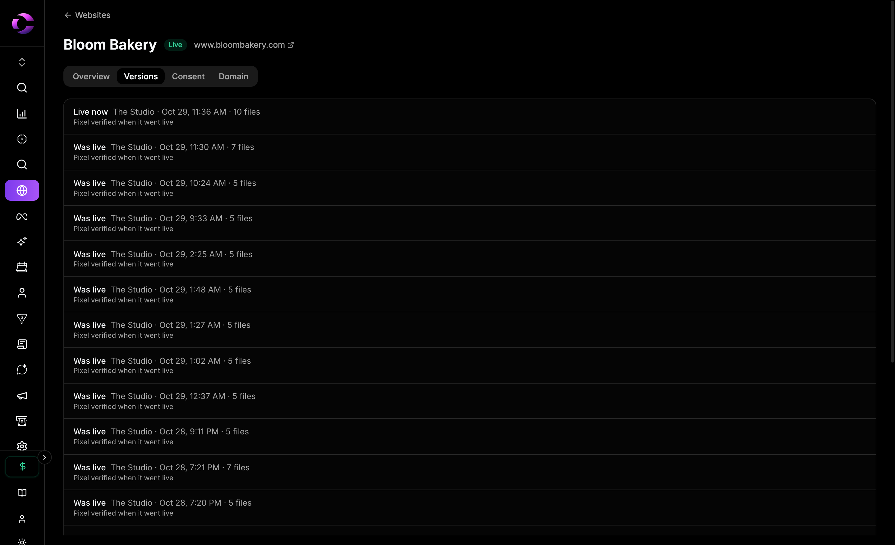
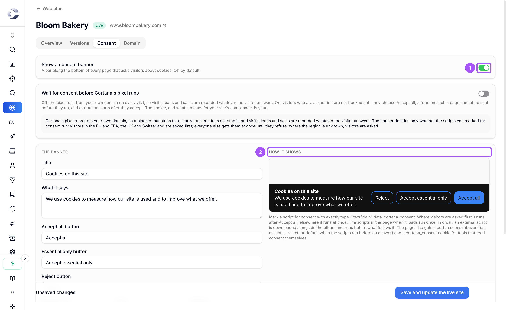
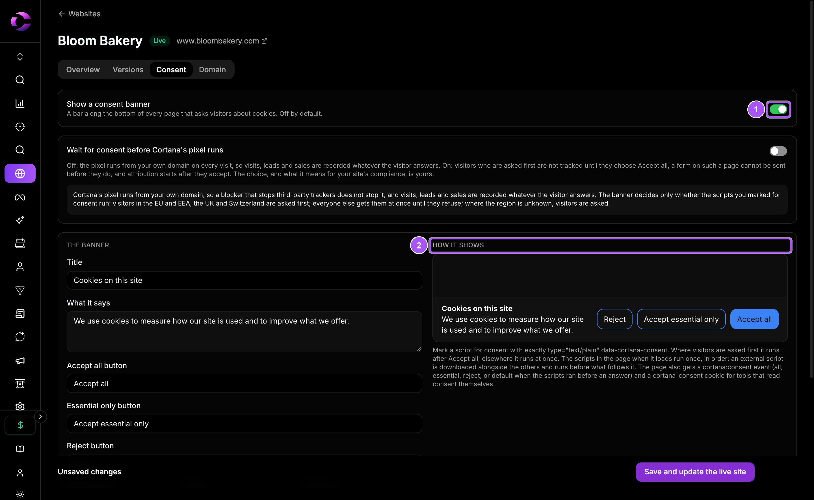
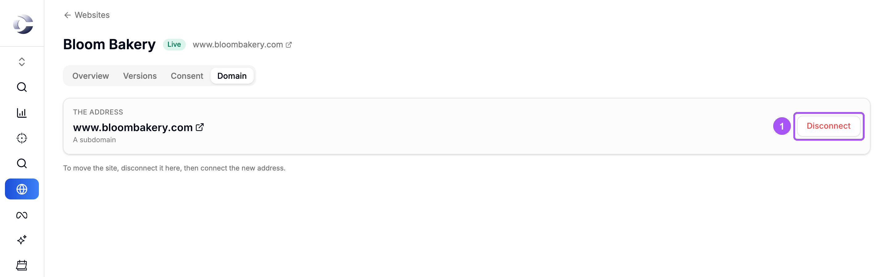
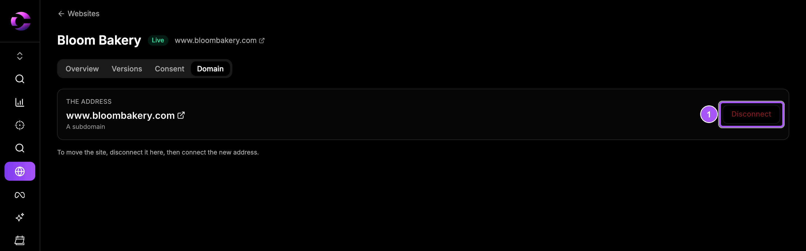

{/* last-verified: 2026-10-29 · route: /business/[businessId]/websites/[siteId] */}

## Overview

Each site has its own page. Open **Websites** and click the site's name on its card. The page has four tabs: **Overview**, **Versions**, **Consent** and **Domain**.

<Frame caption="A site's page. The four tabs sit under its name.">
  
  
</Frame>

---

## 1. See how the site does

The **Overview** tab shows:

- **Views**: visits to the site over the last 30 days, with a small chart.
- **Conversions**: conversions whose visit landed on this site (last click), and the revenue when there is any.
- **Pages**: views and conversions for each page.

Numbers are counted each night. A site that just went live shows its first numbers the next day.

---

## 2. Pause the site

<Steps>
  <Step title="Flip the switch">
    On **Overview**, turn off the switch next to **The site is on**.
  </Step>
  <Step title="Confirm">
    Read the question and click **Pause the site**.
  </Step>
</Steps>

Within a minute, every page goes offline. Nothing is deleted. To bring it back, turn the switch on and click **Bring it back**.

<Note>
  **A site you connected with I already have a site** works differently. Pausing it takes Cortana's pixel off its pages. Your pages keep loading from your own host.
</Note>

---

## 3. Roll back to an earlier version

Every publish makes a version. The **Versions** tab lists them, newest first, with their state: **Live now**, **Was live** or **Not published**.

<Frame caption="The Versions tab. Each publish is one row.">
  
  
</Frame>

For an uploaded site, click **Roll back to this** on a **Was live** row, then **Roll back**. That version goes live within a minute. The one live now stays in the list, so you can come back to it.

A site you build in the Studio is rolled back differently: change the page in the Studio and publish it again.

---

## 4. Add a cookie consent banner

<Steps>
  <Step title="Turn it on">
    On the **Consent** tab, turn on **Show a consent banner**.
  </Step>
  <Step title="Write it">
    Edit the **Title**, **What it says**, the three button names, the colors, and **Days an answer is kept**. The preview under **How it shows** updates as you type.
  </Step>
  <Step title="Save">
    Click **Save**. On a live site the button reads **Save and update the live site**.
  </Step>
</Steps>

<Frame caption="The Consent tab. Write the banner on the left, see it on the right.">
  
  
</Frame>

<Warning>
  A banner alone does not make your site compliant with any law. The choice, and what it means for your site, is yours.
</Warning>

---

## 5. Change or disconnect the domain

The **Domain** tab shows the site's address and how it lives, like **A subdomain**.

<Frame caption="The Domain tab. To move the site, disconnect it, then connect the new address.">
  
  
</Frame>

Click **Disconnect** to take the site off its address. Every page goes offline there, and the site becomes a private draft again. Nothing is deleted. To move it, connect the new address and publish again. See [5) Publish Your Site](/websites-publish).

<AccordionGroup>
  <Accordion title="Wait for consent before Cortana's pixel runs">
    **Off** (the default): the pixel runs on every visit, so visits, leads and sales are recorded whatever the visitor answers. The banner only decides whether the scripts you marked for consent run.

    **On**: visitors who are asked first are not tracked until they click **Accept all**. A form on such a page cannot be sent before they do.

    Visitors in the EU and EEA, the UK and Switzerland are asked first. Everyone else gets the scripts until they refuse. Where the region is unknown, visitors are asked.
  </Accordion>

  <Accordion title="Mark your own scripts for consent">
    Give a script `type="text/plain" data-cortana-consent`. Where visitors are asked first, it runs after **Accept all**. Elsewhere it runs at once.
  </Accordion>
</AccordionGroup>

## FAQ

<AccordionGroup>
  <Accordion title="Why are my views 0?">
    Views are counted each night. A site that went live today shows its numbers tomorrow.
  </Accordion>

  <Accordion title="I paused my site but it still shows.">
    It can take up to a minute. Reload the page after a minute.
  </Accordion>

  <Accordion title="Why is there no Roll back button on my Studio site?">
    A Studio page is rebuilt from your pages each time. To go back, change it in the Studio and publish again. **Roll back to this** is for uploaded sites.
  </Accordion>

  <Accordion title="Does disconnecting delete my site?">
    No. It only takes the site off its address. Your pages, funnels and versions stay.
  </Accordion>
</AccordionGroup>

## Next step

<Card title="Upload Or Connect A Site" icon="upload" href="/websites-upload-or-connect">
  Bring a site you already have.
</Card>
