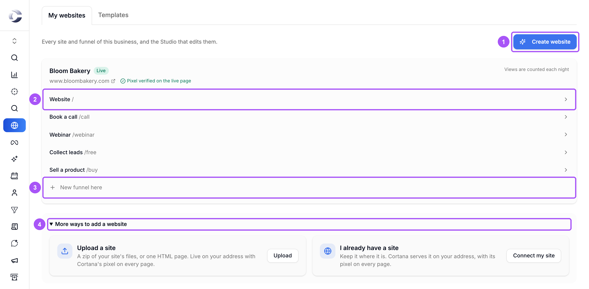
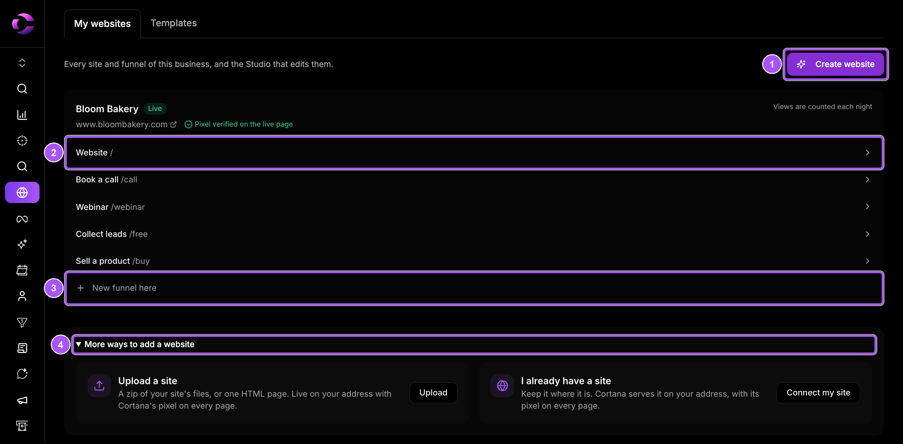

{/* last-verified: 2026-10-29 · route: /business/[businessId]/websites */}

Websites lets you build a website or a funnel from a template, edit it in the **Studio**, and publish it on your own domain.

Cortana's pixel is on every page by itself. Visits, form fills, bookings and sales are tracked like the rest of Cortana, with no code to add.

<Frame caption="My websites: each card is one site, with its website and its funnels.">
  
  
</Frame>

## The journey in five lines

1. **Pick a template**: a website, or a funnel to book calls, sell, collect leads or run a webinar.
2. **Make it yours** in the Studio: words, pictures, colors, and Cortana's calendars, forms and checkouts.
3. **Test it**: walk the whole funnel. Nothing is booked, saved or charged.
4. **Publish it** on your domain. The pixel goes live with it.
5. **Watch it work**: views, conversions and revenue for each site.

## What you see on the page

Click **Websites** in the menu on the left of your business. The page has two tabs:

- **My websites**: every site in this business. **Create website** sits at the top right.
- **Templates**: the designs you can start from.

Each site card shows:

- The site's name and its state: **Draft**, **Live** or **Paused**.
- Its address, and **Pixel verified on the live page** once it is live.
- Its pages: **Website /** first, then each funnel with its address, like **Book a call /call**. Click a row to open it in the Studio.
- **New funnel here**: add a funnel to this site.

Click the site's name to open its own page, with its numbers and settings. See [6) Manage Your Site](/websites-manage).

## Three ways to add a site

| Way | When to use it |
| --- | --- |
| **Create website** | Start from a Cortana template and edit it in the Studio. |
| **Upload a site** | You already have the site's files, as a zip or one HTML page. |
| **I already have a site** | Your site stays on Webflow, WordPress, Shopify or your own host. Cortana serves it on your address with its pixel. |

The last two are under **More ways to add a website**, at the bottom of **My websites**. See [Upload Or Connect A Site](/websites-upload-or-connect).

## The steps

| Step | What you get done |
| --- | --- |
| [1) Create Your Website](/websites-create) | Pick a template, name your business, and choose what you are building. |
| [2) Edit In The Studio](/websites-studio) | Change words, pictures, sections, colors and pages. |
| [3) Add Calendars, Forms And Payments](/websites-elements) | Put a real calendar, form, checkout or AI agent on a page, and say where people go next. |
| [4) Test And Get Feedback](/websites-test) | Walk the funnel with nothing saved, and share a review link. |
| [5) Publish Your Site](/websites-publish) | Give the site its address and put it live. |
| [6) Manage Your Site](/websites-manage) | See views and conversions, pause the site, roll back, and add a cookie banner. |
| [Upload Or Connect A Site](/websites-upload-or-connect) | Bring a site you already have. |

## FAQ

<AccordionGroup>
  <Accordion title="Do I need to install the Cortana pixel on my Cortana website?">
    No. Every page Cortana serves carries the pixel by itself, and Cortana checks it when the site goes live. You see **Pixel verified on the live page** on the site's card.
  </Accordion>

  <Accordion title="What is the difference between a website and a funnel?">
    A website is your main pages, like home, about and pricing. A funnel is a short path with one goal, like booking a call or buying a product. A funnel lives at its own address on a website, like `/call`.
  </Accordion>

  <Accordion title="Why does my site say Views are counted each night?">
    Views are counted once a day. A new live site shows its first numbers after the next nightly count.
  </Accordion>

  <Accordion title="Can I use my own domain?">
    Yes. You can use a whole domain, a subdomain like `go.yoursite.com`, or a folder of a site you already have. See [5) Publish Your Site](/websites-publish).
  </Accordion>

  <Accordion title="Can I put my GoHighLevel or Calendly form on a Cortana page?">
    Yes. Use the **Embed** element. See [3) Add Calendars, Forms And Payments](/websites-elements).
  </Accordion>
</AccordionGroup>

## Next step

<Card title="1) Create Your Website" icon="wand-magic-sparkles" href="/websites-create">
  Pick a template and make your first draft.
</Card>

Stuck on a step? Click the support button at the bottom right of Cortana and we will help.
