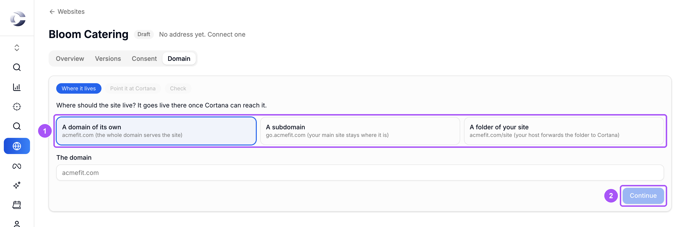
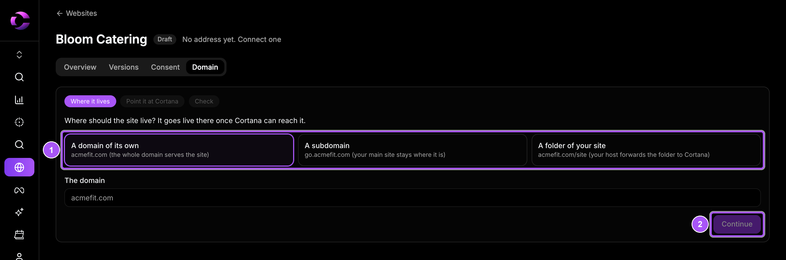

{/* last-verified: 2026-10-29 · route: /studio/..., the Publish dialog; /business/[businessId]/websites/[siteId], Domain tab */}

## Overview

Publishing puts your pages live on your own address. The first time, Cortana asks where the site should live and helps you point your domain. After that, **Publish** only checks your pages and puts them live.

Cortana's pixel goes live with every page. You add nothing.

---

## 1. Open Publish

Click **Publish** at the top right of the Studio. The steps show at the top: **Address**, **Check**, **Publish** and **Live**. The **Address** step shows only the first time.

You can also set the address from the site's own page: open the site and click the **Domain** tab.

---

## 2. Choose where the site lives

<Steps>
  <Step title="Pick one">
    Under **Where should the site live?**, pick **A domain of its own**, **A subdomain** or **A folder of your site**.
  </Step>
  <Step title="Type the address and continue">
    Type your domain, like `bloombakery.com` or `go.bloombakery.com`, and click **Continue**.
  </Step>
</Steps>

<Frame caption="Where should the site live? The three choices, then Continue.">
  
  
</Frame>

| Choice | Example | When to use it |
| --- | --- | --- |
| **A domain of its own** | `bloombakery.com` | The whole domain is this site. |
| **A subdomain** | `go.bloombakery.com` | Your main site stays where it is. Most people pick this. |
| **A folder of your site** | `bloombakery.com/site` | Your main site's host forwards one folder to Cortana. |

---

## 3. Point your domain at Cortana

For a domain or a subdomain, Cortana asks you to add it as a **tracking domain**. That is one CNAME record at your DNS host.

<Steps>
  <Step title="Open tracking domains">
    Click **Open tracking domains**. Add your address there and follow its steps. Cortana sets the record up for you where your DNS host allows it.
  </Step>
  <Step title="Check it">
    Come back and click **It is set up. Check it**. Cortana tells you if it can reach your address, or why not.
  </Step>
</Steps>

For a folder, Cortana shows a short recipe for your platform, with a **Copy** button. Add it on your site's host, then check.

<Note>
  **DNS can take a few minutes.** If the check fails right after you add the record, wait a few minutes and click it again.
</Note>

---

## 4. Check and publish

<Steps>
  <Step title="Read the check">
    Cortana saves and checks every page. The top line says how many pages there are and how many go live, like *3 pages · 3 going live · pixel on every page*. Each page shows **New**, **Changed** or **No changes**.
  </Step>
  <Step title="Look at the tips">
    Lines under *Worth fixing: the publish goes ahead without it* point out small things, like an image missing its description. You can fix them or go ahead.
  </Step>
  <Step title="Publish">
    Click the publish button. It names your address, like **Publish to go.bloombakery.com/call**.
  </Step>
</Steps>

Going live takes about a minute. You can close the box. The Studio's header says **Live** when it is done.

---

## 5. You are live

The last step shows **Live**, your page's address, and *Pixel verified* once Cortana sees its pixel on the live page. Click **Open the page** to see it, or **Back to the Studio** to keep working.

To publish new changes later, click **Publish** again. When nothing changed since the last publish, the button reads **Publish again to** your address.

<AccordionGroup>
  <Accordion title="Why a tracking domain?">
    Your site is served through the same Cortana address setup as your tracking links. One CNAME record does both. The pixel then runs from your own domain, so a blocker that stops third-party trackers does not stop it.
  </Accordion>

  <Accordion title="A page address is refused">
    A funnel address cannot cover a short link or a booking page you already have on that domain. The check lists the paths that clash. Rename the funnel's address in the Studio, or move the link, then click **Check again**.
  </Accordion>

  <Accordion title="Publishing a test with two versions of a page">
    If a page has an A/B test, the check shows both, like *B: new, 70% of visitors*. After publishing, each visitor sees one version and keeps it. See [4) Test And Get Feedback](/websites-test).
  </Accordion>
</AccordionGroup>

## FAQ

<AccordionGroup>
  <Accordion title="Do I need to add the Cortana pixel to my published pages?">
    No. Every published page carries the pixel by itself, as the first script on the page.
  </Accordion>

  <Accordion title="My edits are not on the live site.">
    Edits stay in your draft until you publish. Click **Publish** in the Studio, then the publish button.
  </Accordion>

  <Accordion title="The check says it cannot reach my address.">
    Your DNS record may not be live yet. Check the CNAME under **Settings**, **Tracking Domain**, wait a few minutes, and click **It is set up. Check it** again.
  </Accordion>

  <Accordion title="Are bookings and payments real on the live page?">
    Yes. On the live page, bookings, forms and checkouts are real and tracked.
  </Accordion>

  <Accordion title="Can I move my site to another domain?">
    Yes. Open the site's **Domain** tab, click **Disconnect**, then connect the new address and publish again. See [6) Manage Your Site](/websites-manage).
  </Accordion>
</AccordionGroup>

## Next step

<Card title="6) Manage Your Site" icon="sliders" href="/websites-manage">
  See your numbers, pause the site, roll back, and add a cookie banner.
</Card>
