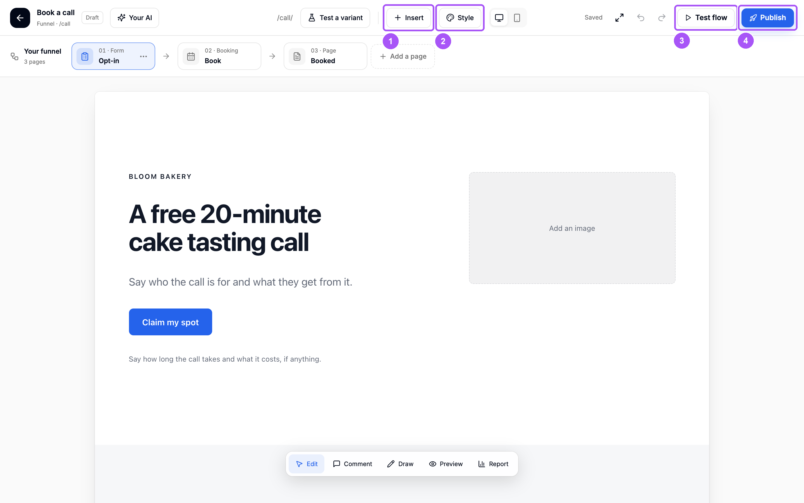
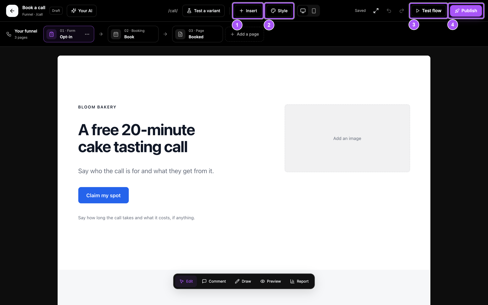
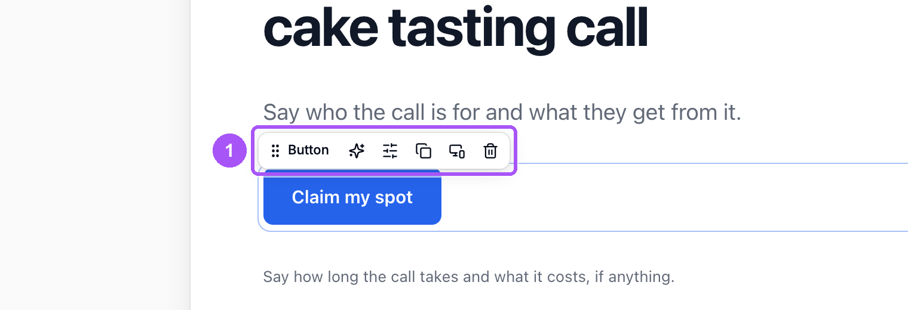
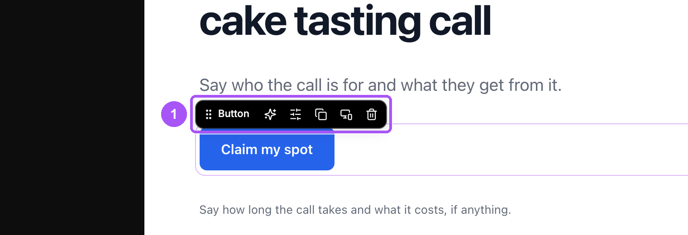

{/* last-verified: 2026-10-29 · route: /studio/[businessId]/[siteId]/[funnelId] */}

## Overview

The **Studio** is where you edit your pages. You click on the page and type, like in a document. Every change saves by itself.

To open it, click a page row on your site's card, like **Website /** or **Book a call /call**.

<Frame caption="The Studio. The page sits in the middle, the tools are along the top and the bottom.">
  
  
</Frame>

**The parts of the Studio:**

- **The header**: **Insert** (1) adds an element. **Style** (2) sets the look of every page. **Test flow** (3) walks your funnel. **Publish** (4) puts it live.
- **The funnel strip**: your funnel's pages in order. Click one to open it. A website has a page picker in the header instead.
- **The dock** at the bottom: **Edit**, **Comment**, **Draw**, **Preview** and **Report**.
- **The save line** at the top right: **Saved**, or **Unsaved changes** while you type.

---

## 1. Change the words

<Steps>
  <Step title="Click the text">
    Click any heading or paragraph and type. A small toolbar shows above it.
  </Step>
  <Step title="Style the words">
    Select words, then use the toolbar: **Bold**, **Italic**, **Underline**, a highlighter, and a link.
  </Step>
  <Step title="Change size and color">
    Click **Aa** for the font, the size and the **Text colour**. **Reset style** puts them back.
  </Step>
</Steps>

Changes save a second or two after you stop typing. Press **⌘Z** (Ctrl+Z on Windows) to undo, or use **Undo** and **Redo** in the header.

---

## 2. Move, copy or delete an element

Hover over any element on the page. Its toolbar shows above it.

<Frame caption="An element's toolbar: move it, ask your AI, settings, copy, phone and desktop, delete.">
  
  
</Frame>

- **Move**: drag the grip with the element's name to a new line. Or click the grip, use the arrow keys, and press Enter.
- **Settings**: on buttons and Cortana elements. For a button, set **What does it say?** and **Where does it go?**
- **Duplicate**: puts a copy right after it.
- **Phone and desktop**: show it only on phones or only on computers.
- **Delete**: removes it. Undo brings it back.

---

## 3. Add a section

<Steps>
  <Step title="Hover a section">
    Click **Add a section** at the bottom edge of a section, or at the end of the page.
  </Step>
  <Step title="Pick one">
    Three sections show, drawn in your page's look. Click **Show others** for more. Click one to add it.
  </Step>
</Steps>

Hover a section to see its own tools at its top right: **Move section up**, **Move section down**, **Section style** and **Delete section**. **Section style** sets its background, like a tint, your brand color or a photo.

---

## 4. Add text, pictures, buttons and more

Click **Insert** in the header. Drag an element onto the page, or click it and pick a line.

- **Text**, **Image**, **Button**, **Video**, **Divider** and **Sculpture** (an editable 3D visual).
- **Connected with Cortana**: your real calendars, forms, checkouts and AI agents. See [3) Add Calendars, Forms And Payments](/websites-elements).
- **Over the page**: a **Popup** or a **Bar**.

**Pictures:** place an **Image**, or click **Choose image** on one. Click **Upload a picture** (PNG, JPEG or WebP, up to 5 MB). Fill in **Describe it for people who cannot see it**.

**Videos:** paste a YouTube, Vimeo, Loom or Wistia link.

---

## 5. Set the look of the whole site

Click **Style** in the header. Every change here applies to every page of the site.

- **Theme**: Clean, Bold, Warm, Editorial, Fresh or Luxe.
- **Headings** and **Body text**: the fonts.
- **Colours**: page, surface, text, muted text, primary and accent.
- **Corners**: Sharp, Soft or Round.
- **Spacing**: Compact, Balanced or Airy.

---

## 6. Check it on a phone

Click the phone icon in the header (**Phone width**) to see the page at phone size. Click the screen icon (**Desktop width**) to go back.

To show something on one size only, click **Phone and desktop** on its toolbar and pick under **Shows on**. Text also has **Size on a phone**.

---

## 7. Add, rename and order pages

**In a funnel:** click **Add a page** at the end of the strip, type a **Name**, and click **Add page**. Click **⋯** on a page card to rename, move or delete it. You can also drag the cards.

**In a website:** open the page picker in the header and use **Add a page**. The site's menu follows your pages by itself.

<AccordionGroup>
  <Accordion title="Popups and bars">
    Click **Insert**, then **Popup** or **Bar** under **Over the page**. Click the popup's badge to choose **When it shows**: after a delay, after scrolling, or as they leave (computers only). Set **Shows again after** to a day, a week, a month or 3 months. A page holds up to 3 popups and one bar at each edge.
  </Accordion>

  <Accordion title="The command menu">
    Press **⌘K** (Ctrl+K on Windows). Type a command or a page name, like `phone` or `insert text`. It runs what the buttons do.
  </Accordion>

  <Accordion title="Your AI: let Claude or ChatGPT edit your pages">
    Click **Your AI** in the header, then the button under the status line. It opens [Let Your AI Edit Your Pages](/websites-your-ai), which walks you through connecting Claude or ChatGPT.

    Then ask your AI to change a page. Each change shows on the page and in the panel, with its own **Undo**.

    To ask about one element, click the sparkle (**Ask AI**) on its toolbar. It writes the start of the message for you.
  </Accordion>

  <Accordion title="Someone else is editing this page">
    One person edits a page at a time. If someone else has it open, you see their name and can look around, comment and preview. You can edit once they leave.
  </Accordion>

  <Accordion title="The save line says it could not save">
    Check your internet. The Studio tries again by itself. Click **Try again** to retry now, or **Discard changes** to go back to the last saved version.
  </Accordion>
</AccordionGroup>

## FAQ

<AccordionGroup>
  <Accordion title="Do I need to click Save?">
    No. Every change saves by itself. The top right says **Saved** when it is done.
  </Accordion>

  <Accordion title="Do my edits show on the live site right away?">
    No. Edits stay in your draft until you click **Publish**. See [5) Publish Your Site](/websites-publish).
  </Accordion>

  <Accordion title="How do I undo a change?">
    Press **⌘Z** (Ctrl+Z on Windows), or click **Undo** in the header. Press **⇧⌘Z** to redo.
  </Accordion>

  <Accordion title="Why can't I delete a section?">
    A button on your page goes to that section. Point the button somewhere else first, then delete the section.
  </Accordion>

  <Accordion title="What image files can I upload?">
    PNG, JPEG or WebP, up to 5 MB each.
  </Accordion>
</AccordionGroup>

## Next step

<Card title="3) Add Calendars, Forms And Payments" icon="calendar-check" href="/websites-elements">
  Put a real calendar, form or checkout on your page.
</Card>
