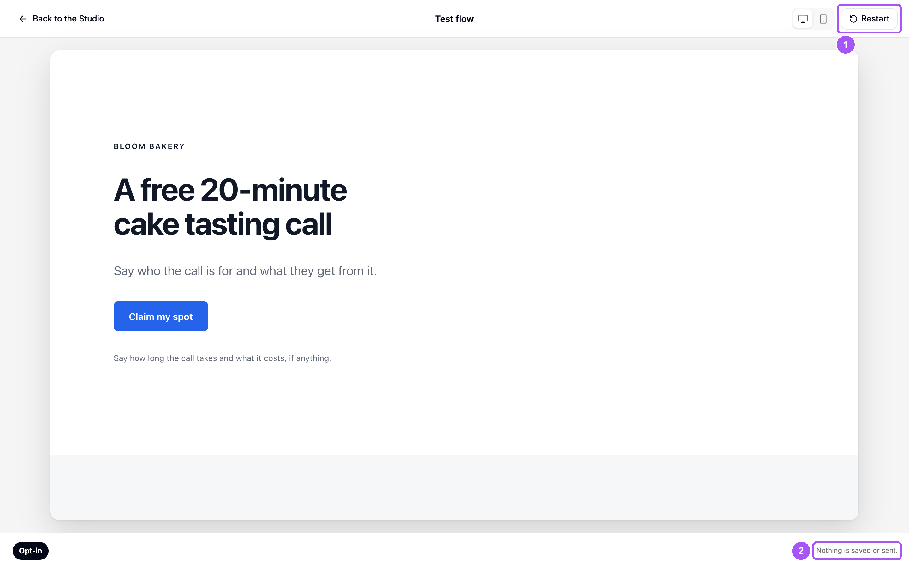
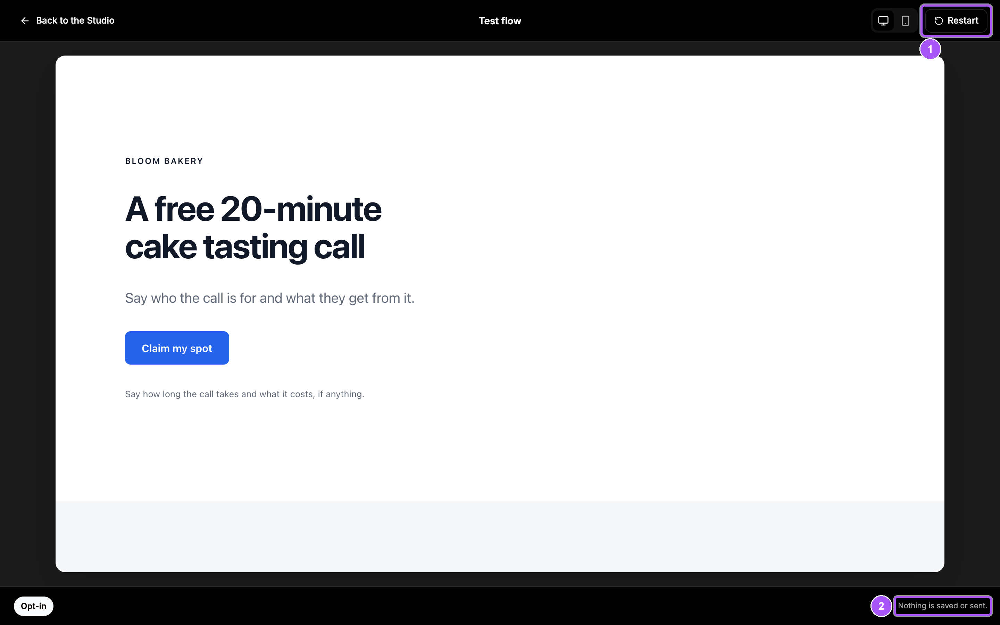
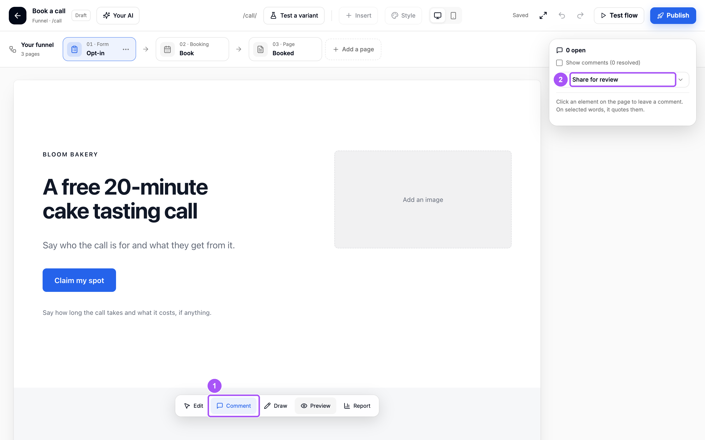
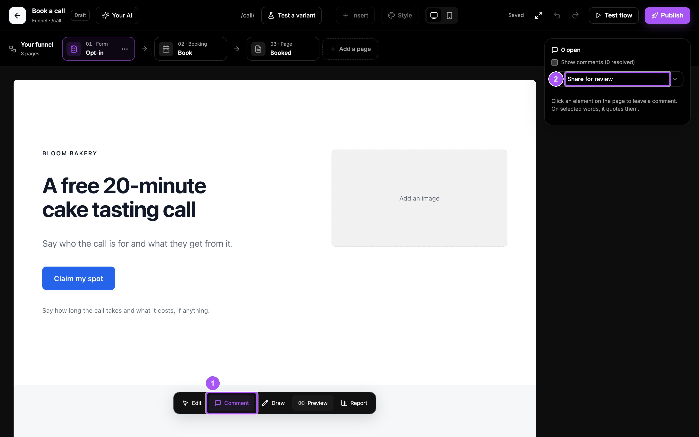

{/* last-verified: 2026-10-29 · route: /studio/..., Test flow, Preview, Comment and Draw */}

## Overview

Before you publish, walk your funnel the way a visitor would. In a test, bookings, forms and payments run, but **nothing is saved or sent**. No appointment, no contact, no email, no charge.

You can also leave comments on the page, and share a link so others can leave notes too.

---

## 1. Walk the whole funnel

<Steps>
  <Step title="Click Test flow">
    Click **Test flow** at the top right of the Studio. Your first page opens full screen.
  </Step>
  <Step title="Act like a visitor">
    Click the buttons, book a time, fill in the form and pay. For a test payment use the card `4242 4242 4242 4242`, any future date and any CVC.
  </Step>
  <Step title="Watch the trail">
    The bar at the bottom shows each page you reach, and what happened: **Booked (test)**, **Form sent (test)** or **Paid (test)**.
  </Step>
  <Step title="Start again or leave">
    Click **Restart** to start over. Click **Back to the Studio** when you are done.
  </Step>
</Steps>

<Frame caption="Test flow. The page works like the live one, and the trail shows where you went.">
  
  
</Frame>

<Tip>
  **Just one page?** Click **Preview** in the dock at the bottom. The page shows as visitors see it, right in the Studio.
</Tip>

---

## 2. Leave comments

<Steps>
  <Step title="Click Comment">
    Click **Comment** in the dock at the bottom.
  </Step>
  <Step title="Click what you want to comment on">
    Click an element on the page. If you selected words first, the comment quotes them.
  </Step>
  <Step title="Type and pin">
    Type your comment and click **Pin comment**. A numbered pin stays on that element, even if it moves.
  </Step>
</Steps>

Click **Resolve** on a comment when it is done. Tick **Show comments** to see resolved ones again.

To draw instead, click **Draw** in the dock. Pick a color and a **Pen**, a **Box** or **Text**, then click **Save drawing**.

---

## 3. Share a review link

Send the funnel to a client or a teammate. They do not need a Cortana login.

<Steps>
  <Step title="Open Share for review">
    Click **Comment** in the dock, then **Share for review** in the panel.
  </Step>
  <Step title="Create the link">
    Click **Create the link**, then **Copy**. Send it to anyone you like.
  </Step>
  <Step title="Read their notes">
    They click **Leave a note** on the page, then **Send the note**. Their notes show in your comments, with their name.
  </Step>
</Steps>

<Frame caption="Comment mode. Share for review sits at the top of the panel.">
  
  
</Frame>

The link shows your funnel as it is in the Studio, not the live site. It works for 7 days. **New link** ends the old one. **Stop sharing** ends it now.

<AccordionGroup>
  <Accordion title="A/B test a page">
    Open a funnel page and click **Test a variant** in the header, then **Start the test**. Page B starts as a copy of page A. Change B on its own.

    Once the funnel is published, each visitor sees A or B. Click the split button, like **50% B**, to change the share. When one wins, click **Keep A** or **Keep B**.
  </Accordion>

  <Accordion title="Report mode: see how each page does">
    Click **Report** in the dock. It shows the last 30 days: views for each page, and bookings, leads or sales on Cortana elements. **How these are counted** explains the numbers.

    Click **Fix my funnel** to ask your AI what to improve.
  </Accordion>

  <Accordion title="What a test run does not do">
    A test booking makes no appointment, no contact and no email. A test form sends no submission. A test payment charges nothing in Stripe. None of it counts as a conversion.

    An AI agent answers for real in a test, so you can try the chat. Its chat is marked as a Studio test.
  </Accordion>
</AccordionGroup>

## FAQ

<AccordionGroup>
  <Accordion title="Did my test booking create a real appointment?">
    No. Nothing in **Test flow** or **Preview** is saved. Check the trail: it says **Booked (test)**.
  </Accordion>

  <Accordion title="It says This test run has ended.">
    A test run lasts about 30 minutes. Start it again from the Studio with **Test flow**.
  </Accordion>

  <Accordion title="Can people with the review link change my pages?">
    No. They can look, click through the funnel and leave notes. Nothing else they do there is saved.
  </Accordion>

  <Accordion title="Why can't I use my embedded form in a test?">
    A form or calendar from another tool sends real submissions, so a test shows a short note in its place instead. Try it on the live page.
  </Accordion>
</AccordionGroup>

## Next step

<Card title="5) Publish Your Site" icon="rocket" href="/websites-publish">
  Give your site its address and put it live.
</Card>
