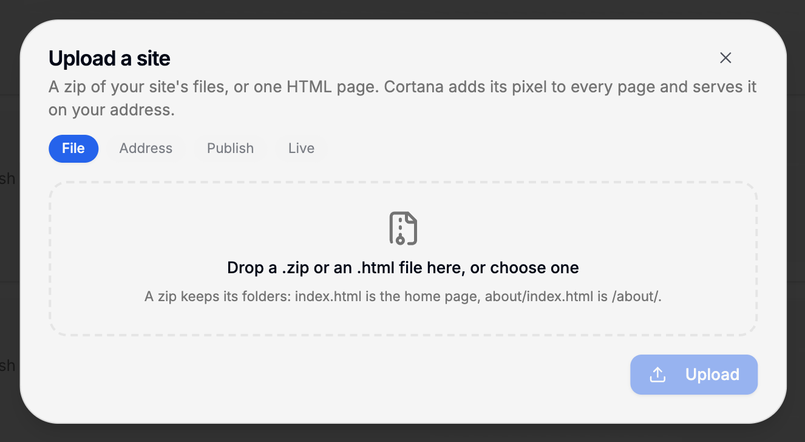
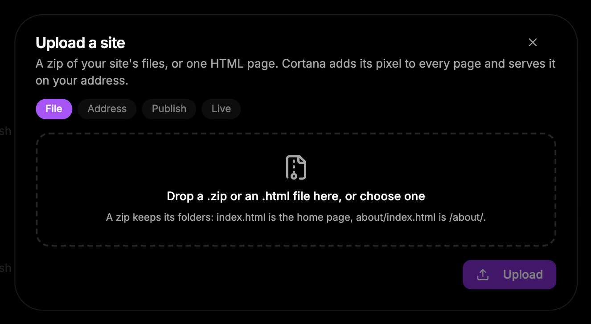
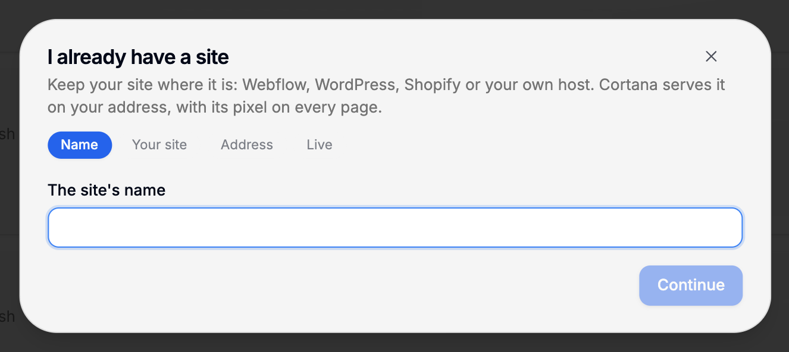
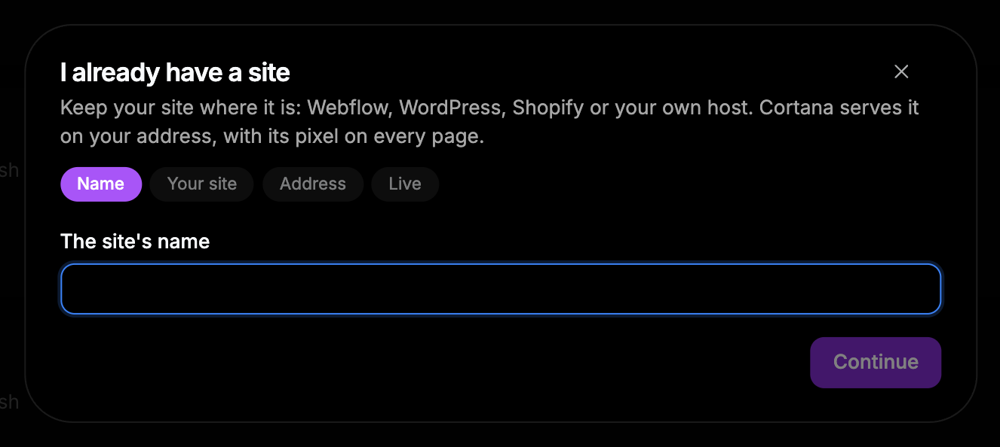

{/* last-verified: 2026-10-29 · route: /business/[businessId]/websites, More ways to add a website */}

## Overview

Already have a website? You do not have to rebuild it. There are two ways to bring it:

- **Upload a site**: send Cortana the site's files. Cortana hosts them on your address.
- **I already have a site**: your site stays where it is. Cortana serves it on your address.

Both put Cortana's pixel on every page by themselves.

Find both on **My websites**, under **More ways to add a website** at the bottom.

---

## 1. Upload a site

<Steps>
  <Step title="Open Upload">
    Under **More ways to add a website**, click **Upload**.
  </Step>
  <Step title="Add the file">
    Drop a `.zip` or an `.html` file on the box, or click to choose one.
  </Step>
  <Step title="Name it and upload">
    Type **The site's name** and click **Upload**. Cortana lists the files and pages it stored.
  </Step>
  <Step title="Give it an address and publish">
    Pick where it lives, point your domain, and click **Publish**. See [5) Publish Your Site](/websites-publish) for the address steps.
  </Step>
</Steps>

<Frame caption="Upload a site. A zip keeps its folders.">
  
  
</Frame>

**How a zip becomes pages:** `index.html` at the top of the zip is the home page. `about/index.html` is the page `/about/`. Styles, images and scripts go live as they are.

**To change the site later:** open the site, click the **Versions** tab, then **Upload a new version**. Publish the new version when you are ready. You can roll back to an older one at any time. See [6) Manage Your Site](/websites-manage).

---

## 2. Keep your site where it is

Use this for a site on Webflow, WordPress, Shopify or your own host.

<Steps>
  <Step title="Open Connect my site">
    Under **More ways to add a website**, click **Connect my site**. Name it and click **Continue**.
  </Step>
  <Step title="Say where it answers today">
    Under **Where your site answers today**, type the address your site loads from now, like `bloombakery.webflow.io`. Click **Check my site**.
  </Step>
  <Step title="Pick its new address">
    Choose **A domain of its own** or **A subdomain**, and point it at Cortana. Click **It is set up. Check it**.
  </Step>
</Steps>

<Frame caption="I already have a site. Keep your site on its host, and Cortana serves it on your address.">
  
  
</Frame>

When it is live, every page of your site answers on the new address, with Cortana's pixel added first. Pictures and files pass through untouched. A change you make on your host shows at once, so this kind of site has no versions.

<Note>
  **What stays Cortana's on that address:** trigger links (`/t/`) and payment links (`/p/`). Short links and a Cortana blog cannot share the address: the check refuses while any are there. Booking pages and forms keep working on your other domains.
</Note>

<AccordionGroup>
  <Accordion title="Upload limits">
    - The zip needs an `index.html` at its top. That is the page visitors land on.
    - The file can be up to 50 MB. Leave out what the site does not serve, like videos and source files.
  </Accordion>

  <Accordion title="Pausing a connected site">
    Pausing a site you connected with **I already have a site** does not take it offline. It takes Cortana's pixel off its pages, and your pages keep loading from your host.
  </Accordion>
</AccordionGroup>

## FAQ

<AccordionGroup>
  <Accordion title="Do I need to add the Cortana pixel to my uploaded files?">
    No. Cortana adds it to every page when it publishes.
  </Accordion>

  <Accordion title="My zip was refused.">
    Check that `index.html` sits at the top of the zip, not inside a folder, and that the file is 50 MB or less.
  </Accordion>

  <Accordion title="Can I edit an uploaded site in the Studio?">
    Its pages are your own files, so change them and upload a new version. You can still add a Studio funnel to it: click **New funnel here** on its card.
  </Accordion>

  <Accordion title="Will my WordPress site still work if I connect it?">
    Yes. Your site keeps running on its host. Cortana only serves it on your address and adds the pixel.
  </Accordion>
</AccordionGroup>

## Next step

<Card title="Websites overview" icon="globe" href="/websites-overview">
  Back to the start of the Websites guide.
</Card>
