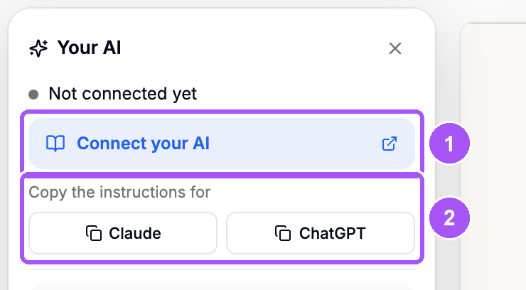
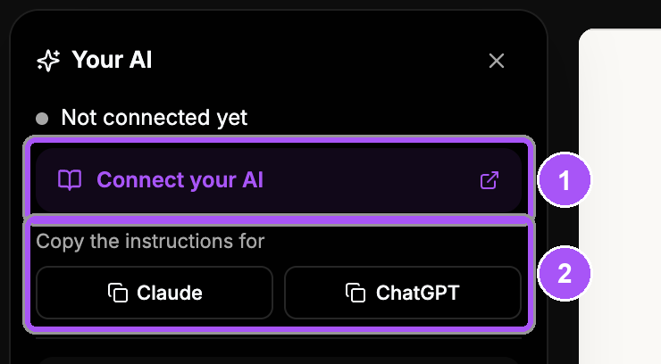
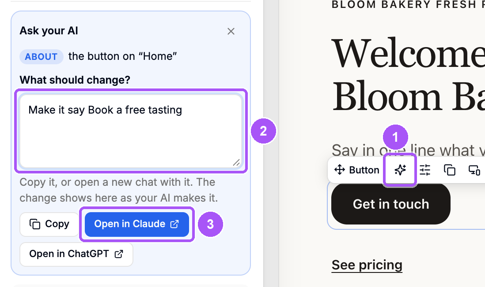
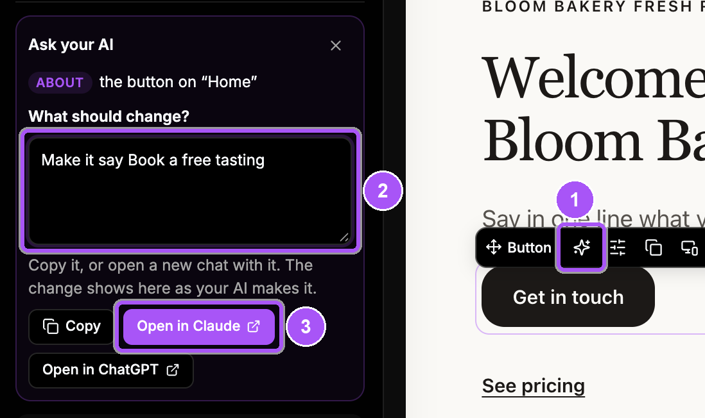

{/* last-verified: 2026-10-29 · route: /studio/[businessId]/[siteId]/[funnelId]/[stepId], Your AI panel; consent: /oauth/authorize */}

## Overview

Connect Claude or ChatGPT to Cortana. Then ask it in a chat to change your pages, like "make the headline shorter" or "add a pricing section".

Every change shows in the Studio as it happens, with its own **Undo**. Nothing goes live until you say yes.

Open the panel with **Your AI** in the Studio's header.

<Frame caption="The Your AI panel. 1 opens this guide. 2 copies the instructions for your AI's project.">
  
  
</Frame>

---

## 1. Add the Cortana connector

<Steps>
  <Step title="Copy the connector URL">
    `https://app.usecortana.ai/api/mcp`
  </Step>
  <Step title="Add it to your AI">
    In **Claude**, open **Settings**, then **Connectors**, then **Add custom connector**. Paste the URL.

    In **ChatGPT**, open **Settings**, then **Connectors**, then **Create**. Paste the URL.
  </Step>
  <Step title="Sign in to Cortana">
    You are sent to Cortana. Sign in with your Cortana login.
  </Step>
  <Step title="Allow building and editing">
    Pick your business. Tick **Allow building and editing websites and funnels**, then approve.
  </Step>
</Steps>

The **Your AI** panel now says **Connected** with your AI's name.

---

## 2. Let it change pages

Does the panel say your AI **can read these pages, not change them**? Then it was connected without the building permission.

Connect it again from your AI's connector settings. When Cortana asks, tick **Allow building and editing websites and funnels**.

---

## 3. Make it your web designer

Give your AI the Studio's instructions once. It then builds the way the Studio expects.

<Steps>
  <Step title="Create a project">
    In Claude or ChatGPT, create a new project for your websites.
  </Step>
  <Step title="Copy the instructions">
    In the Studio, click **Your AI**. Next to **Copy the instructions for**, click **Claude** or **ChatGPT**.
  </Step>
  <Step title="Paste them">
    Paste them as the project's instructions.
  </Step>
  <Step title="Turn the connector on">
    In a chat in that project, turn the Cortana connector on before you ask. In Claude: the **+** button, then **Connectors**. In ChatGPT: the **+** menu, then **Developer mode**, and pick Cortana.
  </Step>
</Steps>

---

## 4. Ask for a change

In a chat, say what to change, like "On my Home page, make the headline shorter." Or start from the element itself:

<Steps>
  <Step title="Click the sparkle">
    Point at an element on the page. Click the sparkle (**Ask AI**) on its toolbar.
  </Step>
  <Step title="Say what should change">
    Type it under **What should change?**
  </Step>
  <Step title="Send it to your AI">
    Click **Open in Claude** or **Open in ChatGPT**. A new chat opens with your words and the element named. Or click **Copy** and paste it in a chat.
  </Step>
</Steps>

<Frame caption="Ask AI on a button. 1 is the sparkle, 2 is what should change, 3 opens the chat.">
  
  
</Frame>

Each change shows in the **Your AI** panel with a line, like **Rewrote the headline**, and its own **Undo**.

---

## More detail

<AccordionGroup>
  <Accordion title="What your AI can do">
    - Change words, sections and pages, and add new sections.
    - Add your real Cortana calendar, form, checkout or AI agent. It never makes one up.
    - Build a custom block, like a slider, a calculator or an animated hero.
    - Create a new website or funnel from the templates, with your business's real details.
    - Offer options for an element or a section to test against each other.
    - Do what a comment asks, then mark the comment done.
    - Read a funnel's numbers and suggest the three fixes that should help most. Click **Report**, then **Fix my funnel** (or **Fix my website**) to start.
  </Accordion>

  <Accordion title="What your AI will not do">
    - Publish without your yes. It first tells you what goes live, then waits for you.
    - Delete a page without your yes.
    - Invent a calendar, a form, a product, a price or a testimonial.
    - Pick its own colors for one page. Colors and fonts come from the site's look in **Style**.
  </Accordion>

  <Accordion title="Who sees the changes">
    Changes land in your draft. You see them in the Studio as they happen. Visitors see them only after you publish. See [5) Publish Your Site](/websites-publish).
  </Accordion>
</AccordionGroup>

## FAQ

<AccordionGroup>
  <Accordion title="Why does it say my AI can read but not change pages?">
    It was connected without the building permission. Connect it again and tick **Allow building and editing websites and funnels**.
  </Accordion>

  <Accordion title="Can my AI publish my site by itself?">
    No. It tells you what would go live and publishes only after you say yes.
  </Accordion>

  <Accordion title="How do I undo what my AI changed?">
    Open **Your AI** in the Studio. Click **Undo** on that change.
  </Accordion>

  <Accordion title="Do I need to paste the instructions?">
    They are not required. They tell your AI how the Studio builds pages. Paste them once per project.
  </Accordion>
</AccordionGroup>

## Next step

<Card title="5) Publish Your Site" icon="rocket" href="/websites-publish">
  Put your pages live on your own domain.
</Card>
